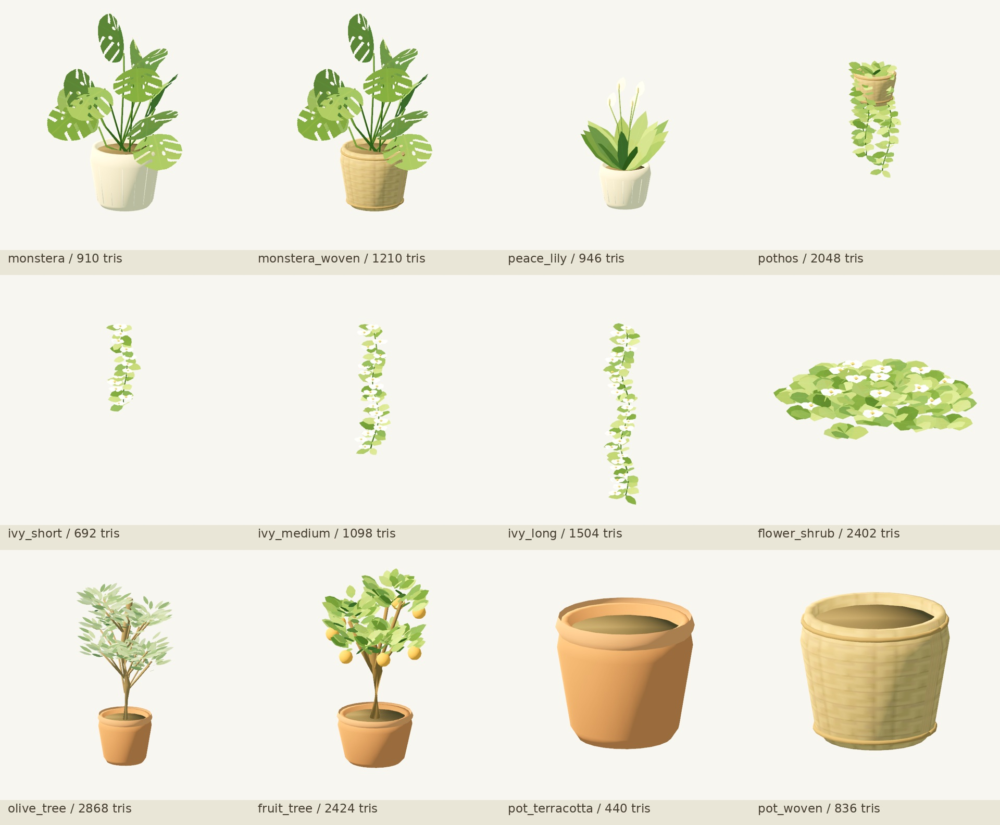

# Shared stylized plants · Liu Bei · SGODOT-179 R2.1

Twelve editable local-pivot modules: monstera, monstera_woven, peace_lily, pothos, three ivy lengths, flower_shrub, olive_tree, fruit_tree, pot_terracotta and pot_woven. R2 replaces R1's closed dense leaf meshes with open curved patches: ordinary leaves/petals have 6 triangles; Monstera patches have 8 triangles and an authored alpha-scissor silhouette with edge splits and internal holes. Do not substitute alpha blending: scissor retains depth writes. Bind the supplied shared `material.tres`, including double-sided rendering and threshold 0.45.

Vine and pothos leaves are 60% of R1 length/width. The six yellow-green source colours now retain two middle/deep variants; R2.1 reduces value about 15% and raises saturation 10–15%. Four peace-lily spathes are approximately half R1 size. Olive has 352 silver-green leaves and a terracotta pot. The right-corner Monstera variant uses the woven pot. The stand-alone terracotta and woven pots can be reused separately.

## Atlas correction

The shared 2048 RGBA atlas has explicit 128px detail tiles and 12px guards; UVs stay inside each tile. Leaf veins and wicker weave are authored into the atlas. Whole source objects choose one material treatment. R1's per-face switch to constant swatches caused rectangular discontinuities on curved surfaces; it is no longer used here. Shader linear colours are encoded to sRGB before writing generated image pixels, avoiding double decoding and dark saturated foliage. The editable `.blend` embeds this same atlas and retains source `LeafDetailUV` plus runtime `RoomAtlas`.

This texture contains surface colour/detail, not a beauty render or direct-light bake. No texture is embedded in individual GLBs. The atlas must use mipmaps and VRAM compression in the consuming project. A material override that forgets alpha scissor will reveal rectangular Monstera patches.

## Placement and budget

Godot metres, Y up, front +Z. Pots/trees/shrub pivot at their base; vines pivot at the upper stem and grow along local -Y. Rotate local Z to follow the tangent of an arch. Coffee Shop retains editable placements but merges the vines per wall at export, preserving atlas UVs. Small leaves/flowers and distant garden masses do not cast shadows; large potted plants can cast shadows.

The library has **17,378 unique triangles** (R1: 99,620). `flower_shrub` is **2,402** (R1: 14,992). These are library unique costs, not placed-scene costs. See `asset_stats.json` for per-module before/after values. Coffee Shop R2 places 60,250 plant triangles. Consumers must enforce their own ≤100,000 plant / ≤200,000 total / ≤60 static-surface limits, including instances.

## Rebuild and review

```sh
blender --background --factory-startup --python "$PWD/assets/rooms/_shared/plants/source/build_plants.py"
```

Generator: `source/build_plants.py`; explicit UV atlas/export: `source/export_atlas.py`; editable source: `source/plants.blend`. Generation overwrites the source: keep manual edits in the generator before rebuilding. There is no dependency on ignored local R1 evidence.

`source/render_library.gd` produces independent actual Godot Mobile/Vulkan module previews. All 12 have been rendered, with normals, pot openings and atlas appearance inspected. Source leaf triangle counts are asserted during generation. All runtime GLBs have one mesh/surface and no embedded images.



179 R2 passed art-director review on 2026-10-07. 180–186 may consume the library. R2.1 restores twice as many 1.5x white vine flowers, a closed hemispherical shrub canopy, silver-green olive leaves and three deep Monstera splits plus oval holes. Eight-triangle pollen centres preserve density within the budget. Basic Room and the shared scene benchmark remain unchanged by Liu Bei.
