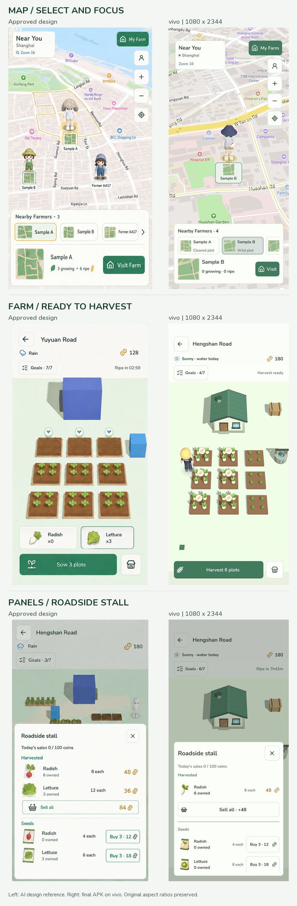
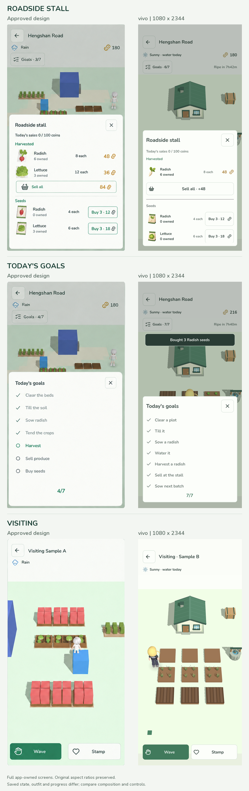
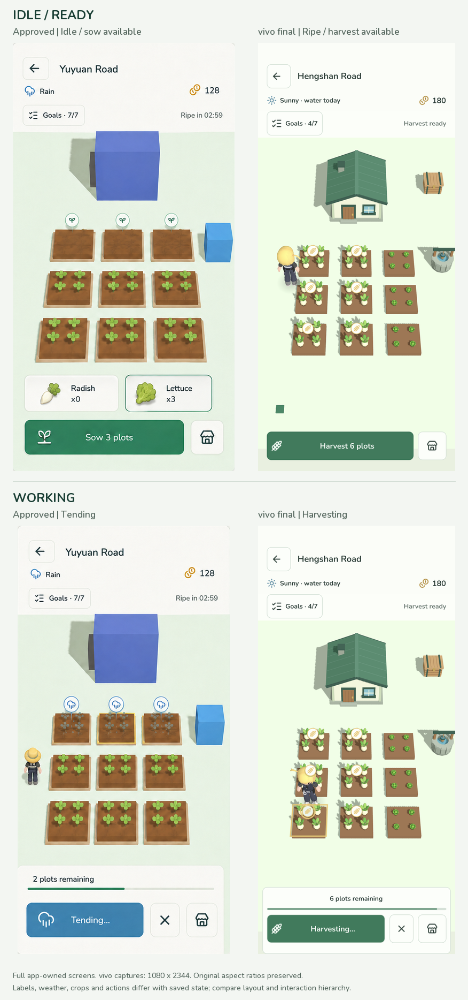
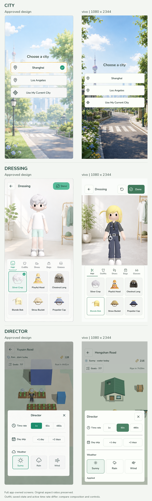

# 种田体验与 UI 设计验收

2026-09-05 · 分支 `feat/farm-ui-playability`。

**Final result: passed。** 本轮实现通过 519 项全量自动测试、最后地图装扮修复的 29 项定向回归及 vivo 真机验收。最终新包已安装，原手机数据与默认生产连接已恢复，手机当前运行原有农场。此结论覆盖本地实现、配套服务验证和客户端真机体验；自由选址后端尚未发布到公网，发布边界见下文。

## 设计依据

用户认可的四张设计板是本轮实装依据：

| 设计板 | 覆盖范围 | 当前落实 |
| --- | --- | --- |
| [地图稿](docs/design/farm-ui-2026-09-05/generated/map-design.png) | 地图状态、角色与农场标记、缩放、附近列表、选中预览 | 统一顶部与侧栏；地图角色/缩略图、选中环、同位置聚类、访问预览和镜头聚焦。 |
| [农场稿](docs/design/farm-ui-2026-09-05/generated/farm-design.png) | 状态区、九格田畦、作物选择、批量动作、移动与劳作反馈 | 三行九格的私有农场布局、上下 HUD、作物 PNG、动作颜色、进度、取消、落点和小型地块提示。 |
| [日常面板稿](docs/design/farm-ui-2026-09-05/generated/panels-design.png) | 摊位、目标、访客与弹层关闭 | 收成/种子图标、单价和总价、清单进度、统一互斥弹层、访客 Wave/Stamp。 |
| [次级页面稿](docs/design/farm-ui-2026-09-05/generated/secondary-design.png) | 城市选择、换装、导演面板 | 城市街景、稳定房间背景、实时角色、五个分类、3×2 缩略图、导演的分组控制。 |

[设计图库](docs/design/farm-ui-2026-09-05/index.html) · [原始生成提示词](docs/design/farm-ui-2026-09-05/image-prompts.md) · [素材来源与处理记录](docs/design/farm-ui-2026-09-05/assets.md)。设计板均为 AI 图像，不作为运行成功的证据。

## 关键行为

| 项目 | 当前行为与验证边界 |
| --- | --- |
| Plane 37：选址不限于三个固定点 | 先选蓝图，再进入 Place Farm；拖地图调整中心位置，按 Create Farm 保存。蓝图和地理位置分离，支持区域边界校验。已通过本地隔离 PostgreSQL/HTTP 服务及真机自由拖动选址验证；配套服务尚未发布到公网。 |
| Plane 37：同位置多人重叠 | 位置相近的农场聚为一个代表角色和人数入口；点人数后在列表中选择具体农场。聚类不丢失成员身份。 |
| Plane 38：My Farm / Sample B 混淆 | 自家入口与访客选择分离，预览与访问绑定 farm_id；切回自家清除其他农场选择。异步快照只更新当前目标，防止过期响应覆盖。My Farm → 返回地图 → Sample B 的真机切换已通过，访客页身份为 Sample B。 |
| 地图缩放 | 15–18 级；按钮、捏合和双击共用边界，超过边界时回弹。选中农场时镜头、轮廓、缩略标记与预览同步。 |
| 私有农场布局 | 服务端蓝图的田格映射到统一三行庭院；发送请求时恢复源蓝图 cell_id。数据、解锁和服务器校验仍以源蓝图为准。 |
| 种田闭环 | 清理 → 翻土 → 播种 → 按播种时记录的天气照料 → 生长 → 收获 → 卖菜/买种子。批量任务逐格行走和执行，支持取消未开始任务。 |
| 点击移动 | 单摇杆移除；绿色落点环和路线点表示可达目的地，珊瑚色表示不可达。点击田格先走到可工作的相邻位置。 |
| 田格反馈 | 下一步可用后显示约 20px 气泡与 12px 图形，命中半径约 22px；密集提示会避让。当前工作格有描边和进度弧。 |
| 弹层 | 目标、摊位和导演互斥；遮罩、关闭按钮和 Android Back 先关闭面板。打开时隐藏底部劳作栏及地块提示。 |
| 换装 | 实时 3D 角色与房间画布分离；近景涵盖最高帽子。640px 高度使用紧凑抽屉，800px 使用标准抽屉，字体不随视口缩小。 |

地图中的公开农场和角色来自服务端快照；本轮没有新增实时多人位置同步。没有角色的旧表现是客户端显示、锚点与选择链路问题，不能归因于“完全没有多人数据”。

**后端发布边界：** 本轮自由选址在 `PORT=3101` 的隔离真实 PostgreSQL/HTTP 服务上验证，并由真机经 `adb reverse` 连接。公开服务 `https://farm.sensenjoy.cn/v1/regions` 当前尚未返回 `farm_placement_version`，配套后端部署待 release。客户端遇到旧服务会明确返回 `LOCATION_UNSUPPORTED`，不会忽略位置并静默建到旧点位。已有农场与种田 UI 不依赖这次服务端发布。部署及能力字段说明见 [server/README.md](server/README.md)。

## 素材与视觉

- 操作图标继续使用项目现有 Lucide 系列；许可证随 `assets/ui/icons/lucide/` 保存。
- 字体使用 Nunito 650，配合项目的中文后备字体。字体许可位于 `assets/ui/fonts/`。
- 已检查 Kenney Food Kit（CC0）及 OpenGameArt Farming Game - Basics（CC-BY 3.0）。它们缺少指定四种作物和配套种子袋的完整同风格套系，因此没有将这些外部美术打包入游戏。
- 按用户授权通过 sensenjoy / `gpt-image-2` 生成并处理白萝卜、生菜、胡萝卜、洋甘菊的 8 张作物/种子袋 PNG，最终为 256×256 RGBA，已检查透明边缘和 40px 可读性。文件位于 `assets/ui/farm/crops/` 与 `assets/ui/farm/seeds/`。
- 城市和换装背景位于 `assets/ui/backgrounds/`，不含文字、界面或画死的人物；换装仍渲染真实角色。提示词、原图尺寸、透明处理及切图方法见素材记录。
- 小屋、井和木箱已用原创 Godot 低模替换占位几何体，来源为 [farm_props.gd](modules/farm/farm_props.gd)。每个道具由基础几何体合并成一个网格、一个表面，使用统一顶点色；无外部模型或纹理依赖。[运行预览](output/farm-ui-device/farm-props.png)及最终真机农场截图均已检查。

## 设计对照

地图沿用真实 Mapbox 地图，因此区域、街道和缩放下的地物与概念稿不同。应用自己的界面已落在相同区域：左上状态、右上自家入口、右侧换装/缩放/定位、地图角色与农场缩略标记、底部附近列表和访问预览。真机选中 Sample B 时，角色、金色选中环、缩略标签和 Visit 预览保持同一身份。地图角色使用当前服务端快照装扮，不以设计稿人物作为固定内容。相比概念稿，实际角色和卡片更大，单屏显示的附近条目更少，但列表可横向滚动。

摊位保留收成、单价、总价、卖出汇总和种子购买的分组顺序；真机为 6 颗萝卜、48 金币，设计板为萝卜加生菜、84 金币。素材为已切图实装的同风格 PNG。弹层按内容高度变化，售出后出现空收成状态；关闭按钮和下方种子购买始终属于同一弹层。

目标弹层的清单、状态勾选、总进度和关闭入口按稿落地；真机已完成 7/7，因此与稿中的 4/7 文案及勾选数不同。访客页显示实际 Sample B 身份并保留 Wave/Stamp，隐藏种田动作；场景采用与自家一致的三行九格庭院，因此不同于日常面板概念稿中的旧零散田格排布。

农场对照仅裁切设计板中的单屏；真机图保留完整的 1080×2344 游戏画面，以原始比例缩放到同一高度。第一组为设计稿待播种与真机待收获，第二组为设计稿照料与真机收获劳作；天气、路名、作物、数值和动作文案来自不同存档状态，不用作逐字一致性判断。

已对齐：顶部返回/路名、天气/金币、目标/成熟状态，中央三行九格，底部主动作/摊位，工作时的剩余田格/进度/取消，以及每格小型下一步提示。最终 vivo 截图确认农场背景不再透出地图，成熟提示、当前田格金色描边和取消后的可播种提示均可见。未发现文字裁切、操作栏遮挡田地或越界的主要控件。

保留差异：真机田畦整体占比小于概念稿，中央及底部留白更多；作物改为可辨认的萝卜与生菜，三座占位物替换为原创小屋/井/木箱；头像取决于保存的装扮。真机收获按钮使用绿色，设计中的蓝色按钮表示照料，二者是不同动作状态。仅可播种时显示种子栏，因此待收获截图中没有种子选择。

保留的非阻断 P3 项：

| 项目 | 观察与影响 |
| --- | --- |
| 井边缘 | 右边缘轻微超出屏幕；不影响田格和操作入口。 |
| 原出口标记 | 左下绿色方块是原有 exit 锚点，返回已由左上按钮承担。 |
| 摊位末行 | 满内容时最后一行购买按钮的下边框被滚动区裁掉一小段，文字与图标完整；售出后内容缩短时完整显示。 |
| 聚类人数口径 | 人数气泡为 3，访客列表列出 2 座农场。前者计入自家、后者排除自家，界面尚未明确标注口径。 |

这些差异没有标记为“完全一致”。

上图使用认可稿的单屏裁切和 vivo 的 1080×2344 游戏画面，按同一高度保持原始比例。[较早的桌面运行对照](docs/design/farm-ui-2026-09-05/qa/secondary-comparison.png)保留为窄屏布局证据，采用 Godot 360×800 模拟安全区，不是真机图。

已对齐：全屏街景、中央实时角色、房间两侧道具、顶部标题/完成、五个分类、完整 3×2 缩略图；导演按倍率、跳日、天气分组。真机换装页没有地图透出，试穿草帽可见实时角色与选中项更新。360×640 与 360×800 桌面布局检查也未发现文字裁切、控件重叠或越界；全身与头部截图中选取的 24,220 个背景边缘像素完全一致，确认背景不会跟随角色镜头缩放。

保留差异：

- 新生成的街景与房间比设计板更写实；主按钮使用更深的绿色，设计板为浅薄荷色。
- 城市按钮组稍靠下；换装缩略图更紧凑，以保证较短手机也能一次看到六项。
- 城市目前点击后直接进入地图，没有设计板中的常驻金边/勾选状态。
- 换装选中项使用绿框、绿字和实时试穿结果，没有设计板右上角的小勾。
- 换装保留额外 Reset 图标；Hair / Shoes 使用 Lucide 的剪刀/脚印图形。
- 导演标题左对齐，分组选项之间留有独立间距；设计板使用更紧凑的连体分段样式。真机图为 60x、晴天且显示 Applied，设计板为 1x。

较早的次级页面检查记录见 [secondary-notes.md](docs/design/farm-ui-2026-09-05/qa/secondary-notes.md)。以上对照覆盖四张认可设计板中的主要界面；换装返回地图刷新另已通过最后小修包的保存/取消补验，见真机记录。

## 自动证据

| 验证 | 结果 | 证据 |
| --- | --- | --- |
| 收尾前 GdUnit 全量（Metal） | 519/519 通过，70 个套件，0 错误、失败、跳过和孤立节点。包含背景修复、低模道具及换装背景断言。 | [report_742](reports/report_742/results.xml) |
| 最后地图装扮修复定向回归 | 29/29 通过：self 装扮 5 项，地图街景/自家入口 24 项。覆盖已生成和排队中的自身角色刷新、取消未保存草稿、保持位置与动画、缩放与自家访问。 | [report_744](reports/report_744/results.xml) · [report_745](reports/report_745/results.xml) |
| 场景背景像素复验 | 2/2 通过；地图退出恢复不透明，强制保留透明视口后农场最终画面仍不透明。透明负对照验证像素读取有效。 | [report_741](reports/report_741/results.xml) |
| 城市/换装定向回归 | 44 项通过；含真实控件命中、换装取消、装配等待、保存失败、相机与窄屏布局。 | [report_733](reports/report_733/results.xml) |
| 真实 HTTP 种田闭环 | 42/42 通过，207 秒；教学萝卜使用真实 180 秒成熟时间，完成清理、翻土、播种、照料、收获、卖菜和买种子。 | [g3-play.log](output/farm-ui-device/g3-play.log) |
| 服务端田格身份 | 上述真实流程发送 42 次农事命令，均携带源蓝图格 ID，无服务器命令拒绝。11 项庭院映射测试也纳入全量。 | [映射测试](tests/farm/test_farm_interior.gd) |

此前 [report_734](reports/report_734/results.xml) 的 512 项运行有 3 条旧背板断言失败；更新断言后 [report_735](reports/report_735/results.xml) 的 8 项定向复验通过。report_742 完整重跑 519 项；最后地图装扮小修使用上述 29 项定向复验。不同运行不重复累加为独立用例总数。

## 真机验收

设备：vivo V2509A，序列号 `10AFAF162200319`。本轮 APK 已安装并运行。前段完成自由拖动选址、清理和翻土；收尾包已确认不透出底层地图，并验证成熟、收获劳作、取消、交易、访客与换装界面。下列截图采自地图装扮刷新小修前的同一轮实现；该小修不改这些界面的布局和美术。

- [最终城市选择](docs/design/farm-ui-2026-09-05/qa/vivo/city-final.png)
- [成熟待收获](docs/design/farm-ui-2026-09-05/qa/vivo/farm-ripe-final.png) · [收获中](docs/design/farm-ui-2026-09-05/qa/vivo/farm-working-final.png) · [取消后](docs/design/farm-ui-2026-09-05/qa/vivo/farm-cancelled-final.png)
- [摊位 6 颗萝卜 / 总价 48](docs/design/farm-ui-2026-09-05/qa/vivo/stall-final.png) · [卖出后金币 180→228 / 目标 7/7](docs/design/farm-ui-2026-09-05/qa/vivo/stall-sold-final.png)
- [买 3 颗萝卜种子 / 金币 228→216](docs/design/farm-ui-2026-09-05/qa/vivo/stall-bought-final.png) · [七项目标完成](docs/design/farm-ui-2026-09-05/qa/vivo/goals-final.png)
- [地图选中 Sample B](docs/design/farm-ui-2026-09-05/qa/vivo/map-sample-b-final.png) · [同位置农场列表](docs/design/farm-ui-2026-09-05/qa/vivo/map-cluster-list-final.png) · [聚类成员选中预览](docs/design/farm-ui-2026-09-05/qa/vivo/map-cluster-selected-final.png)
- [进入 Sample B](docs/design/farm-ui-2026-09-05/qa/vivo/visitor-b-final.png) · [Wave](docs/design/farm-ui-2026-09-05/qa/vivo/visitor-wave-final.png) · [Stamp](docs/design/farm-ui-2026-09-05/qa/vivo/visitor-stamp-final.png)
- [点击移动与路线](docs/design/farm-ui-2026-09-05/qa/vivo/farm-movement-final.png) · [导演 60x Applied](docs/design/farm-ui-2026-09-05/qa/vivo/director-final.png)，测试后已恢复 1x。
- [换装](docs/design/farm-ui-2026-09-05/qa/vivo/dressing-final.png) · [试穿草帽](docs/design/farm-ui-2026-09-05/qa/vivo/dressing-hat-final.png)
- 最终小修包：[选择金发并保存](docs/design/farm-ui-2026-09-05/qa/vivo/dressing-outfit-save-final.png) → [地图立即显示金发](docs/design/farm-ui-2026-09-05/qa/vivo/map-outfit-saved-final.png)；[试穿银发草稿](docs/design/farm-ui-2026-09-05/qa/vivo/dressing-outfit-cancel-draft-final.png) → [Back 取消后仍显示金发](docs/design/farm-ui-2026-09-05/qa/vivo/map-outfit-cancelled-final.png)。取消前后 outfit SHA256 均为 `3dd4f5f590755dcb133eadd392150051266b8f100fddfcba8bc46edd49ff8069`，确认未保存草稿没有覆盖存档。
- 阶段包记录：[蓝图选择](docs/design/farm-ui-2026-09-05/qa/vivo/map-start.png) · [自由放置](docs/design/farm-ui-2026-09-05/qa/vivo/map-placement.png)

最终小修包安装及保存/取消补验已通过。随后停止应用，恢复 `farm_choice`、`install_key`、`region_choice`、`ui_state`、`avatar` 五项原配置并逐字节比较，全部为 RESTORED；移除 `server.txt` 和 `adb reverse` 的 3101 转发。隔离后端已停止，3101 端口不再监听。

新包连接默认生产地址后，成功进入原 My Farm：[Yuyuan Road / 128 金币 / Goals 7/7 / 九格原生长作物](docs/design/farm-ui-2026-09-05/qa/vivo/farm-original-restored-final.png)。原角色装扮正确，农场无底层地图透出，点击移动正常。手机保留最终新包并运行原农场。[最终装扮日志](output/farm-ui-device/sensen-vivo-final-outfit.log)与[生产恢复日志](output/farm-ui-device/sensen-vivo-production-restored.log)均未发现 `SCRIPT ERROR`、`Parse`、`FATAL` 或 `ERROR`；归档副本省略了含 Authorization 的日志行。自由选址配套后端的公网 release 未执行，也未列为已发布能力。

最终安装包：[sensen-farm-ui-debug.apk](build/sensen-farm-ui-debug.apk)。地图装扮小修后导出的 SHA256：`f6025d01bf96f0fbc19e5a30e7a2cfd6ea86a93d99a97c119dab43bbced2ac6b`，已独立校验、安装到 vivo 并通过保存/取消补验。上述大部分界面截图采自该小修前的安装包；本次小修只同步地图中的自身装扮，不改截图中的布局、农事和素材。

## 玩家说明

[farm-controls-guide.html](docs/qa/farm-controls-guide.html) 已同步当前操作流程，并以九张本轮真机图替换之前的主要历史流程截图。已检查 390px 与 1440px 浏览器宽度，没有横向溢出、失效图片或失效本地链接。临时浏览器检查均已退出，未额外启动文档服务器。

## 后续章节阶段（SGODOT-41）

上述真机截图和 7/7 清单属于 UI 整理阶段。正式章节现已接通服务端完成事实，旧 growing 状态不能证明下一批完成，卖菜不再是完成条件；D0 先完成六格教学萝卜，再引导九格新批次。D1–D6 显示各章目标，完成后显示次章倒计时并在边界刷新。

本阶段服务端 259/259、Godot 544/544、蓝图库 27/27 通过，真实 UI 首日两轮种田 78 项检查通过。ADB 本阶段只有 Android 模拟器，已验证待完成、正式完成、04:00 自动切章及重启恢复，没有把它记作新一轮 vivo 验收。新普通 APK 已导出，生产领域迁移和发布仍归 SGODOT-39。详见 [章节验收记录](docs/qa/chapters-2026-09-05.md)；玩家指南中的目标图已换成本阶段截图。

## 后续生活闭环阶段（G3）

地点、居民、经济、厨房、苗圃摆件、五事件与两种结局合照已实装，Plane 40、42、43、44、45 已完成。Godot 全量 624/624、服务端 327+11 项通过；两条桌面七日路线及 Android 模拟器生活工具路线均通过真实 UI、HTTP 和隔离 PostgreSQL 验证。设备原 APK、配置和显示设置已恢复。本阶段尚未完成真机验收，Plane 46 保持进行中；上文 vivo 证据只覆盖较早的 UI 整理阶段。详情见 [G3 验收记录](docs/qa/g3-seven-day-2026-09-05.md) 与 [十五分钟演示脚本](docs/qa/g3-demo-runbook.md)。生产发布和旧存档迁移仍归 SGODOT-39。
