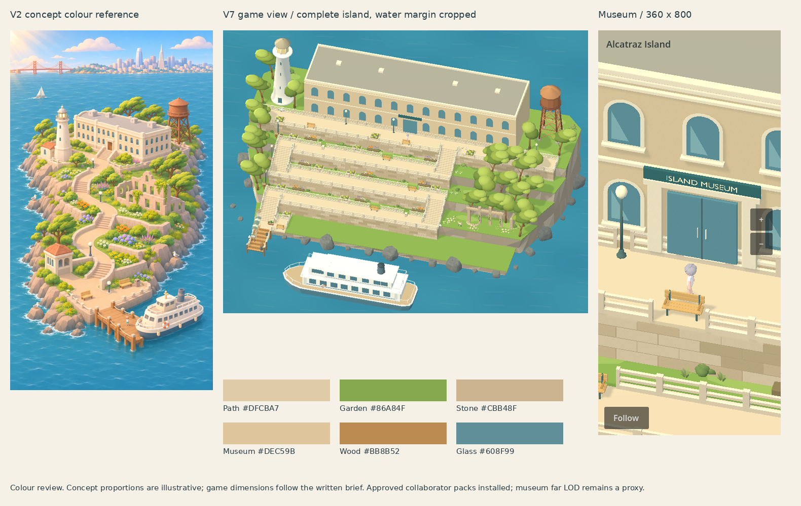

# SGODOT-424 · v7 正式配色与整岛合成

作者：马可波罗。草稿 [PR #792](https://github.com/IndieMiao/sensen-godot/pull/792) → wp-3d-scene。参考 landmark_alcatraz_v2.jpg／c_alc2.png，按文字实尺建模。当前是供上官婉儿技术检查、不知火舞画面验收的正式配色首版；主楼正式远档和轻微动作包已收到，待双审后换入。

暖浅石墙博物馆、无栏拱窗、公众玻璃入口和 ISLAND MUSEUM 招牌；浅砂步道高于黄绿草台的明度，边缘为公园石栏与石沿。海湾蓝绿，码头木板有浅色桩帽。全岛约60×40 m，主楼40×10 m／高9 m，角色与农场比例相同，默认视宽6.72 m。

## 已合成的正式件

已验收包 #794、#802、#815、#816、#820、#821、#801 v3 均安装，GLB与原包SHA-256一致。26棵树、36块岸石、26丛灌木和52丛草；自然件严格替换原114点位，不追加旧撒点。码头候船棚／欢迎牌等五件和废墟细节五件已合入；废墟前两棵树后移，露出拱券。三只海鸥为站立、理羽、展翅静态姿势，渡轮只作展示。

每层三条2 m花带、每条六簇同色成组，花床抬高0.30 m；每层一段连续绿篱。转角按确认方案：**东侧成对低花簇，西侧成对陶盆**。十处栏杆平斜端点高差修正，挤叠短段换单柱转角；十一个花坛按1.7×1.7 m内收并同步碰撞／导航。渡轮泊位改为(-3,0,25)，避免其上层进入开场与前段路线右下操作区。

## 审阅图和视频

- [开场 360×800](01-opening.png)：Map门钮／名字条、候船区和左上金门大桥。
- [半山 360×800](02-mid-hill.png)、[主楼前 360×800](03-visitor-center.png)。
- [俯视及真实导航路线](04-top-layout.png)、[整岛](05-whole-island.png)、[20.16 m最远斜向](06-summit-zoom-out.png)。
- [每约6.5 m逐屏联系表](07-route-contact-sheet.png)；route目录有20张原始360×800图。
- [半山灯柱留白对照](08-mid-hill-hud-comparison.png)、[全路线HUD预留框](09-hud-route-contact-sheet.png)、[博物馆前后](11-museum-before-after.png)。框是审阅标注，不是运行时添加的HUD。
- Plane SGODOT-424附件前缀 `SGODOT-424-colour-v7-`：31张PNG及 `walk.mp4`。视频68.9 s、360×800／30fps，按正常步速从码头走到主楼并拉至最远；准备画面已裁掉，首／中／尾核看，来源和SHA-256见movie-validation.json。此为固定帧步离线视频，不是手机帧率证据。

## 预算与验证

Godot4.7.2／Vulkan Mobile／RTX2060实渲，每个机位12帧取峰值。draw包含可见物、阴影和本场景预览UI；右列额外包括审阅工具呈现的一次draw。

| 机位 | 可见三角 | 场景总draw | 整窗总draw |
| --- | ---: | ---: | ---: |
| 码头开场 | 35,678 | 46 | 47 |
| 半山 | 51,578 | 52 | 53 |
| 主楼前 | 45,272 | 45 | 46 |
| 主楼最远 | 49,698 | 49 | 50 |

20个路线点各扫0.85／0.68／0.5／1⁄3四档，共80组全部通过，峰值61,498三角／60整窗draw。默认20屏峰值52,040三角。全场驻留（含角色、近远档、海面与全部MultiMesh实例）114,079三角／77surface；48独立GLB共40,205唯一三角、102,288放置三角，683复用实例。均在全场300,000／80预算内。

全岛工具视角1000×1200显示所有低小件，整岛斜视91,419三角／81场景draw；这是不可玩的美术审阅机位，不列入360×800可玩镜头预算。手机HUD接入后仍须由亚瑟重测，当前计数不是vivo FPS。

262项主检查通过：实际路线119.31 m到达／镜头跟随、默认比例与缩放／拖拽／恢复／Map信号；6,565导航格实际地面；花坛四角和花园根部地面支撑；每屏看点；26棵正式树冠不遮人物；沿路线234个约0.5 m采样的高件均避开操作区。左上大桥像素、最远灯塔像素、主楼正面大半同屏、海面满屏均通过。全部GLB单mesh／单surface、顶点色／法线、Godot UID字符、尺寸和被测文件字节一致已核验。Blender回开核对48模块、60个独立命名踏步、698个装配节点。

无阴影装饰使用实际实例包围盒做视锥裁剪，压入同一MultiMesh的可见段；不隐藏阴影投射物、不修改阴影距离。海鸥无UV／法线贴图，关闭其不需要的切线生成，原GLB和UID不变。近远建筑／渡轮55 m切档，主楼远档仍为343面同色代理。

证据：[asset-validation.json](asset-validation.json)、[verification.json](verification.json)、[wide-sweep.json](wide-sweep.json)、[view-budgets.csv](view-budgets.csv)、[source-validation.json](source-validation.json)、[movie-validation.json](movie-validation.json)。图片和视频上传后逐件完整下载比对，回执见media-receipts.json。

## 接入边界

场景 `scenes/landmark/alcatraz_island.tscn`，`layout.json`含camera／spawn／anchors／boundaries／walk_bounds，四加载节点DockZone／TerraceZone／SummitZone／FarZone。坐标、枢轴、basis_columns、点位去重、分工见[HANDOFF.md](../../../../tools/art/source/alcatraz_island/HANDOFF.md)。

默认镜头／人物比例未改，最远渐变至用户选择的斜向。生成器和可编辑blend在tools/art/source/alcatraz_island，协作包各有独立源；不改地图注册、共享玩法或发布配置。所有Godot／Blender使用共享flock并已退出。未做新的Android真触摸／物理手机FPS验收；早期协作者模拟器的双指缩放问题交亚瑟复查。11-09 08:00正式件硬线保持，合并由奕星在双审通过后执行。

后续包已收到：黄忠 #819 正式主楼远档2,417面／7738a2e7，以及 #823 原地动作／4aac9b05，均等待双审后替换；本轮交审头未擅自换入。近档相对给黄忠的d7b57574，位置／法线／顶点色／索引逐字节一致，仅重导出网格名和无贴图UV浮点微差，见museum-handoff-equivalence.json。
