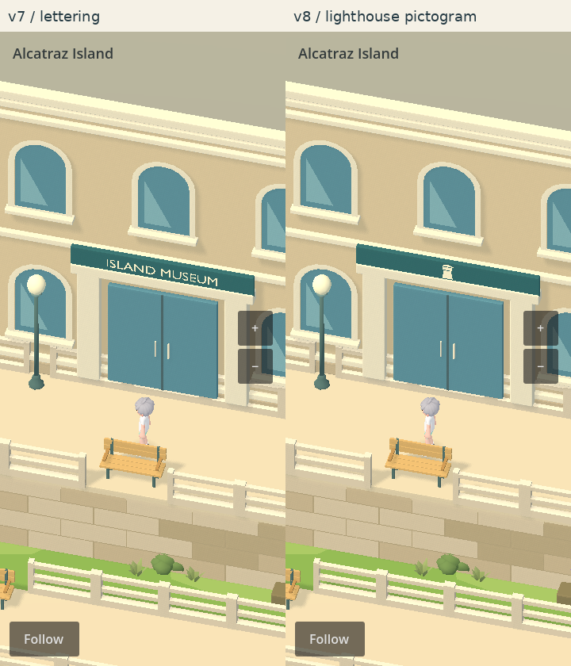

# SGODOT-424 · v8 无文字近档招牌、原地动作与岸边浪花

马可波罗；[草稿PR #792](https://github.com/IndieMiao/sensen-godot/pull/792) → wp-3d-scene。主楼近档去掉写死的英文几何，保留原青绿色牌面，中央改奶油色灯塔剪影。地名由应用标题和地点卡展示；地标3D不写文字的规范已写入[制作流程](../../mobile-3d-asset-workflow.md)。固定近档交接头bf0c31b1，7,869三角，40×10×9m包围／门窗／枢轴保持。

已安装验收通过的 #819主楼远档（7738a2e7）、#823海鸥／渡轮动作（4aac9b05）、#824浪花与浮物（1442acaf）。已追加黄忠#828中独立的图形招牌提交fbf5463a：远档219面旧字换为近档原样7面图形，现2,205面，近远档均无文字；实测54m只提交7,869面、56m只提交2,205面。layout.lod_groups.alc_museum.sign_sync_pending=false。整岛增量供本轮复验，PR继续草稿。

## 整合行为

三只海鸥各用gull.tscn独立实例，播放8.5s idle，创建时分三个区间随机一次起始偏移；原地转头、理羽和偶尔展翅。256个周期样本中169个静止，根位移0，无点击、碰撞或飞行路径。纠正旧悬空点位：码头(-23.6,2.03,18.25)落桩帽；半山(9.5,4.25,8.94)落栏柱；山顶(-24,10.02,-7)落铺装，三点实际射线支撑通过。

渡轮以ferry.tscn只实例化一次，内部包含近远档和52面船尾旗，4s idle仅使BodyRig上下±0.020m，根仍(-3,0,25)，近远档同相位。海鸥／旗帜没有UV或法线贴图，关闭不需要的切线生成，GLB及UID保持。

102片接触浪花、2浮标、3漂木按刘备107点位安装。浪花保持原UV／顶点alpha／共享透明材质，在海面上方1.8cm，不修改海面shader或调色参数。开场左上桥区显示／隐藏浪花的RGB差为0。

独立GLB和完整点位表保留，树、灯、长椅、栏杆等仍可MultiMesh实例化。当前预览将102片同材质静态浪花合为一surface，7个码头件与既有入口空白牌合为一哑光surface，原废墟主体并入台地区静态绘制；材质、颜色、碰撞和摆位维持。接入程序优先读取surface_group／render_merge_into，不能再次重复绘制。码头花箱没有下移，转角仍为东侧成对低花簇、西侧陶盆。

## 图和视频

- [开场](01-opening.png)、[半山](02-mid-hill.png)、[主楼前](03-visitor-center.png)，均原生360×800。
- [俯视布局](04-top-layout.png)、[整岛](05-whole-island.png)、[最远斜向](06-summit-zoom-out.png)。
- [20屏路线联系表](07-route-contact-sheet.png)和route目录原图；[HUD预留框](09-hud-route-contact-sheet.png)。
- [参考色彩](10-reference-colour-comparison.png)、[无文字近档交接](sign-handoff/README.md)。
- Plane附件前缀SGODOT-424-v8-：32张PNG（含单独近档交接图），另有9秒SGODOT-424-v8-effects.mp4。视频840×800／30fps；左侧为原生开场360×800，右侧是同世界、当前点位的渡轮和三只海鸥特写，实际速度，未将海鸥挪进同一机位。首／中／尾核看且完整解码通过；不是手机帧率证据。

## 预算和验证

Godot4.7.2／Vulkan Mobile／RTX2060，360×800机位每次12帧取峰值。场景draw含物体、阴影和当前预览UI；整窗另含审阅工具呈现一次draw。

| 机位 | 可见三角 | 场景总draw | 整窗总draw |
| --- | ---: | ---: | ---: |
| 开场 | 40,996 | 44 | 45 |
| 半山 | 55,673 | 53 | 54 |
| 主楼前 | 49,367 | 46 | 47 |
| 最远斜向 | 53,167 | 49 | 50 |

80个缩放采样全部通过，峰值66,865三角／60整窗draw。全场驻留含角色、海面、近远档、动画子件和实例为120,090三角／75surface，低于300,000／80；55份独立GLB共41,668唯一三角。layout根引用放置三角为106,385，PackedScene内部旗帜及远档另计入前述驻留总数。32张PNG长边均≤1600。

280项断言全部通过（verification文件总288条记录另含统计元数据）：119.31m实际路线到达、6,565导航格地面、花坛角点、树冠与人物、234个沿路HUD留白采样、看点／镜头／Map与恢复；新增4个动画根、海鸥动作与落脚、±2cm起伏、渡轮近远档／旗帜各一次、107岸边点位和透明材质验证。Blender回开55模块、60个命名踏步、805个装配节点，近档无FONT并有4个可编辑图形部件。

合批视觉控制：浪花与逐件原型最大1/255、均差0.0000035/255。码头在一个木箱轮廓的MSAA边缘像素最大24/255，均差仅0.000167/255，放大核看是CPU／GPU变换后的边缘取样差；不声称全像素完全一致。主体、材质和宽度／颜色没有改动来压预算。阴影投射物和阴影距离保留；画外无阴影实例按实包围裁剪。

全岛工具机位显示全部装饰，另报98,339三角／78场景draw，不冒充可玩镜头。未做新的Android真触摸或vivo FPS验收；早期模拟器双指路由问题仍交亚瑟复查，vivo低于30 FPS不上线。

证据：[asset-validation.json](asset-validation.json)、[verification.json](verification.json)、[wide-sweep.json](wide-sweep.json)、[view-budgets.csv](view-budgets.csv)、[source-validation.json](source-validation.json)、[movie-validation.json](movie-validation.json)、[附件回读](media-receipts.json)。

场景：scenes/landmark/alcatraz_island.tscn；layout包含camera／spawn／anchors／boundaries／walk_bounds及四区加载结构。完整坐标与组装规则见[HANDOFF.md](../../../../tools/art/source/alcatraz_island/HANDOFF.md)。所有Godot／Blender使用共享flock并退出。保留.codex/config.toml原删除，不提交；不改共享玩法、地图接入或发布配置。11-09 08:00正式件硬线保持，合并由奕星执行。
