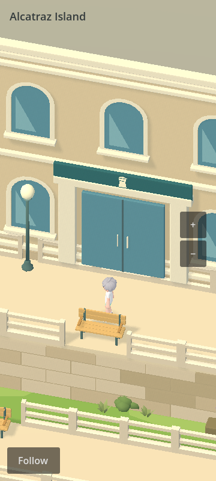

# 无文字招牌 · 近档交接

按不知火舞 b4f4cf63 / 上官婉儿指令：保留原4.45×0.65m青绿色牌面，去除全部英文几何，中间换奶油色灯塔剪影（塔身／灯室／屋顶／岛基四个命名部件）。正文不烘入3D，地名由应用标题与地点卡展示；以后地标均遵循此规则，已写入mobile-3d-asset-workflow.md。

源：tools/art/source/alcatraz_island/finish.py 的 museum_sign_icon；Blender主楼collection中 museum_pictogram_*，没有FONT对象。近档轮廓／窗格／原点／40×10×9m包围保持，牌面仍(0,4.12,5.12)，图形前面Z=5.195。请黄忠依据这份近档替换#819远档文字并重做54／56m对照。本提交仅解开近远档图形交接；已验#819／#823／#824整岛接入继续进行。

改牌后原262项场景检查通过，图为实际Godot Vulkan Mobile默认镜头。完整增量另交v8，不覆盖v7历史审阅。
