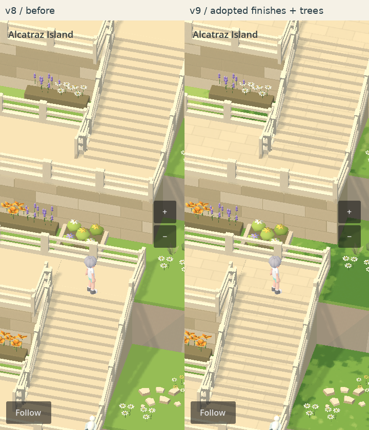

# SGODOT-424 · v9 地表材质、双塔校色与四树种

作者马可波罗；[草稿PR #792](https://github.com/IndieMiao/sensen-godot/pull/792) → wp-3d-scene。已套用#827地形／码头材质，并跟进提前通过双审的草坡v1.1（25923b8e）；#828双塔正式色（fbf5463a）已接入；#826在.import补齐的新头4d8cdab5合并后换入，同时使用已验#825 a/b远档。

本轮地形和码头只换material_override，模型和UV不变。草坡使用更清楚的深浅绿块，平台和台阶出现克制的石板接缝，码头有沿横板方向的木纹。四种树仍为26棵，12个指定原位换成窄柏／低伞冠，保持全部树根、旋转、缩放、碰撞；原先为废墟后移的两棵树不移回。

## 固定版本和保留证据

| 内容 | 版本／结果 |
| --- | --- |
| 地表材质 | #827 / 25923b8e；三地形节点用alc_terrain_detail.tres，dock用alc_dock_detail.tres |
| 草坡显示色 | 深#527E35／普通#78A044／亮#A2B95D；原garden*模型识别键保留 |
| 石板／木纹 | surfaces图、码头材质及对应shader分支与91c563b1逐字节相同，强度未加强 |
| 双塔 | #828 / fbf5463a；四GLB仅COLOR_0 RGB变化，位置／法线／UV／索引／alpha及导入配置保持 |
| c/d新树 | #826 / 4d8cdab5，4份.import含Godot写回的nodes/root_script=null，导入后字节一致 |
| 树组合 | 8a＋6b＋4c＋8d；c高7.8m，d高3.6m；原位替换12棵，不追加第二套点位 |
| 自制模型 | 三地形、码头、近档主楼和废墟6个GLB与b81605af全字节相同；Blender六集合的顶点、面、UV、变换和材质分配也相同 |
| 导航／相机 | 6,565格、119.31m实走路线；spawn／exit／camera／anchors／boundaries／walk_bounds与b81605af一致 |

刘备同暖光独立验图的深／普通草亮度差为22.66–22.83%，本轮直接使用同版资源；该数据来自其[验证报告](../../alcatraz-ground-424/v1.1/brightness-validation.json)，不把树影当作本轮额外的草色测量。地名仍由UI展示，近远主楼均是无文字灯塔图形。

## 复用、LOD与预算

树按实际相机到共同Mesh AABB中心40m逐实例分配近／远MultiMesh，每区每种两批；先拟合相机再判距离，不按名义11m偏移判断。实际渲染39.95m／40.05m分别只提交近／远：a520／118、b316／118、c240／116、d316／118；两档实例数相加始终等于根点数，根部碰撞不变。建筑和渡轮保持55m，近远树均保留阴影，阴影距离未改。

独立GLB与点位表仍完整。台地区同材质小花簇合成一surface，浮标／漂木合成一surface，保留原图形、坐标与材质；花簇合批与逐件渲染最大差2/255、均差0.000094/255。默认6.72m显示所有看点，花簇和低装饰在视宽8m内显示，灯牌在12m内显示；全岛工具视图显示全部。第一档缩放仍保留花簇，避免通过删默认细节压预算。

Godot4.7.2／Vulkan Mobile／RTX2060，以下每机位12帧取峰值，场景draw含阴影和预览UI，整窗另含审阅呈现1次：

| 机位 | 可见三角 | 场景draw | 整窗draw |
| --- | ---: | ---: | ---: |
| 开场 | 34,426 | 45 | 46 |
| 半山 | 55,855 | 52 | 53 |
| 主楼前 | 52,385 | 39 | 40 |
| 最远斜向 | 47,531 | 52 | 53 |

全场按所有近远档、角色、海面及实例展开计121,010三角／78surface；61份独立GLB，42,694唯一三角，layout根引用104,245放置三角。20个路线点×18档，共360个缩放样本（含实际＋／−按钮档位），峰值63,683三角／60整窗draw。正常步速连续录制的1,857个走路帧也记录计数，峰值62,227三角／59整窗draw。都在8万可见三角／60draw及全场30万／80surface内。

全岛工具机位显示全部细节，另报89,715三角／77场景draw，不是可玩机位。以上是渲染计数，不是vivo FPS。

## 验证和媒体

304项断言通过（verification共312条记录，另含统计字段），覆盖四处准确材质绑定、四树种计数与实际切档、原地动作与落脚、全路线／镜头／Map／恢复、全部导航格地面、花坛支撑、树冠不遮人、234个沿路HUD采样、每屏看点、开场桥像素、最远主楼与灯塔。模型／UV保留和资源版本另有Python／Blender验证；工作区与隔离被测资源一致。

- [开场](01-opening.png)、[半山](02-mid-hill.png)、[主楼前](03-visitor-center.png)，均360×800。
- [俯视布局](04-top-layout.png)、[整岛](05-whole-island.png)、[最远视角](06-summit-zoom-out.png)。
- [20屏路线](07-route-contact-sheet.png)和route原图；[HUD预留框](09-hud-route-contact-sheet.png)。
- [开场前后](11-opening-comparison.png)、[半山前后](12-mid-hill-comparison.png)、[山顶前后](13-summit-comparison.png)。比较包含本轮材质、树和双塔色彩整合，不宣称只有材质像素变化。
- Plane SGODOT-424附件前缀SGODOT-424-v9-：33张PNG及68.9秒SGODOT-424-v9-walk.mp4。视频为360×800／30Hz正常步速、完整路线和最远端，首／中／尾核看、全量解码通过；离线固定帧步，不是设备FPS。

证据：[asset-validation.json](asset-validation.json)、[preservation.json](preservation.json)、[editable-geometry-preservation.json](editable-geometry-preservation.json)、[source-validation.json](source-validation.json)、[verification.json](verification.json)、[wide-sweep.json](wide-sweep.json)、[view-budgets.csv](view-budgets.csv)、[movie-validation.json](movie-validation.json)、[附件回执](media-receipts.json)。

源与重建方法：[README](../../../../tools/art/source/alcatraz_island/README.md)、[HANDOFF](../../../../tools/art/source/alcatraz_island/HANDOFF.md)。本轮使用--layout-only保留GLB，不重展UV；palette.json的识别键不改成显示草色。ShaderMaterial、PNG及.import须随模型交付，不能只取GLB。

场景仍为scenes/landmark/alcatraz_island.tscn，装配数据assets/landmarks/alcatraz_island/layout.json，四区结构保持。所有Godot／Blender经共享flock并退出；.codex/config.toml原删除不提交。未改共享玩法、发布或地图注册；真实Android输入／vivo帧率由亚瑟验，低于30FPS不上线。PR保持草稿供整岛复验，11-09 08:00硬线保持。
