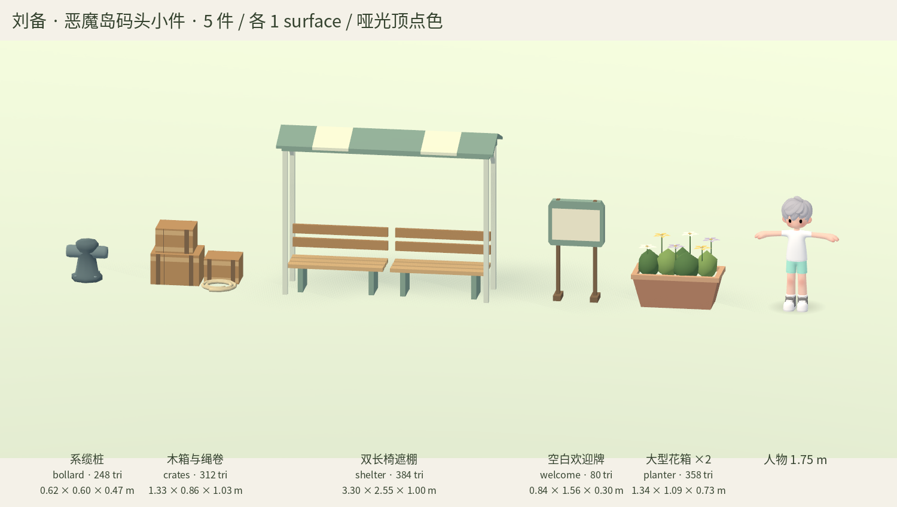
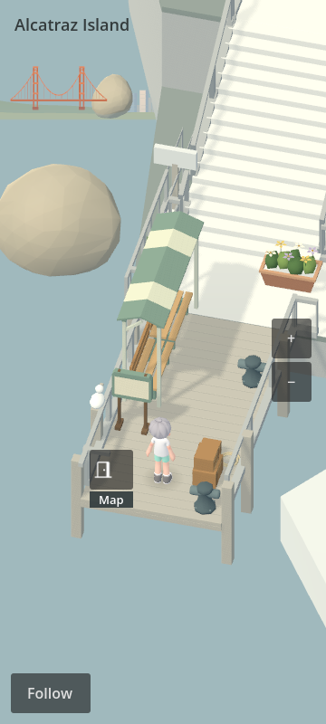
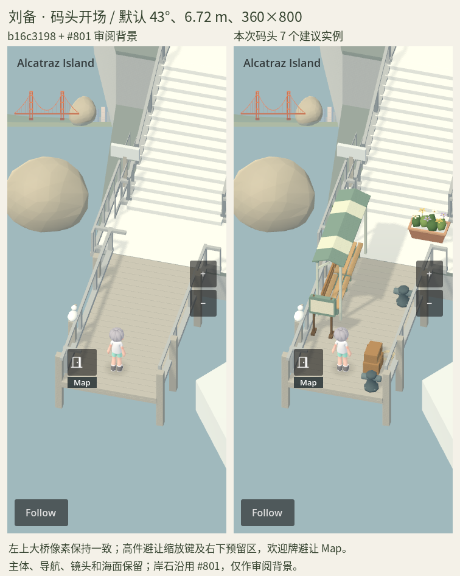
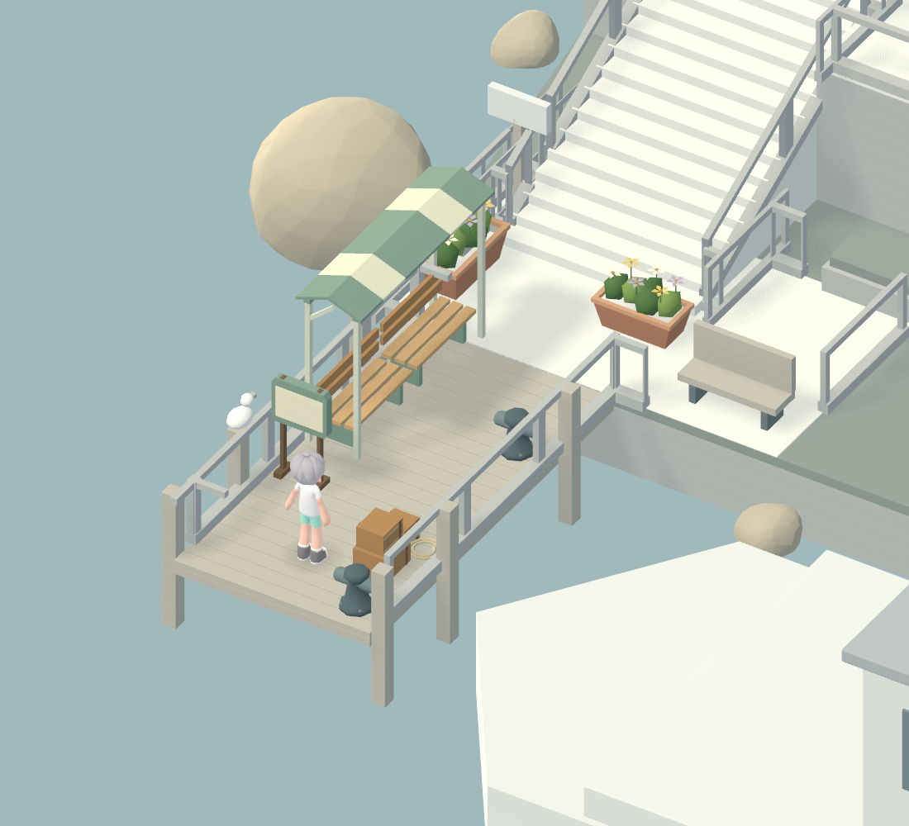

# SGODOT-424 · 恶魔岛码头小件

刘备，2026-11-06。五种小件围绕 b16c3198 的 `dock_000` 和出生点 (-22, 1, 19) 布置：左侧双长椅遮棚与空白欢迎牌、右侧低木箱与绳卷、两盆大花箱、两个系缆桩。保持金门大桥在开场左上可见，欢迎牌避让 Map 门钮，高件避让缩放按钮和右下主键预留区。待上官婉儿技术检查、不知火舞画面验收。

| GLB | 宽 × 高 × 深（m） | 三角面 | surface |
|---|---|---:|---:|
| alc_dock_bollard | 0.62 × 0.60 × 0.47 | 248 | 1 |
| alc_dock_crates | 1.33 × 0.86 × 1.03 | 312 | 1 |
| alc_dock_shelter | 3.30 × 2.55 × 1.00 | 384 | 1 |
| alc_dock_welcome | 0.84 × 1.56 × 0.30 | 80 | 1 |
| alc_dock_planter | 1.34 × 1.09 × 0.73 | 358 | 1 |

五件共 **1,382 个独立三角面、75,652 字节 GLB**。每件一个网格、一个 surface；无外部贴图、透明卡片、骨骼或动画。连续多圈绳卷、板条、座椅、花瓣用实际几何和顶点色表达，花瓣正背面均计入预算。欢迎牌正反面均为空白。

长椅每条 1.45 m，座面上缘 0.45 m；两条并排置于条纹浅色棚下，棚顶 2.55 m。深灰系缆桩、暖木与麻绳、米白和灰绿遮棚、陶土花箱配白 / 黄 / 淡紫花，沿用柔和哑光风格。

## 接入与建议点位

资源在 `assets/landmarks/alcatraz_island/`，按五个合同名称加载。每件原点为底面与水平包围盒中心，米制、Y 向上、局部 +Z 为正面；GLB 网格变换为单位矩阵。

保留五个 Godot 生成的 `.glb.import` 与 `alc_dock_material.tres`。导入材质启用 `vertex_color_use_as_albedo`，roughness=0.94、metallic=0、specular=0.15，不透明、常规背面剔除。可直接拖入 GLB，也可取导入网格用于 MultiMesh；不要用不启用顶点色的白模材质覆盖。原 GLB 含完整颜色，不依赖外部纹理。

`alc_dock_placements.json` 是给马可波罗的 **7 个新增建议点位**，不是替换既有其他成员的点位。对应 `dock_000` 中心 (-22, 1, 16.75)，保留出生点 (-22, 1, 19)、Map 出口 (-23, 1, 19.4)。全部 owner=刘备、DockZone、纯装饰、无碰撞 / 交互。共享五种网格组成五个 MultiMesh 批次，放置面数 **1,988**。

| 实例 | 位置 (X,Y,Z) | Y 旋转 | 均匀缩放 |
|---|---|---:|---:|
| shelter_000 | (-23.00, 1, 15.35) | 90° | 1 |
| crates_000 | (-21.00, 1, 18.45) | 90° | 0.85 |
| welcome_000 | (-23.00, 1, 17.65) | 0° | 1 |
| planter_000 | (-23.60, 1, 12.80) | 90° | 1 |
| planter_001 | (-20.94, 1, 12.55) | 0° | 0.90 |
| bollard_000 | (-20.95, 1, 19.60) | 0° | 1 |
| bollard_001 | (-20.95, 1, 15.65) | 0° | 1 |

遮棚纵向贴左侧，木箱实例高约 0.73 m；花箱横向放在东侧平台，前缘留在首阶台阶以南。所有模型完整水平包围盒避开中央 X=-22 ±0.45 m 的通路，保留 **至少 0.90 m** 通行宽度；距出生点至少 0.50 m。没有修改导航、碰撞或主体 `layout.json`。最终整合若新增 NPC 或改变台地，应由程序重新检查站位与通行。

## 原生开场验收

实际 Godot 4.7.2 / Vulkan Mobile / Steam Deck 默认 43°、6.72 m 镜头，原光照与出生点。主体使用 #792 **b16c31982f34a64cdd4f9c6683064edbf20837a0** 白模；岸石与植被沿用 #801 **07326180a** 已交付自然件，仅作为前后相同的审阅背景，未复制进本次分支或改色。建筑、地形、船、海面和远景仍是主体版本，非最终整景美术。

- 欢迎牌投影底边 Y≈481.99，Map 门钮区顶边 Y≈497.10，相距 **15.10 px**，通过 12 px 安全边界。
- 高件的完整投影包围盒避开实际缩放按钮（X=300，Y=352/400，44×44）及 12 px 安全边界；也避开右下 (244,508,112,172) 主键预留区及 12 px。
- 开场左上金门大桥的 **654 个橙色几何像素与加入小件前完全一致**，未改远景、镜头或通过重新构图藏掉遮挡。
- 单帧开场可见统计 33 draw calls / 45,496 primitives，含整个白模与人物，不能当作本套模型独有成本或手机性能结论。

原始开场图保持 360×800、未修图；并排图只在截图外加标题和尺寸，`hud-clearance.png` 是另存的 2× 最近邻安全框说明，不替代原图。左侧花箱在默认镜头被遮棚部分遮住，整体图和俯视图展示其完整位置。

## 验证与来源

- [97 项实际 GLB / 点位检查](asset-validation.json)：三角面、法线、非退化几何、单 surface、材质、落地原点、出生点和通路。
- [55 项 Godot 导入检查](import-validation.json)：解码数组、尺寸原点、哑光顶点色与唯一 UID。
- [Blender 源文件回开](source-validation.json)：五个 collection、所有命名零件、面数和包围盒对应导出。
- [33 项实渲检查与大桥像素记录](render-validation.json)，[主体文件逐字节保留](preservation.json)。
- [Android 小包验证](android-validation.json)：API 37 / SwiftShader 软件模拟器，360×800 下五件和人物完整显示，码头默认画面及实际放大/缩小按钮点击通过。不是物理手机性能或完整导航、双指验收。
- [安装包完整回读](package-validation.json)及[包内网格检查](package-import-validation.json)：五件解码几何数组、材质、实际导入 UID、点位与 manifest 均与桌面验收资源一致。QA app 已停止，模拟器恢复原 720×1280 覆盖尺寸 / 默认密度。

可编辑 `.blend`、确定性生成器、原设定和固定布局快照在 [源目录](../../../tools/art/source/alcatraz_dock_424/README.md)。新分支 `wp-3d-scene-liubei-alcatraz-dock` 从最新 `origin/wp-3d-scene` 的 `9d39f9636` 新建，仅新增码头资产、源文件及审阅材料；未改其他成员资产或运行时逻辑。
