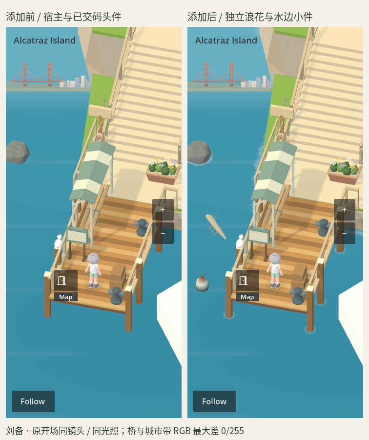
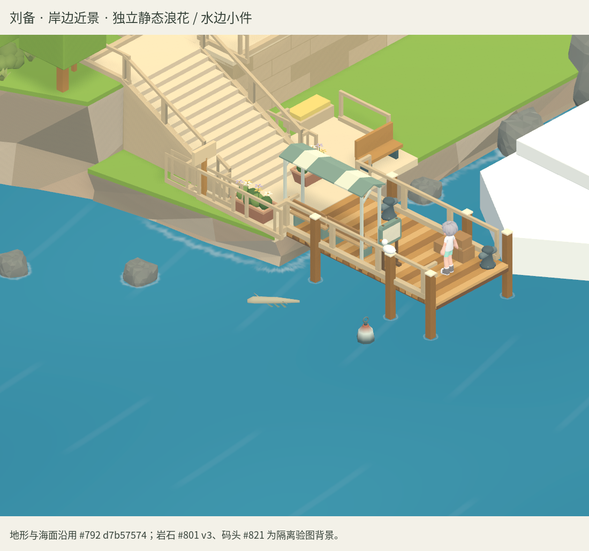
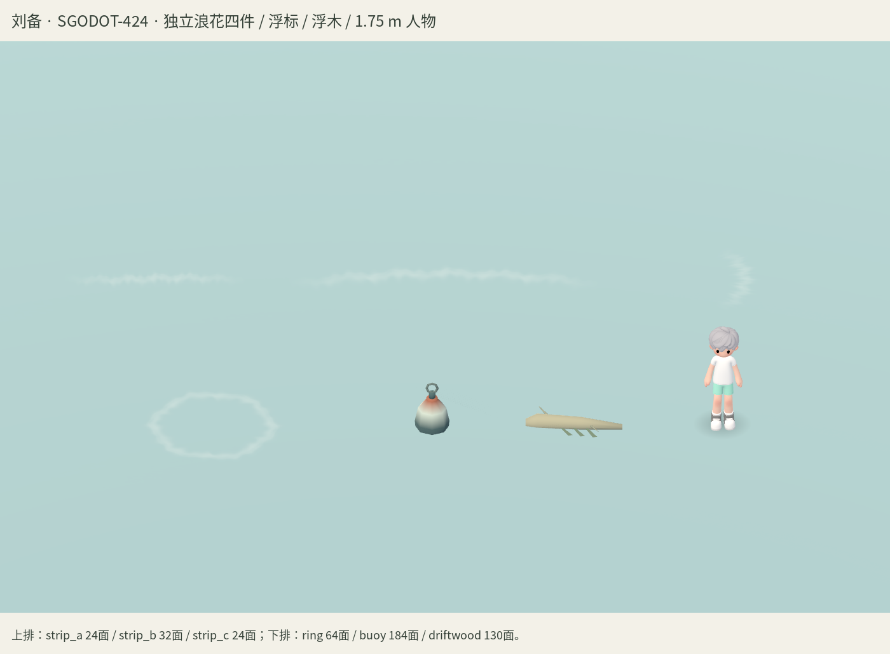
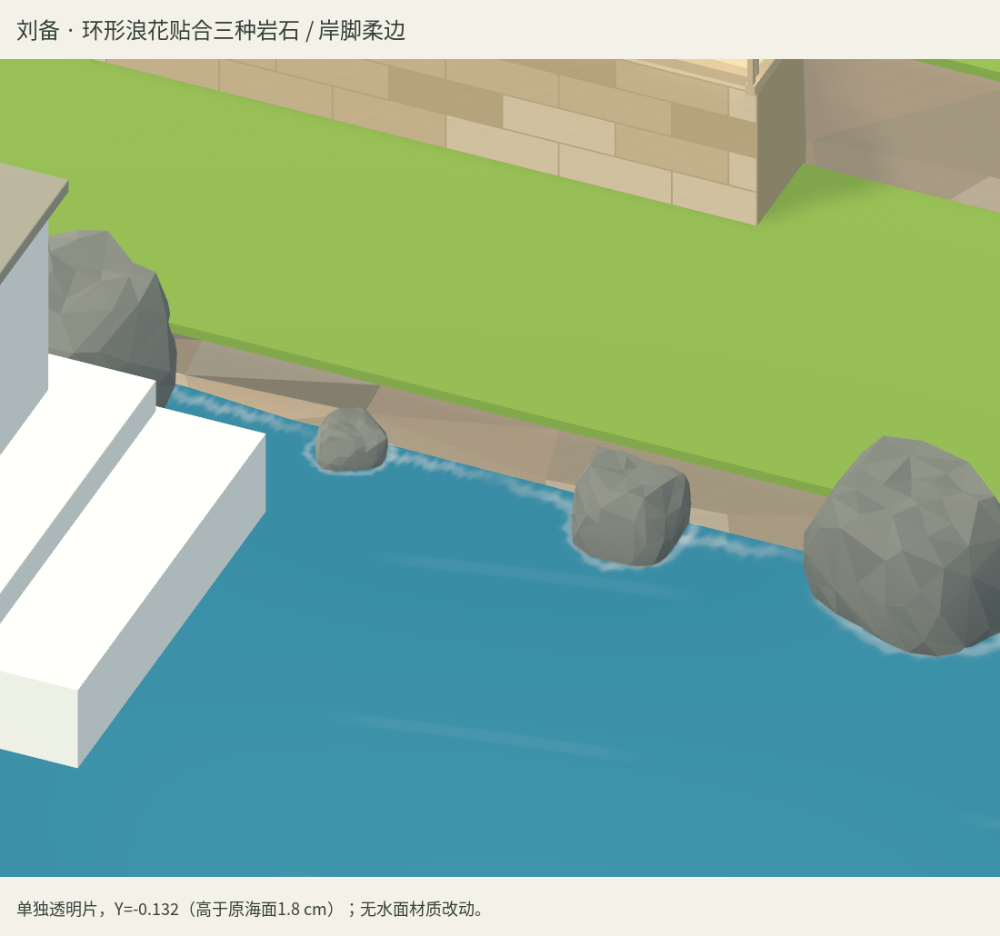
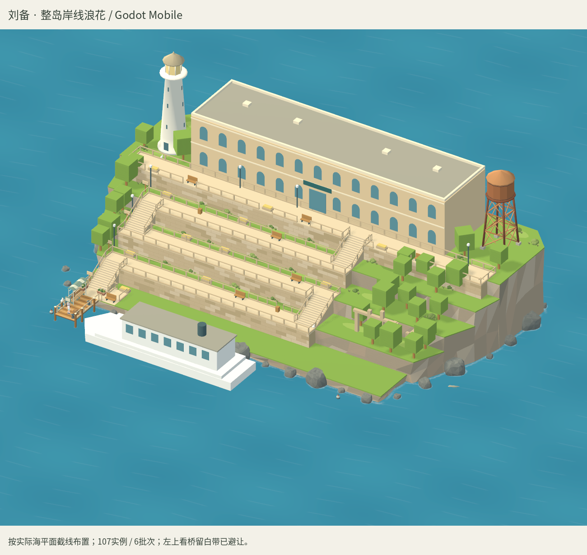
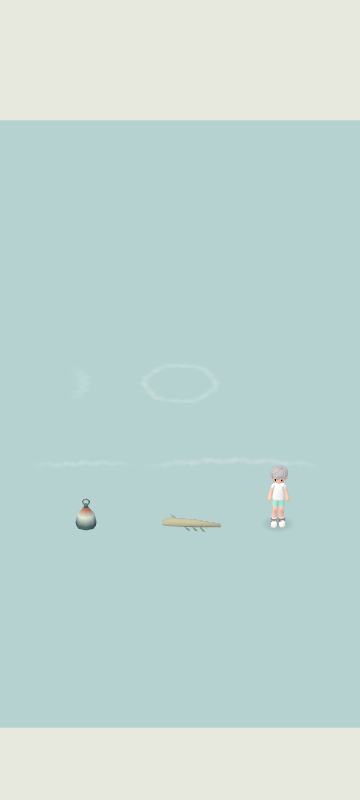

# SGODOT-424 · 岸边浪花与水边小件

刘备，2026-11-06。独立静态浪花四件、浮标和浮木两件，交上官婉儿技术审、不知火舞画面审、奕星合并。分支 `wp-3d-scene-liubei-alcatraz-foam` 从最新美术主分支 `fb4af0458` 建立，目标 `wp-3d-scene`。




浪花是叠在海面上的独立透明片，静态柔边、低对比、不投影。没有新增水面 shader，也没有编辑海面材质。验图固定使用 #792 **d7b57574d359952858319d17b43722651a0fcbcb** 的原地形、海面、相机和光照；岩石采用 #801 v3 `af3197575`，码头摆设采用已通过的 #821 `cc59ef9fb`，均只解包到忽略目录作为背景，不重复提交到此 PR。

## 资产

| 资产 | 用途 / 外接尺寸（m，X×Y×Z） | 三角面 | surface |
|---|---|---:|---:|
| alc_foam_strip_a | 短直段，2.842×0×0.672 | 24 | 1 |
| alc_foam_strip_b | 长浅弯段，4.960×0×1.012 | 32 | 1 |
| alc_foam_strip_c | 短弯角，0.887×0×2.065 | 24 | 1 |
| alc_foam_ring | 岩石 / 桩脚环，2.300×0×2.300 | 64 | 1 |
| alc_buoy | 哑光浮标，0.540×0.964×0.540 | 184 | 1 |
| alc_driftwood | 单根漂木带少量海草，1.500×0.263×0.753 | 130 | 1 |

共 **458 个独立三角面 / 21,228 B GLB**。六件均单 mesh、单 surface；水边小件无交互、不发光、不闪动。米制、Y 向上、+Z 南；四件浪花本地 Y=0，浮标和浮木以水线为 Y=0、部分体积在水下。所有原点居中，无岛上世界位移烘入模型。



资产位于 `assets/landmarks/alcatraz_island/`。四件浪花共享 **512×128 RGBA 原创纹样 `alc_foam_soft.png`**，沿 U 平铺，横向边界 alpha=0、接缝相同，含 mipmap。纹样最大 alpha=90/255，材质 alpha=0.8，未叠放处最大有效 alpha 约 **0.282**；直／弯段端点另有顶点 alpha 渐隐。没有 alpha scissor/hash、UV 动画或 shader TIME；环片的纹样连续跨接缝。

## 程序接入要点

必须同时保留六个 Godot 生成的 `.glb.import`、PNG `.import`、`alc_foam_material.tres` 和 `alc_shore_props_material.tres`。四件浪花使用 alpha blend、unshaded、禁写深度、保留深度测试、`render_priority=1`，在宿主原海面之后叠加；浮标/漂木为不透明顶点色哑光材质。

**宿主 d7b57574 的 `_add_batch()` 会把 `paint` 设为 `material_override`。接这六件时需清空该 override，保留导入网格自带材质，并关闭投影。否则浪花会变成不透明白片。** 独立审阅的 `add_shore()` 已按这一方式创建 MultiMesh；只需对新增六类处理，不修改海面。

```gdscript
# 六件新资产：mm.mesh 使用该 GLB 的已导入 Mesh。
node.material_override = null
node.cast_shadow = GeometryInstance3D.SHADOW_CASTING_SETTING_OFF
node.gi_mode = GeometryInstance3D.GI_MODE_DISABLED
```

`alc_shore_foam_placements.json` 是 **新增建议表**，不是替换旧岸石或码头点位。共107实例：短直41、长弯15、短弯角4、环42（36岩石+6桩脚）、浮标2、漂木3；按资产6批次，合计 **5,006个放置三角面**。无碰撞与交互，owner=刘备。有 `basis_columns` 的环片优先用该矩阵，避免宿主 `Basis.scaled()` 把非等比缩放作用到世界轴；旋转、缩放字段也保留供查阅。

岛岸线由三份宿主地形 GLB 在海平面 Y=-0.15 的真实截线生成，外周约175.09m。浪花统一 **Y=-0.132，抬高1.8cm**；岩石环按 #801 v3 各岩石水线截面定大小，桩脚环对应 `dock_000` 的六根0.22m桩。弯段已贴实际岸角；岸线若改形或海平面改高，需重生成建议表。

原生360×800开场，左上 x=0..179、y=45..159 为桥和城市保留带；排除了两段落入该带的候选浪花，最终全部107件包围盒避让。显示／隐藏本包时该区域最大RGB差 **0/255**。浮标与漂木也避开 Map 和缩放键。原生图：[码头开场](dock-opening-360x800.png)。




## 验证与范围

- [420项资产与保留检查](asset-validation.json)：实际GLB面数、单surface、非退化三角形、法线、UV、透明边界、平铺接缝、原点、点位元数据及宿主海面/场景/导航/地形/码头/远景字节一致。
- [76项Godot实际导入检查](import-validation.json)：UID、面数、透明混合、深度写入关闭、材质优先级、mipmap和水线原点通过。
- [Blender回开](source-validation.json)：六个collection和可编辑命名部件、尺寸及导出面数一致。
- [146项实渲检查](render-validation.json)：Godot4.7.2 / Vulkan Mobile / Steam Deck AMD VANGOGH。原生开场、岸边、岩石接触、全岛及完整1.75m人物展示通过。独立浪花/浮物展示间隔30帧，像素差0；桥/城市带前后差0。
- 宿主 d7b57574 海面自带慢纹动画。成对比较只在审阅工具中用 `Engine.time_scale=0` 固定采样时刻，不修改原海面文件或材质参数；独立浪花的30帧“不闪”检查正常计时。
- 原开场：添加前33 visible draw / 41,522 primitives，添加后39 / 46,528；岸边40 / 45,988，整岛59 / 54,223。6次新增draw与5,006个放置三角面一致。数据包含宿主及既有自然件/码头件，不是六个原型的独有成本或手机性能结论。
- Android API37 / SwiftShader 软件模拟器验证见 [Android记录](android-validation.json) 和 [APK回读](package-validation.json)：原开场、六件透明层/浮物、完整人物及两次实际缩放按钮。未做本轮完整导航、双指或物理手机性能验收。



原始帧未修图；只在图外加说明、按标注拼版。部分建筑和其他成员件仍为宿主快照，不代表最终整景。可编辑源、参考原件、固定头和复现命令见 [源目录](../../../tools/art/source/alcatraz_foam_424/README.md)。
