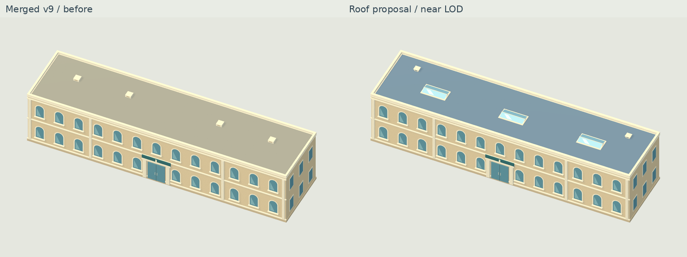
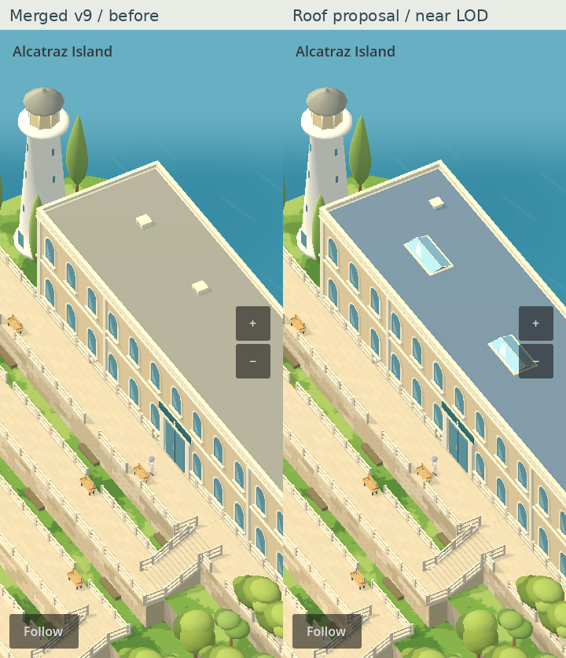

# SGODOT-424 · 主楼屋顶装饰

**当前增量见 [v1.1 通风口](v1.1/README.md)**：两个通风口固定底座放大 1.5 倍，改为深灰蓝，顶端升至局部 Y=9.18 m；其他内容保留。#835 等黄忠同步远档后一起合，不单合近档。下文及本目录原图为已通过两关的 v1（`4a47e622`）历史记录。

马可波罗。分支 `wp-3d-scene-makeboluo-museum-roof`，从已合 v9 的 `origin/wp-3d-scene`（`02d5534768fc1a5557feaecb705b8f445562fd6b`）新建。独立草稿 PR 交上官婉儿技术审、不知火舞画面审；不包含 farm-dev 整合。

近档屋面改冷灰蓝石板色，四周增加奶油色压顶线，原四个小方块改为三个浅蓝玻璃天窗与两个低通风口。玻璃以不透明顶点色、宽反光面表达；仍然哑光单 surface，无新贴图、透明或额外 pass。





## 范围与固定尺寸

- 运行时只更换 `assets/landmarks/alcatraz_island/alc_museum.glb`，并更新其 manifest 条目。
- 保持主楼名义尺寸 40 × 10 m、高 9 m，局部原点和世界摆位 `(0, 10, -13)` 不变。含原门把手的实际 AABB 为 `(-20, 0, -5)` 至 `(20, 9, 5.222499847)`，新旧完全一致。
- Blender 源中屋顶以外 **1,589 个对象／实例完全一致**，包含墙面、拱窗、门、无字招牌／灯塔图形、其他模块和整岛摆位。导航、碰撞、相机、出生点、出口、layout 及运行脚本均未改。
- 其余 **171 个资产文件逐字节相同**，含远档和全部 `.import`。近档沿用 Godot 生成的 UID `duqyefqkjnrw5`。
- GLB 非屋顶三角的位置／法线／顶点色在 6 位小数比较中一致；重求值原倒角导致导出 UV 的最大浮点差为 `0.00000006`，见 [精确报告](asset-verification.json)。Blender 源 UV 完全一致，无 UV 依赖材质变更。

## 黄忠远档同步合同

**本 PR 先交近档。`alc_museum_far` 仍为已验 v9，等待上官婉儿派黄忠同步；近远配色当前尚未一致。** [整岛图](05-whole-island-current-lods.png) 保留真实 55 m 切档，所以该远机位看到旧屋顶；没有为了审图强制显示近档。正式补入前须合并远档更新并复核 54／56 m 对照。

色值为 sRGB HEX，按既有 `hex_rgb` 转线性顶点色。墙、门窗、招牌保持 v9 原色。

| 部件 | 色值 | 说明 |
| --- | --- | --- |
| 屋面 | `#748B9C` | 冷灰蓝石板色 |
| 压顶、窗框、通风口 | `#F0E1C2` | 既有奶油色 |
| 天窗朝前玻璃 | `#A9D5DF` | 浅蓝，不透明 |
| 天窗背坡／端面 | `#7FAEBE` | 较暗蓝色 |
| 天窗宽反光面 | `#D7EDF0` | 单片天空反光，无格栅 |
| 通风口凹面 | `#526C7C` | 低对比暗槽 |

全部为主楼局部坐标，Y 向上、正面 +Z，远档保持同一原点和 55 m visibility range：

- 天窗中心 X/Z：`(-12, 0.6)`、`(0, 0.6)`、`(12, 0.6)`；基座 3.8 × 2.0 m，Y 8.62–9.00。可用每面一块玻璃平面简化，但保留浅蓝三处轮廓。
- 通风口中心 X/Z：`(-16.3, -2.5)`、`(16.3, -2.5)`；帽沿 0.82 × 0.82 m，Y 8.64–9.00。
- 压顶沿原女儿墙，宽 0.32 m、厚 0.06 m，顶面 Y 8.96；不越出 X ±20／Z ±5 外框。
- 机读合同：[museum_roof_contract.json](../../../tools/art/source/alcatraz_island/museum_roof_contract.json)。

## 验证与预算

Blender 5.2.2 源回开比对；Godot 4.7.2 冷导入；gs66 RTX 2060 / Vulkan Mobile，实际 360 × 800 跟随镜头。所有 Godot／Blender 进程持 `~/gs66-render.lock`，结束即退出。截图原图长边 ≤ 1,000 px，对比图 ≤ 1,500 px。

近档 **7,869 → 8,757 三角（+888）**、1 surface。全场沿 v9 已验 121,010 三角仅增加这 888 面，得到 **121,898 三角／78 surfaces**；其他模型与实例字节／源数据一致。360 个路线缩放组合的实测峰值为 **64,571 可见三角／60 全局 draw calls**。

| 实测机位 | 可见三角 | 全局 draw calls |
| --- | ---: | ---: |
| [开场](01-opening.png) | 34,426 | 46 |
| [半山](02-mid-hill.png) | 56,743 | 53 |
| [主楼前](03-visitor-center.png) | 53,273 | 40 |
| [山顶最远缩放](04-summit-wide-after.png) | 48,419 | 53 |

包围盒、摆位、单不透明 surface、导航初始化、近远切换只绘制一档、三处 HUD 留白及无背景露出检查全部通过。逐项结果见 [verification.json](verification.json)、[360 档采样](wide-sweep.json)、[源比对](source-verification.json)、[资产比对](asset-verification.json)。[天窗特写](07-skylight-detail.png) 为同材质／同灯光独立模型视图。该桌面审阅不替代亚瑟的 vivo 测帧率或最终近远配色验收。

11 张 PNG 已以 `SGODOT-424-roof-v1-` 前缀上传 Plane SGODOT-424，署马可波罗虚拟用户；全部下载后与本地逐字节比对一致，见 [回执](media-receipts.json)。

## 重建

从仓库根目录运行，使用当前有效 DISPLAY／XAUTHORITY：

```sh
flock ~/gs66-render.lock blender --background --threads 3 --python-exit-code 1 --python "$PWD/tools/art/source/alcatraz_island/build_museum_roof.py"
flock ~/gs66-render.lock blender --background --threads 3 --python-exit-code 1 --python "$PWD/tools/art/source/alcatraz_island/verify_museum_roof.py"
python3 tools/art/source/alcatraz_island/verify_museum_roof_assets.py
python3 tools/art/source/alcatraz_island/prepare_museum_roof.py
flock ~/gs66-render.lock timeout 180s godot --headless --path output/alcatraz-roof-424/project --editor --import
flock ~/gs66-render.lock timeout 180s env ALCATRAZ_REVIEW="$PWD/output/alcatraz-roof-424/review" godot --path output/alcatraz-roof-424/project --rendering-method mobile --rendering-driver vulkan --display-driver x11 --resolution 360x800 --disable-vsync --max-fps 60
```

`build_museum_roof.py` 只替换现有 blend 中的屋顶命名件并单独导出主楼，保留完整整岛装配。`finish.museum` 也调用相同屋顶生成函数，避免全量重建时退回旧造型；`preserved_geometry.json` 已同步新主楼哈希，其他五个自制模块继续保留原哈希。历史 v9 的保存检查与审阅证据保留不改，本次使用屋顶专属检查。
