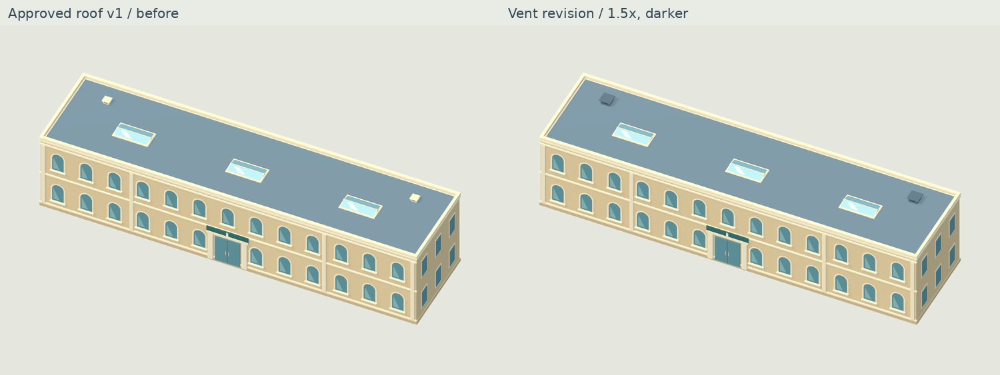
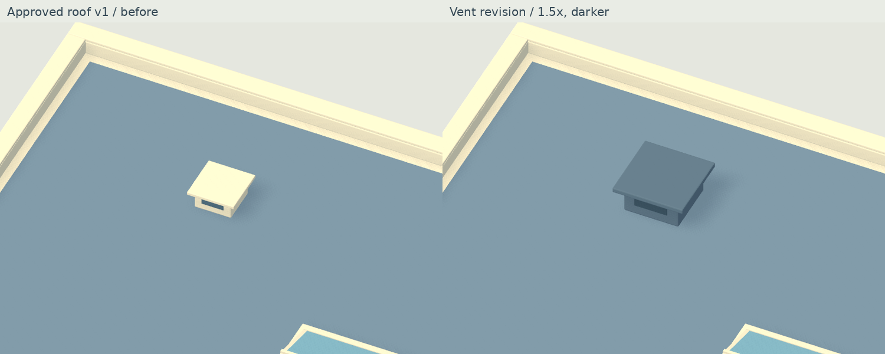

# SGODOT-424 · 通风口 v1.1

马可波罗，#835 小增量。以通过两关的近档 `4a47e6223903e4adb504dfd738bbb0ab2cb63a27` 为基准，只改两个通风口的尺寸与颜色。**#835 必须等黄忠远档同步后一起合，不单合近档。**





## 黄忠远档对齐值

两个通风口以原底座为支点，三轴尺寸均放大 **1.5 倍**，中心 X/Z 仍为 `(-16.3, -2.5)` 和 `(16.3, -2.5)`；本体与帽沿均为 sRGB **`#5E7383`**，正面暗槽为 **`#3F5362`**。屋面仍为 `#748B9C`。

| 部件 | 原尺寸 X × Y × Z（m） | 新尺寸 X × Y × Z（m） | 新局部中心 Y（m） |
| --- | --- | --- | ---: |
| 本体 | 0.64 × 0.30 × 0.64 | **0.96 × 0.45 × 0.96** | 8.865 |
| 帽沿 | 0.82 × 0.06 × 0.82 | **1.23 × 0.09 × 1.23** | 9.135 |
| 暗槽 | 0.38 × 0.095 × 0.012 | **0.57 × 0.1425 × 0.018** | 8.910 |

暗槽向正面 +Z 偏移 **0.489 m**，中心 Z 为 `-2.011`。本体倒角 0.03 m、帽沿倒角 0.018 m。底座 Y 仍为 **8.64 m**，通风口总高 **0.54 m**，顶端由 9.00 升至 **9.18 m**（世界 Y=19.18 m）。仅装饰顶端新增 0.18 m，主楼 40 × 10 × 9 m 的楼体、世界位置 `(0,10,-13)`、天窗及压顶均保持原样。

GLB AABB 为 `(-20,0,-5)` 至 `(20,9.180000305,5.222499847)`：X/Z 和底部与 v1 完全相同，只在两个放大的通风口处增加高度。近远档都使用这个装饰上沿，55 m 切档参数不改。精确机读值见 [museum_roof_contract.json](../../../../tools/art/source/alcatraz_island/museum_roof_contract.json)。

## 验证

- Blender 5.2.2：只替换六个 `roof_vent_*` 对象；其余 **1,638 个对象／实例的几何、UV、材质、倒角、变换和集合关系完全一致**，包括已验天窗、压顶和整岛摆位。
- GLB 独立比对：所有改变的三角均落在两个通风口包围盒内；其他位置／法线／顶点色在六位小数比较中一致，其他导出 UV 最大浮点差 `6e-8`，源 UV 完全一致。
- 近档仍 **8,757 三角／1 个不透明 surface**；全场仍按已验 v9 加屋顶差量计算为 **121,898 三角／78 surfaces**。171 个其他资产文件、layout、运行脚本和原 Godot UID 逐字节不变。
- Godot 4.7.2 重导入及 **40 项审阅检查通过**；360 个路线／缩放组合峰值仍 **64,571 可见三角／60 全局 draw calls**。54／56 m 切档仍只绘制一档。
- 开场 **34,426／46**，半山 **56,743／53**，主楼前 **53,273／40**，山顶最远缩放 **48,419／53**（可见三角／全局 draw calls）。

证据：[源比对](source-verification.json)、[资产比对](asset-verification.json)、[实渲检查](verification.json)、[360 档采样](wide-sweep.json)、[农场镜头对照](09-farm-camera-comparison.png)。gs66 RTX 2060 / Vulkan Mobile，360 × 800；不是 vivo 性能验收。所有 Godot／Blender 命令持 `~/gs66-render.lock` 并在结束后退出。

10 张 PNG 已以 `SGODOT-424-roof-v1.1-` 前缀上传 Plane SGODOT-424，全部下载后与本地逐字节比对一致，见 [回执](media-receipts.json)。

## 重建与审阅

仓库根目录运行，使用当前 DISPLAY／XAUTHORITY。v1 图片和验收记录保留在上级目录。

```sh
flock ~/gs66-render.lock blender --background --threads 3 --python-exit-code 1 --python "$PWD/tools/art/source/alcatraz_island/build_museum_roof.py" -- --vents-only
flock ~/gs66-render.lock blender --background --threads 3 --python-exit-code 1 --python "$PWD/tools/art/source/alcatraz_island/verify_museum_roof.py"
python3 tools/art/source/alcatraz_island/verify_museum_roof_assets.py
python3 tools/art/source/alcatraz_island/prepare_museum_roof.py
flock ~/gs66-render.lock timeout 180s godot --headless --path output/alcatraz-roof-424/project --editor --import
flock ~/gs66-render.lock timeout 180s env ALCATRAZ_REVIEW="$PWD/output/alcatraz-roof-424/v1.1/review" godot --path output/alcatraz-roof-424/project --rendering-method mobile --rendering-driver vulkan --display-driver x11 --resolution 360x800 --disable-vsync --max-fps 60
```

远档 `alc_museum_far` 当前保留 v9。本目录为近档增量交审；近远色值、通风口尺寸和装饰顶高齐后再一起合入。
