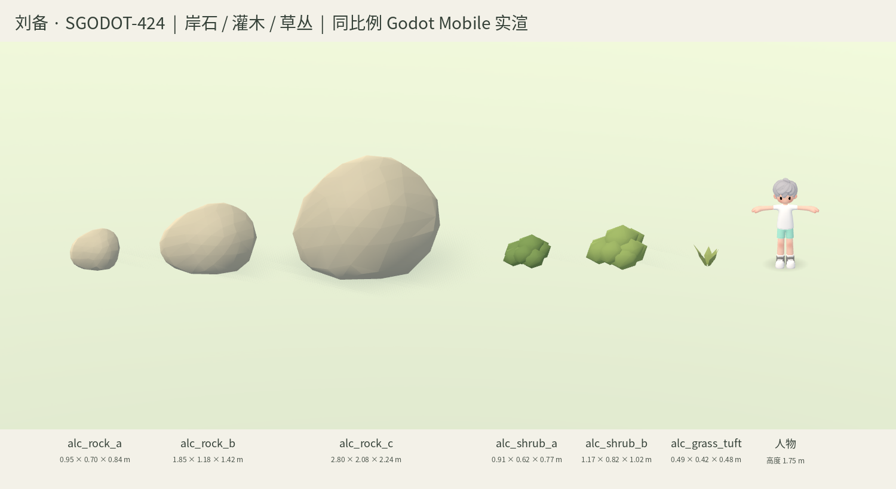
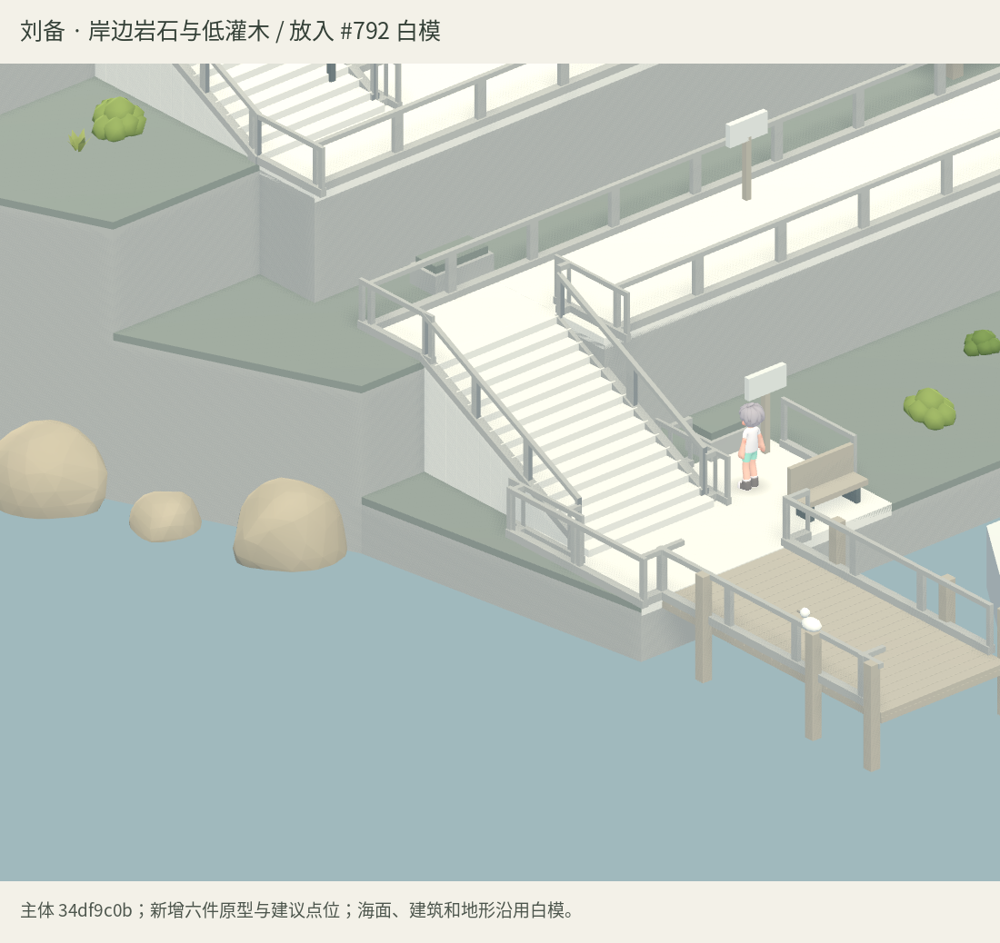
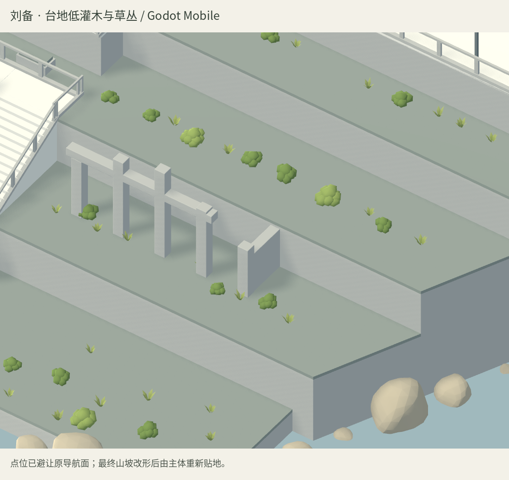
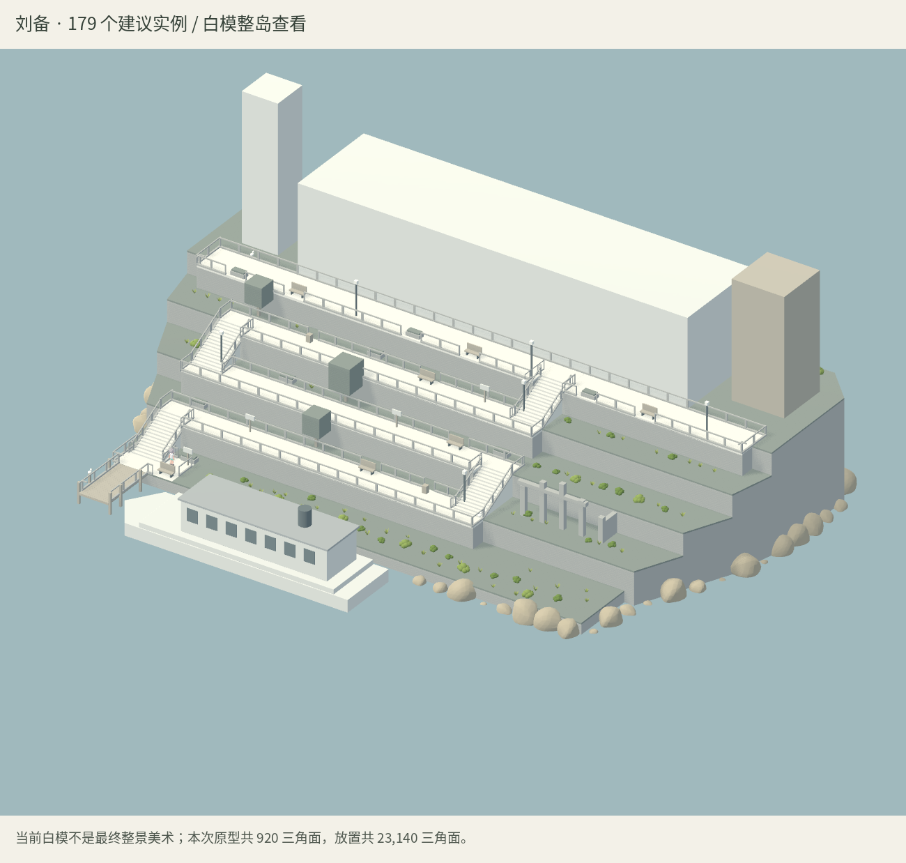
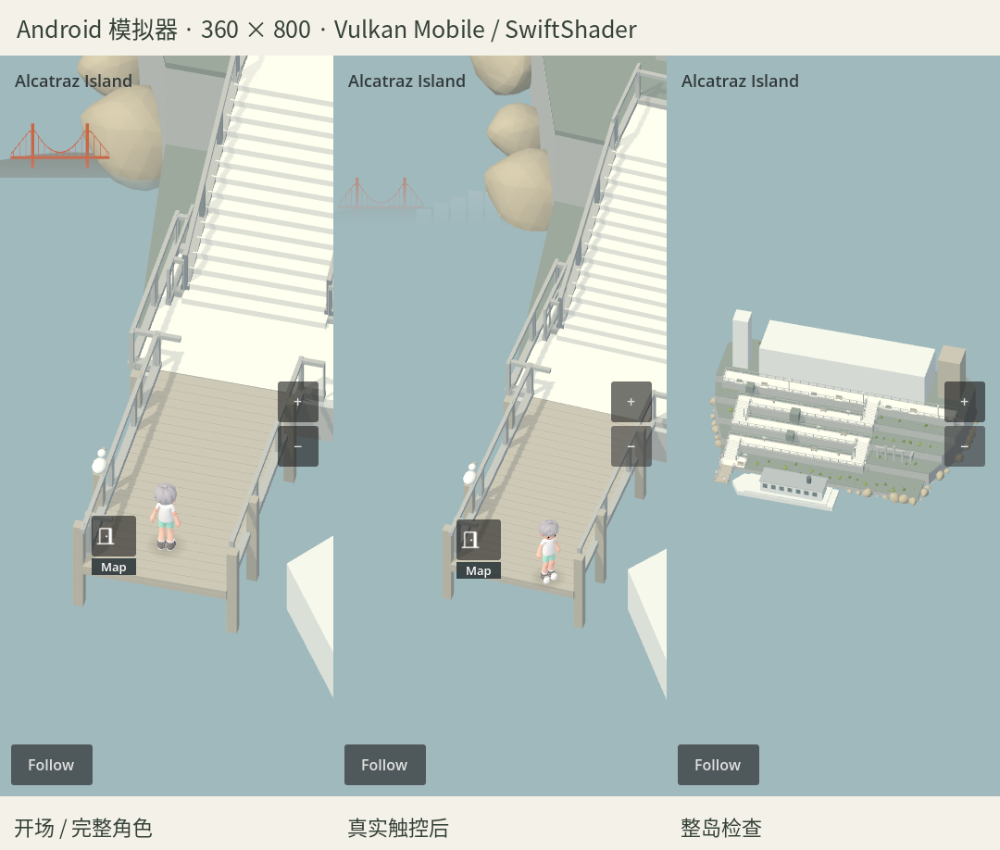

# SGODOT-424 · 恶魔岛岸石与草坡植被

刘备，2026-11-06。六件可复用资产交付给马可波罗接入 #792，技术检查交上官婉儿、画面验收交不知火舞，验收后由奕星合并。

| GLB | 宽 × 高 × 深（m） | 三角面 | surface | 用途 |
|---|---|---:|---:|---|
| alc_rock_a | 0.95 × 0.70 × 0.84 | 180 | 1 | 小号圆钝岸石 |
| alc_rock_b | 1.85 × 1.18 × 1.42 | 180 | 1 | 中号宽肩岸石 |
| alc_rock_c | 2.80 × 2.08 × 2.24 | 180 | 1 | 大号岸石 |
| alc_shrub_a | 0.912 × 0.621 × 0.773 | 140 | 1 | 深绿低灌木 |
| alc_shrub_b | 1.168 × 0.820 × 1.021 | 180 | 1 | 偏黄绿低灌木 |
| alc_grass_tuft | 0.494 × 0.418 × 0.484 | 60 | 1 | 六片折叶草丛，含背面 |

六件共 **920 个独立三角面**，GLB 共 99,496 字节。颜色采用浅灰褐岩石、深绿和偏黄绿植被，柔和哑光；细节用顶点色表达，不使用草地照片或透明叶片。

## 接入

资产在 `assets/landmarks/alcatraz_island/`。保留六个 Godot 生成的 `.glb.import` 和 **`alc_nature_material.tres`**：它们通过同名材质子资源绑定，启用 `vertex_color_use_as_albedo`、roughness 0.94、metallic 0、specular 0.15。直接拖入 GLB 或把导入网格放入 MultiMesh 都沿用此材质。不要用白模统一材质覆盖这些网格，否则会丢失正确的颜色或哑光参数。无外部贴图、动画、骨骼及额外 shader。

米制、Y 向上、+Z 为南/码头；每件原点为底面与水平包围盒中心，网格变换为单位矩阵。材质不透明、常规背面剔除；草叶显式包含背面，总面数仍为 60。建议实例不带碰撞或交互，预览中关闭投影。

`alc_nature_placements.json` 为独立建议文件，**179 个点、23,140 个放置三角面**：岩石 14 / 23 / 23，灌木 38 / 18，草丛 63。点位 owner 均为刘备；预览按 zone × asset 合为 12 个 MultiMesh。请与主体已有的占位点对照后合并一次，避免叠加两套。原 `layout.json`、`placement_points.json`、导航和主体材质没有在本分支修改。

点位基于马可波罗白模提交 **34df9c0b6af42a85567dfb5318c6717f929a4ab8**：海面 Y=-0.15，岸石底部放在 Y=-0.62 嵌入岛脚；植被根部在相应台地面下 0.01–0.035 m。码头/渡船湾和原导航面保持净空。当前地形仍是白模台地；最终山坡改形后，需要重新投射落点、检查坡面贴合与远近密度。

## 验证

- 实际 GLB 结构、三角面、法线、非退化三角形、材质和原导航面避让：[430 项通过](asset-validation.json)。
- Godot 实际导入的单网格/单 surface、尺寸原点、材质和唯一 UID：[66 项通过](import-validation.json)。
- 重新打开 Blender 源文件，六个 collection 的命名零件、面数与尺寸均对应导出：[源文件验证](source-validation.json)。
- Godot 4.7.2 / Vulkan Mobile，Steam Deck AMD VANGOGH，7 张实际渲染截图通过尺寸和角色检查：[渲染记录](render-validation.json)。并排图人物按实际完整模型包围盒缩放为 **1.75 m**；场景图人物保留白模默认尺寸。
- 白模海边视图 31 次可见 draw / 45,424 primitives；整岛视图 49 / 55,904。这是当前白模加角色及本次实例的单帧可见统计，包含主体成本；不是六件原型独有成本，也不是手机性能结论。主体和其他成员资产合入后由整景重新测量。

Android API 37 / SwiftShader 软件模拟器、360×800 下，六件资产、整岛与完整人物显示正常；真实点击行走、拖拽镜头及缩放按钮通过。**双指缩放未通过**：100→150 px 与 120→300 px 两种对称手势均未观察到 zoom 改变；保留失败记录，交主体/程序继续检查原白模输入。此项未通过不能算作完整交互验收，也不涉及本次模型或材质修改。[Android 记录](android-validation.json) 中 `passed=false`、`asset_render_smoke_passed=true` 分开表达这两项。

已完整回读安装 APK，并将其中六件导入网格和共享材质重新加载进 Godot，解码几何数组哈希、面数、原点、材质和 UID 全部与本地一致，见 [导出内容记录](package-validation.json) 及 [包内资源检查](package-import-validation.json)。测试由仓库 runner 启停，结束后停止 QA app、删除临时触控 dex、恢复模拟器原 720×1280 显示。未测物理手机性能。

原始帧内容未修图；审阅图只在画面外添加标题与说明。白模建筑、地形、海面保持主体版本，背景未代表最终整景美术。

## 来源与复现

已查看用户提供的 `landmark_alcatraz_v2.jpg` 和 `c_alc2.png`；原件、固定白模 layout、哈希和建模推定保存在 [源目录](../../../tools/art/source/alcatraz_nature_424/README.md)。可编辑 `.blend`、确定性生成脚本、导入配置与隔离审阅工具一并提交。

分支 `wp-3d-scene-liubei-alcatraz-rocks` 从 `origin/wp-3d-scene` 的 `aa5ad868` 新建，交付前同步至 `4b1902a4`，PR 目标 `wp-3d-scene`。此交付为资产草稿评审，尚待双审。
