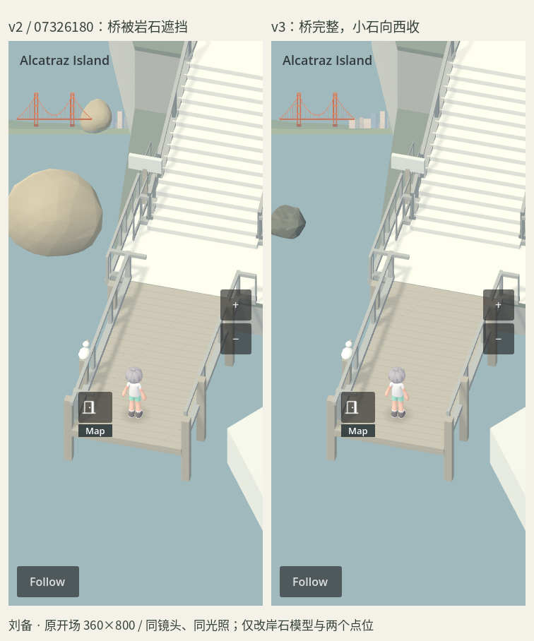
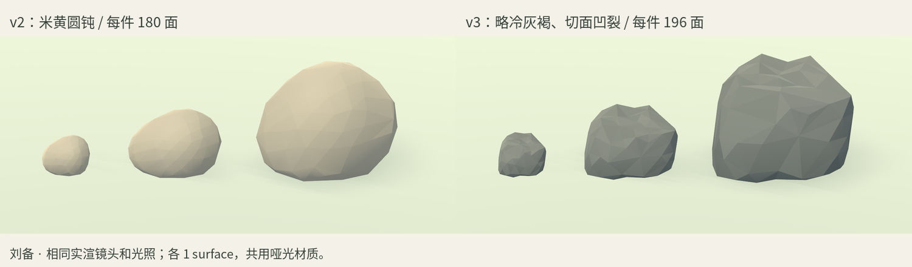
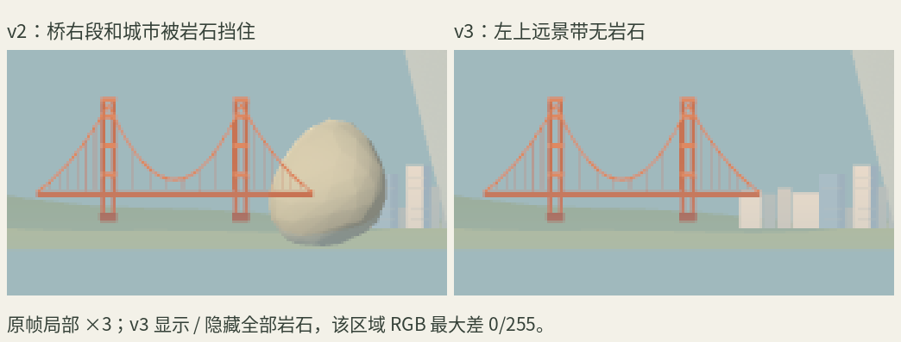
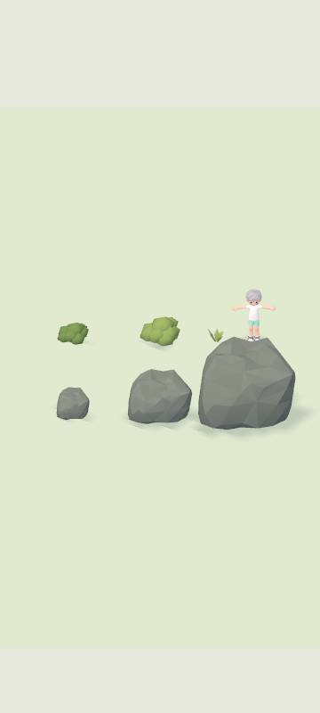

# SGODOT-424 · 恶魔岛岸石与草坡植被

刘备，2026-11-06，**v3 岸石修订**。按不知火舞评论 `cb1485c4` 和上官婉儿后续派活调整三款岸石及两个开场点位；#792 白模固定为 `b16c31982f34a64cdd4f9c6683064edbf20837a0`。交上官婉儿技术审、不知火舞画面审，奕星合并；PR #801 保持草稿待复核。

三款岩石从偏米黄的圆钝形改为略冷灰褐，保留原尺寸，增加截肩切面、棱角和两条凹裂带。色板为 sRGB **stone #777A75 / light #93958B / shade #515B59**，写入 GLB 前转换为线性顶点色；法线平滑混合由 50% 降到 12%，让裂面在暖光下可读。共享材质不变：roughness 0.94、metallic 0、specular 0.15。

| GLB | 宽 × 高 × 深（m） | 三角面 | surface |
|---|---|---:|---:|
| alc_rock_a | 0.95 × 0.70 × 0.84 | 196 | 1 |
| alc_rock_b | 1.85 × 1.18 × 1.42 | 196 | 1 |
| alc_rock_c | 2.80 × 2.08 × 2.24 | 196 | 1 |
| alc_shrub | 0.912 × 0.621 × 0.773 | 140 | 1 |
| alc_shrub_b | 1.168 × 0.820 × 1.021 | 180 | 1 |
| alc_grass_tuft | 0.494 × 0.418 × 0.484 | 60 | 1 |

六件共 **968 个独立三角面 / 106,624 B GLB**。三件植物与 v2 `07326180` 完全相同，六件 `.glb.import` 及 UID 保持。无外部贴图、透明叶片、动画、骨骼或新增 shader。

## 点位修订与接入

资产、共享 `alc_nature_material.tres` 和 `alc_nature_placements.json` 在 `assets/landmarks/alcatraz_island/`。米制、Y 向上、+Z 南；原点为底面与水平包围盒中心，网格单位变换。导入配置已绑定顶点色材质，不要用白模统一材质覆盖它。

建议表仍覆盖 b16c3198 全部 **114 个 owner=刘备 占位**。按 `source_name` 一对一替换，**不要追加为第二套点位**，也不要同时使用首版179点建议表。v3 只在 v2 点位基础上变动两项：

| source_name（保留不改名） | v2 | v3 | 原因 |
|---|---|---|---|
| alc_rock_c_003 | alc_rock_c @ (-26.2,-0.35,11.5) | **alc_rock_a @ (-27,-0.35,11.5)** | 大石换小号并向西收，不占左边小半屏 |
| alc_rock_a_004 | alc_rock_a @ (-26.2,-0.35,7) | **alc_rock_a @ (-29.2,-0.35,8.5)** | 移出开场左上桥与城市带 |

旋转、缩放、分区均沿用主体。JSON 的 `adjustments` 以主体原记录为 before：c_003 的原始 X 是 -24.8，因此与上表 v2 的 -26.2 不同。最终实例为 rock_a 13、rock_b 12、rock_c 11、shrub 17、shrub_b 9、grass 52，仍 **9 个 MultiMesh 批次 / 14,176 个放置三角面**。

海面 Y=-0.15，岸石底 Y=-0.35。植物根部保留 0.035/0.01 m 嵌入；两款灌木和草丛保留原 8 m 视宽隐藏规则。各件无碰撞、无交互，关闭投影；全岛美术审阅显示全部自然件。正式坡面改形后需重新贴地。

默认开场保持出生 (-22,1,19)、俯角43° / yaw14.5° / 宽6.72 m，原光照、海面、远景、导航和主体文件未改。36 个岩石的实际变换包围盒全部避开屏幕左上 x=0..169、y=55..149 区域；显示/隐藏全部岩石的控制帧在该区 **RGB 最大差 0/255**。桥完整可见；左侧保留一枚小石。原生图：[360×800](default-opening-360x800.png)。

## v3 验证

- [418 项资产/导航检查](asset-validation.json)：实际 GLB 三角面、单 mesh/surface、法线、非退化面、材质、占位唯一替换和原可走面避让通过。
- [66 项 Godot 导入检查](import-validation.json)：实际导入网格、尺寸原点、材质、唯一 UID 通过。
- [Blender 源文件回开](source-validation.json)：六个 collection、命名可编辑零件、尺寸和导出面数一致。
- [78 个植物根点](placement-support-validation.json) 与真实地形贴合；[植物保留](geometry-preservation.json) 与 [主体/远景/水体保留](integration-preservation.json) 验证通过。
- [58 项实渲检查 / 8 帧](render-validation.json)：Godot 4.7.2 / Vulkan Mobile / Steam Deck AMD VANGOGH。包含六件与完整1.75 m人物、岸石近景、海边、台地、整岛、原开场和隐藏岩石控制帧。
- 原开场 28 visible draw / 44,084 primitives；海边30 / 43,568；整岛48 / 51,448。计数含当前白模和角色，不是六件独有成本或物理手机性能。正式整景合成后重测。

Android 本轮结果见 [v3 冒烟](android-v3-validation.json) 和 [APK 回读](package-v3-validation.json)：API37 / SwiftShader 软件模拟器，六件、完整人物、原开场及两次真实缩放按钮点击。未做完整导航/双指或物理手机性能验收。v1 的 [旧 Android 记录](android-validation.json) 和旧包记录仍保留为历史，其中双指失败不能算通过；当前 v3 不复用其验收结论。

原始帧不修图；对比图只做标注、拼版和明确注明的缩放裁切。白模建筑和环境不是最终整景上色。v2 历史可在 `07326180` 查看。

## 来源和复现

已读取用户实际设定 `landmark_alcatraz_v2.jpg` 与 `c_alc2.png`。可编辑 `.blend`、确定性生成器、参考原件及哈希、导入与审阅工具见 [源目录](../../../tools/art/source/alcatraz_nature_424/README.md)。没有修改主体运行用 layout、场景、导航、海面或其他成员资产。

分支 `wp-3d-scene-liubei-alcatraz-rocks`，目标 `wp-3d-scene`。本轮为 #801 增量；码头五件已独立交付 #821，不重复提交。
