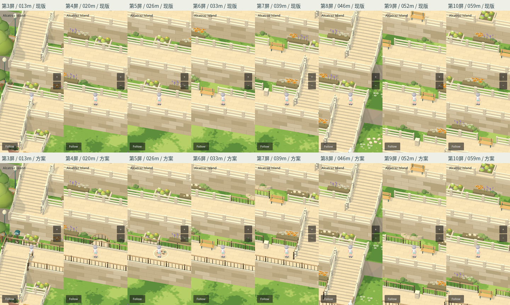
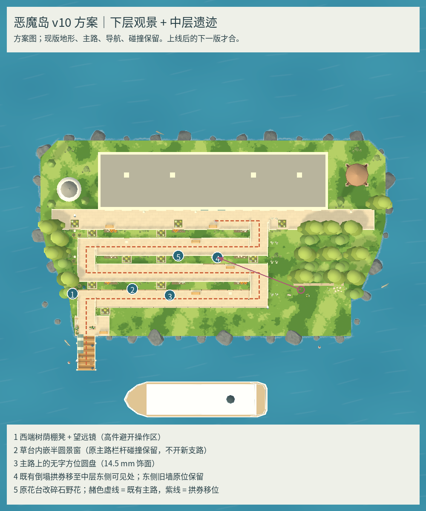

# SGODOT-433 · 恶魔岛 v10 台地主题方案

**当前方案见 [v2](v2/README.md)**：已合入带近远档新屋顶与观景台 v1.1 的 `4e2c401a`；主路全保留奶油石栏、花台用冰花厚垫占位、入口观景台朝西海湾外挑，新增低矮陈列并交完整 20 屏对照。以下为 `12286d65` 的第一版历史记录。

马可波罗。**仅交方案图，待上官婉儿／不知火舞审过再改正式文件；上线后的下一版才合，不影响 #834。** 分支 `wp-3d-scene-makeboluo-alcatraz-v10` 从当时最新 `origin/wp-3d-scene` 的 `05a2c032f88cc0d39caebca05bd79df98845fbbe` 新建。

本方案选下层（Y=3.25）和中层（Y=5.5）：下层沿海湾观景，中层展示遗迹。原地形体量、台阶、主路、导航、碰撞、出生点、出口和镜头均保留。



## 两层安排

**下层观景。** 西端放带棚长凳与朝海的望远镜，高件集中在左侧，避免上层回走时进入右下操作区。棚凳转 90° 朝步道，四个落脚点都落在现有草台，座椅／棚柱／棚顶与原有实体无交叠。中段嵌一座半圆景窗，沿原路再放无字方位圆盘。半圆台置于既有草台中，原主路栏杆仍在，不新增支路；圆盘为主路上的薄饰面，不带交互。

下层平直栏杆换成 SGODOT-431 的木扶手／金属栏杆造型，并保留原有碰撞体、长度与安装变换。中层拱券前另用几段相同的疏栏作为视窗。共 36 段外观替换，全部原碰撞形状和位置不变；这项外观试排只在隔离审阅脚本内执行。

**中层遗迹。** 把原东侧的无碰撞倒塌拱券单件从 `(15.3,3.25,5.95)` 移至中层路侧 `(.8,5.5,.35)`，保持原尺寸；原东侧主体旧墙留在原位。这样到原 `step-08-052m` 机位时，可从疏栏后看到完整弧形。两处原花台移去 12 簇重复花带，改放原有的低碎石和野花，花台体块保留。



| 点位 | 方案坐标（米，Y-up） | 说明 |
| --- | --- | --- |
| 带棚长凳 | `(-24.4,3.25,6.6)`，Y 转 90° | 西端原草台，朝路；不挡主路 |
| 投币望远镜 | `(-22.4,3.25,5.5)`，Y 转 180° | 镜头朝 +Z 海湾，装饰不可点 |
| 半圆景窗 | `(-14,3.135,5.8)` | 台面 Y=3.255，嵌入现有草台；两端各一根端柱 |
| 无字方位圆盘 | `(-7.5,3.28,6.95)`，Y 转 180° | Ø1.6 m，14.5 mm 厚，原路面上的饰面 |
| 倒塌拱券 | `(.8,5.5,.35)`，Y 转 0° | 原件等比 1，不改变几何；中层路侧可见 |
| 两处碎石／野花 | `(-6,5.8,.05)`、`(4.8,5.8,.05)` 附近 | 沿用原花台顶面，无碰撞装饰 |

完整增删／移位及栏杆段名见 [proposal.json](proposal.json)。方案参数不写入正式 `assets/landmarks/alcatraz_island/layout.json`。

## 审阅图

`comparisons/` 每张为两个**未缩放的 360×800 原图**并排，上方另加 40 px 标签；`before/`、`after/` 同名文件为独立原图。主要对照覆盖原 v9 实际步行采样 `step-02` 至 `step-11`（人读第 3–12 屏），包含要求的第 3–9 屏和相邻受影响画面。所有主对照使用原 43°、默认 zoom=1、6.72 m 视宽、同一角色点位。

- [第3屏／登台后的观景入口](comparisons/step-02-013m.png)
- [第4屏／半圆景窗](comparisons/step-03-020m.png)
- [第5屏／方位圆盘](comparisons/step-04-026m.png)
- [第6屏](comparisons/step-05-033m.png)、[第7屏](comparisons/step-06-039m.png)
- [第8屏／东侧转角](comparisons/step-07-046m.png)、[第9屏／拱券视窗](comparisons/step-08-052m.png)
- [第10屏／碎石花台](comparisons/step-09-059m.png)、[第11屏](comparisons/step-10-065m.png)、[第12屏](comparisons/step-11-072m.png)
- [西端补图](comparisons/02-entry-lookout.png)：使用现有缩放外拉 1.5 倍，单独标明；用来查看棚凳与望远镜关系，不冒充默认镜头。
- [开场控制图](comparisons/01-opening.png)：金门大桥仍可见。

俯视原图为 1000×1200，带编号图同尺寸；联系表 1440×860。所有审阅图长边 ≤1600 px。

12 张并排对照、1 张联系表和1张标注俯视图已以 `SGODOT-433-proposal-v1-` 前缀上传 SGODOT-433，全部下载后逐字节比对一致；见 [14 张回执](media-receipts.json)。独立 360×800 原图也保留在本目录。

## 固定取件来源

观景件按 #836 的 `1ac655fd7e42a031f1bf9f0a474166ce2aa5ef3f` 固定取件；该头的投币盒／扶手统一修订由黄忠完成。**这里只审摆位，正式接入取 #836 验收后的新头。** 取件来自 `assets/landmarks/_shared/street_kit/lookout_*` 与 `railing_endpost`，无改模或回写；[inputs.json](inputs.json) 记录 GLB 哈希。所有图形沿用源件，3D 中没有新增文字。

源件仅复制到 `output/alcatraz-v10-433/project/`，通过隔离别名供现有地标加载器读取。观景静态件和替换栏杆在审阅场景合成一个顶点色 surface；独立 GLB 与点位仍可复用。正式导入、MultiMesh／分区组织在方案批准后再接入。

## 检查与边界

- **176 个正式运行资源逐字节未变**，见 [preservation.json](preservation.json)。原 `.import`／UID、地形 GLB、导航与镜头文件均保留。
- 两次真实场景实例化的 **269 个碰撞形状／变换完全一致**。碰撞比较去掉 Godot 自动节点编号，比较实际形状顶点与世界变换；没有仅以文件未改代替运行检查。
- 新棚凳四足支撑高度均为 3.25 m；座椅、四柱及棚顶的物理查询无原有实体交叠。新增高件沿标注路线每约 0.5 m 采样，无操作区侵入；粗折线对既有花箱／树冠的候选重叠前后相同，原件未因这次方案移动。主对照机位采用已验 v9 的实际步行采样点，并通过默认 HUD 留白检查。
- 84 项记录检查通过。隔离方案总量 **132,236 三角／79 surfaces**（原版 121,010／78）；所拍机位峰值 **69,675 可见三角／55 全局 draw calls**。这是这些方案机位的桌面 Vulkan Mobile／RTX 2060 结果，不是全缩放扫描、vivo 帧率或上线验收。
- 原始帧计数、投影、粗路线候选及碰撞结果见 [verification.json](verification.json)。开场桥像素检查通过；移动拱券没有新增点击或功能。

## 复现

在本分支根目录，使用当前有效 DISPLAY／XAUTHORITY：

```sh
python3 tools/art/source/alcatraz_v10_433/prepare.py
flock ~/gs66-render.lock timeout 180s godot --headless --path output/alcatraz-v10-433/project --editor --import
flock ~/gs66-render.lock timeout 240s env ALCATRAZ_REVIEW="$PWD/output/alcatraz-v10-433/review" godot --path output/alcatraz-v10-433/project --rendering-method mobile --rendering-driver vulkan --display-driver x11 --resolution 360x800 --disable-vsync --max-fps 60
python3 tools/art/source/alcatraz_v10_433/package_review.py
```

运行前须能通过 git 读取上述固定组件头。所有 Godot 执行持 `~/gs66-render.lock`，采完即退出；本任务没有重建 Blender 或打开常驻编辑器。生产目录写回入口没有加入此方案工具。
