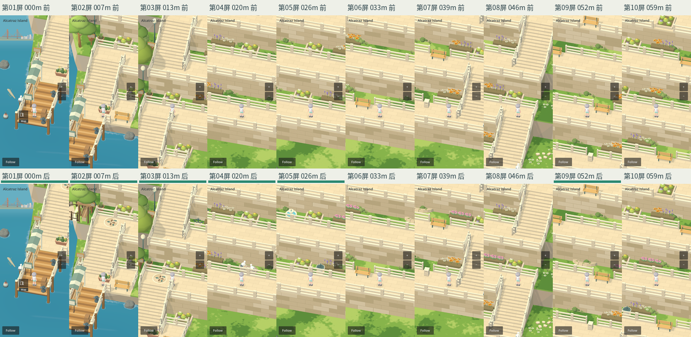
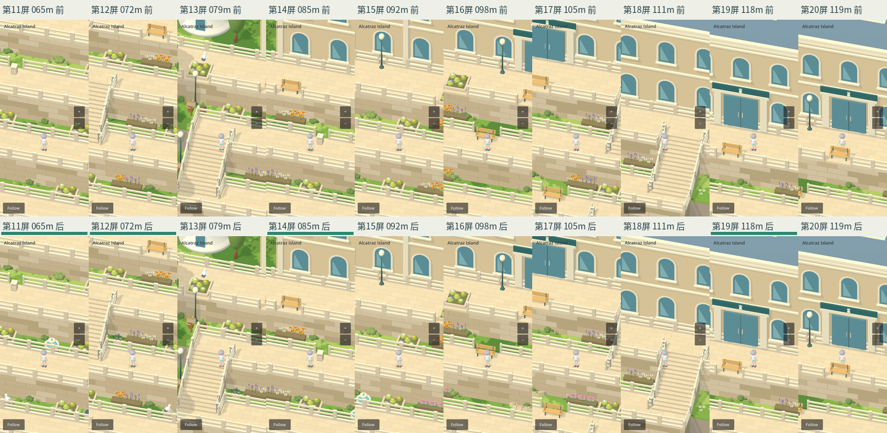
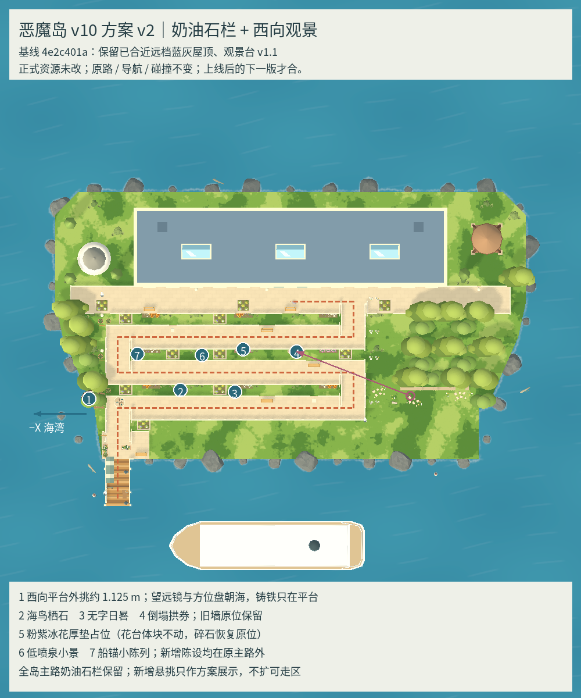

# SGODOT-433 · 恶魔岛 v10 方案 v2

马可波罗，#842 第二版。**仍只审方案图，审过再动正式文件；上线后的下一版才合，不影响 #834。** 已正常合入 `origin/wp-3d-scene` 的 `4e2c401acf7940638690362fbe40a5176b623506`，保留历史，没有 rebase 或强推。本版的“前”是这个新基线，不是旧米色屋顶。





## 五项修订

1. **主路奶油石栏全部保留。** 第一版 36 段深色栏杆替换全部取消。铸铁只在西侧入口观景台的半圆弧栏和两段短侧栏上出现，使用已合 #836 v1.1 的同色圆管；原主路石栏的网格、摆位和碰撞不变。
2. **花台恢复植物。** 第一版移入花台的碎石、零星野花恢复基线摆位；原花台体块不动。两处用粉紫厚垫冰花占位替换重复花带。占位按 #435 的粉紫／灰绿色板制作，后续换赵云验收件；不是把尚未验收的件冒充正式接入。
3. **更新屋顶和观景套件基线。** #835／#838 的灰蓝屋顶、三个天窗、两个加大的深色通风口及远档都保持新基线原字节。俯视图实际使用新版远档。#836 取已合入的 v1.1，投币盒和弧栏／直栏统一已包含。
4. **入口观景台向西海湾挑出。** 半圆台朝 −X，中心断面实测岸缘 X=-25.525，台外缘 X=-26.65，向海挑出 **约 1.125 m**。望远镜镜头和方位盘主箭头均朝 −X，已做向量检查。悬挑与连接片只做方案展示，未扩展可走区；角色仍在原主路，原导航与碰撞不改。
5. **增加独立看点。** 增加海鸟栖石、无字日晷，并用低喷泉和船锚小陈列补足中层节奏。完整 20 屏按下表计入 **10 屏独立焦点**；冰花另记为植物变化，同一正门或拱窗的重复画面不重复计数。



## 看点计数与默认机位

以下编号是 1–20；文件中的 `step-00` 对应第 1 屏。计数是对原生图的画面判断，供美术验收，不是仅凭物体坐标落入屏幕自动宣布通过。联系表下排绿线标记这 10 屏。

| 屏 | 原生对照 | 计入焦点 |
| --- | --- | --- |
| 1 | [step-00 / 000 m](comparisons/step-00-000m.png) | 渡轮、码头与远景金门大桥 |
| 2 | [step-01 / 007 m](comparisons/step-01-007m.png) | 登岸欢迎棚、码头陈设 |
| 3 | [step-02 / 013 m](comparisons/step-02-013m.png) | 向海方位盘、观景入口 |
| 4 | [step-03 / 020 m](comparisons/step-03-020m.png) | 两只静态海鸟栖石 |
| 5 | [step-04 / 026 m](comparisons/step-04-026m.png) | 无字日晷 |
| 9 | [step-08 / 052 m](comparisons/step-08-052m.png) | 路侧倒塌拱券 |
| 11 | [step-10 / 065 m](comparisons/step-10-065m.png) | 低喷泉小景 |
| 12 | [step-11 / 072 m](comparisons/step-11-072m.png) | 船锚小陈列 |
| 14 | [step-13 / 085 m](comparisons/step-13-085m.png) | 博物馆拱窗长廊 |
| 19 | [step-18 / 118 m](comparisons/step-18-118m.png) | 博物馆图形正门 |

其余 10 屏作为道路过渡、植物变化或同一地标的连续画面，不加计。逐屏数据在 [coverage.json](coverage.json)，所有 20 组对照在 `comparisons/`，独立原图在 `before/` 和 `after/`。每半幅都是未缩放的 **360×800**，默认 43°／zoom=1／6.72 m 视宽。并排图另加顶部标签，成图 720×840。

[入口补图](comparisons/02-entry-lookout.png) 使用现有镜头外拉 1.5 倍，明确单独标注，便于看西侧平台和朝向；不混入上述默认 20 屏计数。[开场控制图](comparisons/01-opening.png) 保留金门大桥视线。俯视 1000×1200，两张联系表各 1440×704，全部长边 ≤1600 px。

25 张交审图已以 `SGODOT-433-proposal-v2-` 前缀上传 SGODOT-433：20 组路线对照、2 张补充／控制对照、2 张联系表和1张标注俯视图。全部下载后逐字节比对一致，见 [回执](media-receipts.json)。

## 摆位与占位范围

米制 Y-up；西海湾为 −X。完整点位见 [proposal.json](proposal.json)。

| 陈设 | 位置 | 朝向／性质 |
| --- | --- | --- |
| 半圆台 | `(-25.65,3.13,6.3)` | Y 转 90°，台面 3.25；外缘 X=-26.65 |
| 连接片 | `(-25.35,3.13,6.3)` | 0.6×0.12×2 m，连接既有岸沿；只作展示 |
| 望远镜 | `(-26.35,3.255,6.5)` | Y 转 90°，镜头朝海；底座落在台面内 |
| 方位圆盘 | `(-21.8,3.28,6.75)` | Y 转 90°，主箭头朝海；水平缩放 0.9 适配原落脚处 |
| 带棚长凳 | `(-24.4,3.25,6.6)` | 沿用第一版已核支撑位，Y 转 90° |
| 海鸟栖石 | `(-14,3.25,5.25)` | 两只现有 gull 静态复用；不乱飞、不可点 |
| 日晷 | `(-7.1,3.25,5.47)` | 只有刻线与三角晷针，无文字／数字 |
| 低喷泉 | `(-11.25,5.5,.75)` | 不透明哑光蓝水面及静态水线，占位无功能 |
| 船锚陈列 | `(-19.5,5.5,.65)` | 低矮海事陈列，无文字／交互 |
| 冰花厚垫 | 两个原花台，Y=5.8 | 粉紫厚垫占位，原花台和原碰撞均保留 |

观景台用合入基线的共享件；海鸟直接复用现有模型。鸟栖石、日晷、喷泉、船锚、连接片和冰花是可重建的命名 Blender 方案样件，全部生成到 `output/`，没有新增正式 GLB。正式资源仍待方案审批及对应组件验收。

## 验证与预算

- **224 个正式运行资源逐字节等于 `4e2c401a`**，包含恶魔岛、共享 street_kit 和场景脚本。近档屋顶 SHA `ff853c97…`、远档 `4cc97a8d…`，见 [preservation.json](preservation.json)。
- **269 个实际碰撞形状／世界变换一致**；主路石栏替换数为 0。原导航、路线、出生／出口、镜头和花台体块不变。
- 棚凳四足支撑与净空通过；观景台、望远镜、方位盘均朝西，外挑实测 1.125 m；望远镜底座位于台面内。新增鸟栖石、日晷、喷泉与船锚的占地均避开原导航。
- 新增高件（棚架、望远镜）沿约 0.5 m 路线采样无新增操作区侵入；20 个默认机位通过既有 HUD 留白与背景检查，开场桥像素检查通过。粗折线对原有花箱／树冠的候选重叠前后相同，原件未被这轮修改。
- **153 项记录检查通过**。隔离方案总量 **138,701 三角／79 surfaces**，所拍机位峰值 **78,082 可见三角／57 全局 draw calls**。基线总量 121,932／78。详情见 [verification.json](verification.json)。
- Godot 4.7.2、Blender 5.2.2、gs66 RTX 2060 / Vulkan Mobile。结果限于这些方案机位，不替代全缩放或 vivo 帧率验收。所有 Godot／Blender 均持共享 `~/gs66-render.lock`，完成后退出。

## 复现

```sh
flock ~/gs66-render.lock blender --background --threads 3 --python-exit-code 1 --python "$PWD/tools/art/source/alcatraz_v10_433/build_prototypes.py"
python3 tools/art/source/alcatraz_v10_433/prepare.py
flock ~/gs66-render.lock timeout 180s godot --headless --path output/alcatraz-v10-433/v2/project --editor --import
flock ~/gs66-render.lock timeout 240s env ALCATRAZ_REVIEW="$PWD/output/alcatraz-v10-433/v2/review" godot --path output/alcatraz-v10-433/v2/project --rendering-method mobile --rendering-driver vulkan --display-driver x11 --resolution 360x800 --disable-vsync --max-fps 60
python3 tools/art/source/alcatraz_v10_433/package_review.py
```

使用当前有效 DISPLAY／XAUTHORITY。`output/.../v2/prototypes/proposal_props.blend` 保留每个样件的命名部件，生成脚本是可复现源。第一版记录在上级目录，当前工具不把方案写回生产目录。
