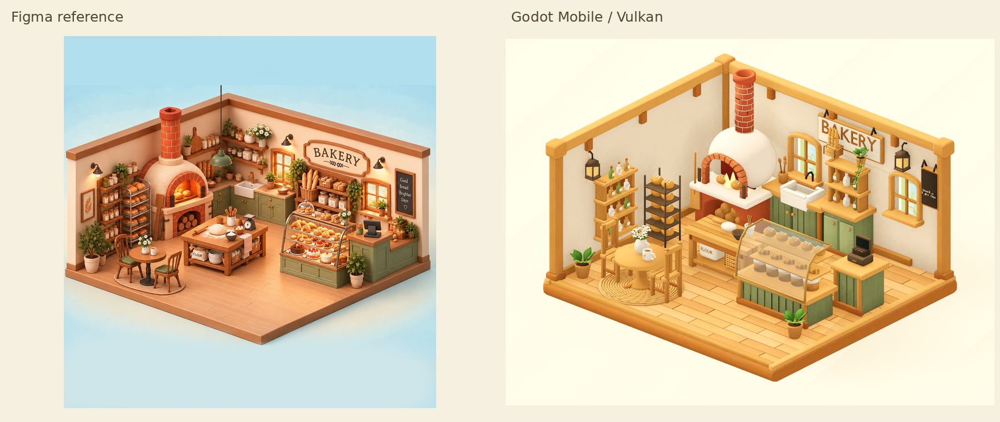

# Bakery · art review candidate

Plane [SGODOT-175](https://plane.sensenjoy.cn/zili/browse/SGODOT-175), owner Zhao Yun / 赵云. **In Progress, awaiting user review.** Produced 2026-10-07 under the user's request to proceed sequentially overnight and send each scene through Lark CLI.

Reference: Figma file `OMLTC3yw3u2WDjOZhLnhaR`, node [545:2964](https://www.figma.com/design/OMLTC3yw3u2WDjOZhLnhaR/Gensen--US-?node-id=545-2964). The [original export](reference.png) was downloaded and visually inspected before modeling.



A warm bakery with a genuine cut-out domed masonry oven and open chimney, brick arch, recessed wood store and visible flame; tray rack and ingredient jars; sink and wall windows; kneading bench with dough, rolling pin and flour sack; curved transparent pastry case with three shelves; separate register counter; and a small round café table. BAKERY, FLOUR and Good Bread / Brighter Days preserve the source English wording.

## Deliverables

- [Editable Blender model](../../../tools/art/source/bakery/bakery.blend), with named objects and module collections.
- [Deterministic scene generator](../../../tools/art/build_bakery.py), using the [room pipeline](../../../tools/art/scene_room_pipeline.py).
- [GLB placement and collision manifest](../../../assets/rooms/bakery/layout.json), individual local pivots and a shared external base-color/contact-AO atlas.
- [Reusable Godot art scene](../../../scenes/bakery/bakery_art.tscn), without gameplay/account/network dependencies.
- [Whole-scene runtime image](godot.png), [model orthographic views](orthographic-sheet.png), [budget and verification hashes](verification-summary.json).

## Reconstruction and contract

```sh
blender --background --factory-startup --python "$PWD/tools/art/build_bakery.py" -- --views
python3 tools/art/prepare_room_review.py bakery
godot --headless --editor --path output/bakery-2026-10-07/godot-project --import --quit
godot --path output/bakery-2026-10-07/godot-project \
  --script res://tools/art/review_room.gd -- bakery \
  "$PWD/output/bakery-2026-10-07"
```

Use the actual host display for rendering. Blender 5.2.0 LTS and Godot 4.7.2 were used here. `--geometry-only` skips bake/export. Rebuilding replaces this scene's `.blend`; preserve manual edits deliberately. Source assets from Basic Room remain read-only.

Coordinates are metres, Godot Y-up/front +Z and Blender `(x,-z,y)`. Modules export about their own floor/mounting pivot; placement is in the manifest. The baked atlas contains procedural surface detail and softened contact AO, with live runtime sunlight. Rebake after major rearrangement. Raw GLBs must bind this atlas. Triangulation occurs before UV bake/export to keep surface interpolation consistent, and empty atlas gutters are extended before mip generation.

## Validation and budget

Actual Godot **Mobile / Vulkan**, AMD Custom GPU 0405 (RADV VANGOGH), 1440×1080. 42 meshes have atlas materials and finite nonempty bounds; 14 simple collision shapes are present. The imported triangle count matches the export manifest.

| Metric | Measured |
|---|---:|
| Unique GLBs / placed instances | 41 / 42 |
| Unique / placed triangles | 119,848 / 121,144 |
| Static surfaces | 42 |
| GLB bytes combined | 5,482,500 |
| Atlas source PNG bytes | 2,776,542 |
| Shared atlas | 2048 × 2048 |

Texture imports enable mipmaps and VRAM compression. Fine geometry keeps uncompressed vertices and disables automatic mesh LODs. Static surface counts exclude renderer shadow passes; PNG bytes are not GPU memory. No physical-phone performance measurement is claimed.

## Inferences and differences

The 7.2 × 6.4m floor, hidden construction and all dimensions are inferred. Brickwork and bread scoring are simplified; croissants and cakes use readable stylized forms instead of the exact pastry assortment. The shelving is less crowded, curtain/lighting embellishments are reduced, and the menu font differs. The source does not define an entrance, so the open presentation side is retained rather than inventing a visible door. Godot uses one deliberate transparent glazing material; the original image has more complex reflections and warm bounce light.

The oven has a real arched cavity and a shallow dark lining positioned for the review angle. Counters, rack and furniture have simple collision boxes; decorative pastry, glass and tools do not introduce gameplay collision.

This is an art-only candidate awaiting review. No gameplay/map integration, avatar benchmark, Android QA, production build, migration or release is included.
