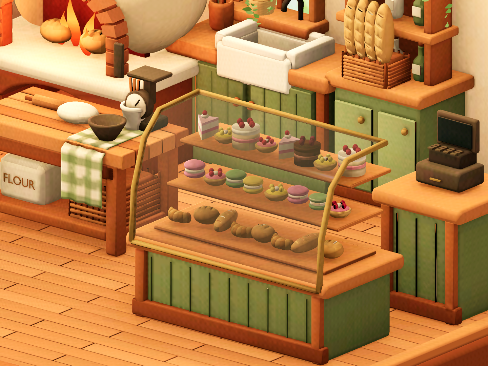

# SGODOT-175 · R2.1 finishing review

赵云已补齐实际 Godot Mobile/Vulkan 整景、特写、固定取色、34/34角色检查和新的15秒原速走位录像。当前完整交付入口：[Bakery R2.1](../bakery-2026-10-07/README.md)。

三层共24件/11个命名原型：下层可颂、面包与长棍；中层三色马卡龙、草莓/柠檬挞；上层白粉蛋糕切块、奶油草莓蛋糕与挞。白掌移到收银柜右侧；旧白色浮条改为实际浅凹槽。预算181,235总面/31,154植物面/40surface，固定取色色相差均≤10°。

[源模型审计](source-audit.json)保留不同层次、凹槽内壁和主机位植物/柜体投影分离的检查；[早期无界面导入检查](local-runtime-contract.json)是辅助记录，最终实渲证据以上述主入口为准。此前的Blender CPU预览仍保留为建模过程记录，不当作Godot画面。
