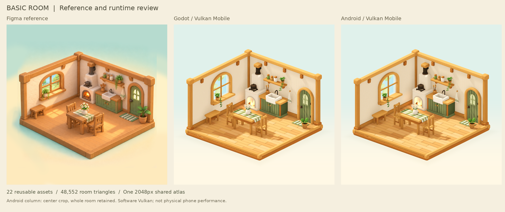

# Basic Room: Blender assets and Godot benchmark

The user accepted this asset iteration on **2026-10-06** and requested a commit/push and an English production guide for other agents. Read the [mobile 3D asset workflow](../mobile-3d-asset-workflow.md) for reusable methods and troubleshooting.

For a new machine, first follow [Art environment setup](../art-environment-setup.md) to install tools and verify Figma/Lark access before using the reproduction commands below.

The requested reference is Figma `Scene_design → Basic Room-1 1`, node [3:4550](https://www.figma.com/design/5SVgfevrLzZXqD83uyPgmV/Gensen_US_2026?node-id=3-4550). The [retained reference](reference.png) is a 2561 × 2561 node export. This work supplies room art and an offline movement benchmark; it does not implement online housing assignment, cooking settlement or a production release.

## Review evidence



The Android panel is a center crop retaining the complete room. [Orthographic views](orthographic-sheet.png) come from the actual Blender geometry. The committed [verification summary](verification-summary.json) retains test results, asset hashes and delivery verification. Full logs, APKs and recordings remain under ignored `output/basic-room-2026-10-06/`; they are not automatically available in a fresh checkout.

## Entry points

- Editable source: [basic_room.blend](../../../tools/art/source/basic_room/basic_room.blend).
- Modeling, baking and export: [build_basic_room.py](../../../tools/art/build_basic_room.py).
- Reusable room: [basic_room_art.tscn](../../../scenes/basic_room/basic_room_art.tscn). It assembles art and collisions without account, network or save dependencies.
- Character/movement benchmark: [basic_room.tscn](../../../tools/dev/basic_room/basic_room.tscn).
- Offline launcher: [open_basic_room.sh](../../../tools/dev/open_basic_room.sh).
- Runtime meshes, texture, placement and collision data: [asset directory](../../../assets/rooms/basic_room/).
- Validation and environment limitations: [QA report](../../qa/basic-room-2026-10-06.md).

## Reconstruction

The room retains the two-wall cutaway layout: an arched window and bench on the left; stove, pot, sink cabinet, pantry shelf, towel and green door at the back; a central table with two chairs, gingham runner and daisy jug; and plants at the window, shelf and entrance.

Blender geometry supplies the real wall/window apertures, recessed firebox and sink, beveled timber, staggered floorboards, chair slats, handles, faucet, cloth folds, leaves and petals. An original painted landscape card sits behind the window without casting shadows. No image-2 generation was used. Front, side and top checks were rendered from the actual model.

The reference supplies no dimensions or back views. The approximately 6.2m internal width, inferred thicknesses/backs and 0.21m player capsule radius provide walking routes around furniture. Plant shapes, outdoor scenery, material grain and soft-light transitions still differ. Art acceptance is not a claim of pixel-identical reconstruction or physical-phone performance.

## Modules and reuse

| Category | GLB modules |
|---|---|
| Architecture | `room_shell`, `window_wall`, `back_wall`, `arched_window`, `window_garden`, `green_door` |
| Hearth and kitchen | `hearth`, `kettle`, `fire`, `sink_cabinet`, `utensil_crock`, `wall_shelf`, `hanging_towel` |
| Furniture and textiles | `dining_table`, `checked_runner`, `chair`, `bench`, `entry_mat` |
| Plants and small props | `window_plant`, `shelf_plant`, `floor_plant`, `daisy_jug` |

There are 22 assets and 23 placed instances. The second chair shares the first chair's GLB and atlas. Modules use their own floor/mounting pivots, metres and Godot Y-up. Placement and yaw remain in `layout.json`. Named source parts remain editable in Blender; runtime exports merge each module into one surface.

The atlas contains base color, wood/plaster detail and static contact AO, not direct sunlight. Rebake after substantial layout changes to avoid stale contact shading. `basic_room_art.gd` binds the shared material; raw GLBs loaded separately also need `room_albedo_ao.png`. The window scenery uses an unshaded two-sided material without shadow casting; the flame uses an emissive variant.

## Asset budget

| Metric | Current value |
|---|---:|
| Unique triangles | 47,256 |
| Placed room triangles | 48,552, including the reused chair; excluding avatar/shadow repeats |
| Static surfaces | 23 |
| Shared color + AO atlas | 2048 × 2048, mipmapped and VRAM-compressed |
| Combined GLBs | 1,712,708 bytes |
| Atlas PNG | 3,397,744 bytes; not its GPU residency |
| Lighting | One shadowed directional light, one small unshadowed hearth light, ambient color |

The benchmark uses 2048 directional shadows and MSAA 4×. It does not need runtime SSAO, real-time GI, SSR, depth of field or particles. Bevels and weighted normals provide soft edges. These are implementation choices, not universal scene budgets; runtime measurements are in the QA report.

## Controls and isolation

Desktop supports WASD/arrow keys, floating drag joystick and wheel zoom. Android supports the floating joystick, pinch zoom and double-tap recentering. The joystick uses 260/120px outer/inner diameters at a 1080px reference width. Movement is camera-relative, slides against furniture and stops on release/focus loss. The camera uses safe-frame following and a 0.4s recenter transition.

`View` toggles the character-free reference view, `Reset` restores spawn/framing, and `Stats` shows diagnostics. Desktop F1 hides the HUD; V/R/C toggle the view, reset and restore whole-room framing.

The benchmark reuses AvatarRig, the default fixture outfit and idle/run clips. Only the Avatar autoload is enabled in the isolated project. It does not load or change saved appearance, identity, farm or inventory. Android uses `com.sensen.basicroomqa`.

## Rebuild and desktop checks

Prerequisites: Godot 4.7.2 with matching export templates; Blender 5.2 for source rebuilds. Run from the repository root with commands on `PATH`.

```sh
mkdir -p output/basic-room-2026-10-06
touch output/.gdignore
blender --background --factory-startup --python "$PWD/tools/art/build_basic_room.py"
godot --headless --editor --path . --import --quit
godot --headless --path . --script res://tools/dev/basic_room/collect_avatar_deps.gd
python3 tools/dev/basic_room/prepare_basic_room.py
godot --headless --editor --path output/basic-room-2026-10-06/qa-project --import --quit
godot --headless --path output/basic-room-2026-10-06/qa-project --script res://tools/dev/basic_room/configure_imports.gd
godot --headless --editor --path output/basic-room-2026-10-06/qa-project --import --quit
```

The full generator recreates the source file. Preserve manual changes before rebuilding, or use `--bake-only` with the expected source structure. Flatpak Blender may change the working directory; use an absolute script path. `.gdignore` files keep editable sources/generated QA projects out of the parent import/class scan.

With a working desktop display:

```sh
tools/dev/open_basic_room.sh
godot --path output/basic-room-2026-10-06/qa-project --resolution 700x700 \
  --script res://tools/dev/basic_room/test_basic_room.gd
```

Do not use headless results to judge visibility-dependent animation. For a 1600px reference image, use the benchmark's SubViewport to avoid desktop window-size limits:

```sh
godot --path output/basic-room-2026-10-06/qa-project --resolution 700x700 -- \
  --beauty --no-hud --capture-square \
  --capture "$PWD/output/basic-room-2026-10-06/godot-beauty-final.png"
```

## Android reproduction

Use the current machine's SDK/JDK paths. This case used JDK 21, build-tools/platform 36 and an API 35 x86_64 AVD named `Sensen_BasicRoom_API35`. Configure Godot's SDK/JDK paths and `export/android/shutdown_adb_on_exit=false`. The wrapper uses private ADB port 5061; reserve appropriate free ports when adapting this setup.

```sh
ROOM_SDK="${BASIC_ROOM_SDK:-$HOME/Android/Sdk}"
ROOM_JDK="${JAVA_HOME:-$HOME/.local/opt/jdk-21}"
export BASIC_ROOM_SDK="$ROOM_SDK"
python3 -m venv output/basic-room-2026-10-06/venv
output/basic-room-2026-10-06/venv/bin/pip install pillow numpy
mkdir -p output/basic-room-2026-10-06/touch/classes output/basic-room-2026-10-06/touch/dex
"$ROOM_JDK/bin/javac" -source 8 -target 8 -Xlint:-options \
  -cp "$ROOM_SDK/platforms/android-36/android.jar" \
  -d output/basic-room-2026-10-06/touch/classes tools/dev/basic_room/RoomTouch.java
PATH="$ROOM_JDK/bin:$PATH" "$ROOM_SDK/build-tools/36.0.0/d8" \
  --lib "$ROOM_SDK/platforms/android-36/android.jar" \
  --output output/basic-room-2026-10-06/touch/dex \
  output/basic-room-2026-10-06/touch/classes/RoomTouch.class
godot --headless --path output/basic-room-2026-10-06/qa-project \
  --export-debug 'Android Basic Room QA' "$PWD/output/basic-room-2026-10-06/basic-room-qa.apk"
```

Start the isolated AVD with the validated software backend. This reproduces the local graphics workaround; it is not a universal recommendation to disable hardware acceleration.

```sh
ANDROID_ADB_SERVER_PORT=5061 "$ROOM_SDK/emulator/emulator" \
  -avd Sensen_BasicRoom_API35 -port 5588 -no-window -no-audio -no-boot-anim -no-snapshot \
  -gpu lavapipe -feature -VulkanNativeSwapchain -memory 3072 -cores 4 \
  > output/basic-room-2026-10-06/android-emulator.log 2>&1 &
tools/dev/basic_room/adb.sh -s emulator-5588 wait-for-device
tools/dev/basic_room/adb.sh -s emulator-5588 shell getprop sys.boot_completed
```

Wait until `sys.boot_completed` returns `1`, then install and run one managed scenario:

```sh
tools/dev/basic_room/adb.sh -s emulator-5588 install -r output/basic-room-2026-10-06/basic-room-qa.apk
tools/dev/basic_room/adb.sh -s emulator-5588 push \
  output/basic-room-2026-10-06/touch/dex/classes.dex /data/local/tmp/basic-room-touch.dex
ADB="$PWD/tools/dev/basic_room/adb.sh" tools/android/run_test.sh \
  --serial emulator-5588 com.sensen.basicroomqa -- \
  output/basic-room-2026-10-06/venv/bin/python tools/dev/basic_room/android_qa.py
```

The runner stops the test app on exit. Retain the emulator; remove the temporary touch dex after checking. The isolated project disables Swappy frame pacing and enables native Android scale gestures for the specific failures documented in the QA report.
