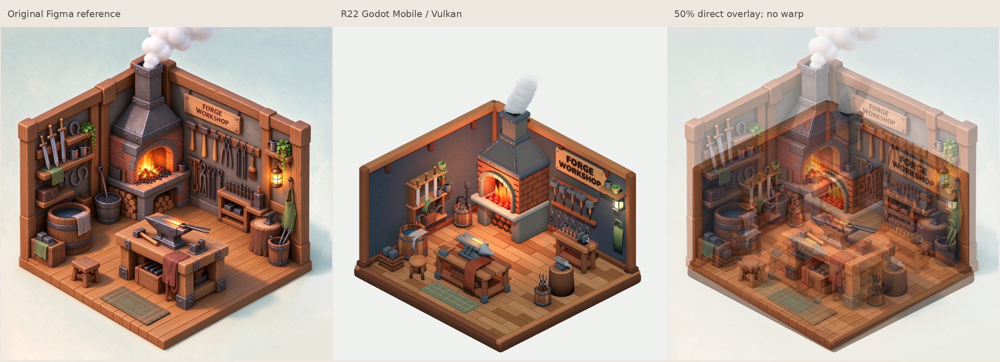

# Blacksmith Shop · Liu Bei R2.2 particle review candidate

[SGODOT-178](https://plane.sensenjoy.cn/zili/browse/SGODOT-178) · owner 刘备 · submitted for art-director **Review**, not Done. R2.1 static art was approved. This R2.2 replaces only displayed smoke and flame meshes with shared GPU particles, following the subsequent review request. Prior images named `godot.png` and `orthographic-sheet.png` are historical R1 media; use the R2.2 links below.

Reference: Figma `OMLTC3yw3u2WDjOZhLnhaR`, node 545:2965; [original export](reference.png), inspected at native resolution.



The accepted R2.1 furnace, chimney, cool walls, reddish timber and glowing coal bed remain. Displayed `fire.glb` / `smoke.glb` placements are removed; the old editable meshes and unused individual exports remain as authoring sources. Layout `effects` declares two reusable resources under [assets/rooms/_shared/fx](../../../assets/rooms/_shared/fx/README.md). The assembler instantiates their positions and parameters from the manifest.

Fire: 16 upward cartoon flame sprites, 0.72 s lifetime, shrinking/fading; four short-lived sparks. Smoke: 12 billboard clouds rendered from the accepted R2.1 volumes, 3.5 s lifetime, growth from 0.30 to 1.15 and late fade, rising to the same side. Full-lifetime preprocess fills the plume on entry. All 32 particles use fixed_fps 30, explicit AABBs, no shadows/collision. Smoke is unlit; the orange/red fire has restrained emission. The existing forge OmniLight retains its node, transform, colour and range with smooth bounded ±8% modulation.

**Moving clips are the primary review evidence:** three 8 s real-time recordings (whole / fire / smoke) are attached to SGODOT-178 and delivered via Lark. [Beginning/middle/end frames](particles-video-timeline.jpg), [particle/render/light/clip records](particles-verification.json). The isolated shared-FX project passes 13 checks and has no room/game dependencies. The complete room passes 31 character checks.

**工作台未改动**：`back_tool_bench.glb`, `bench_vise.glb` and `room_albedo_ao.png` are byte-identical to delivered R2.1, confirmed against `fb5e0eb5`. [Hashes](workbench-r22-preservation.json). Only the export group containing old smoke is regrouped; no atlas bake or workbench UV change. SGODOT-231 consumers need no recopy for R2.2.

Three hammer and three tong source variants supply five wall hammers and six wall tongs. The workshop also has three swords, horseshoes, metal mugs, cloth, two crate sizes, a towel over the water barrel, a long coal shovel, corner-braced workbench, corrected tapered anvil horn, hot steel, bench tongs, vise, leather/green aprons and a checked gray-green mat. The FORGE WORKSHOP sign uses Nunito Black with 4 mm depth. Shared pothos plants retain the accepted library atlas.

Three unshadowed local lights cover the furnace, lantern and hot steel. Neutral sun and low ambient preserve gray walls; the forge contributes most of the warm light. On/off screenshots isolate the forge light alone at the anvil, main bench and floor; the lantern and hot-steel lights stay off in both controls. The furnace-to-mainbench aisle is 2.185 m, above 0.8 m. The route stops 0.81 m in front of the furnace mouth, above 0.5 m. Furnace, both benches, water barrel and stump block the avatar. The low stool intentionally has no blocking collision. Main worktop is 1.045 m above its floor pivot, rear worktop 0.9802 m (13.64% below Basic Room), and stool seat 0.6608 m. No human doorway is present in this open-front scene.

The accepted SGODOT-172 R2.1 editable structural meshes supply posts, beams, beam pegs/corbels, feet, skirting and plinth. Only spans and positions adapt to the existing room; cross sections and bevel modifiers are retained. The [reuse ledger](../../../tools/art/source/blacksmith_shop/structure-reuse.json) records source SHA-256, per-part dimensions/modifiers and retained/removed parts. Basic Room, 172 and the shared plant library remain read-only.

The orthographic camera fits three visible plinth edge intersections and an inferred fourth, following 172 R2. No geometry or comparison image is warped. [Camera evidence](camera-registration.png) / [fit data](camera-registration.json); residuals 12.42, 11.85, 13.37 px. Rounded reference edges are estimated intersections, not calibrated survey points.

| Budget | R2.2 |
|---|---:|
| Unique room modules / placed room modules | 44 / 50 |
| Unique room triangles | 80,866 |
| Placed triangles including all plants | 87,250 / 200,000 |
| All plants, including incidental room vegetation | 4,096 / 100,000 |
| Runtime static surfaces after grouping | 18 / 60 |
| Individual room GLB bytes | 3,229,820 |
| Room atlas | 2048 × 2048, base colour + contact AO; fire/smoke strips each 1024 × 256, spark 64 × 64 |

Particles add three draw surfaces; observed whole-scene render calls are 23, versus R2.1’s 21 (net +2 after removing one static flame draw).

Exported groups share material/atlas and preserve unmerged editable parts plus individual local-pivot GLBs. Small leaves do not cast shadows. Godot imports use mipmaps and VRAM compression. Source PNG/GLB bytes are not GPU memory; static surfaces exclude shadow passes and the avatar.

[Whole scene](godot-whole.png), [detail sheet](asset-details.jpg), [orthographic views](orthographic.png), [native-pixel sign check](signage-check.png), [colour patches](colour-patch-comparison.jpg), [local light controls](light-pool-controls.jpg), [budget/import verification](revision-verification.json), [character checks](bench-result.json), [video timeline](bench-video-timeline.jpg).

Actual checks run in Godot 4.7.2 **Mobile / Vulkan**, AMD Custom GPU 0405 / RADV VANGOGH, on this Linux host. Hero renders are 1400×1400. Rendered character/collision/input-fixture checks and a real-time 15 s viewport recording use the existing isolated shared harness; the shared core is unchanged. This is desktop evidence, not Android/physical-phone performance or production gameplay acceptance. No APK, phone install or save operation is included.

Differences retained for art-director review: The reference has taller walls relative to its floor, a different furnace/bench spacing and more elaborate metal surface highlights. The original room envelope and Basic Room furniture sizes remain; rigid floor-corner registration exposes the remaining height/composition difference instead of stretching the model. Smoke is a stylized billboard plume; animated visual acceptance remains pending this review. The wall remains slightly blue as noted in the nonblocking R2.1 feedback. No wall/atlas rebake was made during this particle-only revision. [Evaluated source-mesh height audit](dimensions-r2.json) independently measures every worktop and seat against the Basic Room baseline. Representative colour medians test corresponding physical surfaces; they do not establish complete-image fidelity. The R2 gray-wall colour test compared the reference wall below the warm lantern to a runtime point outside that pool. R2.1 retains the reference point and corrects the runtime point to the wall below the lantern; the former cold-wall measurement is retained in [sampling correction](wall-sampling-correction.json), including its failed 163.75-degree hue difference. Unlit walls remain cool gray rather than being warmed to satisfy that mismatched sample.

Editable source: [Blender](../../../tools/art/source/blacksmith_shop/blacksmith_shop.blend), [revision generator](../../../tools/art/source/blacksmith_shop/revision2.py), [layout](../../../assets/rooms/blacksmith_shop/layout.json), [Godot scene](../../../scenes/blacksmith_shop/blacksmith_shop_art.tscn). Coordinates are metres, Godot Y-up/front +Z; source Blender coordinates are `(x,-z,y)`.

```sh
blender -b -t 4 --python tools/art/build_blacksmith_shop.py
DISPLAY=:0 python tools/art/source/coffee_shop/render_r1.py r22 blacksmith_shop
DISPLAY=:0 python tools/art/source/coffee_shop/run_bench.py blacksmith_shop --record
DISPLAY=:0 output/art-tools/bin/python tools/art/source/tavern/light_controls.py blacksmith_shop r22
output/art-tools/bin/python tools/art/source/coffee_shop/package_series.py blacksmith_shop r22
output/art-tools/bin/python tools/art/source/coffee_shop/check_series_colour.py blacksmith_shop r22
output/art-tools/bin/python tools/art/source/coffee_shop/prepare_series_media.py blacksmith_shop r22
output/art-tools/bin/python tools/art/source/coffee_shop/package_r2_details.py blacksmith_shop r22
DISPLAY=:0 python tools/art/source/blacksmith_shop/record_particles.py
output/art-tools/bin/python tools/art/source/blacksmith_shop/package_particles.py
```

Use the host's working display; `-- --geometry-only` skips bake/export. Rebuild replaces this scene's source file. Review attachments and Lark media are hash-readback verified in [delivery record](delivery-verification.json) after sending.

SGODOT-236 remains **Todo** until this shared effect passes art-director review. Basic Room and farm-dev have not been changed; its standalone PR, <=20-particle configuration, emulator before/after median and 1% low FPS, and notification to 奕星 occur after that gate.
