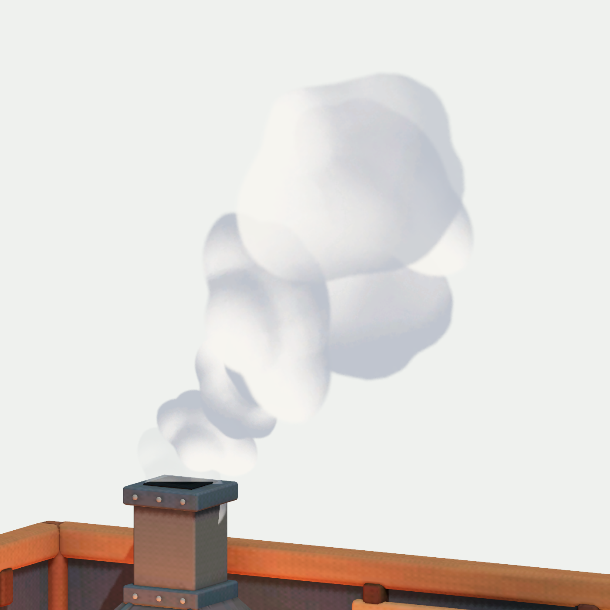

# SGODOT-178 smoke R2.5 — 2026-10-08

刘备 · submitted for art-director Review; user confirmation is still required for Done. This follows the 2026-10-08 02:17 UTC comment on SGODOT-178. Reference: Figma 545:2965, retained in the original blacksmith-shop review directory.

The only changed runtime resource is **assets/rooms/_shared/fx/smoke_strip.png**. Original R2.1 cloud-mesh render lighting is remapped into warm-white lit lobes and shallow cool-grey shadow sides. The four silhouettes retain the previous erosion/outline; the broad 4.5 px blur is reduced to 1.1 px. Measured average 10–90% alpha transition is **3.08–3.30 px**, or **3.86–5.27%** of equivalent cloud radius, below the requested ~10%.

## Actual rendered contrast

The existing ACES mapping lifts texture greys. Source endpoints are therefore compensated to (150,154,163) and (229,225,215), rather than assigning the requested display colours directly to albedo. No material multiplication, exposure, background, light or helper change is needed. Warm-white highlight sampling is approximately (246,245,240).

In the unchanged 1400 × 1400 closeup, the background median is **(239,241,238)**. Three marked 20 × 20 shadow patches measure:

| Patch | Median rendered RGB | Darker than background, encoded sRGB luma | Linear luminance reduction |
|---|---|---:|---:|
| Upper | 199, 202, 210 | 15.98% | 32.48% |
| Middle | 199, 202, 207 | 16.07% | 32.65% |
| Lower | 193, 197, 206 | 18.12% | 36.27% |

These are visible shadow patches, not an all-pixel or reference-fidelity score. Naturally fading final-life puffs are lighter. [Marked samples](contrast-sampling.png) · [Coordinates, formula results and feather measurements](contrast-verification.json). Individual lobe boundaries remain visible during the inspected clip; moving puffs still overlap under the unchanged simulation. The [350 px whole-scene thumbnail](whole-thumbnail.png) retains the plume silhouette.

## Preserved behaviour and resources

**工作台未改动**：back_tool_bench.glb, bench_vise.glb and room_albedo_ao.png are byte-identical to dfe6cbe0. All **106 other tracked runtime FX, blacksmith asset and blacksmith scene files** match both the pre-edit snapshot and dfe6cbe0. This includes approved fire, particle_style.gd, smoke scripts/scenes, layout, cameras, collisions and lighting. [Complete SHA-256 ledger](preservation.json).

Parameters are byte-identical: **8 smoke puffs**, 4 s lifetime, 1.2→2.6 m size, ±25% size randomness, 15° spread, existing drift/wind, random rotation/four-frame selection, and opacity held through 62%. Total **16 flames + 4 sparks + 8 smoke = 28 particles**, below 40. Fixed FPS 30, no collision/shadow, explicit AABB. Static geometry remains 87,250 triangles / plants 4,096 / 18 surfaces. Whole-scene rendering remains 23 draws.

SGODOT-236 / PR #29 and farm-dev are untouched. Basic Room does not use smoke; later art integration should take the newest smoke texture.

## Validation and delivery media

Godot 4.7.2 Mobile/Vulkan on AMD RADV VANGOGH. Isolated shared-FX project: **13/13 existing checks passed**, with only the shared directory and test fixture present. No new character/mobile-performance test is claimed for this texture-only change.

The **8 s closeup MP4** uses 127 actual wall-clock viewport samples resampled to 30 fps; ffprobe confirms 960 × 960, H.264, 240 frames, 8.000 s. No acceleration. Beginning/middle/end were inspected for plume shape, background readability, cropping and dialogs; no black frames. [Timeline](smoke-timeline.jpg) · [Clip provenance/hash](media-verification.json) · [Render statistics](godot-verification.json). Desktop recording does not establish physical-phone performance.

[Whole scene](godot-whole.png) · [Reference comparison](comparison.png) · [R2.4/R2.5 closeups](smoke-before-after.jpg). The closeup shows the full plume; the existing whole-room camera remains unchanged.

Reproduce the texture with `tools/art/source/shared_fx/soften_smoke.py` (Pillow/NumPy). If the original four renders are absent, run `render_smoke.py` in Blender first; it renders the archived R2.1 cloud meshes without saving/changing the blend. Do not run `pack_sprites.py`, which also writes fire. For captures, run `render_r1.py r25 blacksmith_shop` then `record_particles.py r25`. `package_smoke_r25.py` packages this capture and its explicit image-sampling coordinates; a freshly timed particle capture requires checking those sample positions again.
