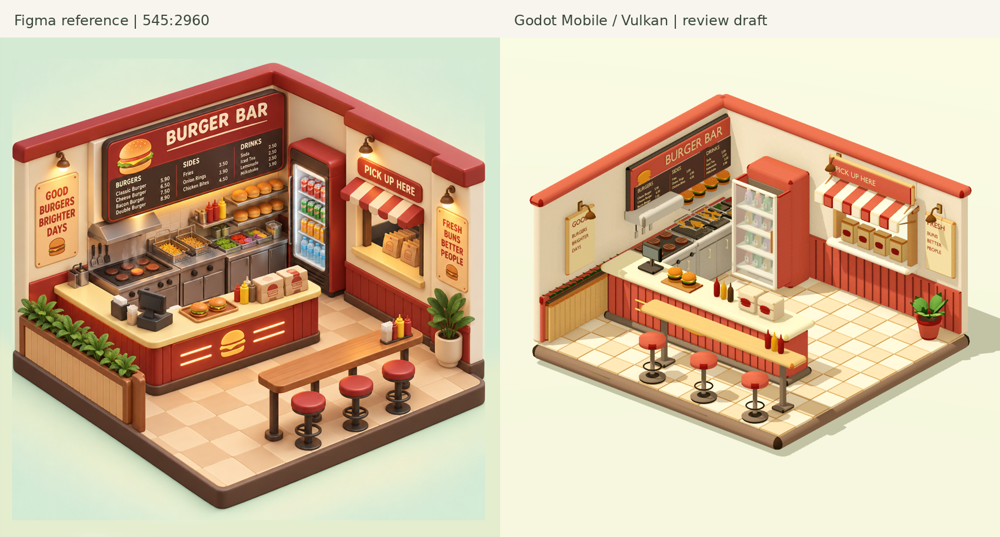
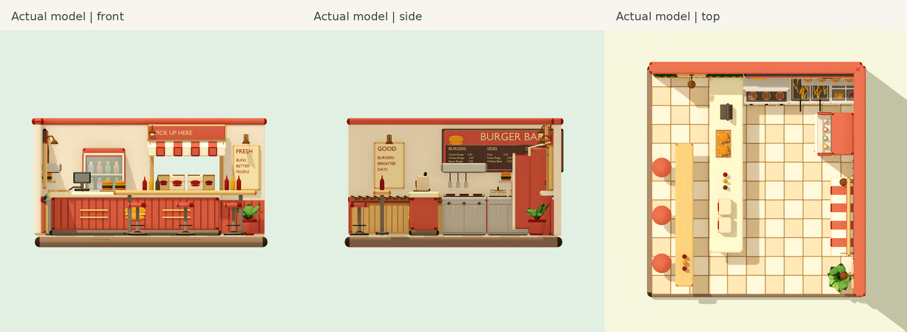

# Burger Shop — SGODOT-184

Review draft produced by 刘备 on 2026-10-07. User art approval is pending; Plane remains In Progress.

## Reference and visual scope

Actual Figma export: file `OMLTC3yw3u2WDjOZhLnhaR`, node `545:2960`.
[Reference](https://www.figma.com/design/OMLTC3yw3u2WDjOZhLnhaR/Gensen--US-?node-id=545-2960). Local export SHA-256: `d197ef4ea5ea24de5823c2f938033e5e701d1ce51a4cee7ea2cd8f0cbddd329a`.
The full image was inspected before modeling. Geometry is original; unshown backs, depths and metre dimensions are inferred.



## Deliverables and rebuild

- Editable named Blender objects/collections: `tools/art/source/burger_shop/burger_shop.blend`.
- Generator: `tools/art/build_burger_shop.py`; shared helpers remain in the Coffee Shop source directory. Basic Room is unchanged.
- Runtime modules, atlas, layout/collisions and budget: `assets/rooms/burger_shop/`.
- Reusable art scene: `scenes/burger_shop/burger_shop_art.tscn`. Contains artwork and simple box collisions only.
- Godot metres, Y up, front +Z; each GLB has its own floor/mount pivot. Repeated objects use the same GLB.

```sh
blender --background --factory-startup --python "$PWD/tools/art/build_burger_shop.py"
python3 tools/art/render_shop_review.py burger_shop
```

For manual source edits, use `-- --bake-only` to rebake/export the saved source. A full rebuild overwrites the generated `.blend`; preserve intentional edits first.
The renderer needs the current host's legitimate DISPLAY/XAUTHORITY. Pillow is needed only for packaging comparison images.

## Asset budget

| Metric | Value |
|---|---:|
| Unique GLBs / placed instances | 22 / 26 |
| Unique / placed triangles | 98,270 / 100,582 |
| Static mesh surfaces | 26 |
| Shared atlas | 2048 × 2048, mipmaps + VRAM compression |
| GLB bytes, total | 3,385,744 |
| Atlas PNG bytes | 2,910,271 |

One shared matte atlas material; separate soft translucent material for glass modules where present. Color/surface detail and softened contact AO are baked; direct lighting remains dynamic. Padded palette swatches protect subpixel detail from black seams. Major rearrangements require rebaking contact AO.

## Verification and limits

Blender 5.2.2 LTS; Godot 4.7.2 Mobile/Vulkan on `AMD Custom GPU 0405 (RADV VANGOGH)`. All 22 GLBs pass container/mesh/surface checks and contain no duplicated embedded images; the assembled render contains all 26 instances. Whole/detail/front/side/top images rendered at 1400 × 1400. Source import settings are retained beside the atlas.

The images are real Godot renders of the exported models. No Android, character/movement benchmark, gameplay integration, release or physical-phone performance claim is part of these art-only cards.

Differences / inferred choices: The red/cream palette, warm checker floor, left-wall menu and cooking line, actual pickup opening, warming burgers and three front stools follow the source. Menu wording and prices are retained with approximate typography. The order counter uses a straight reusable cabinet instead of the full curved L-shaped return; the planter sits against the wall. Beverage stock, burger logos, poster illustrations and leaves are simplified. Steel shares the matte atlas and lamps are static geometry without the reference glow; glass uses a simple translucent material. Kitchen clearances and unseen backs are inferred; no cooking or shop interaction is implemented.



Delivery: Lark self-review messages and downloaded-attachment verification are recorded privately under `output/burger_shop/delivery/`; no chat identifiers or credentials are committed.
