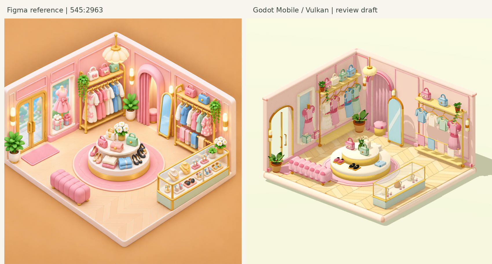
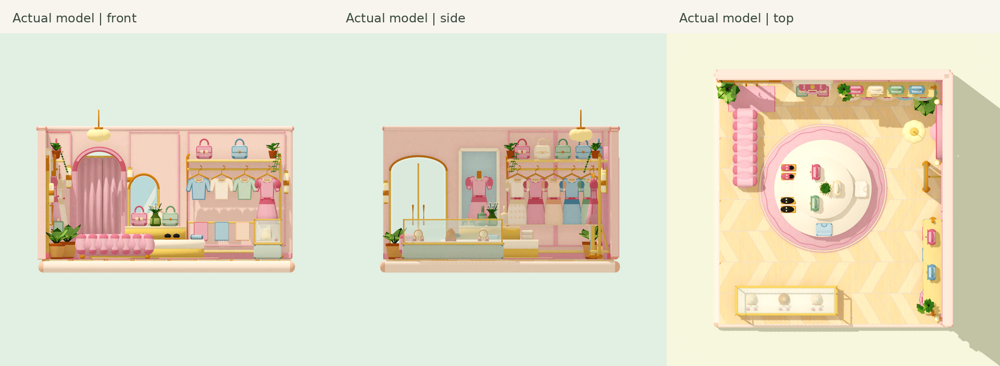

# Clothing Store B — SGODOT-185

Review draft produced by 刘备 on 2026-10-07. User art approval is pending; Plane remains In Progress.

## Reference and visual scope

Actual Figma export: file `OMLTC3yw3u2WDjOZhLnhaR`, node `545:2963`.
[Reference](https://www.figma.com/design/OMLTC3yw3u2WDjOZhLnhaR/Gensen--US-?node-id=545-2963). Local export SHA-256: `05260b090aa79b5d1d848e62be65b513e9bbc1c9f6d1ebfe4656b1e93d25ca00`.
The full image was inspected before modeling. Geometry is original; unshown backs, depths and metre dimensions are inferred.



## Deliverables and rebuild

- Editable named Blender objects/collections: `tools/art/source/clothing_store_b/clothing_store_b.blend`.
- Generator: `tools/art/build_clothing_store_b.py`; shared helpers remain in the Coffee Shop source directory. Basic Room is unchanged.
- Runtime modules, atlas, layout/collisions and budget: `assets/rooms/clothing_store_b/`.
- Reusable art scene: `scenes/clothing_store_b/clothing_store_b_art.tscn`. Contains artwork and simple box collisions only.
- Godot metres, Y up, front +Z; each GLB has its own floor/mount pivot. Repeated objects use the same GLB.

```sh
blender --background --factory-startup --python "$PWD/tools/art/build_clothing_store_b.py"
python3 tools/art/render_shop_review.py clothing_store_b
```

For manual source edits, use `-- --bake-only` to rebake/export the saved source. A full rebuild overwrites the generated `.blend`; preserve intentional edits first.
The renderer needs the current host's legitimate DISPLAY/XAUTHORITY. Pillow is needed only for packaging comparison images.

## Asset budget

| Metric | Value |
|---|---:|
| Unique GLBs / placed instances | 42 / 53 |
| Unique / placed triangles | 66,944 / 78,042 |
| Static mesh surfaces | 53 |
| Shared atlas | 2048 × 2048, mipmaps + VRAM compression |
| GLB bytes, total | 1,946,832 |
| Atlas PNG bytes | 3,648,206 |

One shared matte atlas material; separate soft translucent material for glass modules where present. Color/surface detail and softened contact AO are baked; direct lighting remains dynamic. Padded palette swatches protect subpixel detail from black seams. Major rearrangements require rebaking contact AO.

## Verification and limits

Blender 5.2.2 LTS; Godot 4.7.2 Mobile/Vulkan on `AMD Custom GPU 0405 (RADV VANGOGH)`. All 42 GLBs pass container/mesh/surface checks and contain no duplicated embedded images; the assembled render contains all 53 instances. Whole/detail/front/side/top images rendered at 1400 × 1400. Source import settings are retained beside the atlas.

The images are real Godot renders of the exported models. No Android, character/movement benchmark, gameplay integration, release or physical-phone performance claim is part of these art-only cards.

Differences / inferred choices: The pink boutique layout, gold racks, hanging dresses, bags, two-tier round island, curtain arch, mirror, jewelry case, window mannequin and channel-tufted bench follow the source. Clothing is static low-detail display geometry, without cloth simulation or wearable rigs; fabric prints and seams are simplified. Shoes, jewelry and foliage are less dense than the concept. The floor uses chevron parquet; the display window has a plain blue recess instead of an exterior view. The mirror uses a stylized painted highlight, glass is simple translucency, and gold/lamp surfaces use the shared matte material without reference glow. Dimensions and unseen construction are inferred. The island tiers meet without overlapping coplanar sidewalls.



Delivery: Lark self-review messages and downloaded-attachment verification are recorded privately under `output/clothing_store_b/delivery/`; no chat identifiers or credentials are committed.
