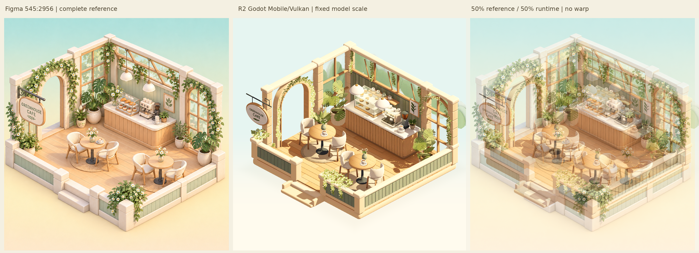
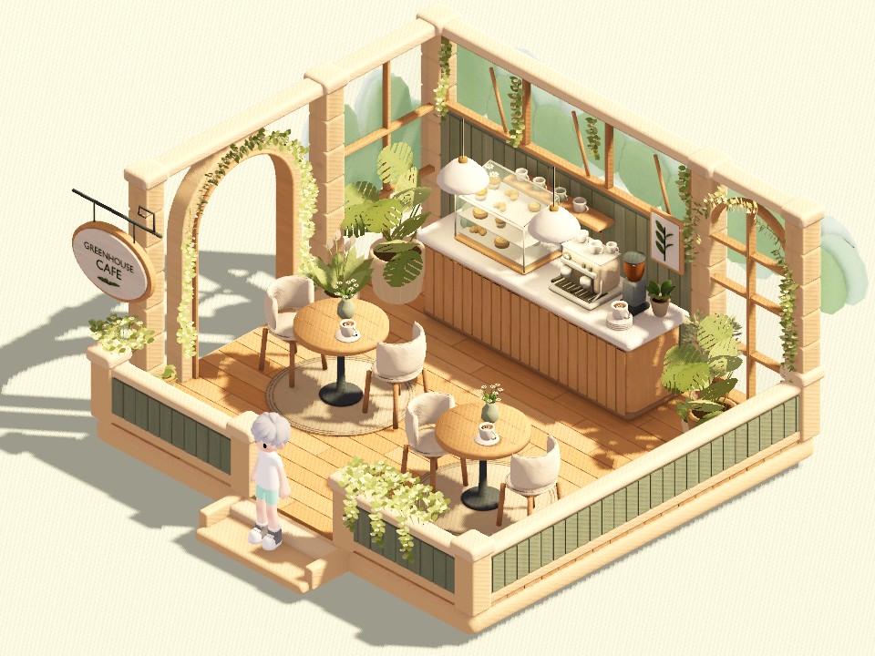
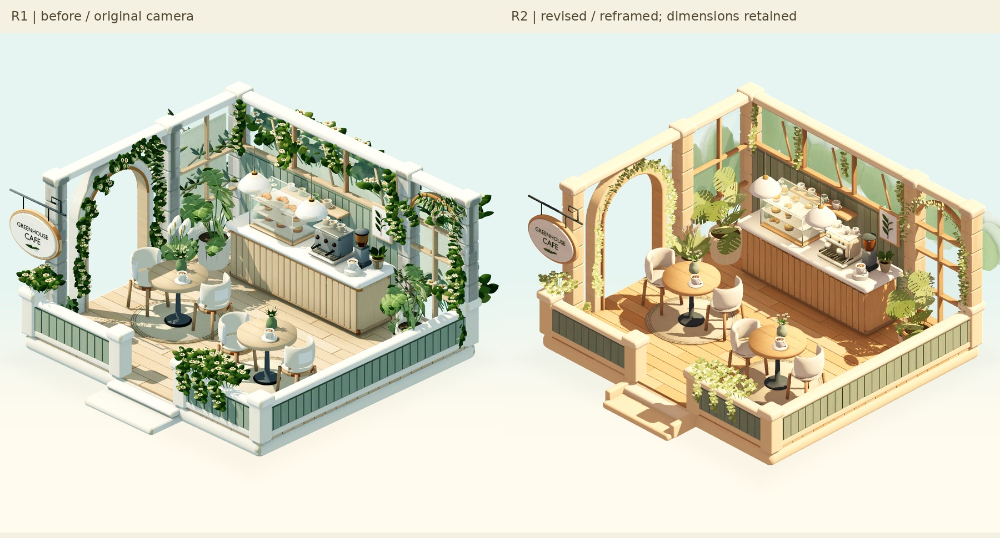

# Coffee Shop · SGODOT-179 · R2 Review

刘备，2026-10-07。按 179 复审 `6534b296` 和尺度补充 `31308f60` 修改，完成后进入 **Review**。用户已决定维持 Basic Room 基线，并保留 179 所有现有尺寸：本轮没有缩短墙柱、改变台面/座面/桌面高度或角色比例。180–186 尚未套用本样板，植物和光照须等待 179 R2 通过。



## 参考与尺度

Figma 文件 `OMLTC3yw3u2WDjOZhLnhaR`，[node 545:2956](https://www.figma.com/design/OMLTC3yw3u2WDjOZhLnhaR/Gensen--US-?node-id=545-2956)。保留原图 SHA-256 `bac78a88a5cb5fdc3aa2d2e7a026c31ec402bc84b5a978c84413c2951d44ce7a`。本轮重新目视检查完整原图，没有声称重新获取云端修订。

实际源模型复测：地板顶 0.0495m、柜台 1.2005m、椅面 0.71045m、桌面 1.0175m、侧拱净高 2.69m，与 R1 一致。Basic Room 同类物件偏差仍为 +4.16% / +3.72% / −10.35%；侧拱 +15.45% 的温室高拱例外已由用户保留。见 [source-scale.json](source-scale.json)。

## R2 逐项回应

| 复审项 | 实现与验证 |
|---|---|
| 暖色调 P0 | 柱/底座为奶油石灰色，地板为蜂蜜橡木色；暖金色主光 1.55，环境色从 ADC9D8 改为 C0ADA9、能量 0.58；主光方向照亮参考中对应的外侧柱面。两盏局部暖灯能量 1.2、范围 1.45m。最终图对声明的柱/地板/矮墙亮面取样，色相差均 ≤10°。这不等于全图亮度/饱和度一致。 |
| 小叶和颜色 P0 | 藤蔓/绿萝叶长宽为 R1 的约 60%，黄绿六色中仅 1 色为最深档。叶片为开放弯曲薄片，普通叶 6 面、龟背竹 8 面。图集正确编码 sRGB，消除线性值直接写入产生的发暗偏饱和。 |
| 白色矩形 P0 | 椅背等大曲面不再逐面切换到常量色块；安全色块以完整微小源物件为单位选择。植物改为明确的 128px UV 细节格、12px 内边距，不依赖旧的细碎自动拆岛。整景/两张近景和独立植物目录均已目视检查。 |
| 龟背竹/白掌 P0 | 龟背竹 11 片叶、8 面弯曲片，alpha scissor 轮廓给出多处深裂口和内部孔洞，深度写入保留；这不是高面数封闭体。白掌 4 个佛焰苞约缩半。 |
| 橄榄/花盆 P0 | 橄榄树冠 352 片银绿小叶；新增陶土盆与藤编盆独立模块，新增藤编盆龟背竹。陶土卷边开口已检查，藤编纹理烘于连续柱面 UV。 |
| 窗外与浮叶 P0 | 替换原来从单点放射的花灌木背景，改为三层低模树冠，远层更浅偏青；关闭背景投影。拱顶藤段改按切线旋转并贴拱铺设，清除越过墙顶的旧背景枝叶。 |
| 预算 P0 | 见下表。按实际摆放统计，植物还包含桌花、柜台小盆和窗外背景，没有只算共享库。4 组墙/前沿藤蔓及台面、桌面、玻璃分组在导出时合并，保留原模块和编辑数据。小叶、花朵、窗外背景不投影，主要大盆栽保留投影。 |
| 椅子 P1 | 移除外露木色圆环和靠背木支撑凸点，4 条原木腿直连隐蔽座框；饱满连续软包圆背、原厚坐垫和包边线。原座高保留。 |
| 咖啡机 P1 | 奶油复古外壳、独立冲煮区、浅铬色冲煮头/托盘、黑手柄、单压力表与小矩形按键；顶部杯子大小和前后位置不一。受一个模块/图集策略限制，金属与搪瓷共享折中粗糙度，尚非独立镀铬材质。 |
| 糕点 P1 | 每层 5 件，3 种可颂/玛芬/蛋挞混排，固定随机大小、位置和朝向。可颂改弯曲五段体，保留浅深烤色。 |
| 建筑/机位 P1 | 最新拍板覆盖旧的“墙柱降低 10–15%”要求，所有尺寸保留。相机提高到约 32°俯角、正交 9.6 并微调目标，完整取景保留招牌与底座。叠图仍暴露建筑/桌子/柜台布局偏差；**没有宣称所有地标已达到一柱宽以内**。这是本轮仍待美术复审的构图项。 |
| 台阶 P2 | 原碰撞坡道和落脚区保留；视觉为两级独立倒角踏步，侧面加短挡墙，消除只有一块外伸平板的观感。 |
| 吊灯 P2 | 灯罩 64 段，暖色内衬，原两盏不投影局部灯增强，柜台附近产生暖色照明；没有增加实时投影灯。 |

## 色相检查

[标注取色位置](colour-patch-comparison.jpg) / [完整数值](colour-verification.json)。对参考和实景的同一实体表面取 9×9 像素中位 RGB，以 HSV 的最短环向色相距离判断。相机/布局未像素配准，因此不机械使用相同屏幕坐标。位置事先明确标注，不以阴影面替代所述亮面。

| 对应表面 | 参考中位色 | 实景中位色 | 色相差 |
|---|---|---|---|
| Front-right corner pier; outward lit face | #FEE5C4 | #FFE7B3 | 6.915° |
| Unobstructed front floor between the left table and entrance | #FCCA91 | #FFDC90 | 9.118° |
| Right low-wall sage boarding; outward lit face | #D5CBA1 | #C4BF8C | 6.181° |

更正 R1：`reference-palette.json` 的 `limestone` 坐标 (1229,674) 实际落在木窗框，`honey_oak` (606,1020) 也靠近地毯边缘。此文件保留原始记录，不能继续当正确部位的验收依据。R2 的新坐标/图例和 `colour-verification.json` 替代之前的部位判断。明度、饱和度仍有差异，3 个样本通过不表示全图完全一致。

## 成本与运行检查

| 指标 | R1 | R2 | 新上限 |
|---|---:|---:|---:|
| 总摆放三角面 | 522,310 | 131,172 | 200,000 |
| 共享植物摆放三角面 | 441,576 | 43,972 | 包含于植物合计 |
| 全部植物含桌花/柜台植物/窗外背景 | 456,466 | 62,738 | 100,000 |
| 静态 surface | 97 | 49 | 60 |
| flower_shrub 单模块 | 14,992 | 2,214 | 4,000 |
| 单片叶三角面 | 封闭高密度体 | ≤8 | 8 |

独立植物库共 12 模块、17,286 面；房间模块 87,200 面中有 18,766 面归入植物统计，**植物合计不能再加到总面数上**。实际 Godot 遍历得到 49 个静态 surface，与导出清单一致。整景美术截图为 51 个 draw calls（含背景等）；这不是包含角色及全部阴影 pass 的手机帧预算。两张 2048² 图集，植物图集带 alpha scissor，不能据三角面减少就宣称手机性能已验收。

共享 `scene_bench` 已同步赵云 `341bd2e`，刘备未修改其核心。Godot 4.7.2 Mobile/Vulkan，AMD Custom GPU 0405 / RADV VANGOGH，真实渲染 **39/39 通过**。连续 10 个航点、入口进出、家具/墙/边界阻挡、滑墙、输入释放、idle/run 和焦点停止均通过。实测两桌切面 1.19m、桌柜间 1.30m、入口 1.32m。

[逐项结果](bench-result.json) / [尺度](bench-scale-measurements.json) / [录制路线](bench-record-result.json) / [视频元数据](bench-video-metadata.json) / [视频时间点](bench-video-timeline.jpg)。15 秒视频由真实视口、原始单调时钟时间戳编码，无加速；开头、中间、结束等 8 帧检查无黑屏，完整角色可见。路线约 7 秒走完，后半段保留 idle 观察。线框图绘制实际物理形状，未改碰撞来美化截图。桌面输入检查不代表真实 Android 触控或实体手机性能验收。



## 重建与评审

```sh
blender --background --factory-startup --python "$PWD/assets/rooms/_shared/plants/source/build_plants.py"
blender --background --factory-startup --python "$PWD/tools/art/build_coffee_shop.py"
python3 tools/art/source/coffee_shop/render_r1.py r2
# 需要 Pillow/NumPy 的 Python 环境
python3 tools/art/source/coffee_shop/package_r2.py
python3 tools/art/source/coffee_shop/check_colour_r2.py
python3 tools/art/source/coffee_shop/run_bench.py --record
```

可编辑源文件与确定性生成器保持一致。`batch_r2.py` 消费原 GLB 的 UV/法线和摆放数据，生成 `assets/rooms/coffee_shop/batches/`，不复制图集；原模块仍可复用。局部轴心、Y-up 米制、实例、家具位置及现有碰撞契约保留。大布局变化仍须重烘房间 AO。



179 已改为 **Review**。Plane 新增 15 个 `SGODOT-179_R2_*` 附件，16 个已有附件保留；15 个文件下载 SHA-256 全部匹配。Lark CLI 在已授权的用户自审会话发送 9 条消息，7 张图片及视频下载 SHA-256 全部匹配。见 [交付验证](delivery-verification.json)，私人聊天回执与大视频保存在忽略的 output 目录。Basic Room、赵云场景、用户存档、发布配置与已有 `.codex/config.toml` 修改不在本次提交范围。
