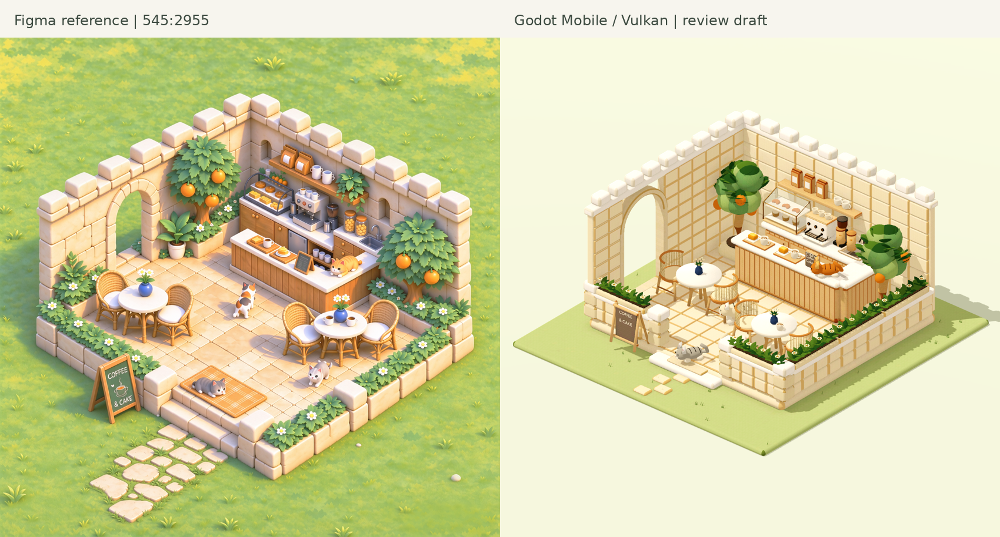
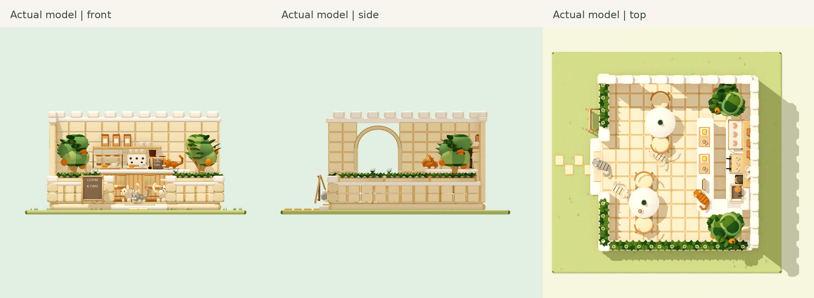

# Coffee Shop 0 — SGODOT-181

Review draft produced by 刘备 on 2026-10-07. User art approval is pending; Plane remains In Progress.

## Reference and visual scope

Actual Figma export: file `OMLTC3yw3u2WDjOZhLnhaR`, node `545:2955`.
[Reference](https://www.figma.com/design/OMLTC3yw3u2WDjOZhLnhaR/Gensen--US-?node-id=545-2955). Local export SHA-256: `16d1ad0bd5a2f98c517b156bffd7730474009cd5f8e1e852e229694de21610a2`.
The full image was inspected before modeling. Geometry is original; unshown backs, depths and metre dimensions are inferred.



## Deliverables and rebuild

- Editable named Blender objects/collections: `tools/art/source/coffee_shop_0/coffee_shop_0.blend`.
- Generator: `tools/art/build_coffee_shop_0.py`; shared helpers remain in the Coffee Shop source directory. Basic Room is unchanged.
- Runtime modules, atlas, layout/collisions and budget: `assets/rooms/coffee_shop_0/`.
- Reusable art scene: `scenes/coffee_shop_0/coffee_shop_0_art.tscn`. Contains artwork and simple box collisions only.
- Godot metres, Y up, front +Z; each GLB has its own floor/mount pivot. Repeated objects use the same GLB.

```sh
blender --background --factory-startup --python "$PWD/tools/art/build_coffee_shop_0.py"
python3 tools/art/render_shop_review.py coffee_shop_0
```

For manual source edits, use `-- --bake-only` to rebake/export the saved source. A full rebuild overwrites the generated `.blend`; preserve intentional edits first.
The renderer needs the current host's legitimate DISPLAY/XAUTHORITY. Pillow is needed only for packaging comparison images.

## Asset budget

| Metric | Value |
|---|---:|
| Unique GLBs / placed instances | 34 / 49 |
| Unique / placed triangles | 98,995 / 151,377 |
| Static mesh surfaces | 49 |
| Shared atlas | 2048 × 2048, mipmaps + VRAM compression |
| GLB bytes, total | 2,756,180 |
| Atlas PNG bytes | 3,720,307 |

One shared matte atlas material; separate soft translucent material for glass modules where present. Color/surface detail and softened contact AO are baked; direct lighting remains dynamic. Padded palette swatches protect subpixel detail from black seams. Major rearrangements require rebaking contact AO.

## Verification and limits

Blender 5.2.2 LTS; Godot 4.7.2 Mobile/Vulkan on `AMD Custom GPU 0405 (RADV VANGOGH)`. All 34 GLBs pass container/mesh/surface checks and contain no duplicated embedded images; the assembled render contains all 49 instances. Whole/detail/front/side/top images rendered at 1400 × 1400. Source import settings are retained beside the atlas.

The images are real Godot renders of the exported models. No Android, character/movement benchmark, gameplay integration, release or physical-phone performance claim is part of these art-only cards.

Differences / inferred choices: Orange-tree crowns, cats and vegetation are simplified stylized geometry; cats are static decorations without rigs or animation. Stone joints and planting are more regular than the reference. Grass uses a bounded rounded base with sparse tufts instead of the reference’s surrounding meadow. The U-shaped work area, cabinet backs and metre dimensions are inferred. The sink has an actual countertop aperture and recessed lining.



Delivery: Lark self-review messages and downloaded-attachment verification are recorded privately under `output/coffee_shop_0/delivery/`; no chat identifiers or credentials are committed.
