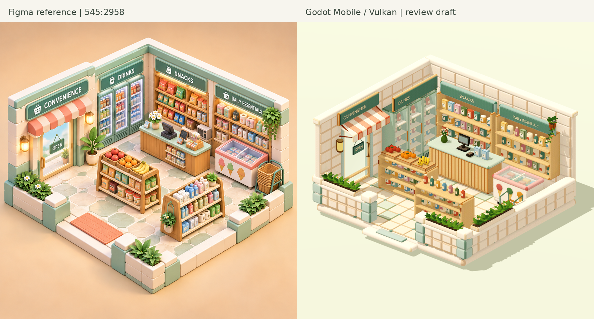
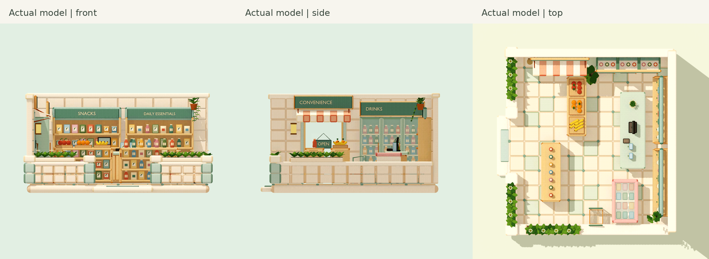

# Convenience Store — SGODOT-183

Review draft produced by 刘备 on 2026-10-07. User art approval is pending; Plane remains In Progress.

## Reference and visual scope

Actual Figma export: file `OMLTC3yw3u2WDjOZhLnhaR`, node `545:2958`.
[Reference](https://www.figma.com/design/OMLTC3yw3u2WDjOZhLnhaR/Gensen--US-?node-id=545-2958). Local export SHA-256: `cb193c5a017295d6773cb6c2859a8fbd5660fdf14943518aa3f2a43139f93615`.
The full image was inspected before modeling. Geometry is original; unshown backs, depths and metre dimensions are inferred.



## Deliverables and rebuild

- Editable named Blender objects/collections: `tools/art/source/convenience_store/convenience_store.blend`.
- Generator: `tools/art/build_convenience_store.py`; shared helpers remain in the Coffee Shop source directory. Basic Room is unchanged.
- Runtime modules, atlas, layout/collisions and budget: `assets/rooms/convenience_store/`.
- Reusable art scene: `scenes/convenience_store/convenience_store_art.tscn`. Contains artwork and simple box collisions only.
- Godot metres, Y up, front +Z; each GLB has its own floor/mount pivot. Repeated objects use the same GLB.

```sh
blender --background --factory-startup --python "$PWD/tools/art/build_convenience_store.py"
python3 tools/art/render_shop_review.py convenience_store
```

For manual source edits, use `-- --bake-only` to rebake/export the saved source. A full rebuild overwrites the generated `.blend`; preserve intentional edits first.
The renderer needs the current host's legitimate DISPLAY/XAUTHORITY. Pillow is needed only for packaging comparison images.

## Asset budget

| Metric | Value |
|---|---:|
| Unique GLBs / placed instances | 28 / 36 |
| Unique / placed triangles | 124,203 / 141,855 |
| Static mesh surfaces | 36 |
| Shared atlas | 2048 × 2048, mipmaps + VRAM compression |
| GLB bytes, total | 3,372,628 |
| Atlas PNG bytes | 3,601,910 |

One shared matte atlas material; separate soft translucent material for glass modules where present. Color/surface detail and softened contact AO are baked; direct lighting remains dynamic. Padded palette swatches protect subpixel detail from black seams. Major rearrangements require rebaking contact AO.

## Verification and limits

Blender 5.2.2 LTS; Godot 4.7.2 Mobile/Vulkan on `AMD Custom GPU 0405 (RADV VANGOGH)`. All 28 GLBs pass container/mesh/surface checks and contain no duplicated embedded images; the assembled render contains all 36 instances. Whole/detail/front/side/top images rendered at 1400 × 1400. Source import settings are retained beside the atlas.

The images are real Godot renders of the exported models. No Android, character/movement benchmark, gameplay integration, release or physical-phone performance claim is part of these art-only cards.

Differences / inferred choices: The rectangular entrance, three-door drink chiller, English category signs, checkout, two stocked aisles, fruit display and ice-cream freezer follow the reference arrangement. Packaging graphics use reusable color/leaf motifs; no tiny brand artwork is reproduced. The tile pattern and low-wall masonry are more regular, the banana bunch and basket weave are simplified, plants are sparser and the exterior view through the entrance is omitted. Cold cabinets use static glass without physical refrigeration/reflection effects; lighting has firmer shadows. Back surfaces and dimensions are inferred.



Delivery: Lark self-review messages and downloaded-attachment verification are recorded privately under `output/convenience_store/delivery/`; no chat identifiers or credentials are committed.
