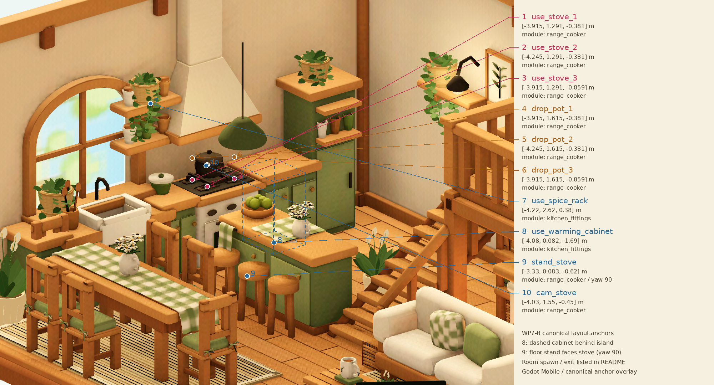

# SGODOT-173 · Deluxe Room-10 R2.2 canonical anchors

赵云 · **R2.1 美术已通过；R2.2 正式挂点修正完成，工程校验与本轮实渲/录像通过，提交Review。** Reference: Figma `OMLTC3yw3u2WDjOZhLnhaR`, SceneDesign, node `545:2970`. Basic Room's accepted scale and Liu Bei's shared botanical library are read-only dependencies.


[Whole scene](godot.png) · [Kitchen](detail-kitchen.png) · [Loft and stairs](detail-loft.png) · [Living](detail-living.png) · [Editable-model orthographics](orthographic-sheet.png).

| Review requirement | Final implementation |
|---|---|
| Spatial layout | Left-wall sink/prep/range/pantry, island with three reused stools, rear stairs rising to the right-back loft. Under-loft bookcase, rounded hearth, separate wood niche and right door. Front-left long dining table with six instances of one padded chair; front-right sofa, low coffee table and TV console. Both main rugs are pale natural jute. |
| Loft and navigation | Structural posts and heavy crossbeam remain visible. Thirteen visual treads sit over one continuous ramp-to-landing convex collider. Outer stair guard stops before the turning opening; loft front/west guards block falling. The solid wedge closes low-headroom under-stair access. Floor is approximately 2.46m high, underside approximately 2.23m, retaining the 1.7455m fixture's clearance. |
| Kitchen | Broad cream trapezoid hood with an oak lip, four-burner oven and cooking pot; glazed jars, open pantry, utensil crock, fruit bowl and flowers. Green enamel pendant has a long black flex and an unshadowed local warm lamp. Island towel and runner use metric UVs. |
| Loft dressing | Checked duvet follows physical fold length, two pillows, drawer nightstand with warm lamp, a real upper arched aperture with green frame, white tied curtains, botanical print and trailing shared plants. |
| Living and dining | Continuous cream upholstered sofa, green and checked cushions, wicker basket, books and ceramic mug. TV console has drawers, knobs and open cubby. Long dining table has a metric checked runner, daisies, six thick solid chairs and tied green pads. Low coffee table is intentionally a distinct furniture category. |
| Hearth and door | Rounded cream plaster, orange gradient flame, charred logs/embers, matte irregular split-log niche, mantel landscape and candlesticks, warm table/wall lighting, greenery near the entry and striped mat. Mantel projects ahead of the loft beam so it reads in the whole scene. |
| Materials and batching | Warm timber and lightly textured plaster, room-wide static contact AO, one shadowed sun and five short-range unshadowed lights. Editable named parts remain in the Blender source; fittings and soft goods are grouped by zone at export. Repeated chairs/stools share local-pivot GLBs. Supplied double-sided alpha-scissor plant material is retained; foliage/flowers/backgrounds do not cast shadows. |

## R2.1 art approval and corrected WP7-B anchors

The director accepted the R2.1 art: smaller angled TV at front-right, cream stair wall with picture/shelf/lamp and fuller plants, clear preparation worktop and a pendant shade bottom of 2.670m. R2.2 changes only the authoring anchors. The previous temporary names and `attachment_points` storage were withdrawn by the director because they conflicted with Arthur's formal contract.

Authority: Plane page **WP7-B / F-03 ③ World anchor names v1**, ID `2d11d5b2-e24c-4089-8e6b-c4810ea26b14`, §§1–7 (2026-10-07). The new top-level **`layout.json.anchors`** contains the following; same-name Blender Empties are provided. All coordinates are room metres, Y up. Only oriented anchors carry `yaw_degrees`; only sign anchors may carry 2D `size`, so these anchors carry no size field.

| Anchor | Position [x,y,z] | Module | Purpose |
|---|---|---|---|
| `use_stove_1` | `[-3.915, 1.291, -0.381]` | `range_cooker` | Visible top centre, first burner |
| `use_stove_2` | `[-4.245, 1.291, -0.381]` | `range_cooker` | Visible top centre, second burner |
| `use_stove_3` | `[-3.915, 1.291, -0.859]` | `range_cooker` | Visible top centre, third burner |
| `drop_pot_1` | `[-3.915, 1.615, -0.381]` | `range_cooker` | Ingredient drop, pot rim height |
| `drop_pot_2` | `[-4.245, 1.615, -0.381]` | `range_cooker` | Ingredient drop, pot rim height |
| `drop_pot_3` | `[-3.915, 1.615, -0.859]` | `range_cooker` | Ingredient drop, pot rim height |
| `use_spice_rack` | `[-4.22, 2.62, 0.38]` | `kitchen_fittings` | Existing open shelf / future Lv2 module |
| `use_warming_cabinet` | `[-4.08, 0.082, -1.69]` | `kitchen_fittings` | Existing green cabinet / future Lv3 replacement |
| `stand_stove` | `[-3.33, 0.083, -0.62]` | `range_cooker` | Floor operation position; yaw 90 faces −X toward stove |
| `cam_stove` | `[-4.03, 1.55, -0.45]` | `range_cooker` | Camera focus above the active burner/pot |
| `spawn` | `[3.85, 0.083, -2.84]` | room | Inside doorway, yaw 180 into room |
| `exit` | `[3.93, 0.083, -3.56]` | room | Door threshold |

The three `use_stove_*`, spice and warming-cabinet positions are preserved exactly. `drop_pot_*` are above their burners at **1.615m**, using the existing pot source rim height. `prep_area` is removed; the clear 0.50m preparation surface remains. Its dimensions remain descriptive room metadata, not an interaction anchor. The current `range_cooker` and `kitchen_fittings` asset names are temporary valid module references until 213 supplies separately switchable kitchen modules. Room-level spawn/exit have no module reference. The obsolete top-level spawn is removed; the benchmark retains its identical legacy start inside `bench.spawn`, separate from canonical room anchors.



Marker3D nodes are parented under the named modules while preserving room-space coordinates, so they follow module visibility. A focused Godot scene-instantiation check verifies all 12 nodes, module parents, positions/up axes and oriented yaws; the standing/spawn capsule is clear and supported by authored floor. [Runtime checks](anchor-runtime-verification.json) · [Schema audit](anchor-schema-verification.json) · [Source geometry preservation](anchor-source-preservation.json) · [Source positions and prep clearance](kitchen-hooks-verification.json).

The engineering **`tools/dev/check_room_anchors.gd`** and its **`P0RoomAnchors`** dependency are now available on `feat/p0-room-shell`. They were copied verbatim into an isolated verification project and run against this scene's actual layout: **12 anchors, 0 problems**. [Exact branch/commit, file hashes and output](anchor-engineering-verification.json). `validate_anchors.py` complements that check with stricter scene-specific field and pot-height assertions.

The mesh/placement digest is identical before/after the metadata migration; runtime GLBs, atlases, camera and lights remain unchanged. After permissions were restored, **R2.2 was freshly rendered in Godot Mobile/Vulkan**, the anchor positions/module parents and capsule clearance were checked there, and **38/38 rendered character checks plus a new 15-second route recording passed**. The annotation uses this current capture with [explicit provenance](anchor-annotation-provenance.json).

## Camera and colour evidence

The camera uses the three declared visible plinth-edge intersections, with the hidden fourth inferred. The concept's floor is squarer and its upper back corner is offset relative to a perfect orthographic rectangular room. The retained physical plinth is 9.6×7.8m: edge slopes determine yaw/pitch; mean horizontal scale plus an 8% framing margin keeps the entire ceiling visible. The direct overlay exposes those remaining shape/projection differences; no image warp or pixel-fidelity score is used. [Fit inputs and limits](../../../tools/art/source/deluxe_room_10/camera-review.json).

[Marked surface samples](colour-samples.png) and [full RGB/HSV results](colour-verification.json) record corresponding left plaster, right plaster, front post and horizontal floor. An early supposed floor pixel was on the vertical plinth: its 11.218° result is retained in the private preliminary evidence, and the floor point was then projected from the fixed declared world position `[0.28,0.083,3.25]` before material tuning. Later the fixed back-wall patch rose to 12.925° after hearth placement; the wall material was corrected at the same point. Final hue differences are **3.941° / 9.193° / 1.047° / 2.454°**, all ≤10°. Saturation and brightness remain separately reported.

## Validation and rebuild

**38/38 rendered checks and the unaccelerated 15-second route video pass.** The fixture traverses ten sequential waypoints: door, living, dining, island, sink, stair approach/foot/top, loft entry, bedside. Probes cover furniture, kitchen cabinetry, the closed stair underside, loft guard and open diorama edges. Live measured main aisles are 0.755m between island seating/dining seating and 0.9342m between sofa and coffee table, above the card's 0.70m minimum. Door exit/reentry, diagonal wall sliding, input release and advancing idle/run animation are checked.

[Per-check results](bench-result.json) · [Scale ratios](bench-scale-measurements.json) · [Blender source dimensions](source-scale.json) · [Metric cloth checks](cloth-uv-verification.json) · [Actual colliders](bench-collisions.png) · [Unaccelerated 15-second video frames](video-frames.png).

Measured source heights: door clear 2.33m, island top 1.17m (+1.52%), padded chair .7825m (+14.23%), dining table 1.135m (baseline). All applicable categories stay within ±15% of Basic Room. Three .78m stools serve the higher island; the .613m coffee table is a deliberately lower category, not a replacement for the dining-table baseline.

**159,455 / 200,000 placed triangles**, **33,952 / 100,000 botanical triangles**, **60 / 60 static surfaces**. Exact budgets, delivered GLB UV/normal/image checks and file hashes are in [verification-summary.json](verification-summary.json). Limits are ≤200,000 total / ≤100,000 botanical / ≤60 static surfaces. Character evidence is Godot 4.7.2 Mobile/Vulkan on AMD Custom GPU 0405 (RADV VANGOGH); it is desktop behavioral validation, not physical-phone performance acceptance.

```sh
blender --background --factory-startup --python "$PWD/tools/art/build_deluxe_room_10.py" -- --views
blender --background --factory-startup --python "$PWD/tools/art/source/deluxe_room_10/measure_review.py"
python3 tools/art/create_room_scene.py deluxe_room_10
python3 tools/art/prepare_room_review.py deluxe_room_10
# Import, retain configure_room_imports.py settings, then capture through review_room.gd.
python3 tools/dev/scene_bench/prepare.py deluxe_room_10
# Import the isolated bench, then run on the current real display:
python3 tools/dev/scene_bench/run.py deluxe_room_10 --record --output output/zhaoyun-173-r22-2026-10-08/bench
SCENE_REVIEW_OUTPUT="$PWD/output/zhaoyun-173-r22-2026-10-08" python3 tools/art/check_room_colour.py deluxe_room_10 173
SCENE_REVIEW_OUTPUT="$PWD/output/zhaoyun-173-r22-2026-10-08" python3 tools/art/package_room_review.py deluxe_room_10 173
```

The builder delegates to `tools/art/source/deluxe_room_10/revision.py`. Source edits belong in that deterministic generator; the `.blend` retains named editable parts and reusable pivots. No gameplay, saves, release presets or another artist's assets are changed.
