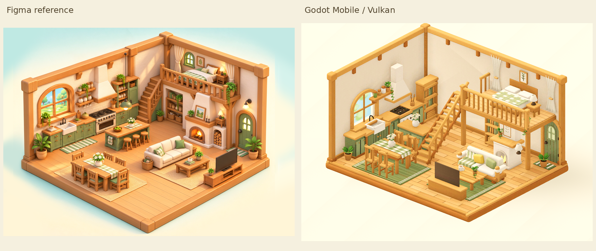

# Deluxe Room-10 · art review candidate

Plane [SGODOT-173](https://plane.sensenjoy.cn/zili/browse/SGODOT-173), owner Zhao Yun / 赵云. **In Progress, awaiting user review.** Produced 2026-10-07 under the user's request to proceed sequentially overnight and send each scene through Lark CLI.

Reference: Figma file `OMLTC3yw3u2WDjOZhLnhaR`, node [545:2970](https://www.figma.com/design/OMLTC3yw3u2WDjOZhLnhaR/Gensen--US-?node-id=545-2970). The [original export](reference.png) was downloaded and visually inspected before modeling.



The larger home includes a structural loft with balustrades and landing, 12 real steps, a bed with checked duvet and curtains, kitchen sink/range/hood and island with three reused stools, a fireplace, a widened sofa, coffee table, television console and four-chair dining area. Furniture source is reused read-only from Basic Room and Standard Room, with scene-local modifications and rebaking.

## Deliverables

- [Editable Blender model](../../../tools/art/source/deluxe_room_10/deluxe_room_10.blend), with named objects and module collections.
- [Deterministic scene generator](../../../tools/art/build_deluxe_room_10.py), using the [room pipeline](../../../tools/art/scene_room_pipeline.py).
- [GLB placement and collision manifest](../../../assets/rooms/deluxe_room_10/layout.json), individual local pivots and a shared external base-color/contact-AO atlas.
- [Reusable Godot art scene](../../../scenes/deluxe_room_10/deluxe_room_10_art.tscn), without gameplay/account/network dependencies.
- [Whole-scene runtime image](godot.png), [model orthographic views](orthographic-sheet.png), [budget and verification hashes](verification-summary.json).

## Reconstruction and contract

```sh
blender --background --factory-startup --python "$PWD/tools/art/build_deluxe_room_10.py" -- --views
python3 tools/art/prepare_room_review.py deluxe_room_10
godot --headless --editor --path output/deluxe_room_10-2026-10-07/godot-project --import --quit
godot --path output/deluxe_room_10-2026-10-07/godot-project \
  --script res://tools/art/review_room.gd -- deluxe_room_10 \
  "$PWD/output/deluxe_room_10-2026-10-07"
```

Use the actual host display for rendering. Blender 5.2.0 LTS and Godot 4.7.2 were used here. `--geometry-only` skips bake/export. Rebuilding replaces this scene's `.blend`; preserve manual edits deliberately. Source assets from Basic Room remain read-only.

Coordinates are metres, Godot Y-up/front +Z and Blender `(x,-z,y)`. Modules export about their own floor/mounting pivot; placement is in the manifest. The baked atlas contains procedural surface detail and softened contact AO, with live runtime sunlight. Rebake after major rearrangement. Raw GLBs must bind this atlas. Triangulation occurs before UV bake/export to keep surface interpolation consistent, and empty atlas gutters are extended before mip generation.

## Validation and budget

Actual Godot **Mobile / Vulkan**, AMD Custom GPU 0405 (RADV VANGOGH), 1440×1080. 55 meshes have atlas materials and finite nonempty bounds; 44 simple collision shapes are present. The imported triangle count matches the export manifest.

| Metric | Measured |
|---|---:|
| Unique GLBs / placed instances | 50 / 55 |
| Unique / placed triangles | 116,062 / 120,302 |
| Static surfaces | 55 |
| GLB bytes combined | 4,274,720 |
| Atlas source PNG bytes | 2,729,278 |
| Shared atlas | 2048 × 2048 |

Texture imports enable mipmaps and VRAM compression. Fine geometry keeps uncompressed vertices and disables automatic mesh LODs. Static surface counts exclude renderer shadow passes; PNG bytes are not GPU memory. No physical-phone performance measurement is claimed.

## Inferences and differences

The single perspective gives no measured dimensions. The 9.2 × 7.4m footprint, 4.9m wall height, 2.68m stair rise, hidden backs, landing and support structure are inferred. The reference uses more compact furniture grouping and a small upper window; this candidate simplifies upper-wall decoration and the fireplace silhouette, retains Basic Room plant/scenery detail, and uses a greener rug and simpler cloth. The television faces the sofa, so the review camera sees its back. Lighting is the Mobile renderer with contact AO, without real-time GI.

The staircase uses individual tread boxes and a separate top-landing box meeting the loft edge. The loft has a floor slab, support-post boxes and simple guardrail volumes. These are structural checks, not a gameplay traversal claim; an eventual controller must define its step/climb policy.

This is an art-only candidate awaiting review. No gameplay/map integration, avatar benchmark, Android QA, production build, migration or release is included.
