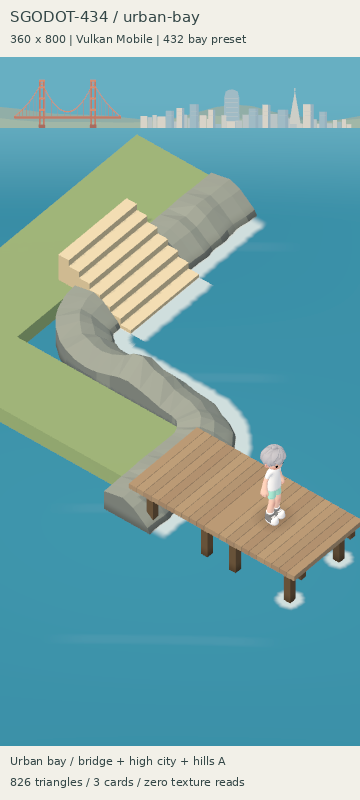
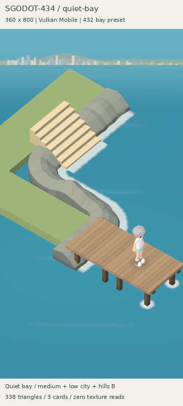

# SGODOT-434 · 通用湾区远景卡片 v1

刘备交审。将黄忠的恶魔岛远景整理为六个独立、单 surface 的卡片：高 / 中 / 低密城市、丘陵 A / B、可换色悬索桥。主色、亮部、暗部、雾色和雾化程度均可在 `.tres` 调整。运行目录与参数表见 [far_backdrop/README.md](../../../assets/landmarks/_shared/far_backdrop/README.md)。恶魔岛原文件未改。

| 默认镜头审阅图 | 组合与预算 |
|---|---|
| [urban-bay-default-review.png](urban-bay-default-review.png) | 桥＋高密城市＋丘陵 A，826 面 / 3 个 surface |
| [quiet-bay-default-review.png](quiet-bay-default-review.png) | 中密城市＋低密城市＋丘陵 B，338 面 / 3 个 surface |

两张均为 Godot 4.7.2 Vulkan Mobile 的 360×800 实渲，正交宽 6.72 m、俯角 43°、yaw 14.5°，与 432 的镜头 / 光照相同。六种卡片都在两张图中展示；前景沿用 426 岸石、430 浪花与 1.75 m 人物作尺度和深度参照。没有交付示例 layout 或游戏接入场景。

## 来源与组合契约

- 分支从最新 `origin/wp-3d-scene` 的 `05a2c032f88cc0d39caebca05bd79df98845fbbe` 新建；源模型、shader 和可编辑 `.blend` 的 SHA 记录在 [provenance.json](../../../tools/art/source/far_backdrop_434/reference/provenance.json)。
- 桥、高密城市、丘陵 A 保留原三角形坐标，导出验证精度 1e-6 m。中密城市去掉两座最高地标塔楼；低密保留 17 栋矮楼并留成组间隙；丘陵 B 调整起伏而不加面数。六份新 `.blend` 均保留命名部件和底边中心原点。
- 配 **432 海湾预设 / #837 `15b0012ee4cb64eaaa07c6637a3d2ea76cafde4c`**。仅在 QA 中复制其材质并将 `render_priority=-100`，让不透明远海先画、远景卡片后画；其 shader、色板、波纹参数和源 `.tres` 不改。
- 前景参考 **426 #831 v1.1 `85967444d6024fbe85cf2af997a7478ee4aab034`** 的正式 0.25 m 湿带与 **430 #833 v1.1 `ac5809c46b3e96a111ada24513b44afc4779c631`** 浪花。它们只被借到隔离审阅工程，未纳入新运行资源。
- 同类轮廓颜色可共享材质，多个实例需不同颜色时复制 `.tres`。桥的冷蓝灰与重雾对照通过实际像素变化确认；原镜头朝向 / 远裁深度算法保持一致。

## 验证

| 项目 | 结果 |
|---|---|
| GLB / 几何 | 81 项通过：6 个独立 mesh / surface，XY 平面、底边中心、无退化面，颜色权重有效，3 件原轮廓几何保全，6 个 UID 独立。 |
| Godot 导入 | 82 项通过：共享材质实际绑定到 Mesh surface；所有 `nodes/root_script=null`；不投影、不导入动画、不生成 LOD。 |
| 实渲预算 | 两种组合均 25 draws，去掉远景均 22，远景增加 3 draws；826 / 338 面均不超过原三卡 826 面。每卡 **0 次采样 / 1 pass**，无新增贴图、深度写入或阴影 pass。 |
| 原投影对照 | 同网格、同权重色、同镜头对比原 shader，360×800 画面 RGB 差异为 0。 |
| 可见性与参数 | 城市组合 6,956 个像素、低密组合 4,984 个像素因卡片而改变，均限于 y=79–127 / 104–127 远景带，前景像素不变。桥换色改变 1,253 个像素；重雾改变 6,956 个像素。 |
| Android | API37 / SwiftShader / Vulkan Mobile；4 次真实点击切换组合和桥色，完整安装 APK 回读一致。截图见 `android-urban.png` / `android-quiet.png`；不代表实体手机 GPU 耗时。 |
| 冷导入与保全 | 从空 `.godot` 导入并复核，运行资源文件名 / SHA 不变；恶魔岛、鱼塘、已验收浪花均与基线一致。没有新贴图，`imported_formats` 不适用。 |

六件库存总计 1,164 面，不会全部出现在一个审阅组合中；保持上述三件组合预算，不把库存数当作单帧开销。材质使用相同透明队列模式，但 alpha 固定 1，空隙来自剪影几何；雾化只混合颜色。

[几何证据](geometry-validation.json) · [导入证据](resource-validation.json) · [实渲证据](render-validation.json) · [像素对照](visual-validation.json) · [Android](android-validation.json) · [冷导入与保全](import-preservation-validation.json) · [媒体 SHA](media-manifest.json)。

[重现步骤及可编辑源](../../../tools/art/source/far_backdrop_434/README.md)。审阅媒体仅存于本目录并以 `.gdignore` 排除导入；本轮不包含游戏上线。
