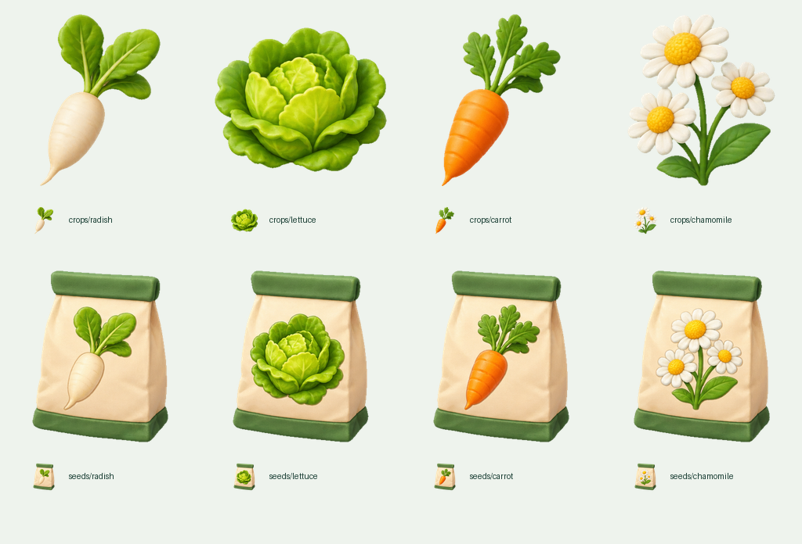
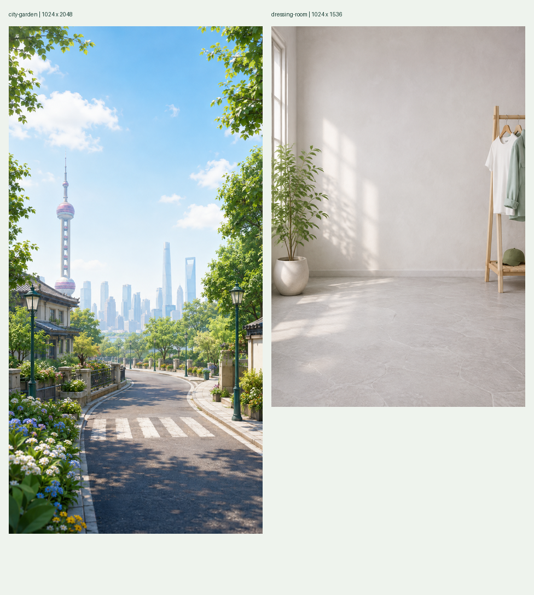

# Implementation Assets

## Existing Libraries Reviewed

- Existing project Lucide icons: retained for actions, weather, navigation, goals and modal controls. The consistent line weight matches the approved UI boards.
- [Kenney Food Kit](https://kenney.nl/assets/food-kit): CC0, 200 low-poly 3D food objects. Reviewed its published preview. It does not provide the requested complete four-crop and corresponding seed-packet UI set; its faceted treatment differs from the approved soft matte icons.
- [OpenGameArt Farming Game - Basics](https://opengameart.org/content/farming-game-basics): 2DPIXX, CC-BY 3.0. Reviewed its published preview. Its flat illustrations cover peas, potatoes, carrots and peppers, with a different crop set and a different visual treatment.
- [OpenGameArt farm icon search](https://opengameart.org/art-search-advanced?keys=farm+icons&field_art_type_tid%5B%5D=9&sort_by=count&sort_order=DESC): results include pixel-art food, farming tools and the simple farming pack above. No matching complete production set was selected.

No art from the reviewed external packs is shipped. Preview downloads are research-only files under `output/imagegen/implementation/`.

## Produce and Seed Packets

The user authorized image generation through the existing sensenjoy API configuration. The bundled imagegen CLI is used with model `gpt-image-2`, size `2048x1024`, quality `high`. The API credential is provided only through environment variables; no credential is saved with the assets.

The generated source is an eight-subject sprite sheet, with four equal columns and two rows. The top row is white radish, lettuce, carrot and chamomile. The bottom row contains corresponding cream paper seed packets with forest-green trim. Each subject uses a soft matte three-dimensional treatment, top-left illumination and simplified shapes that remain readable at 40px.

CLI `gpt-image-2` does not expose a transparent background option. The prompt therefore requested uniform magenta chroma. The sensenjoy endpoint returned an already-transparent `1774x887` RGBA image despite the requested `2048x1024` size. Its alpha was used during slicing, with isolated edge flecks removed using connected-component cleanup and a small inward edge filter. Final assets are centered 256x256 RGBA PNG files with an approximately 18px transparent margin on the longest axis:

| Produce | Harvest Icon | Seed Packet |
| --- | --- | --- |
| White radish | `assets/ui/farm/crops/radish.png` | `assets/ui/farm/seeds/radish.png` |
| Lettuce | `assets/ui/farm/crops/lettuce.png` | `assets/ui/farm/seeds/lettuce.png` |
| Carrot | `assets/ui/farm/crops/carrot.png` | `assets/ui/farm/seeds/carrot.png` |
| Chamomile | `assets/ui/farm/crops/chamomile.png` | `assets/ui/farm/seeds/chamomile.png` |

Source prompt and slicing implementation are retained under `output/imagegen/implementation/`. The prompt specifies the following production requirements:

> Create exactly eight isolated icons in a regular four-column, two-row grid on a 2048x1024 canvas. Every cell is 512x512 and each subject fits inside its central 350x350 square. Use pure magenta #FF00FF chroma background with no floor, cast shadows, reflections or spill. Top row: one creamy-white daikon radish with rounded green leaves; one compact layered lettuce head; one plump orange carrot with compact leafy stems; one compact chamomile sprig with three large white daisies and golden centers. Bottom row: four identical upright cream paper seed packets with forest-green folded trim, each displaying only its corresponding crop illustration. Render in premium cozy mobile farm inventory style, soft matte clay-like forms with hand-painted shading, warm ivory highlights, olive ambient shading and clean separated readable silhouettes. Use consistent slightly elevated three-quarter front view and soft top-left lighting. No text, numbering, logos, watermark, grid lines, extra objects, decorative particles or clipped silhouettes.

Generation completed successfully. All eight final PNG files were inspected together at full output size and 40px consumption size. The source silhouettes are complete and separate, the seed packet illustrations match their crops, and no key-color backdrop remains. All files have transparent borders and are 256x256 RGBA.

## City and Dressing Backgrounds

Both backgrounds use the approved `generated/secondary-design.png` board as the visual direction. They are new raster illustrations generated through the same authorized sensenjoy CLI/API path with `gpt-image-2`, quality `high`. Neither image contains interface controls or a painted character. The native UI and live 3D avatar remain separate interactive layers.

| Background | Final Asset | Canvas | Composition |
| --- | --- | --- | --- |
| City garden | `assets/ui/backgrounds/city-garden.png` | 1024x2048 | Bright Shanghai garden street, sky and distant skyline through the quiet center, detailed trees and planting at the edges and bottom. |
| Dressing room | `assets/ui/backgrounds/dressing-room.png` | 1024x1536 | Pale neutral room, window and plant at the left edge, clothing rack at the right edge, central 60% free for the real avatar. |

The dressing room uses soft upper-left illumination to align with the current scene's directional light. It is intended as a backdrop for the visible character stage, with its floor available beneath the avatar. It must not replace the live character render.

Production prompt set is retained in `output/imagegen/implementation/background-prompts.jsonl`; the two requests are issued together with CLI `generate-batch --concurrency 2`. The prompts are:

> **City garden:** Full-bleed vertical sunlit quiet Shanghai garden street with a distant recognizable slender Oriental Pearl tower toward the upper-left, a pale modern skyline, a narrow street receding into the middle distance, understated lamps and railings, low park plantings, small white and blue flowers near the bottom-left, and soft leafy trees framing the outer edges. The top one-third is bright powder-blue sky with soft white clouds. Keep the central half of the canvas, especially 30% through 65% of the height, quiet and low-detail for native overlaid city choices. Richer path and garden detail belongs in the lower quarter. Use softly painted three-dimensional forms, slightly simplified architecture, crisp open composition, bright fresh greens and pale neutrals, with late-morning sunlight from the upper left. No people, animals, vehicles, readable signs, writing, logos, controls, panels, frame, watermark, dramatic fog, bokeh or decorative particles. Deliver a single scene.

> **Dressing room:** Full-bleed vertical view of a bright airy dressing room, completely empty of people. Centered almost front-on camera with a modest 35-degree perspective; pale neutral gray-white plaster wall, pale gray stone floor, wall-to-floor line around 60% of the height. Keep the middle 60% of the width completely uncluttered. At the far left, a tall narrow window and a compact leafy plant in a matte ivory pot. At the far right, a slender light ash-wood rack with a white T-shirt, muted mint jacket and olive cap, all confined to the outer 20%. Soft daylight enters from the upper left with subtle window shadows mainly at the edges; central lighting stays even. Use soft matte three-dimensional forms, subtly painted textures, warm-white highlights and cool pale-gray shadows. No humans, body parts, mannequin, figurines, character shadows, mirror, central furniture, text, logos, controls, cards or watermarks.

Both backgrounds were generated successfully and visually inspected. The provider returned city art at 887x1774 and the dressing room at 1024x1536. City art was normalized to the requested 1024x2048 canvas without changing the aspect ratio; the room keeps its native size. Final PNGs are opaque RGB and contain no interface text or characters. The room's rendered wall-to-floor line is approximately 66% down the canvas, leaving ample floor for the live stage.

## Original Low-Poly Farm Props

The house, well and storage crate replace the scene's placeholder primitives. They are original, code-authored Godot meshes in [`modules/farm/farm_props.gd`](../../../modules/farm/farm_props.gd), composed from boxes, low-segment cylinders and roof triangles. They do not import any third-party model or texture.

Each prop merges its components into one indexed mesh with one surface and one rough vertex-color material. The shared palette uses muted green roofs and trim, pale walls, gray stone, light wood and turquoise water. Their dimensions fit the existing prop anchors; they introduce no new collision or gameplay nodes.

The automated prop checks are included in the final 519-case Metal regression. They verify anchor position, scale, one mesh surface, color data, fewer than 2,500 triangles per prop and the existing clearance bounds. The runtime preview and final vivo farm capture were visually inspected. The well's right edge is slightly clipped at this framing; the house, crate, playable beds and UI are visible. See the [farm design/device comparison](qa/farm-comparison.png).

