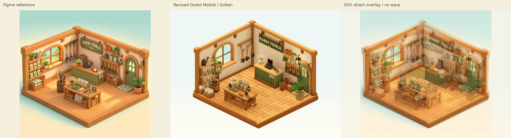

# SGODOT-174 · Farm Tools Store R2.1 finishing revision

赵云 · **Review candidate · R2.1**. Reference: Figma `OMLTC3yw3u2WDjOZhLnhaR`, SceneDesign, node `545:2961`. This responds to the card's display-density, counter-proportion and collision feedback under the SGODOT-172 R2 release.

[Whole room](godot.png) · [Seed display, gloves and goods](detail-display.png) · [Tool wall and counter](detail-tools.png) · [Model orthographics](orthographic-sheet.png).

| Review item | Implementation |
|---|---|
| Space and counter | Usable floor reduced from 6.8×6.0m to 6.4×5.8m. Counter width 2.75→2.09m, moved 0.66m toward the rear wall; worktop lowered to 1.1659m. Display shifted toward the front-left and shortened slightly to retain a walkable west side beside the barrel. |
| Seed display | Actual stepped/leaning 3×2 rack; four reusable illustrated packet GLBs (tomato, spinach, sunflower, carrot) with distinct envelope colours. The same prototypes stock the wall display. Two green gloves, laid-out shovel/rake, two framed blackboard price cards and daisies occupy the top; crates, pots, sacks and twine occupy the lower level. |
| Tools and storage | Foreground coopered barrel contains four varied long tools plus bamboo; two metal heads face upward. Five wall-hung long tools vary in height and lean. Right pegboard has two pruning tools and five short shovels/forks. Left crate has linen seed sacks with visible seeds; counter-side pots and twine crate have blockers. |
| Counter, door and sign | Register, small framed sign, pencil pot, daisies and metre-based folded checked cloth. Iron chain links and leaf motif complete the shop sign. Door has a copper bell and striped mat; a large shared plant is enclosed by the shared terracotta pot. Supplied botanical atlas/material remain unchanged. |
| Materials | Shared static contact AO and warm runtime light. Tool blades, jaws, rivets, barrel hoops and bell form one material group with roughness .43/specular .52, contrasting with matte wood and cloth. No alpha-blended foliage. |

R2.1 responds to the latest three finishing items: the complete table display moves **0.55m right / 0.24m forward** from the prior reviewed revision, with an extra filled sack crate at the front-left and another three-pot stack by the counter. FARM TOOLS moves 0.49m left, clearing the right-hand pot shelf; letters use **Nunito Black with 4mm physical extrusion** and a plaque offset, with every main-view letter including the final S visible. The copper bell is raised and enlarged 23%; the striped door mat is 1.264m wide, covering the 1.02m leaf and frame, and the five hanging tools have greater height/angle variation. Fresh captures use the latest shared deeper-green foliage atlas without changing it.

Budget: **104,546 / 200,000 total triangles**, **39,662 / 100,000 botanical triangles** (conservatively counting complete flower-containing counter/display modules), **43 / 60 static surfaces**. Named editable source geometry remains separate inside meaningful module collections. Repeated seed packets share four local-pivot GLBs; zone grouping controls runtime surfaces.

[Fixed colour samples](colour-samples.png): **4.224° / 9.418° / 2.939° / 5.859°**, all ≤10°. Full RGB/HSV coordinates are in [colour-verification.json](colour-verification.json). Before colour tuning the initial left-plaster patch was found to touch the oak arch cap; it was corrected to a declared world point on the narrow actual plaster strip and the original sample retained privately. The other fixed points are unchanged. These are representative lit faces, not a whole-image similarity score.

The camera fits declared plinth-edge slopes and mean scale at the 6.8×6.2m physical base; the reference's stylized perspective still differs at upper wall corners. [Fit data](../../../tools/art/source/farm_tools_store/camera-review.json) and the unwarped 50% overlay retain those residuals.

**34/34 rendered character checks and the 15-second real-time video pass.** Verification covers a nine-waypoint route from the door to the counter, around the display, to the left rack and window; blockers include counter, table, barrel, crate, shelf and diorama perimeter. The main counter/display aisle measures **2.775m**, above the required .80m. The entrance leg offsets left around the large planter instead of targeting its collision edge. No capsule/floor/guard bypass is used.

[Rendered checks](bench-result.json) · [Source scale](source-scale.json) · [Live ratios](bench-scale-measurements.json) · [Real colliders](bench-collisions.png) · [15-second real-time video frames](video-frames.png) · [Final budget, hashes and media](verification-summary.json).

Measured heights: door 2.33m, counter 1.1659m, display table 1.015m, within ±15% of Basic Room. This store has no seating: the benchmark now records an explicitly inapplicable chair category and its reason, without inventing a height. Missing applicable measurements still fail. The scene owns its blockers; the benchmark change only implements its already documented absence contract.

Rebuild with `tools/art/build_farm_tools_store.py` (delegates to `source/farm_tools_store/revision.py`); run `tools/art/measure_room_source.py -- farm_tools_store` inside Blender for source measurements. Use `prepare_room_review.py`, `configure_room_imports.py`, `review_room.gd`, and the isolated `scene_bench` for Godot evidence. `check_room_colour.py farm_tools_store 174` and `package_room_review.py farm_tools_store 174` verify/package the final captures.

Desktop Godot 4.7.2 Mobile/Vulkan / RADV VANGOGH; not physical-phone performance or a production release. Basic Room and Liu Bei's scenes/library remain read-only.
