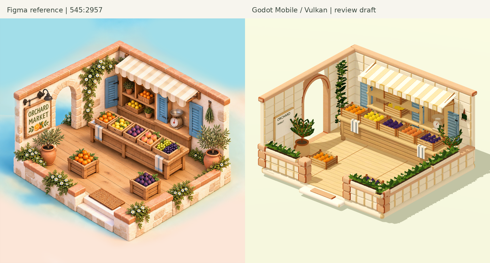
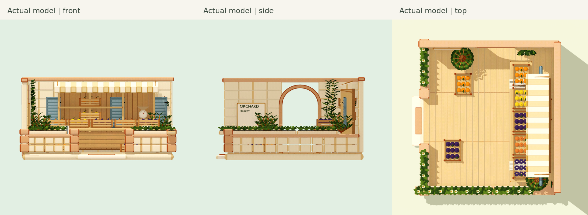

# Fruit Shop — SGODOT-182

Review draft produced by 刘备 on 2026-10-07. User art approval is pending; Plane remains In Progress.

## Reference and visual scope

Actual Figma export: file `OMLTC3yw3u2WDjOZhLnhaR`, node `545:2957`.
[Reference](https://www.figma.com/design/OMLTC3yw3u2WDjOZhLnhaR/Gensen--US-?node-id=545-2957). Local export SHA-256: `6eedf62d50c01a2d659290c314b8427920723a3988530ddab41e99839d079ce7`.
The full image was inspected before modeling. Geometry is original; unshown backs, depths and metre dimensions are inferred.



## Deliverables and rebuild

- Editable named Blender objects/collections: `tools/art/source/fruit_shop/fruit_shop.blend`.
- Generator: `tools/art/build_fruit_shop.py`; shared helpers remain in the Coffee Shop source directory. Basic Room is unchanged.
- Runtime modules, atlas, layout/collisions and budget: `assets/rooms/fruit_shop/`.
- Reusable art scene: `scenes/fruit_shop/fruit_shop_art.tscn`. Contains artwork and simple box collisions only.
- Godot metres, Y up, front +Z; each GLB has its own floor/mount pivot. Repeated objects use the same GLB.

```sh
blender --background --factory-startup --python "$PWD/tools/art/build_fruit_shop.py"
python3 tools/art/render_shop_review.py fruit_shop
```

For manual source edits, use `-- --bake-only` to rebake/export the saved source. A full rebuild overwrites the generated `.blend`; preserve intentional edits first.
The renderer needs the current host's legitimate DISPLAY/XAUTHORITY. Pillow is needed only for packaging comparison images.

## Asset budget

| Metric | Value |
|---|---:|
| Unique GLBs / placed instances | 24 / 39 |
| Unique / placed triangles | 103,588 / 161,916 |
| Static mesh surfaces | 39 |
| Shared atlas | 2048 × 2048, mipmaps + VRAM compression |
| GLB bytes, total | 2,850,768 |
| Atlas PNG bytes | 3,734,136 |

One shared matte atlas material; separate soft translucent material for glass modules where present. Color/surface detail and softened contact AO are baked; direct lighting remains dynamic. Padded palette swatches protect subpixel detail from black seams. Major rearrangements require rebaking contact AO.

## Verification and limits

Blender 5.2.2 LTS; Godot 4.7.2 Mobile/Vulkan on `AMD Custom GPU 0405 (RADV VANGOGH)`. All 24 GLBs pass container/mesh/surface checks and contain no duplicated embedded images; the assembled render contains all 39 instances. Whole/detail/front/side/top images rendered at 1400 × 1400. Source import settings are retained beside the atlas.

The images are real Godot renders of the exported models. No Android, character/movement benchmark, gameplay integration, release or physical-phone performance claim is part of these art-only cards.

Differences / inferred choices: Layout, blue shutters, striped canopy, fruit species, balance scale and local-pivot crates follow the reference. Masonry is more regular; the shelf baskets use slatted crates, floor crate heights and shelf subdivisions are simplified, and foliage remains less dense. The orange illustration and lamp above the ORCHARD MARKET sign are omitted; sign typography is an approximation. Cloth is a rigid static drape, the metal scale uses the shared matte atlas, and the review uses firmer single-sun lighting. Hidden construction and dimensions are inferred.



Delivery: Lark self-review messages and downloaded-attachment verification are recorded privately under `output/fruit_shop/delivery/`; no chat identifiers or credentials are committed.
