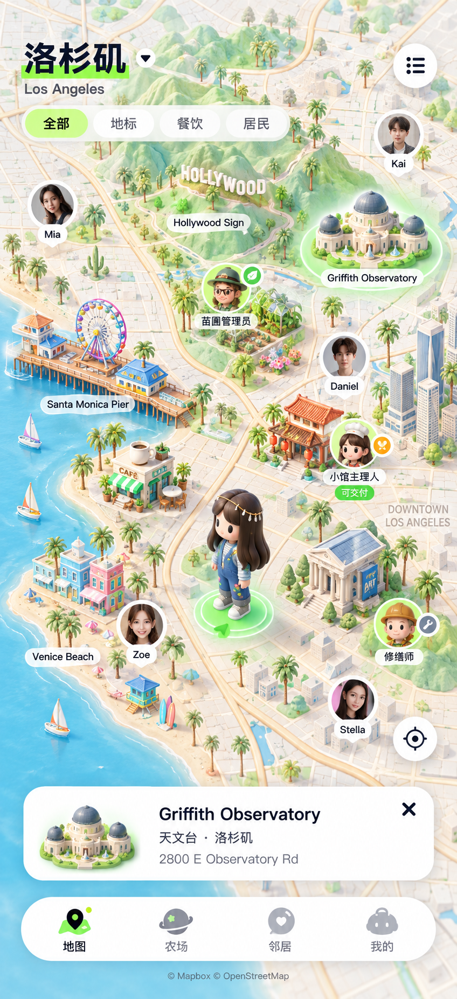

# 洛杉矶地图主视觉稿

- 日期：2026-09-22。
- 状态：用户已于 2026-09-22 确认“这个主视觉ok”，随后要求开始实装。Android地图样板已实现，实际截图与验证见[QA记录](../../qa/la-map-2026-09-22.md)；本页主图仍是原始视觉基准。
- 用户要求：参照最新 Gensen Map 设计图与地图评估，使用 Sensenjoy API，只生成一张主视觉稿。
- 生图渠道：`https://sub.sensenjoy.cn/v1`，模型 `gpt-image-2`，imagegen 附带 CLI 的多参考图 edit 调用。密钥仅来自环境。
- [查看主稿](generated/la-map-main-v1.png)。原始 API 输出另存于 `output/imagegen/la-map-2026-09-22/la-map-main-v1.png`。
- [完整实际提示词](prompts/la-map-main-visual.txt)，[调用与文件记录](assets.json)。

参考图包含用户提供的完整设计板、其中洛杉矶页的放大裁切，以及现有玩家装扮的裁切。完整原始设计板保存在 `../la-map-assessment-2026-09-22/reference.png`；送入 API 的版本转为 RGB 并压缩尺寸，保留参考内容。

主稿采用浅奶白城市底图、浅绿丘陵和蓝色海岸，结合立体地标与轻量白色悬浮 UI。地图上只有一个完整 3D 自己；五个其他玩家显示照片头像，三个 NPC 使用插画头像和不同状态角标。选中的 Griffith Observatory 用底部小卡片展示名称、类别、城市与地址。下方保留地图、农场、邻居、我的四个入口。

已目视检查：单完整角色、5 个玩家头像、3 个 NPC 头像、中文城市和导航文字、地标标签、基本信息卡、无设备外框；主角没有被底部卡片遮挡。

本图是美术与布局概念：地理间距及具体建筑为生图示意，实际实现须使用真实地理数据；NPC 点位和头像是示例。通用 POI 资产清单及交互尚未实现。请求尺寸 1024 × 2240，服务实际返回 848 × 1855，交付保留 API 原图，没有插值放大。

2026-09-22 后续：按用户反馈收紧地图UI比例，见[三栏对照与验收](../../qa/la-map-scale-2026-09-22.md)。

2026-09-22 后续：统一地图二级面板并检查三种模拟器尺寸，见[面板对照与验收](../../qa/la-map-panels-2026-09-22.md)。
