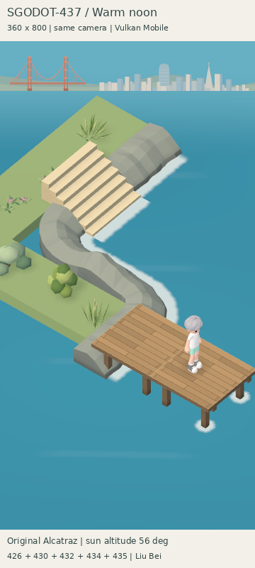
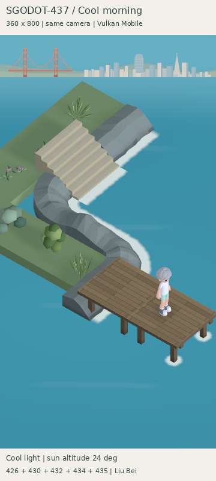
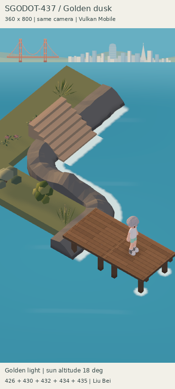

# SGODOT-437 · 通用室外光照预设

【刘备】暖午、清晨、黄昏三个 `.tres`，加一个可实例化的 `lighting_rig.tscn`。暖午完整复现恶魔岛当前 Environment 和主光；清晨为偏冷的 24° 长影，黄昏为金橙色 18° 低角度光。对已有 WorldEnvironment / DirectionalLight3D 应用预设时保留宿主阴影设置。运行资源和参数表见 [lighting README](../../../assets/landmarks/_shared/lighting/README.md)。

| 审阅图 | 主光 / 氛围 |
|---|---|
| [暖午](warm-noon-default-review.png) | 原版恶魔岛，俯角 56° |
| [清晨](cool-morning-default-review.png) | 冷光、俯角 24°，长影 |
| [黄昏](golden-dusk-default-review.png) | 金橙光、俯角 18°，反向长影 |

## 同场景对照

三张都是 Godot 4.7.2 / Vulkan Mobile、360×800 默认镜头。固定正交宽 6.72 m、俯角 43°、yaw 14.5°、海岸旋转 65°、1.75 m 人物；不为单个预设调镜头、曝光或材质。三套均保持普通雾 / 体积雾、SSAO、SSR、SDFGI、Glow 关闭。

426 岸石、430 浪花、432 海湾和 434 桥 / 城市 / 丘陵取自分支基线 `4e2c401ac`。六个 435 草 / 灌木 / 冰花件取自赵云 #841 的 `a590b559dd6e776dc1047f858757c932c3a7cf2b`，仅借用到隔离审阅工程，不把未合并件复制进本 PR 的运行目录。小件和地形保留原材质；两个新建的平面草地区块只接收阴影，避免低角度下辅助地块自身的条纹。

暖午保留恶魔岛实际的诊断背景色 `#D000D0`，完整海面覆盖后画面不露此色；已有海面 / 远景是 unshaded，三套灯光不会替它们换色。没有背景覆盖的室外 POI 在复制的预设中设置正式背景色，README 给出了格里菲斯的 `#E3EBE8` 作为现有参考。恶魔岛和格里菲斯本体均未改。

## 验证与开销

- **45 项资源检查通过**：暖午 Environment 的全部存储属性、所有原阴影属性匹配；清晨 / 黄昏切换保留格里菲斯的独立阴影距离、淡出、pancake 和 blur；实例 Environment 副本互不污染。
- **暖午像素差为 0**：同一示例海岸、同帧，把原恶魔岛设置与新预设对照，完整 360×800 RGB 最大 / 平均差均为 0。
- **灯光 / 绘制预算相同**：一盏 DirectionalLight3D、一个 WorldEnvironment、单级正交阴影；原设置及三套均为可见 31 draws + 阴影 14 draws，阴影三角数 2540。2048 阴影贴图、filter quality=2 不变；无新 pass、纹理或逐帧脚本。
- **实际阴影控制**：与只关闭主光阴影的同帧图对比，暖午有 11,507 px 变化，清晨 29,635 px，黄昏 29,667 px；对照排除了只改色温而没有投影变化。影长 / 高度的平地几何近似分别为 0.67 / 2.25 / 3.08，不代替地形上逐米测量。
- **Android**：独立 `com.sensen.lighting437qa`，API37 / SwiftShader / Mobile；3 次真实点击循环三预设并回到暖午，当前 PID / 预设状态对应，draws 一致，完整 APK 安装后回读 SHA 相同。QA app 已停止，模拟器尺寸 / 密度恢复。
- **冷导入**：空缓存再次导入、资源验证及实渲通过。9 个运行目录文件名称 / SHA 与源完全一致；两个 `.gd.uid` 由 Godot 生成。没有新模型或贴图，`.import` / `root_script` / 压缩格式条目不适用。

### 耗时样本

相同 360×800 SubViewport，Deck 的 AMD VANGOGH / Vulkan Mobile；每组预热 45 帧、采样 90 帧，交替三轮，中间一轮逆序，共每种 270 样本。表为中位数 / P95，单位 ms。

| 设置 | GPU | CPU |
|---|---|---|
| 原恶魔岛设置 | 0.344 / 0.350 | 0.182 / 0.253 |
| 暖午 | 0.344 / 0.349 | 0.185 / 0.248 |
| 清晨 | 0.340 / 0.347 | 0.175 / 0.233 |
| 黄昏 | 0.338 / 0.342 | 0.173 / 0.234 |

这组采样没有出现超过原配置波动的持续增幅；暖午 GPU 中位数相同，CPU 中位数差约 0.003 ms、P95 更低。测量不包含显示合成 / present，不是整机 FPS、实体手机 GPU 或所有地标帧时间的保证；本件提供相同渲染预算和当前示例的对照证据。

证据：[资源](resource-validation.json) · [实渲](render-validation.json) · [耗时](timing-validation.json) · [阴影控制](shadow-controls.json) · [Android](android-validation.json) · [冷导入 / 保全](import-preservation-validation.json) · [媒体 SHA](media-manifest.json)。[源与复现步骤](../../../tools/art/source/lighting_437/README.md) 包含固定参考提交及工具命令。

本件没有游戏注册、导航、layout 或原地标变更；只交可复用光照和审阅资料，等待技术 / 画面验收。
