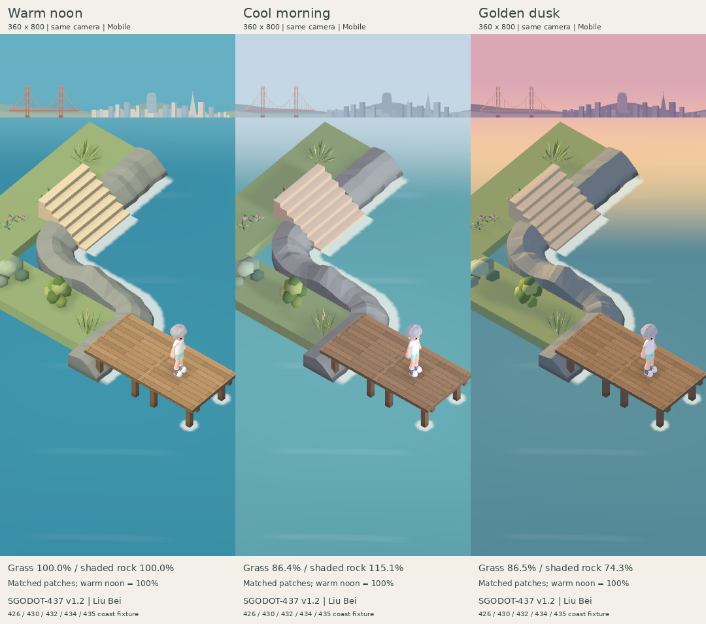

# SGODOT-437 · v1.2 光照与背景联动

【刘备】针对画面复核 `59764fe7`：三套预设现在同步切换环境、主光、海面和远景。清晨为淡蓝白主光、淡紫环境补光、淡蓝灰背景及冷白海纹；黄昏为橙金主光、紫蓝环境补光、桃粉到暖金的海天过渡和偏紫远景。保留 v1.1 的两项技术修正：无全局类注册，共享暖午背景 `#E3EBE8`。

三栏各为完整、未调色的 360×800 Godot 4.7.2 / Vulkan Mobile 实渲，只在画面外添加标题和读数。相机固定为正交宽 6.72 m、俯角 43°、yaw 14.5°；同地形、同材质、同人物，太阳角度按预设变化。426 / 430 / 432 / 434 的基线及 435 试用植被提交与初版一致。

## 明暗取样

以暖午同一组屏幕坐标像素为 100%，取显示 RGB 的 Rec.709 加权均值 Y′。未把海、天、人物算进地表明暗；这是画面亮度比较，不是物理线性照度。取样多边形和原始读数见 [JSON](brightness-validation.json) / [位置图](brightness-regions.png)。两块草地平均值显示在并排图下方。

| 固定区域 | 清晨 / 暖午 | 黄昏 / 暖午 |
|---|---|---|
| 上方草地 | 86.2% | 87.7% |
| 下方草地 | 86.6% | 85.4% |
| 木板 | 85.1% | 84.7% |
| 石阶 | 109.8% | 89.2% |
| 岩石侧面均值 | 115.1% | 74.3% |

清晨光向改变，因此同一岩石侧面在清晨受光更多。黄昏这块暗面的 P10 亮度为暖午同区域的 76.1%，均值 / P10 均高于 60%；不把单个取样区结果宣称为全画面每个像素的下限。草地保持绿色，石阶和木板保留暖色亮面，人物完整可读。暖午在完整海面覆盖的同场景仍与原设置逐像素一致（最大差 0）。

## 接入与预算

每个预设引用本目录的一份海面 `.tres` 和一份远景 `.tres`。远景资源包含城市、丘陵、桥三个子材质；避免把桥、丘陵全部染成同一种颜色。片段只为绑定的已有节点换 material_override，每个角色共享宿主局部副本。

432 / 434 原 shader 与原 `.tres` 完全未改。海面复用原有远处颜色及渐隐：清晨 / 黄昏露出 Environment 背景；黄昏 `far_color=Color(1.30,1.12,0.30,1)` 经现有混合形成柔和暖金横带，无 Glow、反射或额外面片。此为风格化背景反光带，不是物理太阳反射。屏幕渐隐范围需随新地标构图在复制的 `.tres` 调整。[完整参数与挂接](../../../../assets/landmarks/_shared/lighting/README.md)。

仍为一盏主光、一个 Environment；阴影设置不动，无第二盏灯、逐帧回调、新纹理采样、pass 或透明叠层。三个预设均为 **31 次可见绘制 + 14 次阴影绘制**、2540 阴影三角形。无 SSAO / SSR / SDFGI / 普通雾 / 体积雾 / Glow。

同一个 Deck Vulkan Mobile 视口，45 帧预热 + 90 帧采样，交替三轮、每种 270 样本：

| 配置 | GPU 中位数 / P95（ms） | CPU 中位数 / P95（ms） |
|---|---|---|
| 原恶魔岛设置 | 0.344 / 0.349 | 0.1895 / 0.2566 |
| 暖午 | 0.344 / 0.348 | 0.1975 / 0.2561 |
| 清晨 | 0.3405 / 0.346 | 0.1840 / 0.2446 |
| 黄昏 | 0.340 / 0.346 | 0.1890 / 0.2560 |

GPU 中位数未增加；暖午 CPU 中位数差 0.008 ms，P95 相当，处于本次采样波动内。此为视口 CPU/GPU 数据，不含显示合成，不能代替整机或实体手机帧时间。

## 验证

- 无 `.godot`、未经编辑器导入的最小工程直接运行通过 **79 项检查**；完整审阅工程空缓存导入后同样通过。包含三套光照与海面 / 三类远景切换、宿主修改隔离、资源误选保护、阴影保全及高开销效果关闭。
- 17 个运行文件名称 / SHA 在冷导入后与源一致；3 个脚本 UID 由 Godot 生成。无新 GLB / 贴图，因此 `.import`、root_script 和压缩格式条目不适用。
- Android API37 / SwiftShader / Mobile 实际点击三次，暖午 → 清晨 → 黄昏 → 暖午；同一当前 PID 中环境、海面、桥的参数三套不同，返回暖午恢复；绘制数一致，完整安装包回读 SHA 匹配。三个画面含完整人物。QA app 已停止，模拟器尺寸 / 密度已恢复。
- 恶魔岛、格里菲斯、其他共享套件和项目配置相对基线无变动；没有游戏接入或 layout。QA APK 导出保留已有的缺少应用图标提示，导出 / 签名 / 安装回读成功，无脚本或着色器错误。

[资源检查](resource-validation.json) · [冷导入与保全](cold-validation.json) · [实渲](render-validation.json) · [耗时](timing-validation.json) · [Android](android-validation.json) · [媒体 SHA](media-manifest.json) · [复现步骤](../../../../tools/art/source/lighting_437/README.md)。
