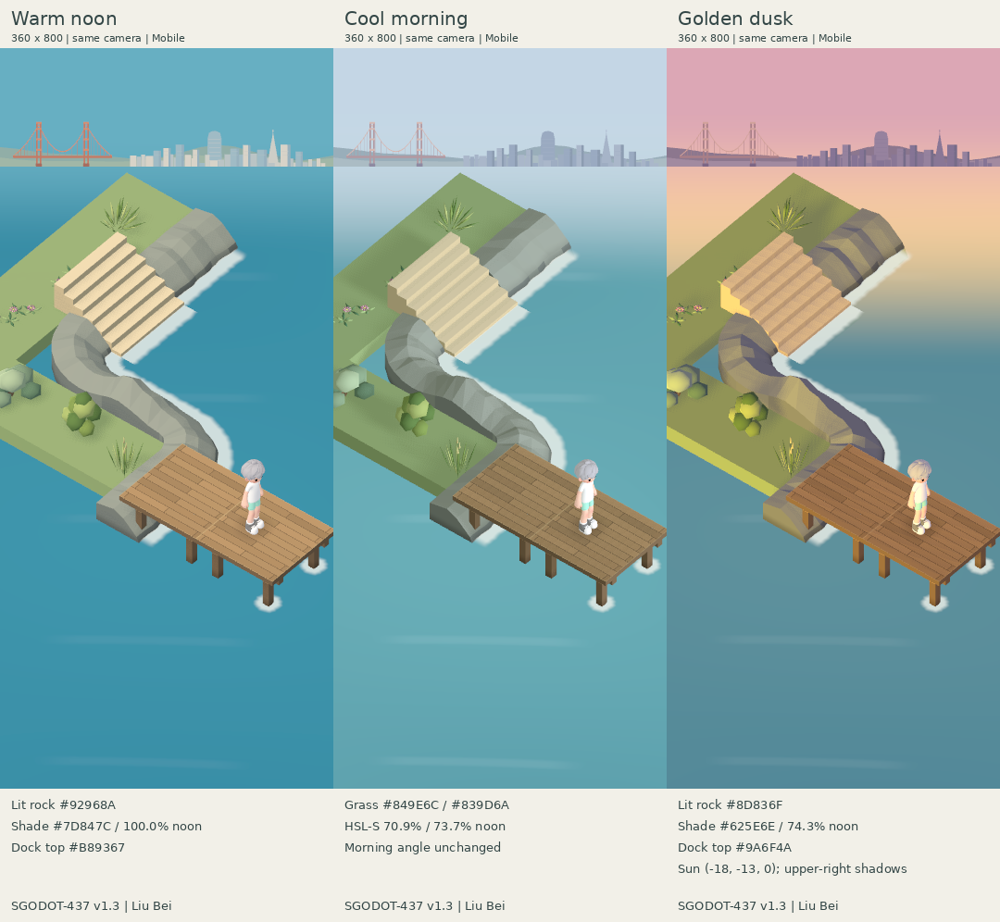
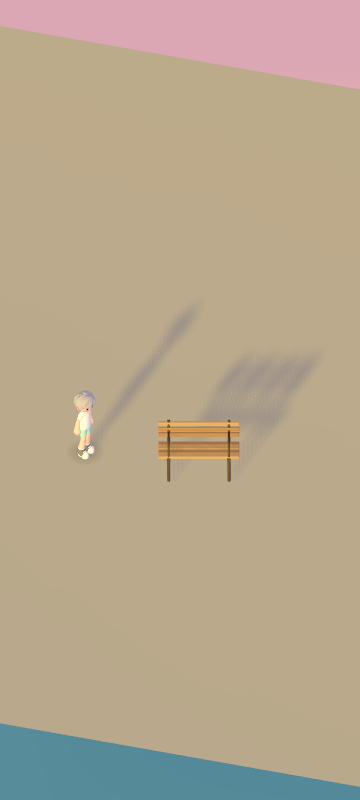

# SGODOT-437 · v1.3 黄昏受光与清晨草色

【刘备】针对不知火舞 `60600b8d`。黄昏指定岩面现在能接到主光，转为暖灰褐；背光面改为紫灰。清晨采用已确认的本地环境光颜色，草地饱和度恢复。三套配套天、海、远景及所有模型、材质颜色不变。

## 角度与参数

原黄昏方向下，指定岩面在关闭环境光时为纯黑，直接主光贡献为零。经奕星和上官婉儿明确授权，黄昏水平角 **−115° → −13°**。保留 **18° 低高度角**及原阴影设置；暖午 `(−56, −34, 0)`、清晨 `(−24, 65, 0)` 不变。

| 参数 | v1.2 | v1.3 |
|---|---|---|
| 黄昏主光颜色 | RGB (1, 0.843137255, 0.549019608) | RGB (1, 0.88, 0.26) |
| 黄昏主光强度 | 1.85 | 1.73 |
| 黄昏环境光颜色 | RGB (0.725490196, 0.796078431, 0.941176471) | RGB (0.83, 0.795, 0.984) |
| 黄昏环境光强度 | 0.92 | 0.62 |
| 清晨环境光颜色 | RGB (0.827450980, 0.811764706, 0.933333333) | RGB (0.788131776, 0.837254004, 0.789618049) |

清晨环境光强度仍为 0.90，主光颜色、强度均不变。未调整曝光、白点或 tonemap；没有新灯、材质调色、shader 修改。

## 实渲取色

Godot 4.7.2 / Deck Vulkan Mobile，同一机位 360×800，正交宽 6.72 m、俯角 43°、yaw 14.5°。画面未经后期调色。以下是标出的多边形内显示 RGB 均值；Y′ 使用 Rec.709 权重，不是物理线性照度。[取样位置](color-regions.png) / [逐项数据](color-validation.json)。

| 黄昏区域 | 目标色参考 | v1.3 实测 | 同区 / 暖午亮度 |
|---|---|---|---|
| 指定岩石侧面，1165 像素 | `#8E7C6E` | **`#8D836F`** | 88.6% |
| 内弯背光岩面，41 像素 | `#5F5A6E` | **`#625E6E`** | **74.3%** |
| 木板顶面，596 像素，含木纹和板缝 | `#94693F` | **`#9A6F4A`** | 77.6% |

指定岩面原为 `#64707D`，现在 R 大于 B。木板均值仍比目标参考略浅，蓝通道高约 11/255；保留原木材颜色，不把接近目标写成逐色一致。岩面色值随原网格各裂面法线而变。原“rock_shadow”大区域随光向变化已成为受光面，不能继续拿它冒充暗面；新背光区位置与它在 v1.2 / 暖午的读数均公开在 JSON 中。74.3% 是该真实背光区对暖午同坐标的比值，不是全场景下限。

| 清晨草地 | v1.3 实测 | HSL 饱和度 / 暖午 | 亮度 / 暖午 |
|---|---|---|---|
| 上方 | **`#849E6C`** | **70.9%** | 86.4% |
| 下方 | **`#839D6A`** | **73.7%** | 86.9% |

所有草地模型、顶点色与材质保持原样；黄昏光照方向及光色改变会自然改变其明暗和暖色响应。三套天空 / 远景上部固定区（y=0–131）及近海固定区（y=640–799）对 v1.2 最大 RGB 差均为 **0**。

## 影子方向

额外独立的检查平面沿用原相机方向和完整生产光照设置，借用既有 `street_kit/bench_wood.glb`。人物和长椅的投影均朝画面右上；1.75 m 人物的平地影长约 5.39 m，屏幕向量 **(+111.9, −146.6) px**，不会正对镜头向下拉。

海岸审阅人物本来使用 blob shadow；仅在这张独立检查中给其现有网格开启真实投影，用来验证完整人高的方向。生产角色、海岸三张主图和所有生产阴影参数不改。附 [关闭投影对照](golden-dusk-shadow-probe-off.png)；该独立检查不计入主图的开销测量。

## 验证与开销

- 三套主图仍为 **31 次可见绘制 + 14 次阴影绘制**，单盏 DirectionalLight、一个 Environment，原阴影参数完整保留，无新增采样、pass、透明层或逐帧回调。
- 原设置 / 暖午 / 清晨 / 黄昏各 270 个交替视口样本，GPU 中位数分别 **0.344 / 0.344 / 0.340 / 0.341 ms**，CPU 中位数 **0.185 / 0.186 / 0.182 / 0.185 ms**。这是 Deck 视口测量，不代替实体手机帧时间；渲染开销保持同一水平。
- 完整审阅工程空缓存冷导入、现有 **79 项资源检查**、桌面实渲通过。16 个运行资源名称 / SHA 完全一致（加 README 为目录原有 17 个文件）。误选 Resource 的检查保留一条预期警告，无脚本或 shader 错误。
- 本轮 Android 未重跑；v1.2 的切换和包回读记录保留其原版本标记。运行切换逻辑未改。
- 运行改动仅在 `cool_morning.tres`、`golden_dusk.tres`。其他改动为说明和复现 / 审阅资料。恶魔岛、格里菲斯、432 / 434、海岸及植被源文件均无变化。

[资源检查](resource-validation.json) · [冷导入](cold-validation.json) · [实渲](render-validation.json) · [耗时](timing-validation.json) · [媒体哈希](media-manifest.json) · [复现](../../../../tools/art/source/lighting_437/README.md)。
