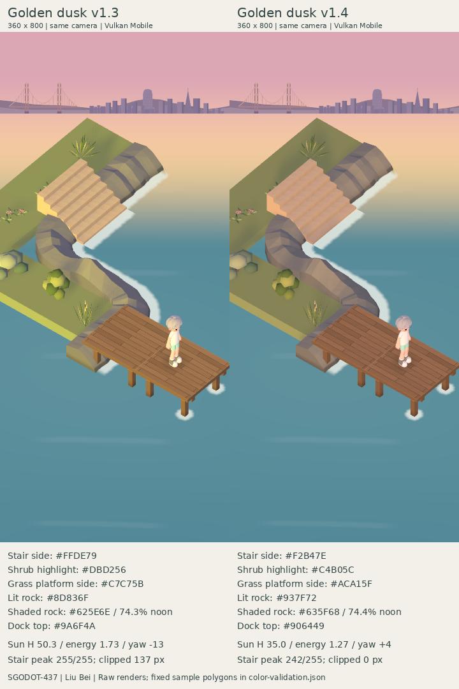

# SGODOT-437 · v1.4 黄昏橙金与高亮收敛

【刘备】对应不知火舞 `614cca74-93e4-4913-8732-03e9310fea28`。只调黄昏光照，压低柠檬黄的台阶 / 草台侧面，保留暖灰褐岩面与约 74% 的暗面亮度。暖午、清晨不动。

## 最终参数

运行增量仅 `assets/landmarks/_shared/lighting/golden_dusk.tres` 的四项参数；Environment 背景、海面 / 远景参数、模型、材质颜色均未改。

| 参数 | v1.3 | v1.4 |
|---|---|---|
| 主光颜色，sRGB | (1, 0.88, 0.26)，色相 50.3° | **(1, 0.7875, 0.49)，色相 35°** |
| 主光强度 | 1.73 | **1.27** |
| 主光欧拉角 | (−18, −13, 0) | **(−18, 4, 0)** |
| 环境光颜色，sRGB | (0.83, 0.795, 0.984) | **(0.835, 0.799, 0.94)** |

环境光强度仍为 **0.62**。不调整 tonemap、曝光或白点。单纯降主光会同时压暗已通过的岩面，因此沿用奕星 / 上官婉儿对黄昏水平角的授权，将水平角微转 17°，降低台阶侧面的直照，同时保持原岩面的亮度。仍为 **18° 低高度角**，所有阴影参数不变。独立人物 / 长椅实渲检查通过，1.75 m 人物投影朝右上，屏幕向量 **(+44.2, −162.5) px**，没有朝镜头下方拉。

## 实渲读数

Godot 4.7.2 / Deck Vulkan Mobile，同机位 360×800，正交宽 6.72 m、俯角 43°、yaw 14.5°。画面未经后期调色。v1.3 的本次复拍与已提交原图逐像素一致。取色为固定多边形内 RGB 均值，坐标 / 像素数在 [color-validation.json](color-validation.json) 中公开；显示亮度 Y′ = 0.2126 R + 0.7152 G + 0.0722 B，不是物理线性照度。

| 区域 | v1.3 | v1.4 实测 | 目标 / 保留情况 |
|---|---|---|---|
| 台阶朝阳侧面，137 px | `#FFDE79` | **`#F2B47E`** | 目标 `#F0B47A`，各通道差 +2 / 0 / +4 |
| 灌木亮面，61 px | `#DBD256` | **`#C4B05C`** | 目标 `#C9B46A`，仍略深，差 −5 / −4 / −14 |
| 草台侧边，150 px | `#C7C75B` | **`#ACA15F`** | 从柠檬绿收成暖橄榄色 |
| 原指定岩面，1165 px | `#8D836F` | **`#937F72`** | 暖灰褐，亮度保留 **99.3%** |
| 原背光岩面，41 px | `#625E6E`，暖午 74.3% | **`#635F68`** | 暖午同区 **74.4%** |
| 木板顶面，596 px，含纹缝 | `#9A6F4A` | **`#906449`** | 比 v1.3 暗 8.8%；相对早先 `#94693F` 参考，差 −4 / −5 / +10 |

台阶取样区 Y′ 为 **74.2%**，降至 v1.3 的 **85.4%**；最大通道和 P95 均为 **242/255**，截顶像素 **137 → 0**。此处同时给出亮度和通道峰值，不把“约 90%”写成全场景的硬限幅，也不把目标近似写成逐色一致。灌木及木板仍有上表所列偏差，没有通过修改材质颜色去单独修正它们。

天空 / 远景 y=0–131、近海 y=640–799 的固定区域，相对 v1.3 最大 RGB 差均为 **0**。其他物体随光色、光向变化自然改变受光，未更换任何配套材质。

## 验证范围

- 完整审阅工程删除缓存后冷导入；**16 个运行资源的源文件、导入前后副本 SHA 一致**。除 `golden_dusk.tres` 外的 15 个运行文件与 v1.3 完全一致，包括暖午、清晨、所有海面 / 远景预设及脚本。
- 现有 **79 项资源检查通过**，保留误选 Resource 的预期警告；无脚本 / shader 错误。
- 实渲与投影检查通过。海岸前后均为 **31 次可见绘制 + 14 次阴影绘制**，同样的 11386 / 2540 三角形。仍为单主光，无新增采样、pass、透明层或运行脚本。
- 本轮不重复 Android 或耗时基准；此前版本的记录仍标为其原版本，不作为 v1.4 的实机帧时间结果。
- 恶魔岛、格里菲斯及 426 / 430 / 432 / 434 / 435 原文件均未修改。只有这一张黄昏并排审阅板；单张原始 360×800 图供复核，影子诊断图留在本地 output。

[原始黄昏图](golden-dusk-default-review.png) · [资源检查](resource-validation.json) · [冷导入及哈希](cold-validation.json) · [实渲及影子方向](render-validation.json) · [媒体哈希](media-manifest.json) · [复现步骤](../../../../tools/art/source/lighting_437/README.md)。
