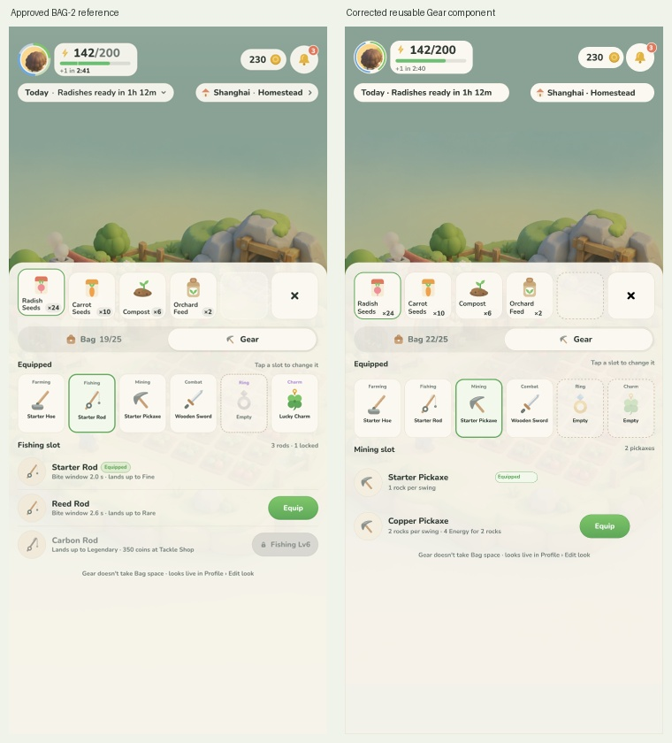

# 后续设计图与组件整理 · 2026-10-06

**当前审阅版本（2026-10-07）**：本目录记录 08–13 首轮设计与 00B/00C 组件来源；当前 288 主卡、统一快捷栏、222 主组件／25 组件集及共享信息窗以[UI 设计审阅入口](../ui-refactor-2026-10-06/REVIEW.md)为准。下文原轮次的“最新”、325 组件／30 集和样式规格属于旧页证据，不是当前重构页统计。

本轮已完成**后续页面与状态的首轮设计**，新增131张卡，沿已采用的玩法v2和原有UI样式。原有07的73张卡同步做了组件一致性修正；不是131个新功能，也不代表P1/P2/P3实现或美术生产验收完成。

用户追加要求：复用之前已完成的设计，尤其组件规格；指出07背包与原设计有出入。本轮以BAG-1/BAG-2、kit.css、kit-profile.css、kit-need.css和Section00为依据修正，不能把07初稿当成替代视觉基线。

## Figma入口

| 分区 | 新增页面/状态卡 | 内容 |
|---|---:|---|
| [08 · P1日常操作](https://www.figma.com/design/OMLTC3yw3u2WDjOZhLnhaR/Gensen--US-?node-id=430-14) | 30 | 设施制作/放置、鱼笼巡线、多灶/Queue/Cook All/Double |
| [09 · P2免费旅行闭环](https://www.figma.com/design/OMLTC3yw3u2WDjOZhLnhaR/Gensen--US-?node-id=430-16) | 18 | Browse→Travel→出发→到达→当地行为→回家，含失败重连 |
| [10 · P2收费旅行与社交](https://www.figma.com/design/OMLTC3yw3u2WDjOZhLnhaR/Gensen--US-?node-id=438-3178) | 38 | 收费/取消/退款/证件/第二故乡、关系、客票、帮工、赠礼、共做、扩展烹饪 |
| [11 · P3料理Buff](https://www.figma.com/design/OMLTC3yw3u2WDjOZhLnhaR/Gensen--US-?node-id=438-3180) | 12 | 五种Buff说明、替换、HUD时间/次数、轻量到期反馈 |
| [12 · P1成长、战斗与居民](https://www.figma.com/design/OMLTC3yw3u2WDjOZhLnhaR/Gensen--US-?node-id=438-3182) | 33 | Lv4–10后果、矿洞3–5战斗、居民交互与12人内容卡、里程碑 |
| [13 · 内容资产与变体](https://www.figma.com/design/OMLTC3yw3u2WDjOZhLnhaR/Gensen--US-?node-id=438-3184) | 资产样式板 | 100个原型图标/头像、20×4生长状态、20剪影、20气候配色、7外观阶段 |

[00B · 既有UI组件复用](https://www.figma.com/design/OMLTC3yw3u2WDjOZhLnhaR/Gensen--US-?node-id=431-20) · [00C · 场景气候组件](https://www.figma.com/design/OMLTC3yw3u2WDjOZhLnhaR/Gensen--US-?node-id=456-12024) · [组件维护说明](COMPONENTS.md) · [逐项资产映射](ASSETS.md) · [未定规则与审阅边界](OPEN-ITEMS.md)

## 背包样式修正

- 半透明奶油抽屉、圆角48px、y=800/高1600（原稿1080×2400尺寸，Figma按1:3展示）。
- 首行5个160px快捷格+关闭格，12px间距；保留原SVG、物品名、数量角标、虚线空格。
- Bag/Gear是分段切换；Bag网格160px、间距16px、五列；Gear恢复单排六槽、行内Equip、已装备标识。
- 主按钮恢复112px高的绿色渐变与白字，次按钮描边；小号Equip为80px高独立变体。
- 材料环L/M/S分别156/112/72px，数字一行，短缺琥珀；劳作主行动键176px圆、56px工具徽标、96px切换键，纯设施空间不使用劳作键。
- 07共65个自制HUD及91个面板按钮替换为共享实例；Bag/Gear3卡直接使用统一抽屉组件。原01–06已批准的整张截图卡不批量覆盖。

## 组件与内容

云端共有325个组件节点、30个组件集（包含100个内容图标/头像、作物生长变体、基础图标等，不是325种控件）。共用按钮、HUD、信息行、Need Tile、Bag Drawer、Action Controls、Outpost气候变体已有主组件；页面与内容板引用实例。信息行155处、材料格35处在本轮整理时归并，后续编辑主组件可传播。

内容以既有可编辑SVG风格为基础：20作物、20鱼、48料理、12居民头像均逐项映射规范ID。原有图标按来源复用；新头像和鱼形为原型候选，料理是菜系底盘+食材装饰组合，不能将48个组件ID解释为48张已批准独立高保真美术。作物生长板为符号化状态示意；高等级房屋和气候配色复用既有场景，不是新3D模型。

## 验证与使用

- 204张流程卡（原07共73+本轮131）回读；131张新卡的文本、图标、按钮、面板可编辑。栅格图只用于原有场景和头像裁切。
- 字体仅Nunito与Noto Sans SC（后者用于稿外中文审阅注释）；修复字号/宽度继承、Equip标签、材料环文字越界、满体力回复状态和Buff过期弹窗。
- 1,293个原型反应回读，无缺失目的地、无当前卡自跳转；文本宽度检查无越界。分镜包含审阅注释，模拟连线不会真正发送礼物/邀请或改游戏存档。
- 新增8个审阅起点，和07原有4个共12个；正常流程、异常状态与独立示例是分镜，非完整数据驱动可运行游戏。
- 整板截图和原尺寸局部检查保存在[最终QA目录](qa/final/)；运行代码、生产配置、游戏资产和设备存档未修改。`git diff --check`通过。

## 逐卡索引

| 编号 | 标题 | 审阅依据/状态边界 |
|---|---|---|
| [FAC-1](https://www.figma.com/design/OMLTC3yw3u2WDjOZhLnhaR/Gensen--US-?node-id=435-999) | 洒水器 · 制作 | §5.7/13.4。木8+石6+铜3，从仓库扣；本样例Homestead4故上限7。制作成功进入放置，不把取消放置当退款。 |
| [FAC-2](https://www.figma.com/design/OMLTC3yw3u2WDjOZhLnhaR/Gensen--US-?node-id=435-1081) | 放置 · 有效覆盖 | 蓝色3×3范围含中心占地，实际浇周围8格。Place确认前仅预览；取消保留已制成设施，扣料时点与制作分开。 |
| [FAC-3](https://www.figma.com/design/OMLTC3yw3u2WDjOZhLnhaR/Gensen--US-?node-id=435-1157) | 放置 · 占地冲突 | 无效预览红格+原因，不能确认落地；拖至空格恢复有效态。服务器拒绝放置后保留待放设施，不再次扣材料。 |
| [FAC-4](https://www.figma.com/design/OMLTC3yw3u2WDjOZhLnhaR/Gensen--US-?node-id=435-1234) | 洒水器 · 已落地 | 落地后数量2→3，范围播种即生长；只省浇水与等待。移动/回收规则尚未定义，不在本批虚构返料比例。 |
| [FAC-5](https://www.figma.com/design/OMLTC3yw3u2WDjOZhLnhaR/Gensen--US-?node-id=435-1310) | 堆肥箱 · 每日转化 | §5.7。每天最多5份任意作物，等量转化；本样例选择5份。可用次数与作物不足都写按钮，不把材料变金币。 |
| [FAC-6](https://www.figma.com/design/OMLTC3yw3u2WDjOZhLnhaR/Gensen--US-?node-id=435-1386) | 设施 · 今日满额与温室 | 堆肥结果与上限同屏。温室入口继续下一张：4×4，成熟−25%，与堆肥上限−45%，不允许多年生。 |
| [TRAP-1](https://www.figma.com/design/OMLTC3yw3u2WDjOZhLnhaR/Gensen--US-?node-id=435-1460) | 渔具铺 · 买鱼笼 | 由Finn问候→Trade→商品。只售不做；价格120。Tackle计容量，堆叠3；购买前检查钱与空位，不能直接从商店落笼。 |
| [TRAP-2](https://www.figma.com/design/OMLTC3yw3u2WDjOZhLnhaR/Gensen--US-?node-id=435-1536) | 到塘 · 投放鱼笼 | 已到访系统塘本人到场；Fishing快捷栏选中鱼笼，主行动键Set Trap。每塘每人1只、0体力；本稿用大按钮呈现该行动。 |
| [TRAP-3](https://www.figma.com/design/OMLTC3yw3u2WDjOZhLnhaR/Gensen--US-?node-id=435-1591) | 鱼笼 · 计时 | 每8h有效时间1条，离线累计最多3条；满笼分镜另列，不在产品中放快进按钮。 |
| [TRAP-4](https://www.figma.com/design/OMLTC3yw3u2WDjOZhLnhaR/Gensen--US-?node-id=435-1657) | 鱼笼 · 满笼收取 | 必须本人到塘，0体力；Common/Fine候选含地区、时段。XP为鱼种XP×50%×等级差，不写固定+XP。 |
| [TRAP-5](https://www.figma.com/design/OMLTC3yw3u2WDjOZhLnhaR/Gensen--US-?node-id=435-1732) | 鱼笼 · 满包保留 | 装不下部分留笼，笼满暂停产出；部分收取按实际容量，不能丢鱼或冒用被动奖励包裹通道。 |
| [TRAP-6](https://www.figma.com/design/OMLTC3yw3u2WDjOZhLnhaR/Gensen--US-?node-id=435-1798) | 鱼笼 · 槽位与同塘限制 | 有空总槽也不能同塘放第2只。Lv5/8/10为1/2/3；P1只家城已访塘，P2后才跨城；此地图按钮为后续共用入口。 |
| [COOK-P1-1](https://www.figma.com/design/OMLTC3yw3u2WDjOZhLnhaR/Gensen--US-?node-id=435-1874) | 第二灶 · 并行操作 | 第二灶由Homestead4，3槽由Cooking4；两个门分开。灶台点击选中，无Cook/Shop设施FAB。背景裁切既有厨房，不计新整屋美术。 |
| [COOK-P1-2](https://www.figma.com/design/OMLTC3yw3u2WDjOZhLnhaR/Gensen--US-?node-id=435-1930) | Queue ×2 · 排下一锅 | 一灶最多当前+下一锅，前锅离灶后自动开火，火候照常。预扣/预留与取消队列的材料时点未在基线定义，本稿只定显示与启动前重检。 |
| [COOK-P1-3](https://www.figma.com/design/OMLTC3yw3u2WDjOZhLnhaR/Gensen--US-?node-id=435-1999) | 队列 · 留灶阻塞 | 满包且柜满，成品留灶；队列不覆盖成品。整理/收走后才自动开下一锅，第二灶继续独立运行。 |
| [COOK-P1-4](https://www.figma.com/design/OMLTC3yw3u2WDjOZhLnhaR/Gensen--US-?node-id=435-2071) | Cook All · 开火前可读 | §4.6.3：按稀有度高→低排满空灶与队列，受同一库存约束；同稀有度排序与预留时点未定，不以任意材料表伪装确定算法。 |
| [COOK-P1-5](https://www.figma.com/design/OMLTC3yw3u2WDjOZhLnhaR/Gensen--US-?node-id=435-2147) | 三灶 · 状态独立 | 示例时长4/12/24来自Cooking6；各灶火候独立，不是一键自动完美。下一张为独立Big Pot设置状态，非时间继续。 |
| [COOK-P1-6](https://www.figma.com/design/OMLTC3yw3u2WDjOZhLnhaR/Gensen--US-?node-id=435-2219) | Big Pot · 一锅双份 | 大锅由Homestead6；用料×2、同轮火候、出2份，按1锅计同页递减；不与Lucky Double叠加。 |
| [COOK-P1-7](https://www.figma.com/design/OMLTC3yw3u2WDjOZhLnhaR/Gensen--US-?node-id=435-2286) | Legendary · 不可Double | Legendary不允许大锅Double，也不触发Lucky Double；P1菜谱保留Buff coming later，实际Buff属P3。 |
| [COOK-P1-8](https://www.figma.com/design/OMLTC3yw3u2WDjOZhLnhaR/Gensen--US-?node-id=435-2351) | Chef · 额外份数反馈 | 本卡是非Double普通锅的独立10%结果，不是上一张Double锅的后续；多1份Plain。容量不足仍按柜/包/灶，不进Parcels。 |
| [FAC-GH](https://www.figma.com/design/OMLTC3yw3u2WDjOZhLnhaR/Gensen--US-?node-id=435-2426) | 温室 · 占地与门槛 | §5.7。温室1座Lv8、2座Lv10；占16格开垦额度，材料与300金币制作后进入独立4×4放置预览。 |
| [TRAP-DONE](https://www.figma.com/design/OMLTC3yw3u2WDjOZhLnhaR/Gensen--US-?node-id=435-2527) | 鱼笼 · 收取成功 | 仅成功装入后从笼删除，失败保留；本示例分成2个物品堆占2空格，23→25。余下有效时间如何保留按结算协议，不重置成任意时间。 |
| [DEX-P1-1](https://www.figma.com/design/OMLTC3yw3u2WDjOZhLnhaR/Gensen--US-?node-id=435-2590) | Cookbook · 五态与图鉴 | 图鉴状态口径先统一；48份独立料理资产仍按清单交付。五态说明是审阅说明页，不能代替48菜的逐页内容。 |
| [DEX-P1-2](https://www.figma.com/design/OMLTC3yw3u2WDjOZhLnhaR/Gensen--US-?node-id=435-2666) | Fish-dex · 寻鱼路标 | Lv8起路标；河鳗Lv9仅夜，不推荐Coast。占位鱼剪影不计独立河鳗资产，仍需20鱼专属图稿。 |
| [FAC-GH-PLACE](https://www.figma.com/design/OMLTC3yw3u2WDjOZhLnhaR/Gensen--US-?node-id=435-2736) | 温室 · 4×4有效放置 | 独立4×4占地预览：先验证开垦额度与连续空地；取消保留已制作设施。 |
| [FAC-GH-DONE](https://www.figma.com/design/OMLTC3yw3u2WDjOZhLnhaR/Gensen--US-?node-id=435-2815) | 温室 · 落地后果 | 播种体力和产量不改；不允许多年生。温室单独3D外观沿设施源，不新增无据规则。 |
| [DOUBLE-RESULT](https://www.figma.com/design/OMLTC3yw3u2WDjOZhLnhaR/Gensen--US-?node-id=435-2886) | 双份出锅 · 同一品质 | Double锅结果独立于Lucky Double；两份遵循柜/包/留灶容量，Extra Plain不是此锅必有。 |
| [FAC-LIMIT](https://www.figma.com/design/OMLTC3yw3u2WDjOZhLnhaR/Gensen--US-?node-id=435-2950) | 设施 · 上限不可超 | 数量门槛可见，不在放置成功后再拒绝。未定义的移动回收流程只记待定，不赋予返料。 |
| [TRAP-NOROOM](https://www.figma.com/design/OMLTC3yw3u2WDjOZhLnhaR/Gensen--US-?node-id=435-3017) | 购买前 · 满包门禁 | 购买放不下先拒绝，不扣币；必须考虑同物品可堆叠空间，不仅看空格。 |
| [COOK-EMPTY](https://www.figma.com/design/OMLTC3yw3u2WDjOZhLnhaR/Gensen--US-?node-id=435-3081) | Cook All · 无空灶 | Cook All无可用灶/队列不扣料；材料不足和空位不足分别写原因。 |
| [MAP-2-FREE](https://www.figma.com/design/OMLTC3yw3u2WDjOZhLnhaR/Gensen--US-?node-id=437-2372) | 目的地四列表 | §11.10四列表；本页Nearby示例，其余标签仅列表筛选。免费首版所有Trip只显示档名；从家城计算距离，不扣费无证件。 |
| [MAP-3-FREE](https://www.figma.com/design/OMLTC3yw3u2WDjOZhLnhaR/Gensen--US-?node-id=437-2456) | 未探索城 · 浏览 | 城市名/人数/时间不遮，服务图钉剪影；当前玩家仍Shanghai。数量是示例夹具，正式从城市簇数据，不从POI猜。 |
| [MAP-4-FREE](https://www.figma.com/design/OMLTC3yw3u2WDjOZhLnhaR/Gensen--US-?node-id=437-2530) | 免费出发确认 | 明确Travel改变玩家城，Browse不变。首版不套用10min收费档；短过渡显示出发请求状态，确定成功再落地。 |
| [MAP-5-FREE](https://www.figma.com/design/OMLTC3yw3u2WDjOZhLnhaR/Gensen--US-?node-id=437-2609) | 出发中 · 在途反馈 | 短过渡分镜，不新增收费等待倒计时。请求未回包时不允许第二次发起；Skip只跳动画，不伪造到达。长时登机牌另在收费版。 |
| [MAP-6-FREE](https://www.figma.com/design/OMLTC3yw3u2WDjOZhLnhaR/Gensen--US-?node-id=437-2678) | 首访到达 · 印章 | 首访计数未到日2次上限时+10；相机城市→玩家城市一致。印章与迷雾永久保留；不展示付费版Day Pass倒计时。 |
| [MAP-7-FREE](https://www.figma.com/design/OMLTC3yw3u2WDjOZhLnhaR/Gensen--US-?node-id=437-2740) | 落地 · 可做的三件事 | 落地兑现卡10s收起；Show仅高亮目标，下一张塘卡Go才进场。系统新手塘与据点保底，真实POI只读名片。 |
| [MAP-8-FREE](https://www.figma.com/design/OMLTC3yw3u2WDjOZhLnhaR/Gensen--US-?node-id=437-2822) | 当地新手塘 · 可进入 | 地区鱼示例须按城市哈希池落实，不宣称真实东京固定两种。本卡不能在到塘后才以技能阻止基础钓鱼。 |
| [LOCAL-FISH](https://www.figma.com/design/OMLTC3yw3u2WDjOZhLnhaR/Gensen--US-?node-id=437-2895) | 当地行动 · 基础钓鱼 | 基础钓鱼执行常规Cast5，免费旅行不等于当地生产免费。收线小游戏沿已完成FISH-2，只补旅行落点。 |
| [LOCAL-CATCH](https://www.figma.com/design/OMLTC3yw3u2WDjOZhLnhaR/Gensen--US-?node-id=437-2960) | 当地兑现 · 首城钓获 | 10是首城额外奖励，鱼种/钓获XP另按既有规则。到达后10分钟发生一次当地动作计兑现，不拿浏览当动作。 |
| [LOCAL-SHOP](https://www.figma.com/design/OMLTC3yw3u2WDjOZhLnhaR/Gensen--US-?node-id=437-3025) | 当地据点 · 先问候 | 岗位名称/名牌复用NPC-G1规范，此处共享场景占位。角色美术气候变体另列，农场无人驿站例外不变。 |
| [LOCAL-TRADE](https://www.figma.com/design/OMLTC3yw3u2WDjOZhLnhaR/Gensen--US-?node-id=437-3087) | 当地购买 · 气候带种子 | 本样例玩家Farming5；低等级可看不可买。首次计数Trip3+礼物2种子另经包裹，不代替玩家购买；免费版先验证实际本地行为。 |
| [LOCAL-BOUGHT](https://www.figma.com/design/OMLTC3yw3u2WDjOZhLnhaR/Gensen--US-?node-id=437-3165) | 特产带回家 | 购买成功才扣17、入包，失败保留币。种子气候带固定温带，回家异带露天时长惩罚按种植规则，不抹标签。 |
| [HOME-RETURN](https://www.figma.com/design/OMLTC3yw3u2WDjOZhLnhaR/Gensen--US-?node-id=437-3228) | 免费返家 | 返家不扣体力/金币、无旅途；保留背包与永久探索记录。返家不是重置旅行成就，也不能再领同城首访奖励。 |
| [PASS-1](https://www.figma.com/design/OMLTC3yw3u2WDjOZhLnhaR/Gensen--US-?node-id=437-3291) | 护照 · 城市章与进度 | 此版只画免费旅行的可用章页；第二故乡设定在收费扩展。地图Me仍Profile入口，再进Collections/Passport。 |
| [PASS-2](https://www.figma.com/design/OMLTC3yw3u2WDjOZhLnhaR/Gensen--US-?node-id=437-3364) | 每城三档 · 下个目标 | §11.9.1/11.5.3：Visited→Regular(5访+3本地交付/交易)→Local(10访+2地区鱼+本带配方)。实际交易计数须主方案统一，免费版先展示进度。 |
| [TRAVEL-RETRY](https://www.figma.com/design/OMLTC3yw3u2WDjOZhLnhaR/Gensen--US-?node-id=437-3447) | 出发失败 · 未到达 | 失败不盖章、不揭雾、不写首访。未知成功先查询同一旅行状态，Retry不创建双旅行。 |
| [TRAVEL-RECONNECT](https://www.figma.com/design/OMLTC3yw3u2WDjOZhLnhaR/Gensen--US-?node-id=437-3508) | 重连 · 回到到达状态 | 恢复服务端旅程；已到账奖励只回显，不再发。免费短过渡可能遇到重连，不能因重启回家重跑首访。 |
| [FOG-THREE](https://www.figma.com/design/OMLTC3yw3u2WDjOZhLnhaR/Gensen--US-?node-id=437-3560) | 迷雾三态 · 复用地图 | 三态样式页；第二故乡标为P2后续，免费首版不开放设定流程。POI只亮灯和只读名片，不成为岗位商店。 |
| [MAP-4-PAID](https://www.figma.com/design/OMLTC3yw3u2WDjOZhLnhaR/Gensen--US-?node-id=439-3178) | 收费旅行 · 原子扣费 | §11.2/11.8。此为收费版，出发一次扣齐；首版免费流程不共用此费用状态。 |
| [MAP-4-GATE](https://www.figma.com/design/OMLTC3yw3u2WDjOZhLnhaR/Gensen--US-?node-id=439-3249) | 出发门禁 · 明确缺口 | 只显示缺的条件；道具、体力、币、印章任一不足整笔拒绝。钱包扣后须≥40。 |
| [MAP-5-PAID](https://www.figma.com/design/OMLTC3yw3u2WDjOZhLnhaR/Gensen--US-?node-id=439-3312) | 在途 · 登机牌 | 按真实时间继续；重启读同一旅程。到点Land，日票按计划到达时刻起算。 |
| [TRAVEL-GUIDE](https://www.figma.com/design/OMLTC3yw3u2WDjOZhLnhaR/Gensen--US-?node-id=439-3392) | 在途 · 当地指南 | 信息预览不允许远程交易；地区鱼由城市簇分配。 |
| [TRAVEL-CANCEL](https://www.figma.com/design/OMLTC3yw3u2WDjOZhLnhaR/Gensen--US-?node-id=439-3462) | 取消 · 返还明细 | 取消前有效时整笔退款，无到访无盖章无冷却；已到达竞争结果以服务端为准。 |
| [TRAVEL-REFUNDED](https://www.figma.com/design/OMLTC3yw3u2WDjOZhLnhaR/Gensen--US-?node-id=439-3525) | 退款成功 | 回显退款一次；中断后查询已取消状态，不再重复退款。 |
| [DAYPASS](https://www.figma.com/design/OMLTC3yw3u2WDjOZhLnhaR/Gensen--US-?node-id=439-3583) | 到达 · 日票并入位置芯片 | §16.1.3覆盖旧右上独立日票卡：时间在位置芯片；24h滚动，Local48h。 |
| [DAYPASS-EXPIRED](https://www.figma.com/design/OMLTC3yw3u2WDjOZhLnhaR/Gensen--US-?node-id=439-3646) | 日票到期 · 不踢人 | 到期不踢人不自动返家；离房后新入口检查日票。 |
| [PERMIT-1](https://www.figma.com/design/OMLTC3yw3u2WDjOZhLnhaR/Gensen--US-?node-id=439-3709) | 旅行许可 · 双带制作 | §11.3.2 两个不同气候带特产+100；每周3张，购买250且每周2张另列。 |
| [PERMIT-DONE](https://www.figma.com/design/OMLTC3yw3u2WDjOZhLnhaR/Gensen--US-?node-id=439-3795) | 许可入包 | 即时0体力；先容量检查再扣100和两件特产。 |
| [TICKET-1](https://www.figma.com/design/OMLTC3yw3u2WDjOZhLnhaR/Gensen--US-?node-id=439-3856) | 长途票 · 制作条件 | §11.3.3。许可1+硬木2+石英2+150。Trip7另验Lv5与12章。图中返回Trip5仅审阅导航，长途票用途为Trip6–7。 |
| [SECOND-HOME](https://www.figma.com/design/OMLTC3yw3u2WDjOZhLnhaR/Gensen--US-?node-id=439-3947) | 第二故乡 · 七日锁 | 常客+对应档印章/Homestead+空槽全部校验；设定后7天不能释放或换城。 |
| [SECOND-HOME-DONE](https://www.figma.com/design/OMLTC3yw3u2WDjOZhLnhaR/Gensen--US-?node-id=439-4009) | 第二故乡 · 永久痕迹 | 已探索全彩叠家徽描边；到期只是允许更换，不自动失效。 |
| [SOC-1](https://www.figma.com/design/OMLTC3yw3u2WDjOZhLnhaR/Gensen--US-?node-id=439-4069) | 关系 · 四级入口 | 延续PROFILE-2，无新社交头像体系；昵称公开为基线待拍板，设计用示例名字。 |
| [SOC-1-GATE](https://www.figma.com/design/OMLTC3yw3u2WDjOZhLnhaR/Gensen--US-?node-id=439-4144) | 密友门槛 | 每对每日最多3次、近7天≥3，双方空槽且接收方确认。此进度按钮仅分镜链接，非一键增加关系。 |
| [SOC-1-CONFIRM](https://www.figma.com/design/OMLTC3yw3u2WDjOZhLnhaR/Gensen--US-?node-id=439-4209) | 密友 · 接收方确认 | Inbox To do接受才建立，任一方取消或取关可解除，不自动过期。 |
| [SOC-2](https://www.figma.com/design/OMLTC3yw3u2WDjOZhLnhaR/Gensen--US-?node-id=439-4274) | 客票 · 主人邀请 | 主人在家城实时房间；发送与接受双检。此只是设计原型按钮，不发送真实消息。 |
| [SOC-2-INBOX](https://www.figma.com/design/OMLTC3yw3u2WDjOZhLnhaR/Gensen--US-?node-id=439-4334) | 客票 · 接收预览 | Trip5一半20，客票价格不是折扣；到达+min(10,已付体力)，不发首访礼。 |
| [SOC-2-ARRIVE](https://www.figma.com/design/OMLTC3yw3u2WDjOZhLnhaR/Gensen--US-?node-id=439-4410) | 客票 · 到达主人房间 | 从142扣20加10=132；主人所在房间不是城市概览。 |
| [SOC-2-ERROR](https://www.figma.com/design/OMLTC3yw3u2WDjOZhLnhaR/Gensen--US-?node-id=439-4471) | 客票失效 · 不扣费 | 还要覆盖30min到期、Close Friends only、客人2/2和体力不足；全部先验不扣费。 |
| [SOC-3](https://www.figma.com/design/OMLTC3yw3u2WDjOZhLnhaR/Gensen--US-?node-id=439-4533) | 帮工 · 自动轮授权 | 自动轮只浇水/一年生收获0体力；主人在线跳过。邀请7天有效，双方可撤销。 |
| [HELPER-INBOX](https://www.figma.com/design/OMLTC3yw3u2WDjOZhLnhaR/Gensen--US-?node-id=439-4606) | 帮工邀请 · 接受 | 帮工自己接受后生效；每农场每日1轮，主人每农场被帮合计≤60格，帮工金币≤12/日。 |
| [HELPER-SUMMARY](https://www.figma.com/design/OMLTC3yw3u2WDjOZhLnhaR/Gensen--US-?node-id=439-4669) | 离线帮工 · 小结 | 已结算只回显；不是用户实账号数据。主人仓库/包裹路径基线有矛盾，保留问题清单。 |
| [HELPER-ONSITE](https://www.figma.com/design/OMLTC3yw3u2WDjOZhLnhaR/Gensen--US-?node-id=439-4731) | 到场补播 · 谁付体力 | 主人种子、帮工体力；只能用帮工等级可买种子。付费成功才XP给帮工，主人收获不再拿重复XP。 |
| [HELPER-BUDGET](https://www.figma.com/design/OMLTC3yw3u2WDjOZhLnhaR/Gensen--US-?node-id=439-4792) | 帮工额度 · 阻止超额 | 主人预算跨所有帮工15等值，帮工预算跨农场40；不拆多条命令绕过。 |
| [SOC-5](https://www.figma.com/design/OMLTC3yw3u2WDjOZhLnhaR/Gensen--US-?node-id=439-4855) | 赠礼 · 只鱼与料理 | 选择界面复用Bag图标格与详情卡；不开放种子/材料/金币/鱼饵/门禁物。实际外发只原型不执行。 |
| [GIFT-SENT](https://www.figma.com/design/OMLTC3yw3u2WDjOZhLnhaR/Gensen--US-?node-id=439-4918) | 赠礼已投递 | 发送与领取各计互动；包裹满8件时不挤旧包，赠礼退回发送者。 |
| [GIFT-CLAIM](https://www.figma.com/design/OMLTC3yw3u2WDjOZhLnhaR/Gensen--US-?node-id=439-4980) | 赠礼领取 · Gifted | 沿SOC-4/Parcels入口，只一个收件箱。满包Make room，过24h原物退回、不折现。 |
| [GIFT-DETAIL](https://www.figma.com/design/OMLTC3yw3u2WDjOZhLnhaR/Gensen--US-?node-id=439-5042) | Gifted · 不可售与继承 | 赠礼始终0金币价值；吃按接收者食物上限与同菜递减，非额外无限体力。 |
| [SOC-6](https://www.figma.com/design/OMLTC3yw3u2WDjOZhLnhaR/Gensen--US-?node-id=439-5106) | 主人三件套 | 来访主人每天最多10；任何访客免费浇3；不给访客田产，真实玩家范围。 |
| [GUESTBOOK](https://www.figma.com/design/OMLTC3yw3u2WDjOZhLnhaR/Gensen--US-?node-id=439-5188) | 留言板 · 预设短句 | 不是自由文本；最近20条，主人可删/拉黑，关注以上才能留言。 |
| [TOGETHER](https://www.figma.com/design/OMLTC3yw3u2WDjOZhLnhaR/Gensen--US-?node-id=439-5269) | 共做委托 · 同场加入 | 同一实时据点2–6人，需求ceil(单人量×人数×0.8)；每日参与1份。10分钟不足转发起人单人。 |
| [TOGETHER-PROGRESS](https://www.figma.com/design/OMLTC3yw3u2WDjOZhLnhaR/Gensen--US-?node-id=439-5332) | 共做进度 · 交付 | 奖励/物品原子结算，需求随确定人数计算。此样例不虚构主方案未定模板量。 |
| [TOGETHER-DONE](https://www.figma.com/design/OMLTC3yw3u2WDjOZhLnhaR/Gensen--US-?node-id=439-5390) | 共做 · 完成与超时 | 超时则发起人单人单，退离队物品/人数变动的锁定时点列待定。 |
| [EXPAND-4](https://www.figma.com/design/OMLTC3yw3u2WDjOZhLnhaR/Gensen--US-?node-id=439-5448) | 烹饪扩展 · 第四槽 | 4槽解锁具体等级未定（Lv11–15或Master）；不擅自写Lv11。材料明细未定，UI先画槽位与状态。 |
| [EXPAND-5](https://www.figma.com/design/OMLTC3yw3u2WDjOZhLnhaR/Gensen--US-?node-id=439-5513) | 烹饪扩展 · 第五槽 | 5槽不能降匹配3槽，重复原料不能偷触发跨带；回复70不变，首做120。 |
| [EXPAND-RECIPES](https://www.figma.com/design/OMLTC3yw3u2WDjOZhLnhaR/Gensen--US-?node-id=439-5586) | 8页扩展与器具 | 8页原料配方与器具工作台配方待定；进口食材箱可选，不在未拍板时加必经商店。 |
| [TRADER](https://www.figma.com/design/OMLTC3yw3u2WDjOZhLnhaR/Gensen--US-?node-id=439-5673) | 旅行商人 · 本周路线 | 全服周路线、人口加权且月内至少1非大城；显示实际路由，不凭空承诺当地售卖清单。 |
| [BUFF-FARM](https://www.figma.com/design/OMLTC3yw3u2WDjOZhLnhaR/Gensen--US-?node-id=440-4852) | 丰收手感 | §7.4.2白名单；不改任何体力单价、不改产量。食物本身按现行回复/递减，此页说明Buff。 |
| [BUFF-FISH](https://www.figma.com/design/OMLTC3yw3u2WDjOZhLnhaR/Gensen--US-?node-id=440-4913) | 钓手专注 | §7.4.2白名单；不改任何体力单价、不改产量。食物本身按现行回复/递减，此页说明Buff。 |
| [BUFF-HANDS](https://www.figma.com/design/OMLTC3yw3u2WDjOZhLnhaR/Gensen--US-?node-id=440-4976) | 稳手 | §7.4.2白名单；不改任何体力单价、不改产量。食物本身按现行回复/递减，此页说明Buff。 |
| [BUFF-TRAVEL](https://www.figma.com/design/OMLTC3yw3u2WDjOZhLnhaR/Gensen--US-?node-id=440-5039) | 路粮 | §7.4.2白名单；不改任何体力单价、不改产量。食物本身按现行回复/递减，此页说明Buff。 |
| [BUFF-CREEL](https://www.figma.com/design/OMLTC3yw3u2WDjOZhLnhaR/Gensen--US-?node-id=440-5104) | 宽篓 | §7.4.2白名单；不改任何体力单价、不改产量。食物本身按现行回复/递减，此页说明Buff。 |
| [BUFF-REPLACE](https://www.figma.com/design/OMLTC3yw3u2WDjOZhLnhaR/Gensen--US-?node-id=440-5166) | 新Buff · 替换确认 | 确认前不吃、不扣菜；Cancel保留旧Buff与菜，新吃的替换旧的，不叠时长。 |
| [BUFF-ACTIVE](https://www.figma.com/design/OMLTC3yw3u2WDjOZhLnhaR/Gensen--US-?node-id=440-5241) | HUD · 剩余时间 | HUD单个Buff胶囊+图标，点开详情。不能用Newcomer祝福混占料理Buff槽；计时离线是否继续见问题清单。 |
| [BUFF-CASTS](https://www.figma.com/design/OMLTC3yw3u2WDjOZhLnhaR/Gensen--US-?node-id=440-5304) | HUD · 剩余抛竿次数 | 次数从抛竿扣，失败退款是否退Buff次数基线未定义，先标待定不自动补次数。 |
| [BUFF-LAST](https://www.figma.com/design/OMLTC3yw3u2WDjOZhLnhaR/Gensen--US-?node-id=440-5369) | 最后一次与失效反馈 | 轻量飘字，不强制弹窗中断收线；HUD清除Buff，不改鱼竿能力。 |
| [BUFF-TIMEOUT](https://www.figma.com/design/OMLTC3yw3u2WDjOZhLnhaR/Gensen--US-?node-id=440-5432) | 时间到期 | 时间型到期移除胶囊，单次反馈；前后台一致，具体时钟口径待产品统一。 |
| [BUFF-RATIONS-USE](https://www.figma.com/design/OMLTC3yw3u2WDjOZhLnhaR/Gensen--US-?node-id=440-5493) | 路粮 · 出发消耗 | 下一次Trip3–7减时向下取整到分钟；24h内使用。取消退款是否返还路粮效果未定义，需补规则。 |
| [BUFF-CREEL-END](https://www.figma.com/design/OMLTC3yw3u2WDjOZhLnhaR/Gensen--US-?node-id=440-5558) | 宽篓结束 · 满容量恢复 | 基线未定义临时2格过期而占用时的去向。本卡保鱼/阻新增为待审安全方案，不能伪称已定；不丢弃、不挤包裹。 |
| [HOME-LV4](https://www.figma.com/design/OMLTC3yw3u2WDjOZhLnhaR/Gensen--US-?node-id=441-5369) | 农场Lv4 · 可见后果 | §8.3逐级后果稿。高等级农舍外观为模块示意，沿既有farm-lv3并标出门廊/灶房/招牌；不冒充新3D生产资产。 |
| [HOME-LV5](https://www.figma.com/design/OMLTC3yw3u2WDjOZhLnhaR/Gensen--US-?node-id=441-5429) | 农场Lv5 · 可见后果 | §8.3逐级后果稿。高等级农舍外观为模块示意，沿既有farm-lv3并标出门廊/灶房/招牌；不冒充新3D生产资产。 |
| [HOME-LV6](https://www.figma.com/design/OMLTC3yw3u2WDjOZhLnhaR/Gensen--US-?node-id=441-5489) | 农场Lv6 · 可见后果 | §8.3逐级后果稿。高等级农舍外观为模块示意，沿既有farm-lv3并标出门廊/灶房/招牌；不冒充新3D生产资产。 |
| [HOME-LV7](https://www.figma.com/design/OMLTC3yw3u2WDjOZhLnhaR/Gensen--US-?node-id=441-5549) | 农场Lv7 · 可见后果 | §8.3逐级后果稿。高等级农舍外观为模块示意，沿既有farm-lv3并标出门廊/灶房/招牌；不冒充新3D生产资产。 |
| [HOME-LV8](https://www.figma.com/design/OMLTC3yw3u2WDjOZhLnhaR/Gensen--US-?node-id=441-5609) | 农场Lv8 · 可见后果 | §8.3逐级后果稿。高等级农舍外观为模块示意，沿既有farm-lv3并标出门廊/灶房/招牌；不冒充新3D生产资产。 |
| [HOME-LV9](https://www.figma.com/design/OMLTC3yw3u2WDjOZhLnhaR/Gensen--US-?node-id=441-5669) | 农场Lv9 · 可见后果 | §8.3逐级后果稿。高等级农舍外观为模块示意，沿既有farm-lv3并标出门廊/灶房/招牌；不冒充新3D生产资产。 |
| [HOME-LV10](https://www.figma.com/design/OMLTC3yw3u2WDjOZhLnhaR/Gensen--US-?node-id=441-5729) | 农场Lv10 · 可见后果 | §8.3逐级后果稿。高等级农舍外观为模块示意，沿既有farm-lv3并标出门廊/灶房/招牌；不冒充新3D生产资产。 |
| [MINE-3](https://www.figma.com/design/OMLTC3yw3u2WDjOZhLnhaR/Gensen--US-?node-id=441-5789) | 第三层 · 行动选择 | 3层首次到达仍Mining；怪可不打，下层看6岩全碎。玩家主动切Combat；上层已清才能付2到新层。 |
| [COMBAT-1](https://www.figma.com/design/OMLTC3yw3u2WDjOZhLnhaR/Gensen--US-?node-id=441-5849) | Combat · 武器与HP | 主行动键剑徽标Attack，Combat快捷栏仅药水；木剑史莱姆3击/精英12击，镐不参与。此为状态截帧不模拟实时战斗。 |
| [COMBAT-LOOT](https://www.figma.com/design/OMLTC3yw3u2WDjOZhLnhaR/Gensen--US-?node-id=441-5912) | 击败 · 材料掉落 | 随机示例非必掉铜；35铜/25盐/40蚯蚓。种子/亮片/Rare装备不进此掉落池。 |
| [COMBAT-HEAL](https://www.figma.com/design/OMLTC3yw3u2WDjOZhLnhaR/Gensen--US-?node-id=441-5973) | 药水 · 只回HP | 药水只3–5层，HP满不消耗；治疗0体力。药水购买来源在据点，非工作台。 |
| [MINE-4](https://www.figma.com/design/OMLTC3yw3u2WDjOZhLnhaR/Gensen--US-?node-id=441-6032) | 第四层 · 清层与Express | 曾清4层账号级解锁Express，整程0，不另收第5层层费；当日两局上限仍生效。 |
| [MINE-5](https://www.figma.com/design/OMLTC3yw3u2WDjOZhLnhaR/Gensen--US-?node-id=441-6099) | 精英与石英日限 | 精英20%掉2石英示例，已掉过时权重转铜/盐/蚯蚓。不是每日保证石英；Express不绕过日限。 |
| [MINE-KO](https://www.figma.com/design/OMLTC3yw3u2WDjOZhLnhaR/Gensen--US-?node-id=441-6159) | 被击倒 · 可恢复 | 此为击倒恢复独立状态，不能把精英Run complete链到Continue；精英完成入口应新局。正式连线拆开检查。 |
| [RESIDENT-TALK](https://www.figma.com/design/OMLTC3yw3u2WDjOZhLnhaR/Gensen--US-?node-id=441-6221) | 居民 · 对话与好感 | 角色NPC跟岗位掌柜分开：角色谈话不直接商业Trade。熟悉45–89，赠餐全居民合计每日1份。 |
| [RESIDENT-CHAT](https://www.figma.com/design/OMLTC3yw3u2WDjOZhLnhaR/Gensen--US-?node-id=441-6288) | 每日首谈 · 好感 | 每日首谈每角色一次；跨城不会再次领。角色外观不随城市变，岗位掌柜才气候换装。 |
| [RESIDENT-MEAL](https://www.figma.com/design/OMLTC3yw3u2WDjOZhLnhaR/Gensen--US-?node-id=441-6351) | 居民赠餐 · 日额度 | 熟悉起所有居民共享每日1份。无柜/柜满的去向按容量规则保持，不把赠餐绕成无限。 |
| [RESIDENT-MEAL-DONE](https://www.figma.com/design/OMLTC3yw3u2WDjOZhLnhaR/Gensen--US-?node-id=441-6413) | 赠餐领取后 | 完成后任何居民均显示已领，不依城市/据点多发。 |
| [RESIDENT-TEACH](https://www.figma.com/design/OMLTC3yw3u2WDjOZhLnhaR/Gensen--US-?node-id=441-6475) | 教学配方 · Tasted | 教学不直接Discovered、不发首做XP；居民具体菜池见§9/7.16，不自定未定配方奖励。 |
| [RES-PIP](https://www.figma.com/design/OMLTC3yw3u2WDjOZhLnhaR/Gensen--US-?node-id=441-6537) | Pip · 居民内容卡 | 12居民名册§9.4。角色职业/喜好与住址分流独立登记；人物候选外观见内容资产区，不以此共用头像计完整立绘。 |
| [RES-GRANNY](https://www.figma.com/design/OMLTC3yw3u2WDjOZhLnhaR/Gensen--US-?node-id=441-6602) | Granny Wu · 居民内容卡 | 12居民名册§9.4。角色职业/喜好与住址分流独立登记；人物候选外观见内容资产区，不以此共用头像计完整立绘。 |
| [RES-MIRA](https://www.figma.com/design/OMLTC3yw3u2WDjOZhLnhaR/Gensen--US-?node-id=441-6667) | Mira · 居民内容卡 | 12居民名册§9.4。角色职业/喜好与住址分流独立登记；人物候选外观见内容资产区，不以此共用头像计完整立绘。 |
| [RES-KAI](https://www.figma.com/design/OMLTC3yw3u2WDjOZhLnhaR/Gensen--US-?node-id=441-6732) | Old Kai · 居民内容卡 | 12居民名册§9.4。角色职业/喜好与住址分流独立登记；人物候选外观见内容资产区，不以此共用头像计完整立绘。 |
| [RES-RAFA](https://www.figma.com/design/OMLTC3yw3u2WDjOZhLnhaR/Gensen--US-?node-id=441-6797) | Rafa · 居民内容卡 | 12居民名册§9.4。角色职业/喜好与住址分流独立登记；人物候选外观见内容资产区，不以此共用头像计完整立绘。 |
| [RES-IVO](https://www.figma.com/design/OMLTC3yw3u2WDjOZhLnhaR/Gensen--US-?node-id=441-6862) | Ivo · 居民内容卡 | 12居民名册§9.4。角色职业/喜好与住址分流独立登记；人物候选外观见内容资产区，不以此共用头像计完整立绘。 |
| [RES-HANA](https://www.figma.com/design/OMLTC3yw3u2WDjOZhLnhaR/Gensen--US-?node-id=441-6927) | Hana · 居民内容卡 | 12居民名册§9.4。角色职业/喜好与住址分流独立登记；人物候选外观见内容资产区，不以此共用头像计完整立绘。 |
| [RES-SAM](https://www.figma.com/design/OMLTC3yw3u2WDjOZhLnhaR/Gensen--US-?node-id=441-6992) | Sam · 居民内容卡 | 12居民名册§9.4。角色职业/喜好与住址分流独立登记；人物候选外观见内容资产区，不以此共用头像计完整立绘。 |
| [RES-LENA](https://www.figma.com/design/OMLTC3yw3u2WDjOZhLnhaR/Gensen--US-?node-id=441-7057) | Lena · 居民内容卡 | 12居民名册§9.4。角色职业/喜好与住址分流独立登记；人物候选外观见内容资产区，不以此共用头像计完整立绘。 |
| [RES-TOMO](https://www.figma.com/design/OMLTC3yw3u2WDjOZhLnhaR/Gensen--US-?node-id=441-7122) | Tomo · 居民内容卡 | 12居民名册§9.4。角色职业/喜好与住址分流独立登记；人物候选外观见内容资产区，不以此共用头像计完整立绘。 |
| [RES-THEO](https://www.figma.com/design/OMLTC3yw3u2WDjOZhLnhaR/Gensen--US-?node-id=441-7187) | Theo · 居民内容卡 | 12居民名册§9.4。角色职业/喜好与住址分流独立登记；人物候选外观见内容资产区，不以此共用头像计完整立绘。 |
| [RES-NADIA](https://www.figma.com/design/OMLTC3yw3u2WDjOZhLnhaR/Gensen--US-?node-id=441-7252) | Nadia · 居民内容卡 | 12居民名册§9.4。角色职业/喜好与住址分流独立登记；人物候选外观见内容资产区，不以此共用头像计完整立绘。 |
| [DEX-MILESTONE](https://www.figma.com/design/OMLTC3yw3u2WDjOZhLnhaR/Gensen--US-?node-id=441-7317) | 图鉴里程碑 · 领取后果 | 20种时+50体力+300金币+完成徽记。被动物品奖励满包入Parcels，币/体力直接到账。 |
| [COOK-MILESTONE](https://www.figma.com/design/OMLTC3yw3u2WDjOZhLnhaR/Gensen--US-?node-id=441-7380) | Cookbook · 四级痕迹 | Mastered10另称号Muscle Memory。P2扩56页按9/22/42/56，不能沿旧8门槛混用。 |

## 维护文件

`figma/all-pages.json`为本轮页面文案和规则注释清单，分组JSON保留来源；云端节点以`figma/finalize-*-result.json`和组件回执为准。构建脚本是本次制作记录，不能全量重跑覆盖用户后续编辑；后续修订应按节点ID和共享组件定向更新。`assets/*.svg`为内容矢量源，只新增在设计目录，没有替换游戏运行图标。
