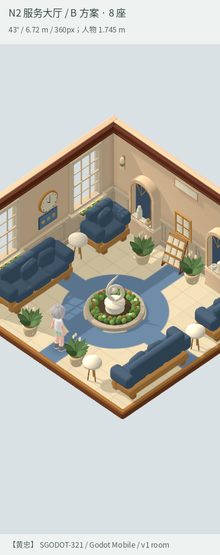
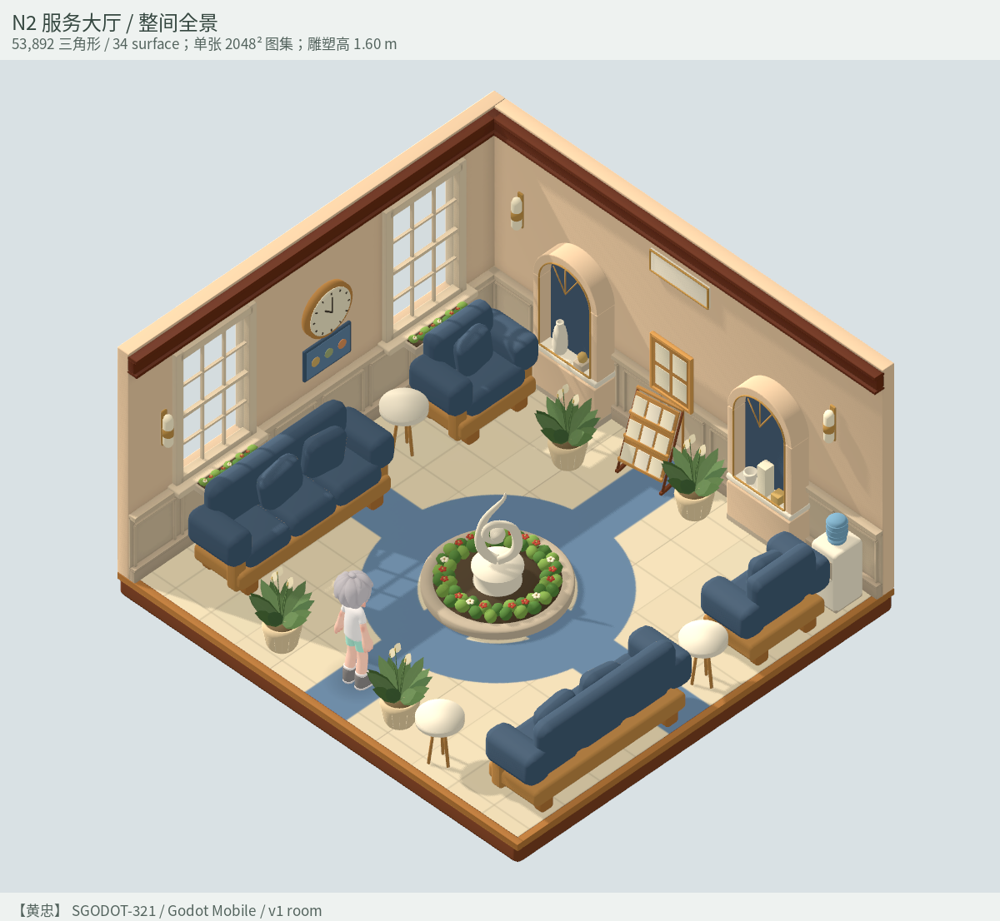
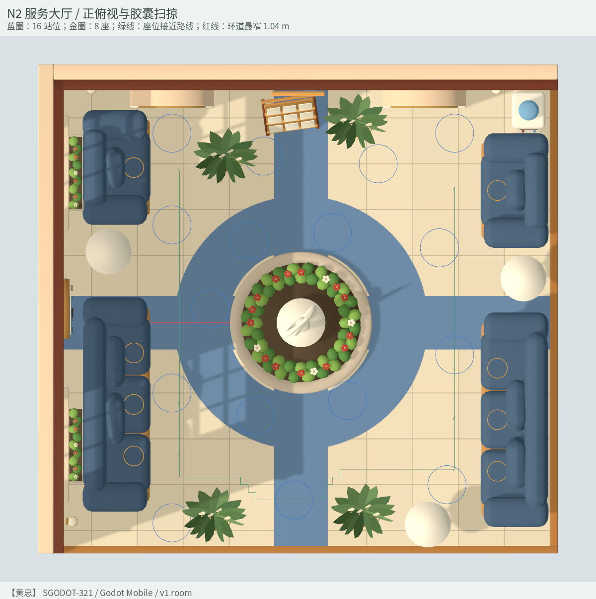

# SGODOT-321 N2 Service Hall / B / 8 Seats

作者：黄忠，Plane virtual_user_id `5281cd25-6a49-4df8-9802-f3e534956e80`。
用户 2026-11-02 批准 C48，按 B 做原尺寸 8 座；批准转达见 321 `2eaa12b5`。
本轮交完整美术装配，PR #597 目标 `wp-3d-scene`，保持草稿，待技术、画面复验和用户批准合并。

## 装配与依赖

- 场景：`scenes/poi_service_hall/poi_service_hall_art.tscn`。读取 `assets/rooms/poi_service_hall/layout.json`，包含室内摆放、碰撞和挂点；不依赖游戏账号、服务或玩法。
- 公共壳沿用赵云 #594 的 `8804d750`，尺寸 6.8 × 6.4 m、地面 Y=0.08、墙高 3.70 m，所有原几何、UV、碰撞和玻璃分面保留。#594 尚未合并，本 PR 的正式装配需要它先进入目标分支。审阅脚本将固定依赖提取至 `output/poi-service-hall-321/dependencies/`，不修改共享资产。
- 家具源为 #563 `104446a2`：两张三人沙发、两把扶手椅保持全部原顶点和法线。三张小圆桌是获准的 Ø0.60 × 0.75 m N2 变体，尺寸烘进导出顶点，节点比例为 1。三盏壁灯保留 324 原件。
- 墙钟直接复用 `post_office.wall_clock` 的 Ø0.78 m 几何，中心 Y=2.53，即离地 2.45 m，在叫号屏上方。四盆白掌保留共享植物库原几何和叶片纹理。
- 十个新件保持 `9600c5dc` 已验收的几何，补单一外链 `hall_albedo_ao_n2.png` 材质槽。双花箱沿用前轮实测挂墙位置；雕塑本体宽 0.578 m、高 1.20 m，加 0.40 m 底座共 1.60 m，正面 yaw=45° 朝默认镜头。
- 编辑源：`tools/art/source/poi_service_hall/service_hall_room.blend` 为具名模块装配，`service_hall_details.blend` 保留新件的细分构造部件，324 原构造源由固定提交提取。每个导出模块有 `modules/<件名>/reuse_provenance.json`。

## 皮肤与预算

一张 2048² RGBA 图集。墙 `#EBCAA8`，石砖 `#DFD1B4`，座椅 `#435B76`，蓝色环道和十字走道 `#6180A3`。地板图案按实际顶面 POSITION / UV 解出的映射绘制，保留原 90° UV 方向；环道和十字都在地板材质里，没有凸起几何。护墙板、窗框按主图改为浅暖色，保留壳自身 AO。

四盆白掌使用的 12 块 128² 原纹理搬入 N2 未使用的 `wood_dark`、`sage_dark`、`leather` 色块区，逐像素保持 RGBA，叶片保留双面 alpha scissor=0.45。验证所有其他模块及壳的 UV 不进入这些区域；不增加第二张运行时图集。窗玻璃仍是独立 surface。

| 统计口径 | 三角形 | Surface |
|---|---:|---:|
| N2 家具、新件、4 盆植物、墙钟和 3 灯，26 次摆放 | 40,926 | 26 |
| 公共壳，8 次摆放 | 12,966 | 8 |
| 合计 | **53,892** | **34** |

不计审阅人物、路线调试线或阴影重复绘制；预算上限为摆放后 150,000 / 50。16 个 N2 GLB 均为 `<件名>_mobile`、单 surface、外链同一图集，`.import` 带独立 UID 和 `gltf/texture_map_mode=1`。

## 挂点与通行

8 座命名为 `seat_sofa_1..6` / `seat_armchair_1..2`，世界 Y=0.795，离地 0.715 m，module 对应实际家具。Marker3D 的 -Z 朝向座位前方的可走接近区；与家具 +Z 正面的约定相适配。`spawn`、`exit`、`badge_exit`、`cam_default` 及带 0.88 × 0.23 m 可写区的 `sign_name` 齐全。

B 家具位置保留；新件使用已验收的实际厚度重算碰撞。雕塑环道最窄 **1.04 m**；主路用半径 0.35 m、高 1.745 m 胶囊检查，支路用半径 0.25 m 胶囊连续扫掠到 8 座、16 站位及出口。站位间隔至少 0.70 m。这是单胶囊可达性验证，不声称模拟 16 人同时走动。

默认画面沿用已选 B 审阅相机：43° 俯角、45° yaw、6.72 m 视宽、360×800，人物实测缩放至 1.745 m。对告示板、宣传架、叫号屏各取 81 个采样点，与雕塑实际三角形求交，三组均无雕塑遮挡。全景包含完整房间；正俯视图标出路线、站位和座位。

## 验证与复现

202 项导出几何/材质/尺寸/来源/图集检查和 262 项 Godot 检查通过。实际渲染为 Godot 4.7.2 / Vulkan Mobile / RTX 2060，未经手机性能验证。每张最终交付图均目检，附件上传后下载 SHA-256 核对。旧 props 和白模媒体保留为历史证据；本轮整间以本目录为准。

```bash
source ~/.codex-huangzhong/env.sh
output/art-setup/venv/bin/python tools/art/source/poi_service_hall/dependencies.py
output/art-setup/venv/bin/python tools/art/source/poi_service_hall/build_room.py
output/art-setup/venv/bin/python tools/art/source/poi_service_hall/prepare_room_review.py
godot --headless --path output/poi-service-hall-321/room_project --editor --import
godot --headless --path output/poi-service-hall-321/room_project --script res://configure_details.gd -- "$PWD"
output/art-setup/venv/bin/python tools/art/source/poi_service_hall/verify_room.py
blender --background --factory-startup --threads 2 --python tools/art/source/poi_service_hall/build_room_source.py
godot --path output/poi-service-hall-321/room_project --rendering-method mobile --rendering-driver vulkan res://review.tscn
output/art-setup/venv/bin/python tools/art/source/poi_service_hall/package_room.py
```

`dependencies.py` 仅作固定源提取；旧白模记录不需要重新提交。新件重建另见上一轮 details README，随后再执行本轮 `build_room.py` 生成完整皮肤和材质。
Godot 使用黄忠私有 ADB 端口 5097；不连接设备，渲染前核对显卡占用，所有本轮启动进程完成后退出。






