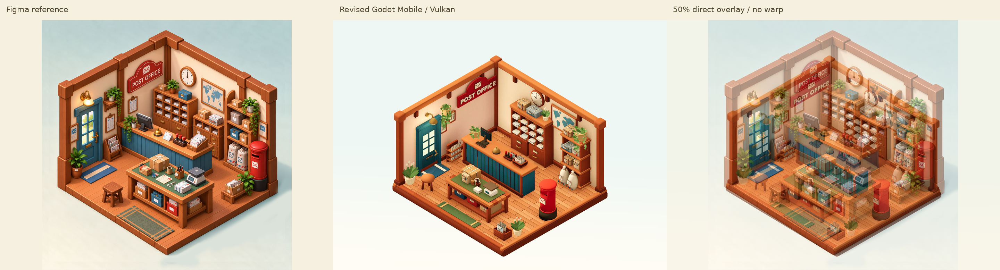

# SGODOT-176 · Post Office review revision

赵云 · Review candidate. Reference Figma `OMLTC3yw3u2WDjOZhLnhaR`, SceneDesign node `545:2967`. The current P0 plan may use this art as a waystation placeholder; this delivery adds no postal or waystation gameplay.

[Whole scene](godot.png) · [Counter and sorting](detail-counter.png) · [Letters, parcels and packing](detail-mail.png) · [Blue entrance](detail-door.png) · [Actual model orthographics](orthographic-sheet.png).

| Review item | Implemented response |
|---|---|
| Mahogany and apricot | Deeper red-brown timber palette, warm apricot plaster, 30 rows of narrow staggered floorboards with visible ends and restrained tonal variation. Accepted furniture scale remains unchanged. |
| Counter | Thin desktop monitor, upright support/foot and a separate keyboard replace the register. Brass service bell, document stand, three red/black stamps and a letter tray remain readable against deep blue vertical panels. |
| Sign | Wall-mounted red arch plaque with white envelope emblem and **Nunito Black rounded bold lettering**, fitted with 4mm physical extrusion and an offset from the plaque. No hanging hooks. |
| Sorting and parcels | Every cubby contains offset individual folded envelopes, using four linked source prototypes with differing paper/stamp/airmail treatments. Four parcel prototypes vary size, colour, knots, postage marks and label motifs. Shelf and cabinet-top stock is assembled from those prototypes. Bottom drawers have brass pulls. |
| Entry | Six lit frosted panes, brass handle and slot on the blue door. Leaf and glass share a real hinge/opening contract for benchmark exit/reentry. Two clipped notices, a stocked magazine rack, a brass wall light and blue woven mat complete the entry. |
| Mailbags and mailbox | Two tied linen sacks with red/blue stripes and envelope marks have floor colliders; the mailbox moves clear of their main-view silhouette. Red pillar box retains its true dark letter slot, white envelope emblem and broad rounded black foot. |
| Packing zone | Green work surface, two package sizes, scale, pencils, twine, mug and individual letter stack. Blue/red/tan storage boxes have exposed coloured fronts and address labels. Right-front crate holds letters and a plant; the left-front stool retains the baseline seat-height range. |
| Plants | Current shared deeper-green library on cabinet/shelf/counter/door and floor placements, with supplied alpha-scissor material and no small-leaf shadows. Cabinet plant sits on the crown, not outside its footprint. |

Source prototypes remain editable in named `PROTOTYPE_envelope_*` / `PROTOTYPE_parcel_*` collections. Linked source meshes are placed with varied offsets/rotations, then grouped by counter/sorting/packing zones for export; each large furniture module retains its own local pivot. Source atlas images are external to GLBs.

[Camera fit](../../../tools/art/source/post_office/camera-review.json) uses three declared plinth-edge intersections and infers the hidden fourth. The direct overlay retains the single-view concept's upper-wall/proportion residuals. It is not a claim of pixel-perfect geometry. [Fixed surface samples](colour-samples.png) include both plaster walls, the mahogany post and clear horizontal floor; [RGB/HSV results](colour-verification.json) list saturation/value independently. A source raycast verifies those runtime samples hit the intended faces. The initial lamp-side left-wall hue missed at 14.358°; its material was corrected at the same position. Final hue differences: **7.900° / 2.198° / 6.216° / 8.346°**, all ≤10°. [Source face-ray audit](colour-source-face-audit.json).

**172,218 / 200,000 placed triangles**, **8,982 / 100,000 botanical triangles**, **34 / 60 static surfaces**. **34/34 actual rendered checks and the 15-second real-time route video pass.**

The source heights are **door 2.30m, counter 1.31m, stool .59m, packing table 1.015m**, all within the agreed ±15% category tolerance. The nine-waypoint rendered route starts at the blue door, visits the counter, loops around the packing table and reaches the mailbox/shelf. Authored blockers cover counter, table, box, sacks, rack, walls and open edges. The counter-to-table passage measures **1.15m**, exceeding .80m. Exit/reentry uses the actual west-wall gap and supported exterior pad.

[Behavior results](bench-result.json) · [Live scale](bench-scale-measurements.json) · [Evaluated Blender source](source-scale.json) · [Actual collider view](bench-collisions.png) · [15-second real-time video samples](video-frames.png) · [Budget, normals, UVs and hashes](verification-summary.json).

Wall-slide evidence requires >.45m tangential displacement and live contact. Jolt can constrain a capsule through recovery without retaining a slide-contact entry; in that case the harness additionally records a short torso ray into the declared wall-normal direction. The [free-floor negative control](wall-slide-negative-control.json) fails only the wall-slide check, while its other 33 checks pass. No controller speed/capsule/floor-snap parameter changes are involved.

Rebuild `tools/art/build_post_office.py` (delegates to scene-local `revision.py`), then `measure_room_source.py -- post_office` in Blender. Stage/import/render with the shared room review tools and run the isolated `scene_bench`; package with `check_room_colour.py post_office 176` and `package_room_review.py post_office 176`.

Godot 4.7.2 Mobile/Vulkan, AMD Custom GPU 0405 / RADV VANGOGH. Desktop scale/appearance/behavior review only, with no production/save changes or phone-performance acceptance. Basic Room, accepted 172, and Liu Bei-owned 177/178 remain unchanged by this revision.

**邮筒已改动**：本轮图集重烘焙/重新打包，`red_post_box.glb` 的 UV 区域和 GLB 字节已改变；本地包围盒/尺寸和轴心契约保持一致，房内摆放位置已调整。[变更校验](mailbox-change-notice.json)。SGODOT-204 的农舍信箱占位由奕星决定是否同步，未自行修改 farm-dev 的副本。
