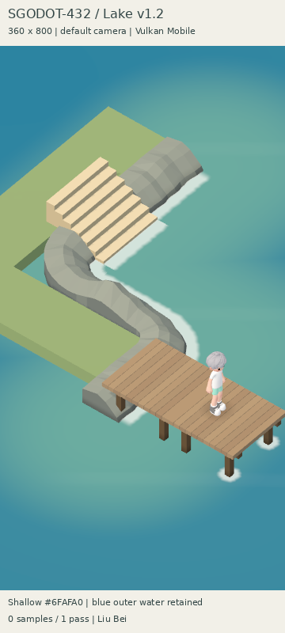
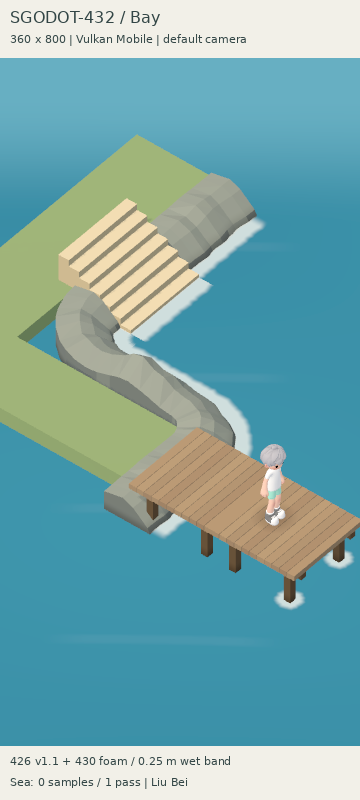
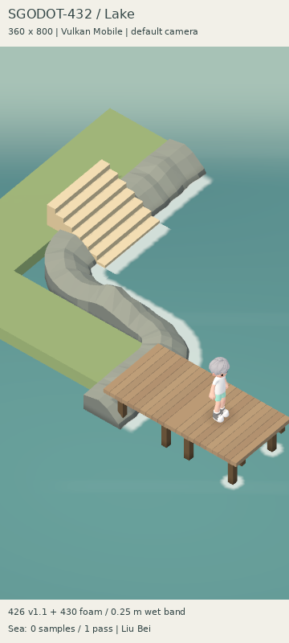

# SGODOT-432 · 当前湖面 v1.2

湖面 v1.2 仅把近岸浅水色收到柔和薄荷青绿 `#6FAFA0`，保留外水湖蓝、深浅过渡和无雾效果。海湾维持已验收版。当前审阅与验证见 **[v1.2 修订说明与 Fern Pond 对照](v1.2/README.md)**。

上一轮结构验证见 [v1.1 历史记录](v1.1/README.md)。

以下是首次交付的历史记录，旧湖面截图 / GIF 不代表当前版本。

# SGODOT-432 · 通用海面 / 湖面背景 v1（历史）

刘备交审。提供一个通用 shader 与海湾、湖面两套 `.tres`；换地标只改浅 / 深水色、远处渐隐色、波纹尺度和速度等参数。海湾沿用恶魔岛蓝色色板，湖面改为更平静的蓝绿色。材质位于 [assets/landmarks/_shared/sea_backdrop](../../../assets/landmarks/_shared/sea_backdrop/README.md)。

| 审阅文件 | 内容 |
|---|---|
| [bay-default-review.png](bay-default-review.png) | 海湾，360×800 默认镜头 |
| [lake-default-review.png](lake-default-review.png) | 湖面，同镜头、同光照、同岸线 |
| [motion-review.gif](motion-review.gif) | 两套各 360×800 并排；4 秒、80 帧、20 fps 时间采样 |

动图来自 Godot Vulkan Mobile 实渲，按生产速度采样，不是模拟器帧率录像。430 的浪花仍为 5.5 秒周期；GIF 是其中 4 秒片段，播放末尾会重启，未声称无缝循环。GIF 调色板会量化渐变，颜色以 PNG 为准。

## 组合与参数

- 分支从 `origin/wp-3d-scene` 的 `05a2c032f88cc0d39caebca05bd79df98845fbbe` 新建，未改恶魔岛、鱼塘、430 浪花或游戏接入。
- 海面算法来源：`assets/landmarks/alcatraz_island/sea_backdrop.gdshader`，`d7b57574d`；文件 SHA 与预设参数见 [provenance.json](../../../tools/art/source/sea_backdrop_432/reference/provenance.json)。
- 岸石和码头采用 **#831 v1.1 / `85967444d6024fbe85cf2af997a7478ee4aab034`**；正式冷灰褐材质及 0.25 m 湿带，只在 QA 实例把 `water_level` 设为 0.20 m。台阶保留原顶点色，QA 材质启用 `vertex_color_use_as_albedo`。未复制或修改赵云的交付文件。
- 浪花采用已验收合入的 **#833 v1.1 / `ac5809c46b3e96a111ada24513b44afc4779c631`**；静态单层面片，原 0.10 m 推收 / 5.5 s 周期 / 单采样。桩环按新版四角桩对齐，只在远海两根桩放环，避免与岸线浪花重叠。
- 约 12 m 岸线、1.75 m 人物；默认正交宽 6.72 m、俯角 43°、yaw 14.5°，与 430 审阅一致。水面 Y=.20、浪花 Y=.218，优先级 0 / 1。此处没有交付 layout 或游戏场景。
- 两套预设默认向不透明远色渐隐，无需额外背景底板。可选 `reveal_far_background` 支持已有远景的宿主；详细参数表和接法见运行目录 README。

## 验证

| 检查 | 结果与范围 |
|---|---|
| 资源与预算 | 41 项通过；与原海面同为 **0 次采样 / 1 pass / 5 次 sin**，无额外纹理、屏幕 / 深度读取或 `next_pass`。新增的是参数乘除和颜色插值。 |
| 原算法画面对照 | 设置同色、同波纹、同渐隐，在 t=0 / 3.5 s 对比原 shader。完整 360×800 画面差异 ≤ 1 RGB/255；记录见 `render-validation.json`。 |
| 叠放绘制 | 两套预设均 22 draws，隐藏浪花后均 14；原 shader 控制组也是 22。此数字包含人物、岸线和阴影，不是海面单独 draw 数。 |
| 独立海面运动 | 隐藏浪花后比较 t=0 / 4，海湾与湖面均有真实像素变化，见 `motion-validation.json`，排除只录到浪花动画。 |
| Android | 独立 `com.sensen.seabackdrop432qa`，API37 / SwiftShader / Vulkan Mobile；4 次真实点击切换两预设和浪花，完整 APK 安装后回读哈希相同。模拟器截图见 `android-*.png`；不是实体手机耗时结论。 |
| 冷导入 | 空 `.godot` 缓存导入，资源验证通过，5 个运行目录文件名称 / SHA 不变，shader UID 保留。没有新贴图或 GLB，因此无需 `.import`、`nodes/root_script`、`imported_formats`。 |
| 保全 | 恶魔岛、已验收浪花、鱼塘资源和程序均与分支基线字节一致。 |

证据：[资源](resource-validation.json) · [实渲](render-validation.json) · [动图](motion-validation.json) · [Android](android-validation.json) · [冷导入与保全](import-preservation-validation.json) · [媒体 SHA](media-manifest.json)。

所有截图在此文档目录内，以 `.gdignore` 排除游戏导入。[重现步骤](../../../tools/art/source/sea_backdrop_432/README.md) 和隔离审阅脚本可复用；原生 shader / `.tres` 即可编辑源。本轮仅交材质与审阅，不包含游戏上线或物理手机性能验收。
