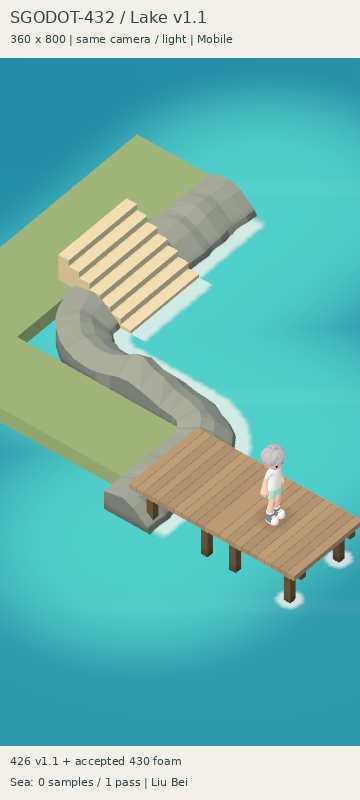

# SGODOT-432 · 湖面 v1.1

刘备按不知火舞 `e3afb862` 修订湖面：水色改为清亮青绿 → 湖蓝；沿简化岸线由浅向深过渡；去掉屏幕上缘的灰绿雾色覆盖。海湾预设及已验收画面保留。

[同镜头前后对比](lake-before-after.png) · [Android 实渲](android-lake.png)。两版使用同一 360×800 默认镜头、原暖光、同一 426 v1.1 岸石 / 湿带和 430 浪花。未调整模型、镜头、岸石、泡沫或人物。

## 参数变更

| 参数 | v1 | v1.1 |
|---|---|---|
| 浅水 `shallow_color` | `#6FA8A1` | `#54D5CD` |
| 深水 `deep_color` | `#487A80` | `#147DA1` |
| 远色 `far_color` | `#A7C2B6` | `#147DA1`（关闭覆盖） |
| `color_mix_range` | (0.25, 0.80) | (0.12, 0.27) |
| `far_color_amount` | 1 | 0 |
| `far_fade_screen_y` | (0.12, 0.30) | (0, 0.08)，本预设未启用 |
| `shore_shallows_strength` | 无 | 0.9；shader 默认 0，海湾关闭 |
| `shore_depth_range_m` | 无 | (0.25, 4.0) m；平方距离平滑插值 |

三段简化岸线的世界 XZ 端点保存在 `lake.tres` 的 `shore_segment_a/b/c`，对应当前审阅岸线。换地标只改这些参数，配置细节见[运行材质 README](../../../../assets/landmarks/_shared/sea_backdrop/README.md)。波长 5.8、速度 0.55、亮脊强度 0.012 均不变，alpha 仍为 1；浅水是颜色观感，没有增加水底、折射或透明层。

## 验证

- **海湾保全**：`bay.tres` 与 `15b0012ee` 字节一致；同场景换旧 / 新 shader，在 t=0 和 3.5 s 完整画面逐像素差均为 **0**。
- **预算**：海面仍为 **0 次纹理采样、1 pass、5 次 sin**，不增加层数或纹理。近岸功能只增加三段解析距离的点积 / clamp / 平滑插值，避免开方；海湾的统一参数分支跳过这段计算。未声称新增 ALU 为零或物理手机 GPU 耗时相同。
- **绘制**：旧湖面、新湖面及海湾均为 22 draws；关浪花后 14，几何不变。
- **颜色取样**：同位置 20×20 px 水面小块，避开岸石和浪花。新版近岸 sRGB 加权亮度 175.96，外水 132.48；近岸 HSV 饱和度 61.4%，画面上缘 78.4%（旧版 13.7%）。取样框和原始均值见 `colour-samples.json`，这是画面证据，不是真实水深测量或视觉验收结论。
- **Android**：API37 / SwiftShader / Vulkan Mobile；4 次真实点击切换海湾 / 湖面、开关浪花，运行预设与当前 PID 对应；完整 APK 安装后回读 SHA 相同。生产 shader 使用原 TIME，QA app 已停止，模拟器尺寸 / 密度恢复。
- **冷导入**：空缓存导入与 41 项资源检查通过，运行目录 5 文件名称 / SHA 不变；无新 GLB 或贴图，无新增 `.import` 项，原 shader UID 保留。
- **范围**：运行改动仅 `lake.tres` 和通用 `sea_backdrop.gdshader`；恶魔岛、鱼塘、426 / 430 及 `bay.tres` 保持原字节。

证据：[实渲与海湾对照](render-validation.json) · [资源](resource-validation.json) · [冷导入与保全](import-preservation-validation.json) · [Android](android-validation.json) · [媒体 SHA](media-manifest.json)。

[重现步骤](../../../../tools/art/source/sea_backdrop_432/README.md)。上级目录的 v1 GIF / 湖面图是历史记录，本次湖面以这里的 v1.1 PNG 为准；波纹速度未改。本件仍是独立材质审阅，没有游戏接入或发布。
