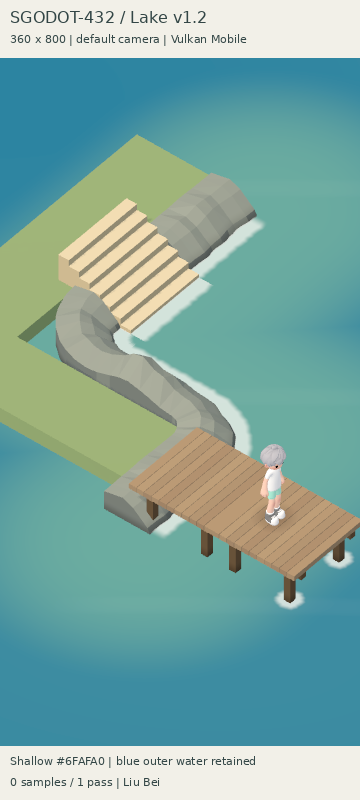
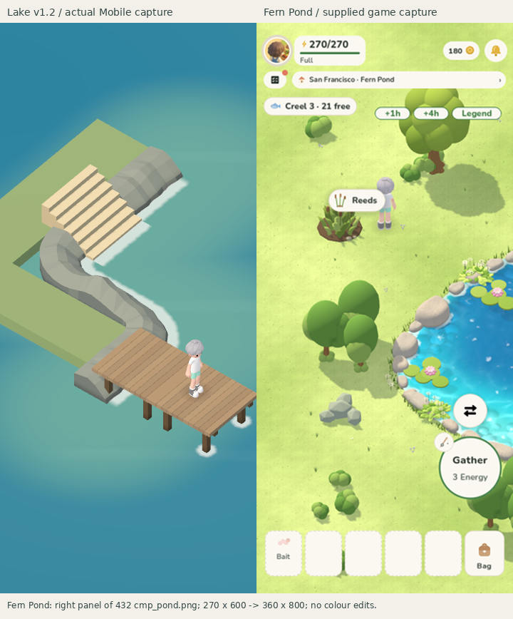

# SGODOT-432 · 湖面 v1.2

刘备按不知火舞 `60575e47` 的 Fern Pond 对照收回近岸饱和度。本次运行资源只改 `lake.tres` 一行：

```ini
shader_parameter/shallow_color = Color(0.435294118, 0.686274510, 0.627450980, 1)
```

对应 sRGB **`#6FAFA0`**。此前为 `#54D5CD`；HSV 饱和度从 60.6% 降到 36.6%，为前版的 **60.4%**，色相向绿色收回。深水 `#147DA1`、深浅过渡、远色覆盖关闭及波纹参数均保持 v1.1；shader 和海湾预设未改。





Fern Pond 来自不知火舞上传到 432 的 `cmp_pond.png`，附件 UUID `31f7aa8a-4d7b-487a-adda-7dc9c6b74ec1`。保留[原始附件](reference/cmp_pond.png)及 SHA。并排图右侧仅提取原图最右侧完整 270×600 面板，等比例放至 360×800；保留全部 UI，未调色。湖面为本轮 Godot Vulkan Mobile 默认镜头实渲；两场景用于色彩风格参考，不是同镜头配准或性能对照。

## 检查

- 同一 20×20 px 近岸水面取样（x=295–314，y=265–284），v1.2 平均色约 `#67A9A0`。该取样饱和度由 61.5% 降至 38.9%，为上版的 **63.2%**；区别于材质参数是因为原 shader 仍混有少量深水色。详见 `colour-validation.json`。
- shader / 海湾 / 恶魔岛 / 鱼塘 / 426 / 430 与 `74cbc529e` 字节一致。非颜色参数全部保留；仍为 0 次采样、1 pass、5 次 sin，没有新增计算或透明层。
- Vulkan Mobile 捕获通过，海湾两个时间点逐像素差均为 0，场景仍 22 draws（隐藏浪花为 14）。
- 空缓存导入、原有 41 项资源检查通过；导入前后暂存目录的 5 文件名称 / SHA 均不变，4 个原生运行资源与提交源字节一致。
- 本次为颜色参数改动，未重建 Android APK；Android 后端 / 输入 / 安装回读证据仍是 v1.1 的历史验证，不将其记为本版重测。

证据：[实渲](render-validation.json) · [颜色和参考来源](colour-validation.json) · [资源](resource-validation.json) · [保全和导入](preservation-validation.json) · [媒体 SHA](media-manifest.json)。

## 重现

在仓库根目录运行 `python3 tools/art/source/sea_backdrop_432/review_lake_v12.py prepare`，沿用原审阅夹具。新目录是 `output/sea-backdrop-432-v12/project`，需要旧头 `74cbc529e9ec72eb8d2e5a527437c4a4f7bfb131` 的 shader / lake 作对照。

持有 `flock /home/deck/gs66-render.lock`，在该目录运行 Godot 4.7.2 的 `--headless --editor --import` 和 `--headless --script verify.gd`，再用实际显示器运行 `--fixed-fps 30 --disable-vsync -- --lake-revision`。镜头、暖光、岸石和浪花继承 v1.1，不改场景。

用具备 Pillow / NumPy 的 Python 执行 `tools/art/source/sea_backdrop_432/review_lake_v12.py publish`，生成两张审阅图和颜色记录。没有游戏接入或发布。
