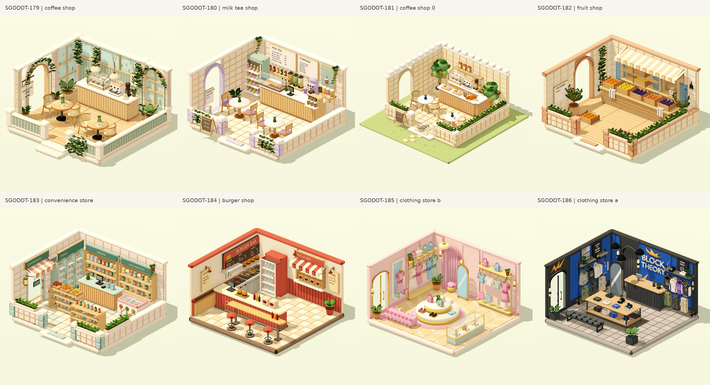

# 刘备：八个店面场景审阅稿 · 2026-10-07

SGODOT-179～186 已按顺序完成美术审阅稿，并逐张通过 Lark CLI 发送到用户飞书。每张开工时改为 In Progress；八张卡目前都保持 In Progress，等待用户确认效果后再改 Done。

下表链接进入各场景的原设计/Godot 对照、整景、细节、模型正交图和完整制作记录。审阅稿与参考仍有明确差异，不代表美术已验收。

| 卡片 | 场景记录 | GLB / 摆放实例 | unique / placed 三角面 | 美术提交 |
|---|---|---:|---:|---|
| SGODOT-179 | [coffee_shop](../coffee_shop-2026-10-07/README.md) | 32 / 52 | 110,588 / 166,484 | `9e2d431` |
| SGODOT-180 | [milk_tea_shop](../milk_tea_shop-2026-10-07/README.md) | 34 / 45 | 118,364 / 150,800 | `ca1feb8` |
| SGODOT-181 | [coffee_shop_0](../coffee_shop_0-2026-10-07/README.md) | 34 / 49 | 98,995 / 151,377 | `6a88aa7` |
| SGODOT-182 | [fruit_shop](../fruit_shop-2026-10-07/README.md) | 24 / 39 | 103,588 / 161,916 | `90227a6` |
| SGODOT-183 | [convenience_store](../convenience_store-2026-10-07/README.md) | 28 / 36 | 124,203 / 141,855 | `c516d32` |
| SGODOT-184 | [burger_shop](../burger_shop-2026-10-07/README.md) | 22 / 26 | 98,270 / 100,582 | `c1e0806` |
| SGODOT-185 | [clothing_store_b](../clothing_store_b-2026-10-07/README.md) | 42 / 53 | 66,944 / 78,042 | `b6e7f60` |
| SGODOT-186 | [clothing_store_a](../clothing_store_a-2026-10-07/README.md) | 43 / 64 | 70,398 / 90,716 | `26452cc` |

每张均包含命名可编辑 Blender、可复现生成脚本、按局部轴心导出的模块 GLB、共享 2048 图集、摆放/简单碰撞清单，以及只含美术的 Godot 场景。文件位置和重建命令见对应记录；重建历史版本时应连同该提交的共享 helpers 一起检出。后续改动源模型后请重新烘焙。

Blender 5.2.2 LTS / Godot 4.7.2。八张均在实际 Mobile/Vulkan 渲染器加载，核对整景、细节和三向正交图；GLB 容器、单模块单 surface、无重复内嵌图集及摆放数量检查通过。八次飞书交付共 32 条消息、24 张图片，下载 SHA-256 与对应本地审阅图完全一致。简洁证据见 [verification-summary.json](verification-summary.json)，私有消息回执留在忽略的 `output/<slug>/delivery/`。

优先 review 整体构图和资产尺度，再看单件细节。主要待审差异：植被密度、布料/商品图案、圆角与细部、金属与镜面表现，以及统一静帧光照和参考的差别；汉堡店柜台为直柜简化。每张详细差异已写入其 README。

本轮按卡片限定只做美术：没有角色控制、玩法接入、Android/真机验证、录屏或发包。渲染成功不代表手机性能验收。Basic Room 已验收源文件与资产未修改。

所有提交在本地 `wt-3d-scene`，未推送或合并；各卡 Plane 评论含提交、预算与飞书审阅链接。用户原有 `.codex/config.toml` 改动保留。
