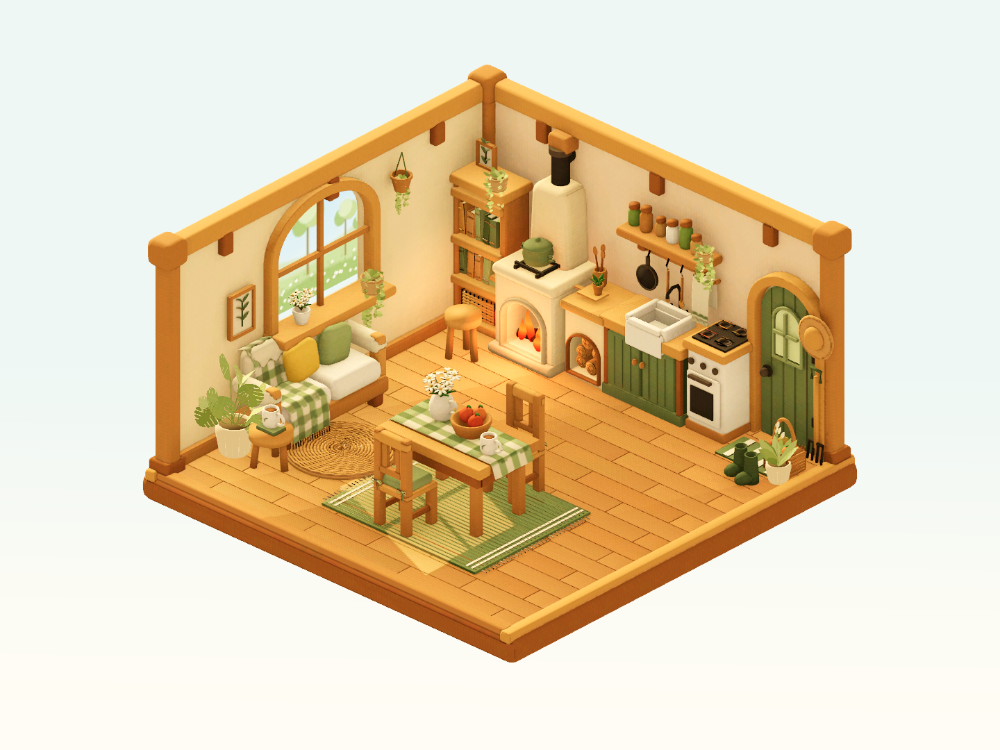

# Standard Room-5 · current R2 sample

The current asset revision responds to the art director's SGODOT-171/172 R2 review and is ready for **Review** under the user's updated Plane workflow. Read the [full R2 checklist, reference palette, comparison/overlay and rendered character evidence](../standard_room_5-review2-2026-10-07/README.md).

Reference: Figma `OMLTC3yw3u2WDjOZhLnhaR`, node [545:2969](https://www.figma.com/design/OMLTC3yw3u2WDjOZhLnhaR/Gensen--US-?node-id=545-2969), original 3402×2561 [node export](reference.png). [Comparison](comparison.png), [model orthographics](orthographic-sheet.png) and [current budgets/hashes](verification-summary.json) remain here for existing links.

The room now has a compact 6.2m square interior, a rounded plaster hearth and six-log niche, a cream range, darker low-variation planks, complete household details, stronger AO, window light, warm hearth illumination and shared botanical modules. Editable source and reusable GLBs remain scene-local; shared plant meshes/atlas are read-only references to Liu Bei's library.

- [Generator](../../../tools/art/build_standard_room_5.py) and [scene-local R2 source](../../../tools/art/source/standard_room_5/revision2.py).
- [Editable Blender source](../../../tools/art/source/standard_room_5/standard_room_5.blend).
- [Placement/collision/bench manifest](../../../assets/rooms/standard_room_5/layout.json).
- [Reusable art scene](../../../scenes/standard_room_5/standard_room_5_art.tscn).
- [Shared rendered character harness](../../../tools/dev/scene_bench/README.md).

The earlier art-only draft and its historical limitations are retained at commit `b95abdf`; its whole-scene image is also [archived in the R1 package](../standard_room_5-review1-2026-10-07/before.png). The review explicitly added desktop character movement/collision evidence to the scope. This is not user art acceptance, Android QA, gameplay integration or a production release.
