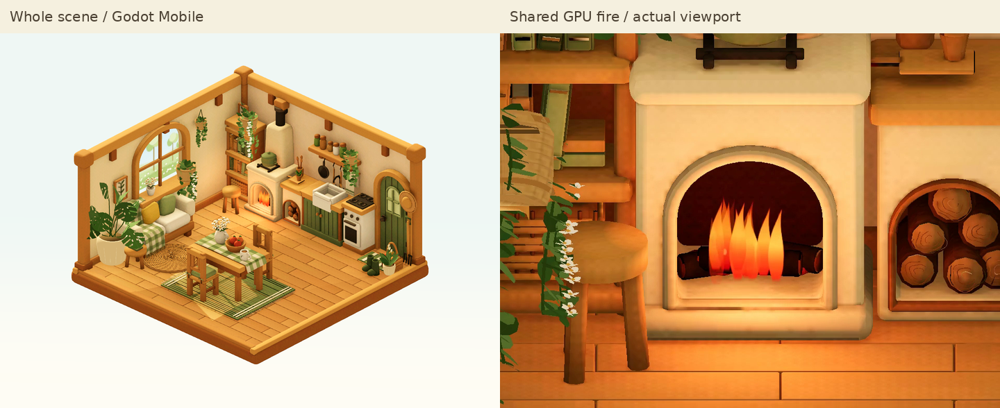
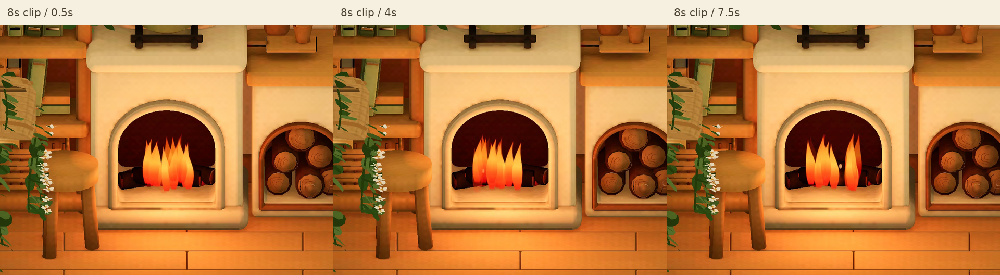

# SGODOT-172 · shared particle hearth fire

赵云 · Review candidate, 2026-10-08. Consumes Liu Bei's **fx_hearth_fire** from shared-library commit **5e5bf6af** without changing that library.

Static `fire` mesh is removed from runtime `assets`; its file and named Blender source remain archived/hidden for provenance. Hearth body, logs, wood niche and all other editable mesh geometry, transforms, materials and source UVs are preserved. **Every existing room GLB and PNG is byte-identical; no atlas rebake.** [File and editable-source preservation](preservation.json).

Two GPU emitters provide **14 flames + 2 sparks = 16 particles / 40 limit**. Emission half-extents `[0.17, 0.006, 0.035]`, root `[-1.59, 0.3, -2.29]`, flame-height parameter **0.42m**. The emitter is placed inside the arched mouth; the oven fire sits behind the loaves. Existing charcoal/low firebox surfaces receive masked low emission through their existing atlas and unchanged mesh. Other material response is retained.

The existing hearth OmniLight moves under the art adapter at the same `[-1.59, 0.56, -1.98]` position, colour `FF8B35`, range `2.0m`, base energy `0.95`. The shared effect alone writes its bounded smooth flicker; the former review-light entry is removed to avoid a duplicate. Measured energy spans **0.8858–1.0249**, within ±10%. No smoke was added to these indoor hearths.

**8-second real-time desktop clip**, recorded at 960×720/30fps; first/middle/last frames were visually inspected and decoded nonblank/different. Actual adapter: Godot4.7.2 Mobile/Vulkan, RADV VANGOGH. Close-view draw samples: `[31, 31, 31, 31, 31, 31, 31, 31, 31]`; these include the visible room and effect, not physical-phone GPU timing. `hearth-8s.mp4` and the separately recorded 15-second character route are delivered as card attachments.

Budget: **128,292 static mesh triangles**, **31,426 botanical-budget triangles**, **50 static surfaces**, plus **2 GPU particle draws** and at most **32 dynamic sprite triangles**. The original static fire's 944 triangles/1surface are no longer placed. **37/37 actual rendered character checks pass**, with unchanged room geometry/colliders/anchors and a fresh15-second route recording. [Full evidence/hashes](verification-summary.json).

For preservation control, both flame forms were hidden, the new ember emission disabled, and the original light fixed to its old base. Same camera/light presets then differ by **0.0001974 RGB/255 mean** across the whole image (maximum channel delta 30 at a small set of raster edges). This is a controlled material/scene comparison, not reference-art similarity. [Control pair](preservation-control.png) · [Numbers](render-preservation.json).

Configuration: `tools/art/source/standard_room_5/shared-hearth-fx.json`. `apply_shared_hearth_fx.py` is a post-export migration that edits layout/stats and source visibility without rebaking. The normal builder now runs it automatically after export. The adapter lives in `scenes/room_effects/`; the reusable FX remains entirely in `assets/rooms/_shared/fx/`. `record_hearth_fx.py standard_room_5 <output>` records the close view; `scene_bench` records the actual route. Basic Room and production/gameplay saves are untouched.
