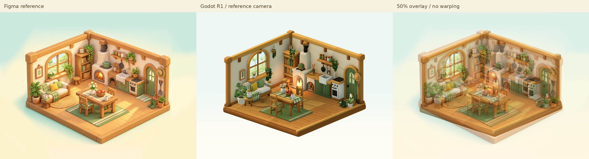
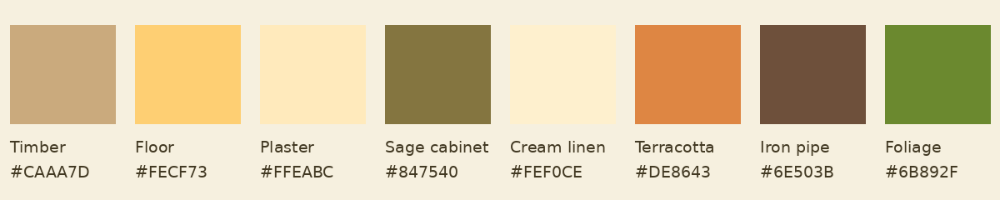

# SGODOT-172 · Standard Room-5 · Review 1 revision

Owner: **赵云**. This is the revised sample requested by [SGODOT-171](https://plane.sensenjoy.cn/zili/browse/SGODOT-171) and [SGODOT-172](https://plane.sensenjoy.cn/zili/browse/SGODOT-172). **Review**, awaiting art direction/user acceptance. The new parent-card rule is to approve the first revised sample before applying the changes to the remaining six Zhao Yun scenes. Their first drafts remain separately reviewable; this round does not mark them as revised.



[Whole-scene render](godot.png) · [Before / after](before-after.png) · [Kitchen detail](detail-kitchen.png) · [Living detail](detail-living.png) · [Model orthographics](orthographic-sheet.png).

The Figma reference is file `OMLTC3yw3u2WDjOZhLnhaR`, node `545:2969`, retained at its original 3402×2561 resolution. The [parent review](171-review.txt) and [scene review](172-review.txt) record the applied brief. The overlay uses a proportional resize to the same canvas and 50% opacity; it does not warp the model or hide mismatched objects. Camera yaw ≈41.76°, pitch ≈22°, orthographic horizontal span 12.65m were inferred from the timber frame and floor silhouette. A single stylized reference does not establish a mathematically registered camera.

## Checklist response

| Review item | Revision and evidence |
|---|---|
| P0 · Footprint and density | Room interior reduced from 8×6.4m to 6.2×6.2m; outer rounded plinth 6.6×6.6m. Sofa, dining set, bookshelf and kitchen are regrouped around measured walkable routes. Raw overlay remains visible for proportion review. |
| P0 · Hearth | New broad rounded lime-plaster body, narrower softened upper breast, genuinely arched opening, dark red lining, black pipe/collars/elbow. Adjacent arched firewood niche holds six staggered logs with visible endgrain. Orange local light reaches the floor and nearby furniture. |
| P0 · Floor | Warm orange-brown plank family replaces the pale high-contrast pattern; consistent board width, regular stagger and thin seams. Primary authored floor color changes from `D39A5D` to `B27D47`; variants remain close in value. The stylized window-light tint is explicitly authored, not presented as a full physical light bake. |
| P0 · Range cooker | Taller, narrower cream enamel oven, dark four-burner hob, three knobs, recessed black oven window and handle. Cooking surface is 1.375m above the floor, compared with Basic Room's hearth slab about 1.295m (+6.2%); the normal sink counter remains 1.1525m. |
| P1 · Window | Small white flower pot with daisies; larger shared pothos now projects beyond and trails beneath the sill. New 512px landscape contains tree/grass/flower layers and uses corrected independent UVs, without duplicating the image in GLBs. |
| P1 · Left wall | Botanical frame and a suspended corner pot with shared trailing greenery. |
| P1 · Bookcase | Four/five books per shelf with different heights, colors and ±2–6° lean; two horizontal books, woven lower basket, top picture and shared trailing pothos. |
| P1 · Kitchen wall/counter | Six differently sized spice jars with staggered depth, hooks, frying pan, two hanging spoons, towel, cutting board, utensil crock and a small herb pot. |
| P1 · Door side | Modeled straw hat, garden fork, four varied apples in a handled wicker basket, offset boots, potted peace lily and striped entry mat. |
| P1 · Sofa | Checked throw with hem fringe, yellow/green loose cushions, cup/book on the small stool and the shared broad-leaf monstera at the left corner. |
| P1 · Dining | Draped checked runner, daisy jug, apple bowl and mug retained; added chair back crossrail, padded seats and grouped rug-end fringe. |
| P2 · Light and surfaces | Cool cyan ambient against a warm shadowed window sun, one short-range unshadowed hearth OmniLight. Stronger wall/contact AO; lower-strength floor AO avoids noisy grooves. Plaster has mottling and a subtle warm lower-wall tint. Source wood/cloth detail is baked; metal rims remain modeled. |
| Shared plants | Consumes Liu Bei's `26aed6f` library: monstera, peace_lily and four differently rotated/scaled pothos placements. The shared GLBs/atlas are referenced directly; library files are not edited or rebaked into the room atlas. |
| Collision / entrance | Art scene owns the actual boundaries, large furniture blockers and controlled doorway opening. Door frame and hinged leaf are separate; the benchmark opens the visual leaf while preserving a closed-door hero view. An exterior threshold strip supports exit/reentry. |

The rounded source construction remains editable. Main framing and countertop bevels are generally 3–11cm; the plinth retains a thick rounded edge. Small fittings use appropriately smaller bevels rather than enlarging every detail indiscriminately.

## Palette



Eight retained reference patches, 13×13px median RGB: timber `CAAA7D`, sunlit floor `FECF73`, plaster `FFEABC`, sage cabinetry `847540`, linen `FEF0CE`, terracotta `DE8643`, iron `6E503B`, foliage `6B892F`. [Coordinates and sample sizes](reference-palette.json) make the selection inspectable. These are **lit image samples**, not PBR albedo values; the actual base-color family is recorded in the generator so live warm/cool lighting does not double the baked brightness.

## Rendered character checks

The [shared harness](../../../tools/dev/scene_bench/README.md) was delivered independently in `39f50fb`. Its core calibration on unchanged Basic Room passed 30 checks, and deliberately invalid route/blocker/gap controls failed. Follow-up `341bd2e` adds blank-video rejection and an optional visual-door hook.

This scene passes **37/37 rendered checks** and all nine recorded route legs. The route is door → southeast aisle → dining south → southwest aisle → sofa front → bookcase front → hearth → kitchen → window. No route leg teleports or exceeds 3s. Blocker probes identify live scene colliders. Open edges contain the capsule, entrance exit/reentry works, diagonal wall contact preserves sliding, joystick release stops immediately and run/idle switch with advancing animation time.

Live ray measurements give **1.657m** between table and sofa, and **2.405m** in the kitchen/dining aisle, above the requested 0.70m minimum. The capsule is Basic Room's r=0.21m / h=1.25m at 3.75m/s. Visual fixture head-top **H≈1.7455m** is measured separately.

| Surface | Actual source height | Change from Basic Room |
|---|---:|---:|
| Door clear height | 2.33m | 0% |
| Sink counter | 1.1525m | 0% |
| Padded chair sitting surface | 0.779m | +13.7% (Basic Room has no cushion) |
| Tabletop | 1.135m | 0% |

These values come from [evaluated Blender bounds](source-scale.json); the [ratio check](bench-scale-measurements.json) uses the same values and measured H.

[Spawn overview](bench-spawn.png) · [At the hearth](bench-main.png) · [At the door](bench-door.png) · [Actual collision shapes](bench-collisions.png) · [All checks](bench-result.json) · [Recorded route checks](bench-record-result.json) · [Video metadata](bench-video-metadata.json).

The **15-second, unaccelerated desktop video** is `output/scene-bench/standard_room_5/evidence/walkthrough.mp4`, delivered on the Plane card and through the authorized Lark review conversation. Its beginning/middle/end were visually inspected and decoded for nonblack/nonuniform content. The figure and video use Godot 4.7.2 Mobile/Vulkan on AMD Custom GPU 0405 (RADV VANGOGH). This is not a phone performance or Android input claim.

## Source, budget and rebuilding

Entry point [build_standard_room_5.py](../../../tools/art/build_standard_room_5.py) delegates to [the scene-local revision](../../../tools/art/source/standard_room_5/revision1.py); it retains the earlier helper functions for dependent scene generators. [Editable source](../../../tools/art/source/standard_room_5/standard_room_5.blend) includes named local modules plus separately identified `SHARED_` source collections for context. [Bench contract](../../../tools/art/source/standard_room_5/bench-r1.json) reproduces the manifest additions. Basic Room remains read-only.

The room has **41 local GLBs**, 43 local placements plus six shared plant placements: **49 scene meshes/surfaces** and **four runtime materials**. The shared botanical atlas is an additional 2048² texture; the local 2048² atlas contains base color, AO and an authored window-light stencil, plus the independent 512² scenery image. Shared foliage substantially increases placed triangles; exact local/shared counts, bytes and hashes are in [verification-summary.json](verification-summary.json). This is an explicit budget increase, not a mobile-performance acceptance.

```sh
blender --background --factory-startup --python "$PWD/tools/art/build_standard_room_5.py" -- --views
blender --background --factory-startup --python "$PWD/tools/art/source/standard_room_5/measure_scale.py"
python3 tools/art/prepare_room_review.py standard_room_5
godot --headless --editor --path output/standard_room_5-2026-10-07/godot-project --import --quit
godot --path output/standard_room_5-2026-10-07/godot-project \
  --script res://tools/art/review_room.gd -- standard_room_5 "$PWD/output/standard_room_5-2026-10-07"
python3 tools/dev/scene_bench/prepare.py standard_room_5
godot --headless --editor --path output/scene-bench/standard_room_5/project --import --quit
python3 tools/dev/scene_bench/run.py standard_room_5 --record
```

Rebuild replaces this scene's generated source; preserve manual edits in the generator. Large furniture or light changes require rebaking the AO/window stencil. Actual rendering requires a display. The shared library source is appended for editing context, but its meshes are excluded from the room bake/export and bind their own atlas in Godot.

## Remaining review judgments

All P0/P1 items have an implemented response, with the tests above. Final visual acceptance remains open: the reference has softer and fuller cloth/foliage, more painted material wear and stronger indirect light. The shared monstera's lobes and pothos crowns are visibly more geometric; changes to those library models belong to Liu Bei. Reference and model framing are inferred rather than pixel-registered. The actual comparison/overlay is retained so those differences are visible.

Per the latest 171 instruction, **173–178 wait for this sample's confirmation** before batch revision. This card moves to **Review**, not Done, following the user's new status rule.
