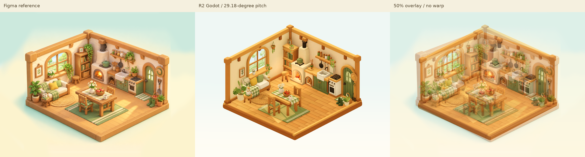
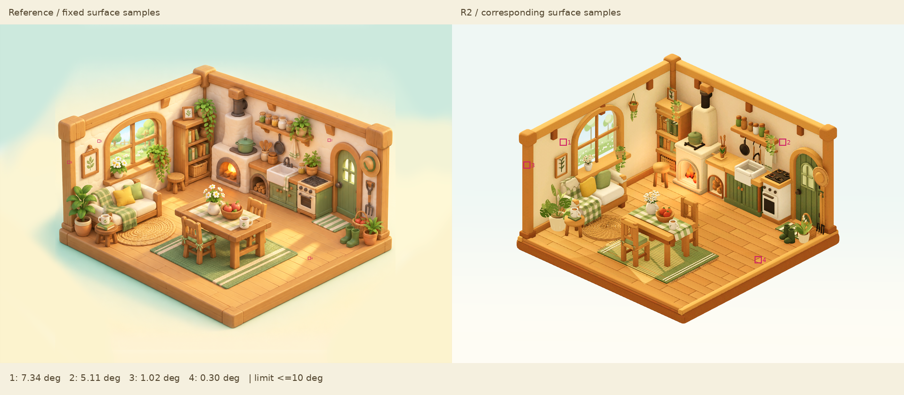

# SGODOT-172 · Standard Room-5 · R2

**赵云 / Review — awaiting art-director and user confirmation.** This responds to [the latest 172 feedback](https://plane.sensenjoy.cn/zili/browse/SGODOT-172), retained in [review-r2.txt](review-r2.txt). Basic Room's accepted character/furniture scale is unchanged. This revision edits Zhao Yun's sample and consumes Liu Bei's shared plant R2.1; it does not edit another artist's scene or the library.



[Whole scene](godot.png) · [R1 → R2](before-after.png) · [Kitchen](detail-kitchen.png) · [Living/textiles/chairs](detail-living.png) · [Fire and logs](detail-fire.png) · [Actual model orthographics](orthographic-sheet.png).

Figma now places the unchanged reference node `545:2969` on the **SceneDesign** page (`1072:92318`). The art director confirmed the page move changed location only; the retained reference identity remains valid.

## Eight review items

| Item | Implemented response |
|---|---|
| 1 · Wall/plaster temperature | Warmer beige wall and hearth albedo, less mottling, warm neutral ambient instead of cyan. The back wall has a slightly peach limewash matching its reference face. Fixed corresponding wall/wood/floor sample results are below; all hue deltas are under 10°. Brightness and saturation remain separately reported. |
| 2 · Fire | Four distinct curling tongues at 0.26/0.33/0.405/0.49m, with explicit orange/red/gold height-gradient UVs and orange emission. Three crossed charred logs and fifteen dark-red embers sit inside the firebox. Fire is not a white additive patch; the nearby OmniLight remains short range and unshadowed. |
| 3 · Window light | Brighter warm-gold window stencil, separated by the actual mullion axes, moved across the dining rug and adjacent floor. The directional sun remains shadowed; the baked stencil is explicitly authored, not claimed as a complete physical light bake. |
| 4 · Camera | Orthographic pitch refitted from 22° to **29.18°**, yaw **43.02°**, horizontal span **12.891m**. The fit uses three visible plinth-edge intersections; the hidden rear corner is inferred from the rectangular footprint. Raw full-scene 50% overlay is supplied without geometric warping. Wall-cap/furniture residuals remain visible for review. |
| 5 · Fabric and sofa | New continuous folded throw with metric UVs: U follows physical width, V follows accumulated fold arc length. Checks remain 0.115m squares around the fold; source length ratios are 0.984–1.030. Seat cushions and the two loose pillows are fuller. |
| 6 · Dining chairs | Continuous solid rear stiles, thicker front legs, single upper/lower back rails and broad slats replace fragmented pieces. Thicker 0.145m pads have modeled rear ties/bows. The seat support was lowered so the actual sitting surface is **0.7825m**, +14.23% versus the 0.685m Basic Room baseline, within ±15%. |
| 7 · Small defects | Both mugs use a smooth sampled curved handle and rounded junctions, with no block underneath. The towel is a folded striped cloth draped over a rail, not a pointed cone. Broad hearth faces use flat planar normals with smooth bevels; pipe/trim bevels are retained. A shadow-off control also isolated diagonal self-shadow bands, corrected with scene-specific shadow bias/distance while retaining shadows. |
| 8 · Shared plants | Consumes shared library R2 (`9c23ab2`) plus the merged R2.1 palette update `a054d81`, using its supplied double-sided alpha-scissor material. No opaque override or library edits. Shared placed foliage drops from **93,328 to 10,048 triangles**. Small foliage, flowers and background cards do not cast shadows. Total botanical budget conservatively includes entire local flower/herb/fruit modules. |

## Fixed colour checks



The same authored surface locations are measured in each view with 11×11px RGB medians and circular HSV hue distance. [Coordinates, RGB, saturation and brightness](colour-verification.json) are retained. These are representative lit patches, not a whole-image fidelity score; different camera projections do not imply identical screen coordinates.

| Surface | Reference | R2 | Hue difference |
|---|---|---|---:|
| Left plaster beside the window | `#FFF2C8` | `#EDCC91` | 7.34° |
| Back plaster above-left of the door | `#F0CAA4` | `#E4BD86` | 5.11° |
| Front-left timber post | `#B27B43` | `#C77527` | 1.02° |
| Clear floor right of dining rug | `#F4B361` | `#EEA547` | 0.30° |

The first fixed back-wall sample missed the threshold at 10.21°. Its position was retained and the back-wall material was corrected before retesting. The measurements do not hide the remaining differences in brightness, material softness or stylized rendering.

## Geometry, texture and runtime budget

| Metric | Final |
|---|---:|
| Local placed geometry | 116,904 triangles |
| Shared botanical placements | 10,048 triangles |
| Total placed scene | **126,952 / 200,000** triangles |
| Botanical budget, including complete local flower/herb/fruit modules | **28,824 / 100,000** triangles |
| Static surfaces | **49 / 60** |
| Local GLBs / shared module types | 41 / 3 |
| Placed mesh instances | 49 |
| Runtime material variants | 4 |
| Local GLB bytes | 4,155,036 |

Textures are a local 2048² color/AO/light-stencil atlas, the shared 2048² botanical atlas, a 512² window landscape and a 32×128 flame gradient. Images are external, not duplicated inside GLBs. Exact bytes, hashes and renderer counts are in [verification-summary.json](verification-summary.json). The added cloth geometry stays inside the requested budget. Surface counts exclude shadow rendering; no phone GPU result is implied.

## Camera and UV evidence

[camera-r2.json](../../../tools/art/source/standard_room_5/camera-r2.json) records the selected plinth-corner coordinates, fit equations and inferred rear corner. The reference is a stylized single view; the three visible ground corners constrain the camera, but do not prove all upper-wall and furniture silhouettes are pixel registered. The overlay deliberately exposes those residuals rather than moving pixels after rendering.

[cloth-uv-verification.json](cloth-uv-verification.json) measures 7,728 throw edges and 5,152 towel edges in the source. Maximum surface/UV length ratio is 1.0303 for both. This complements visual inspection of the exported atlas; it does not replace it.

## Character and capture verification

**37/37 rendered scene checks pass**, including the unchanged 9-waypoint route, floor spawn, furniture/wall/open-edge blockers, doorway exit/reentry, diagonal sliding, live gap measurement, release-to-stop and advancing idle/run animation. Gaps remain **1.657m** and **2.405m**, above 0.70m. Door, counter and table heights remain at the accepted baseline; padded chair height is the documented +14.23%.

[Spawn](bench-spawn.png) · [At the main furniture](bench-main.png) · [Door](bench-door.png) · [Actual collision wireframe](bench-collisions.png) · [Per-check JSON](bench-result.json) · [Source dimensions](source-scale.json) · [Live ratios](bench-scale-measurements.json).

The **15-second real-time desktop route video** is delivered on the Plane card and through the authorized Lark review chat. Its [route result](bench-record-result.json), [media metadata](bench-video-metadata.json) and [first/middle/last frames](video-frames.png) verify a complete route and visible picture. Original MP4 remains in `output/zhaoyun-r2-2026-10-07/bench/walkthrough.mp4`. It is not speed-adjusted footage.

Actual rendering: Godot 4.7.2 Mobile/Vulkan, AMD Custom GPU 0405 / RADV VANGOGH, 1440×1080 art captures and 960×720 character capture. Blender 5.2.0 LTS produces the source and orthographics. Import checks are headless; movement and animation checks are rendered. No Android/physical-phone acceptance or gameplay/production deployment is claimed.

## Rebuild

The [main generator](../../../tools/art/build_standard_room_5.py) now delegates to [scene-local revision2.py](../../../tools/art/source/standard_room_5/revision2.py). R1 code and evidence remain available. Rebuild overwrites this scene's generated source only; manual work must be represented in the generator before rebuilding.

```sh
blender --background --factory-startup --python "$PWD/tools/art/build_standard_room_5.py" -- --views
blender --background --factory-startup --python "$PWD/tools/art/source/standard_room_5/measure_scale_r2.py"
blender --background --factory-startup --python "$PWD/tools/art/source/standard_room_5/check_cloth_r2.py"
python3 tools/art/prepare_room_review.py standard_room_5
godot --headless --editor --path output/standard_room_5-2026-10-07/godot-project --import --quit
godot --path output/standard_room_5-2026-10-07/godot-project \
  --script res://tools/art/review_room.gd -- standard_room_5 "$PWD/output/zhaoyun-r2-2026-10-07"
python3 tools/dev/scene_bench/prepare.py standard_room_5
godot --headless --editor --path output/scene-bench/standard_room_5/project --import --quit
python3 tools/dev/scene_bench/run.py standard_room_5 --record --output output/zhaoyun-r2-2026-10-07/bench
```

`check_colour_r2.py` and `package_r2.py` additionally need Pillow/NumPy. Real rendering/recording requires the execution host's current display environment. The small scene-specific shadow settings are read by the common renderer/harness; other scenes retain defaults unless they opt in.

The latest review explicitly permits other Zhao Yun structural work in parallel, but **172 R2's lighting/temperature and the shared plant appearance remain subject to confirmation before broad rollout**. This sample stays Review; no Done state is set by these tests.
