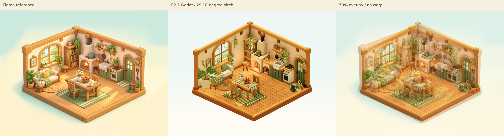

# SGODOT-172 · R2.1 finishing

赵云 · **Review**. The director accepted R2 and released 173–178 on 2026-10-07. This closes the four remaining 172 items; it does not supersede the accepted camera/scale baseline or claim user acceptance of R2.1.

[Approved R2 → R2.1](before-after.png) · [Living and plants](detail-living.png) · [Kitchen](detail-kitchen.png) · [Logs and hearth](detail-fire.png) · [Model orthographics](orthographic-sheet.png).

| Review item | Change |
|---|---|
| Plant volume | Front Monstera and window pothos scale 0.77→1.31 (1.70×), bookcase pothos 0.68→1.19 (1.75×), pantry 0.59→0.95 (1.61×), hanging plant 0.51→0.78 (1.53×). Two extra shared trailing modules fill the window/bookcase silhouette. Supplied R2.1 alpha-scissor material retained; library is read-only. Front pot moves 6cm left/12cm forward to keep the walking lane clear. |
| Sofa icing edge | Replace shallow arm caps and exposed high posts with continuous cream rounded upholstered arms and recessed supports. Raise the checked throw over the back cushion to remove the scalloped intersection. No dangling white cover. |
| Log-end discs | Dark irregular 11-sided bark surrounds pale matte endgrain. Three/four off-centre broken rings have varied spacing/thickness, plus a radial split. Flat ribbons replace raised tubes. Niche material roughness 1.0/specular .06. |
| Grounding | Ambient energy .63→.52; contact AO strength .68→.80, floor .42→.62, distance .75→.86m. Atlas rebaked, deepening furniture feet/table underside/wall intersections while retaining the warm window stencil and local hearth light. |

The same four R2 sampling positions are retained. Hue differences: **7.859° / 5.152° / 2.058° / 0.415°**, all ≤10°. Full RGB, saturation, value and marked coordinates are in [colour-verification.json](colour-verification.json) and [colour-samples.png](colour-samples.png). These patches do not establish whole-image fidelity.

Budget: **129,236 / 200,000 placed triangles**, **31,426 / 100,000 botanical triangles**, **51 / 60 static surfaces**. The botanical count conservatively includes complete local flowers/herbs/fruit modules. All GLBs retain normals/UVs, external images, named editable source parts and local pivots. [Exact budget and hashes](verification-summary.json).

**37/37 rendered character checks pass**, including the existing nine-waypoint route, doorway exit/reentry, furniture and perimeter blockers, live gaps, slide, input release and idle/run animation. The 15-second real-time walkthrough passes and its first/middle/last frames were visually reviewed. [Checks](bench-result.json) · [Scale](source-scale.json) · [Video samples](video-frames.png) · [Actual collision shapes](bench-collisions.png). Cloth metric UV verification also passes after raising the throw.

Godot 4.7.2 Mobile/Vulkan, AMD Custom GPU 0405 (RADV VANGOGH); desktop review, no phone-performance or production update. Source: `tools/art/source/standard_room_5/revision2.py`; evidence scripts with `_r21.py` preserve the earlier R2 evidence. Basic Room and Liu Bei scenes/assets are unchanged.
