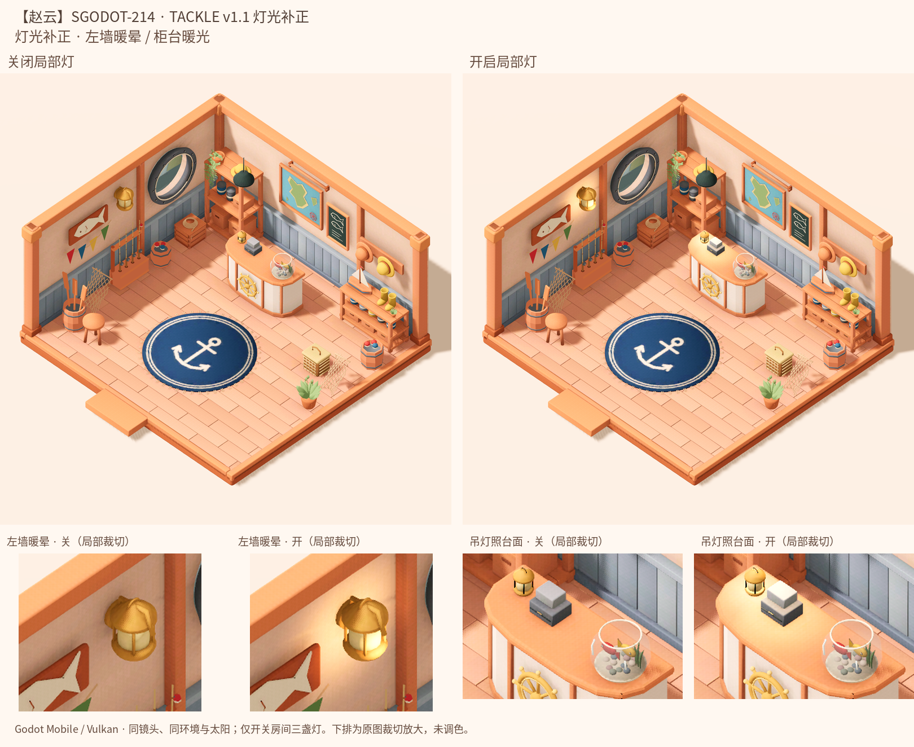

# SGODOT-214 · v1.1 灯光补正

赵云，2026-10-16；[PR #439](https://github.com/IndieMiao/sensen-godot/pull/439)。
按不知火舞 `ab8874ad` 和上官婉儿的复审要求，补出左墙壁灯暖晕与吊灯台面暖光。
v1.1 主体技术 / 画面已通过，本轮交灯光补正确认；最终由用户批准合并。



## 改动

壁灯和吊灯由 OmniLight3D 改为软边 SpotLight3D。壁灯朝舷窗旁的左墙，
吊灯朝柜台中部，缩短范围防止光继续照到地板。台上提灯保持原设置。
三个光源均关闭实时投影，没有新增灯或阴影 pass。

| 光源 | 房间坐标 position → target | 色值 | energy / range / 半角 |
| --- | --- | --- | --- |
| 壁灯 | `(-2.65, 2.40, .24)` → `(-3.22, 2.40, .24)` | `FFB968` | `1.8 / 1.35 m / 59°` |
| 吊灯 | `(-1.48, 2.25, -2.06)` → `(-.45, 1.20, -1.38)` | `FFC17A` | `7.0 / 1.95 m / 20°` |

两个聚光灯的光照 specular 系数为 .25，仅控制这两盏灯的高光贡献；surface 材质自身
仍为 .28。参数同步在 `build_tackle_shop.py` 与 `layout.json`，方向使用房间局部坐标，
整间旋转 / 平移后仍对准同一表面。

**没有烘焙直接光，也没有改图集任何像素。** 38 个 GLB、2048² PNG、导入设置、
两个 surface 材质、Blender 源文件均与基线 `aace15a5` 字节一致；layout 除
`local_lights` 外完全一致。仍为 **66,052 三角面 / 39 surface**，6.8 × 6.4 m，
20 个碰撞体；站位和已通过的交叠检查条件不变。

## 实渲与验证

Godot 4.7.2，Vulkan **Mobile**，RTX 2060；1440² SubViewport，43° / 45° 方位，
正交宽 10.20 m。沿用 v1.1 的环境光、太阳、ACES 和材质，依次截取全关、仅壁灯、
仅吊灯、全开、再次全关。257 项运行时导入 / 预算 / 材质 / 灯光检查通过。
两次全关图逐像素相同，证明切换后没有改变环境或曝光。

画面已检查：左墙有软边暖晕；台面有一块较亮的暖色区域，周围橙色台面和鱼缸可读。
主对照包含完整房间，下排仅为同一原图的裁切放大，没有后期调色或绘制光晕。

| 接收表面（不含灯具） | 对应光单独开启时显示亮度增量 / 255 | 另一盏光单独开启 |
| --- | --- | --- |
| 左墙灰泥取样 | +70.878 | 0 |
| 柜台台面取样 | +17.831 | 0 |

取样区均无 RGB 三通道同时 ≥250 的白色像素；这是两块表面的显示值检查，
不是全图 HDR 曝光测量或视觉验收分数。完整参数、矩形坐标、原图哈希与基线文件哈希见
[lighting-evidence.json](lighting-evidence.json)，运行时检查见
[lighting-validation.json](lighting-validation.json)。本轮为桌面 Mobile 渲染验证。

复现：

```sh
source ~/.codex-zhaoyun/env.sh
python3 tools/art/prepare_tackle_shop_review.py
godot --headless --path output/tackle-214/project --editor --import --quit
godot --path output/tackle-214/project --rendering-method mobile \
  --rendering-driver vulkan res://lighting_review.tscn
output/art-setup/venv/bin/python tools/art/package_tackle_lighting.py
```

打包脚本需要 Pillow、NumPy。原始全开 / 全关图同时保存在本目录；其他单灯控制图由
复现脚本输出到 `output/tackle-214/lighting/final/`。签名对照以
`SGODOT-214_TACKLE_v1_1_14_lamp_control.png` 上传 SGODOT-214，署名与下载回读记录见
`delivery-verification.json`。此前 v1.1 审阅图和记录保持历史版本。
