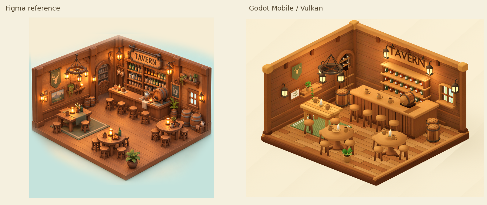

# Tavern · art review candidate

Plane [SGODOT-177](https://plane.sensenjoy.cn/zili/browse/SGODOT-177), owner Zhao Yun / 赵云. **In Progress, awaiting user review.** Produced 2026-10-07 under the user's request to proceed sequentially overnight and send each scene through Lark CLI.

Reference: Figma file `OMLTC3yw3u2WDjOZhLnhaR`, node [545:2966](https://www.figma.com/design/OMLTC3yw3u2WDjOZhLnhaR/Gensen--US-?node-id=545-2966). The [original export](reference.png) was downloaded and visually inspected before modeling.



The tavern has timber wall panelling, a real arched saloon doorway with swing-door leaves, back-bar bottle shelves, an L-shaped counter, a horizontal tap cask, closed coopered barrels, four bar stools and three customer tables. Repeated bottles, mugs, tables, stools and lanterns share GLBs. The iron wheel chandelier and wall lanterns use separate shared luminous glass geometry; the capture uses three small unshadowed warm lights plus ambient and directional light. The English TAVERN sign and stag pennant preserve the reference identity.

## Deliverables

- [Editable Blender model](../../../tools/art/source/tavern/tavern.blend), with named objects and module collections.
- [Deterministic scene generator](../../../tools/art/build_tavern.py), using the [room pipeline](../../../tools/art/scene_room_pipeline.py).
- [GLB placement and collision manifest](../../../assets/rooms/tavern/layout.json), individual local pivots and a shared external base-color/contact-AO atlas.
- [Reusable Godot art scene](../../../scenes/tavern/tavern_art.tscn), without gameplay/account/network dependencies.
- [Whole-scene runtime image](godot.png), [model orthographic views](orthographic-sheet.png), [budget and verification hashes](verification-summary.json).

## Reconstruction and contract

```sh
blender --background --factory-startup --python "$PWD/tools/art/build_tavern.py" -- --views
python3 tools/art/prepare_room_review.py tavern
godot --headless --editor --path output/tavern-2026-10-07/godot-project --import --quit
godot --path output/tavern-2026-10-07/godot-project \
  --script res://tools/art/review_room.gd -- tavern \
  "$PWD/output/tavern-2026-10-07"
```

Use the actual host display for rendering. Blender 5.2.0 LTS and Godot 4.7.2 were used here. `--geometry-only` skips bake/export. Rebuilding replaces this scene's `.blend`; preserve manual edits deliberately. Source assets from Basic Room remain read-only.

Coordinates are metres, Godot Y-up/front +Z and Blender `(x,-z,y)`. Modules export about their own floor/mounting pivot; placement is in the manifest. The baked atlas contains procedural surface detail and softened contact AO, with live runtime sunlight. Rebake after major rearrangement. Raw GLBs must bind this atlas. Triangulation occurs before UV bake/export to keep surface interpolation consistent, and empty atlas gutters are extended before mip generation.

## Validation and budget

Actual Godot **Mobile / Vulkan**, AMD Custom GPU 0405 (RADV VANGOGH), 1440×1080. 95 meshes have atlas materials and finite nonempty bounds; 29 simple collision shapes are present. The imported triangle count matches the export manifest.

| Metric | Measured |
|---|---:|
| Unique GLBs / placed instances | 32 / 95 |
| Unique / placed triangles | 52,027 / 84,743 |
| Static surfaces | 95 |
| Runtime materials | 3 |
| GLB bytes combined | 2,341,704 |
| Atlas source PNG bytes | 2,591,330 |
| Shared atlas | 2048 × 2048 |

Texture imports enable mipmaps and VRAM compression. Fine geometry keeps uncompressed vertices and disables automatic mesh LODs. Static surface counts exclude renderer shadow passes; PNG bytes are not GPU memory. No physical-phone performance measurement is claimed.

## Inferences and differences

The 7.4 × 6.8m layout and back-of-house construction are inferred. The source has a denser, more irregular bottle assortment, varied mugs, richer upholstery and more detailed wall pictures. This version uses an original simplified stag emblem and a botanical picture in place of the detailed landscape. Round-table construction and chandelier chains are simplified for the reusable kit. The rendered review uses warm Mobile lighting; Blender orthographic views use the neutral source lights to expose geometry.

Simple volumes block tables, bars, barrels and stools. The saloon-door leaf geometry is static and the room wall collision remains a containment boundary; this is not an operational door or tavern gameplay implementation.

This is an art-only candidate awaiting review. No gameplay/map integration, avatar benchmark, Android QA, production build, migration or release is included.
