# 当前云端旧稿视觉检查（84/84）

检查日期：2026-10-06。文件 `OMLTC3yw3u2WDjOZhLnhaR`，Prototype 页。通过只读 `figma_get_screenshot` 对 00–06 七个 section 重新截图，maxDimension=16000，实际为自然画布大小（另带40px四边截图边距）。下载因沙箱DNS不可用，使用工具明确支持的 base64 响应保存原始PNG。没有调用 use_figma，没有写入或改动云端。

**检查覆盖：7张当前section图 → 16张行带逐一打开查看 → 84张卡全部出现在已查看行带中。** 同时保存84个单卡裁剪供定位；没有把“裁剪文件存在”当作额外的逐像素验收。原始图、行带和卡片裁剪的SHA-256见 [coverage.json](audit-evidence/legacy/coverage.json)。

目标是让玩家先看懂对象、作用、数量与实际成本，再区分执行、查看与取消。已存在的奶油色容器、五列背包、固定快捷栏、材料环和场景底图应复用。

这次是静态视觉审查。未验证真实运行的点击结果、辅助技术、键盘焦点、手势、动画节拍、短屏滚动与网络失败；也不据截图宣称 WCAG 合规。很小的字体、低对比灰字、密集触区属于可见风险，精确字号/对比度/触区由组件与后续运行检查确认。

## 1. 00 · 组件约定（2张）

规格有基础，必须改为原生组件与变体。

当前截图：[完整分组](audit-evidence/legacy/00.png) · SHA-256 `dffa5aa1324b38aadb53e4c143b0b4140b737501641c655e2d0fe0012d617f2c`。

| 页面 | 看到的问题与保留项 |
|---|---|
| [STATE-ICONS](audit-evidence/legacy/cards/STATE-ICONS.png) | 14种状态与示例齐全，但依旧是整张图，组件实例无法直接复用；小字过密。 |
| [NEED-TILE](audit-evidence/legacy/cards/NEED-TILE.png) | 材料进度规范可复用；标题/数值分槽尚未独立，旧“缺口写按钮”需同步本轮语义。 |

## 2. 01 · 农场、HUD与操控（22张）

主场景结构稳定，行动层级与微小文字需要统一。

当前截图：[完整分组](audit-evidence/legacy/01.png) · SHA-256 `3b100df73e02824257a67e0311c5a7183a39bfe735a23a4c494d332b59ab5997`。

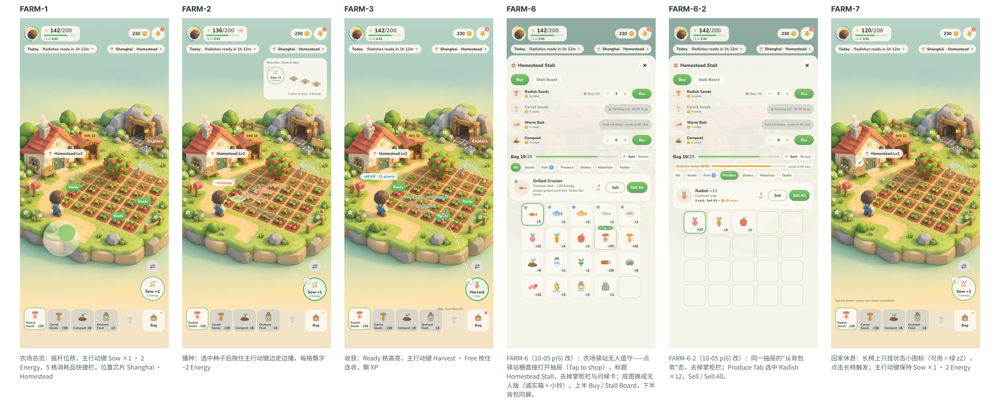

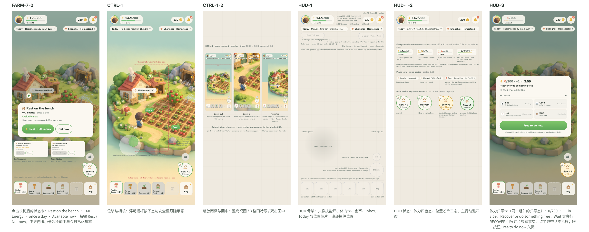

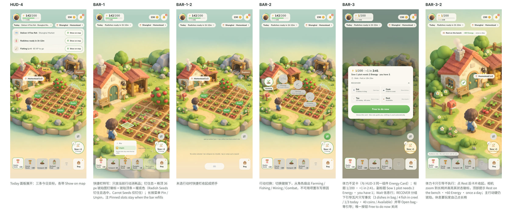

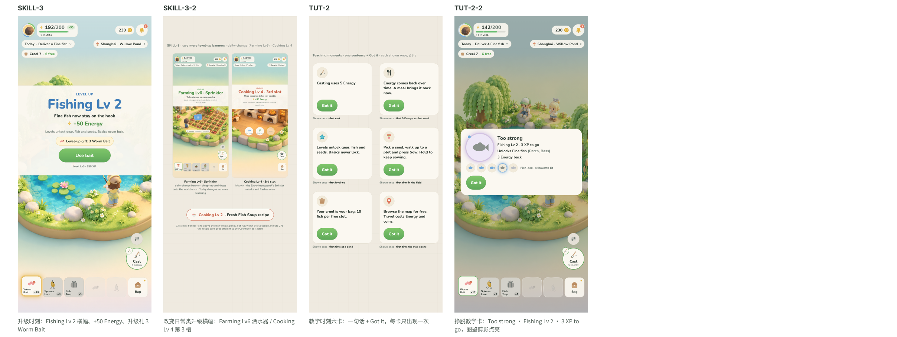

| 页面 | 看到的问题与保留项 |
|---|---|
| [FARM-1](audit-evidence/legacy/cards/FARM-1.png) | 场景清楚，快捷栏名称与数量在小格底部挤压；主行动价格很小。 |
| [FARM-2](audit-evidence/legacy/cards/FARM-2.png) | 浮字、HUD扣费与角落行锄说明同时出现；需要把单次/三格成本分清。 |
| [FARM-3](audit-evidence/legacy/cards/FARM-3.png) | 每格奖励与合计浮字同屏竞争；当前可见 +48 XP / 12 plants 必须回查数值。 |
| [FARM-6](audit-evidence/legacy/cards/FARM-6.png) | 买、卖和物品详情同屏正确；锁定商品把整句条件塞入按钮，详情混入长描述。 |
| [FARM-6-2](audit-evidence/legacy/cards/FARM-6-2.png) | Radish ×12 与每件/总出售价格混排；Sell 与 Sell All 缺少明确数量对应。 |
| [FARM-7](audit-evidence/legacy/cards/FARM-7.png) | 场景保留正确；长椅可用图标很小，设施可点击性主要依赖微小徽标。 |
| [FARM-7-2](audit-evidence/legacy/cards/FARM-7-2.png) | 恢复量、次数、可用态、下次时间重复说明；主态与两张缩略状态需要分开展示。 |
| [CTRL-1](audit-evidence/legacy/cards/CTRL-1.png) | 操控图有明确安全框，但审阅注释与玩家UI同画布，交付应拆注释层。 |
| [CTRL-1-2](audit-evidence/legacy/cards/CTRL-1-2.png) | 三态保留完整；微型手机不足以审字体/触区，需要各态可独立打开。 |
| [HUD-1](audit-evidence/legacy/cards/HUD-1.png) | 骨架完整；尺寸与规则密集堆在一个像素图中，无法组件级维护。 |
| [HUD-1-2](audit-evidence/legacy/cards/HUD-1-2.png) | 颜色/位置/行动状态齐；大量小字解释重复，需变为原生状态变体。 |
| [HUD-3](audit-evidence/legacy/cards/HUD-3.png) | 四个恢复入口较弱，真正只是关闭的 Free to do now 反而是最强绿色按钮。 |
| [HUD-4](audit-evidence/legacy/cards/HUD-4.png) | 任务目标、等待时间与升级目标使用一模一样行，Show on map 仍是胶囊按钮。 |
| [BAR-1](audit-evidence/legacy/cards/BAR-1.png) | 选中和钉住有不同视觉，但长按菜单与格名很小；不能只靠长按发现。 |
| [BAR-1-2](audit-evidence/legacy/cards/BAR-1-2.png) | 收起把手明确；两句小字操作说明属于审阅/一次教学，不应常驻场景。 |
| [BAR-2](audit-evidence/legacy/cards/BAR-2.png) | 四行动可辨；禁用原因压在小气泡，状态与选择形态混杂。 |
| [BAR-3](audit-evidence/legacy/cards/BAR-3.png) | 能看到当前/需要体力，但全文、等待、引导和关闭按钮层级不平衡。 |
| [BAR-3-2](audit-evidence/legacy/cards/BAR-3-2.png) | 高亮目标符合仅引导；顶部提示重复收益/频次，底部还有实现说明。 |
| [SKILL-3](audit-evidence/legacy/cards/SKILL-3.png) | 升级标题突出；Use bait 是导航/选择却像执行，礼物只露一项。 |
| [SKILL-3-2](audit-evidence/legacy/cards/SKILL-3-2.png) | 两种升级与一条小横幅保留；微缩演示字号过小，无法与真实弹层一致维护。 |
| [TUT-2](audit-evidence/legacy/cards/TUT-2.png) | 短句教学方向清楚；全部 Got it 都是强绿按钮，教学关闭与执行语义未区分。 |
| [TUT-2-2](audit-evidence/legacy/cards/TUT-2-2.png) | 门槛、剩余XP、效果和退款挤在一列；首次保护期退款旧文案待纠正。 |

## 3. 02 · 钓鱼（6张）

玩法步骤清楚，失败/满包反馈层级不足。

当前截图：[完整分组](audit-evidence/legacy/02.png) · SHA-256 `a080b7d1b5f71e00e4711f341f757066d02897a4e023bd5e5c2513c961cf8332`。

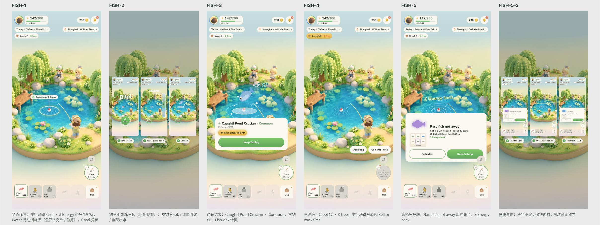

| 页面 | 看到的问题与保留项 |
|---|---|
| [FISH-1](audit-evidence/legacy/cards/FISH-1.png) | 钓鱼主场景清楚；5 Energy 在主行动和教学浮条重复，教程应是一次性状态。 |
| [FISH-2](audit-evidence/legacy/cards/FISH-2.png) | 咬钩/收线/成功三步俱在；必须保留独立三态，而非长列表。 |
| [FISH-3](audit-evidence/legacy/cards/FISH-3.png) | Caught、鱼名、稀有度混在标题；首获 +60 XP 与普通 +5 分布两处。 |
| [FISH-4](audit-evidence/legacy/cards/FISH-4.png) | 原因压进小圆行动键，Open Bag / Go home 是同样胶囊，满包处理不够醒目。 |
| [FISH-5](audit-evidence/legacy/cards/FISH-5.png) | 失败原因、等级、解锁、退款混排；退款又在场景和卡片各出现一次。 |
| [FISH-5-2](audit-evidence/legacy/cards/FISH-5-2.png) | 三种失败有不同含义但只以微型整屏区分；需共享失败卡的独立变体。 |

## 4. 03 · 烹饪（11张）

信息负荷最高，且原生修订与旧稿视觉不一致。

当前截图：[完整分组](audit-evidence/legacy/03.png) · SHA-256 `33f42c40b5179f017ce60173eb7f5fae4c1e046ac47f3aa528e90724509d0577`。

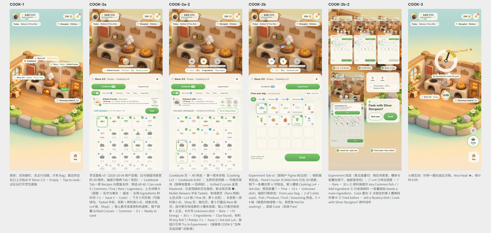

| 页面 | 看到的问题与保留项 |
|---|---|
| [COOK-1](audit-evidence/legacy/cards/COOK-1.png) | 灶台直接点击路径正确；多灶标记把身份、状态、计时塞在同一胶囊。 |
| [COOK-2a](audit-evidence/legacy/cards/COOK-2a.png) | 信息最拥挤：名称、稀有度、回能、时间、熟练度、次数、用途、XP、材料并排。 |
| [COOK-2a-2](audit-evidence/legacy/cards/COOK-2a-2.png) | 图鉴五态存在，但未知菜详情仍重复条件/线索/奖励，辅助字极小。 |
| [COOK-2b](audit-evidence/legacy/cards/COOK-2b.png) | 场景锅与槽条正确；预览胶囊混排四信息，库存格的已投料/不可烹饪标记需统一。 |
| [COOK-2b-2](audit-evidence/legacy/cards/COOK-2b-2.png) | 五个微缩变体完整；稀有材料确认只问 Cook with...，未突出用量与后果。 |
| [COOK-3](audit-evidence/legacy/cards/COOK-3.png) | 当前云端仍有旧 Cook / Free 圆键，与锅内火候点击并存。 |
| [COOK-3-2](audit-evidence/legacy/cards/COOK-3-2.png) | 已有原生稿，但HUD头像、布局和字号明显不同于相邻厨房稿，证明复用仍未统一。 |
| [COOK-4](audit-evidence/legacy/cards/COOK-4.png) | 品质、回能、发现、XP、图鉴串成两行；灰色 Gift later 看起来像不可用按钮。 |
| [COOK-6](audit-evidence/legacy/cards/COOK-6.png) | Mystery Dish +5 Energy 混进标题；解释和线索图标缺少清楚主次。 |
| [COOK-7](audit-evidence/legacy/cards/COOK-7.png) | 当前云端仍有 Cook / Free；Newcomer Blessing ×1.5 靠近进食回能易造成误读。 |
| [COOK-7-2](audit-evidence/legacy/cards/COOK-7-2.png) | 递减、额度、溢出、满体力五态保留；仅确认与普通提示的组件形态区别不明确。 |

## 5. 04 · 背包与装备（4张）

容器结构正确，详情信息和动作语义混杂。

当前截图：[完整分组](audit-evidence/legacy/04.png) · SHA-256 `88575b3d8595bf3c1a4e50c90192a6197ad7746e0be3692c21503499b11187cd`。

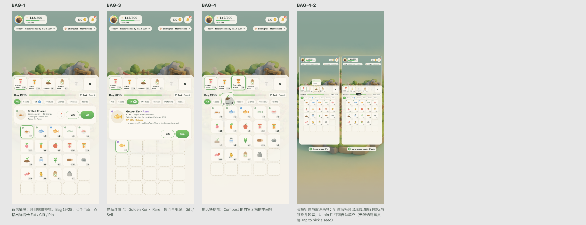

| 页面 | 看到的问题与保留项 |
|---|---|
| [BAG-1](audit-evidence/legacy/cards/BAG-1.png) | 保留抽屉/五列网格；详情把主要效果与风味文案同排，Pin/Gift/Eat像同级动作。 |
| [BAG-3](audit-evidence/legacy/cards/BAG-3.png) | Golden Koi、Rare、3/10、来源、价格、用途、图鉴、XP和风味挤同一详情。 |
| [BAG-4](audit-evidence/legacy/cards/BAG-4.png) | 拖放意图清楚；仍需保留原QuickBar格规格，不把拖拽分镜改成普通按钮。 |
| [BAG-4-2](audit-evidence/legacy/cards/BAG-4-2.png) | Pin/Unpin 两态可见；缩略整屏应改成可独立审阅、共用相同格的状态。 |

## 6. 05 · 地图与NPC据点（22张）

人物与空间辨识较好，交易、导航、限制信息混排最普遍。

当前截图：[完整分组](audit-evidence/legacy/05.png) · SHA-256 `24871635937977b11f18875665f51cc498fc514f954fd8dd06824ef9fdda5209`。

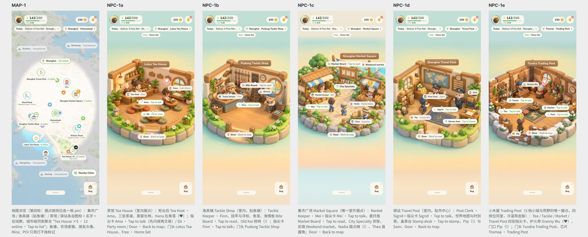

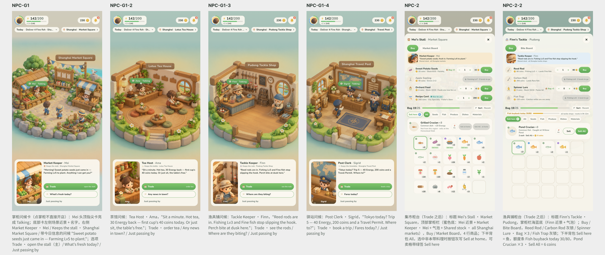

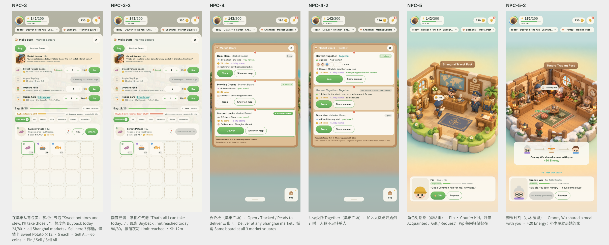

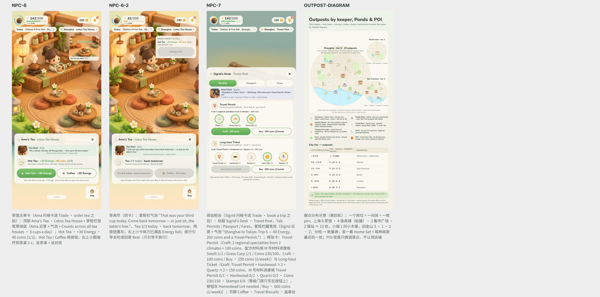

| 页面 | 看到的问题与保留项 |
|---|---|
| [MAP-1](audit-evidence/legacy/cards/MAP-1.png) | 各岗位有独立pin；名字、距离、在线数、提示和角标造成高密度标签噪声。 |
| [NPC-1a](audit-evidence/legacy/cards/NPC-1a.png) | 房间与角色清楚；角色身份/姓名/Tap to talk重复标签，Sit是另一种功能入口。 |
| [NPC-1b](audit-evidence/legacy/cards/NPC-1b.png) | 掌柜、居民、板、出口齐全；功能名与操作提示混成同类气泡。 |
| [NPC-1c](audit-evidence/legacy/cards/NPC-1c.png) | 标签最多的场景之一，居民、特产、周末、委托板均争抢视觉权重。 |
| [NPC-1d](audit-evidence/legacy/cards/NPC-1d.png) | 人物、盖章台、门标签混排；Stamp desk的动作与身份要拆分。 |
| [NPC-1e](audit-evidence/legacy/cards/NPC-1e.png) | 四岗位同室成立，但四个Talk胶囊与居民标签叠加，需控制只显示邻近/选中标签。 |
| [NPC-G1](audit-evidence/legacy/cards/NPC-G1.png) | Trade 和获取信息两条都像按钮；重复掌柜身份/空间信息。 |
| [NPC-G1-2](audit-evidence/legacy/cards/NPC-G1-2.png) | 长问候同时讲效果、价格、免费茶桌；导航Trade被画成强执行按钮。 |
| [NPC-G1-3](audit-evidence/legacy/cards/NPC-G1-3.png) | 问候重复等级和鱼竿效果；Trade像提交，角色身份在场景和近景重复。 |
| [NPC-G1-4](audit-evidence/legacy/cards/NPC-G1-4.png) | 问候直接塞完整旅费清单但当前还没选目的地；信息询问与交易导航语义混淆。 |
| [NPC-2](audit-evidence/legacy/cards/NPC-2.png) | 价格左右重复；库存、技能、效果挤在商品副行，商品很多主绿按钮抢重心。 |
| [NPC-2-2](audit-evidence/legacy/cards/NPC-2-2.png) | 鱼竿效果与价格/门槛混排；当前稿旧鱼竿上限与Gear文案不一致。 |
| [NPC-3](audit-evidence/legacy/cards/NPC-3.png) | 买卖同屏方向正确；Sweet Potato ×12、每件价、总价和来源混在一张详情内。 |
| [NPC-3-2](audit-evidence/legacy/cards/NPC-3-2.png) | 达到额度后的灰按钮变成长时间提示；标题条、台词和详情重复说已满。 |
| [NPC-4](audit-evidence/legacy/cards/NPC-4.png) | Track、Show on map、Drop、Deliver形状相近；任务名混入板名，数量/奖励/地点挤行。 |
| [NPC-4-2](audit-evidence/legacy/cards/NPC-4-2.png) | 加入、倒计时、人数、目标、奖励、兜底混排；同一种任务需状态化而非复制解释。 |
| [NPC-5](audit-evidence/legacy/cards/NPC-5.png) | 角色对话条很矮，Gift与Request都是按钮但实际先选择或查看。 |
| [NPC-5-2](audit-evidence/legacy/cards/NPC-5-2.png) | 当前画面送餐直接显示+20 Energy与HUD增量，获得与进食结算混淆。 |
| [NPC-6](audit-evidence/legacy/cards/NPC-6.png) | 茶名、回能、价格、次数同排，按钮又重复回能；Coffee地点口径需统一。 |
| [NPC-6-2](audit-evidence/legacy/cards/NPC-6-2.png) | 日限与满体力同时做小缩略；灰按钮变长句，退款/可替代路径不突出。 |
| [NPC-7](audit-evidence/legacy/cards/NPC-7.png) | 身份、副标题、规则、材料与两种购买方式挤压；动作标签含成本和周限长串。 |
| [OUTPOST-DIAGRAM](audit-evidence/legacy/cards/OUTPOST-DIAGRAM.png) | 系统结构说明完整但全为单图，文字小；应作为独立原生说明板而非玩家页。 |

## 7. 06 · 内容与成长（17张）

功能覆盖较齐，数量/效果/状态/导航的表达不一致。

当前截图：[完整分组](audit-evidence/legacy/06.png) · SHA-256 `fd1b8c75e0f6ec6db72d547e2a2eb66334e1e8d23aa09122dc850debfafa06de`。

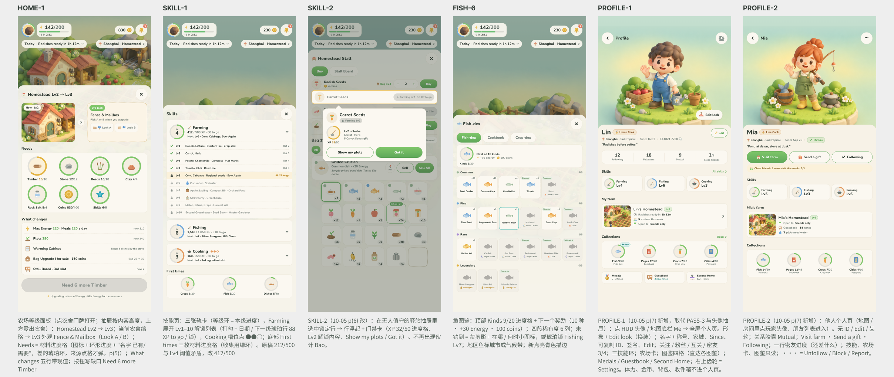

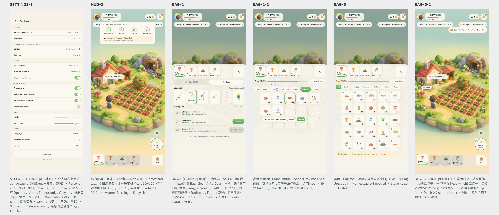

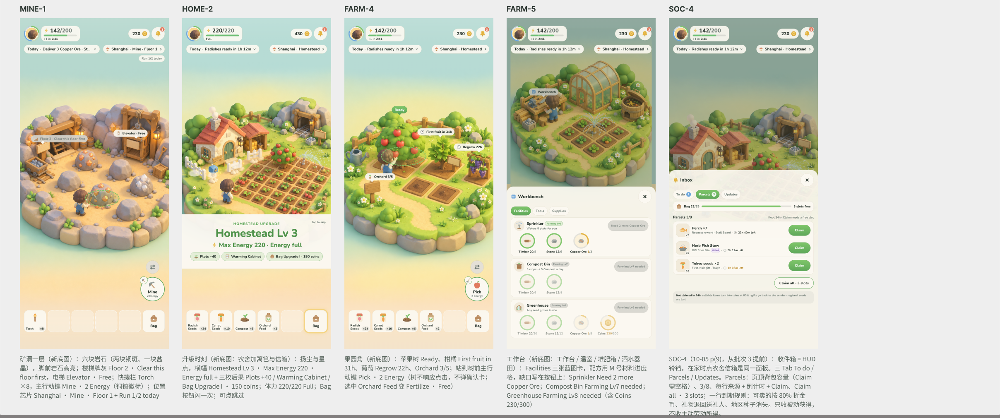

| 页面 | 看到的问题与保留项 |
|---|---|
| [HOME-1](audit-evidence/legacy/cards/HOME-1.png) | 材料环清晰可复用；升级收益比材料弱，缺口整句占据按钮，外观A/B很小。 |
| [SKILL-1](audit-evidence/legacy/cards/SKILL-1.png) | 三轨层级明确；十级解锁长串极密，小日期、XP与效果竞争。 |
| [SKILL-2](audit-evidence/legacy/cards/SKILL-2.png) | 门禁关键信息存在，但 Show my plots / Got it 外观与执行按钮相似。 |
| [FISH-6](audit-evidence/legacy/cards/FISH-6.png) | 四稀有度分组有秩序；六列小格、鱼名/来源/时间/门槛都很小，需详情承担辅助信息。 |
| [PROFILE-1](audit-evidence/legacy/cards/PROFILE-1.png) | 身份/农场/收藏入口完整；元信息、社交数与图鉴数有多套排版，字号层级偏弱。 |
| [PROFILE-2](audit-evidence/legacy/cards/PROFILE-2.png) | Visit farm导航被画成主绿执行，Send a gift/Following同形，三种语义未区分。 |
| [SETTINGS-1](audit-evidence/legacy/cards/SETTINGS-1.png) | 分组明确；多项说明字小，Apple账号与Password并列，删除账户缺少下一步确认画面。 |
| [HUD-2](audit-evidence/legacy/cards/HUD-2.png) | 纯信息弹层方向正确；四个进度环在很小空间中，额度名称/数值需提升可读性。 |
| [BAG-2](audit-evidence/legacy/cards/BAG-2.png) | Bag/Gear整合正确；六槽与候选清晰，但候选效果、速度、价格和来源混在副行。 |
| [BAG-2-2](audit-evidence/legacy/cards/BAG-2-2.png) | 仓库与背包用小房子区分；Timber ×99 · Farm Storage 一行又叠 Take动作。 |
| [BAG-5](audit-evidence/legacy/cards/BAG-5.png) | 满包用琥珀提示正确；扩容门槛/收益长串贴在最底，不容易成为下一步。 |
| [BAG-5-2](audit-evidence/legacy/cards/BAG-5-2.png) | 被动奖励进包裹正确；飘条名称/数量/原因/去向/有效期挤成一行。 |
| [MINE-1](audit-evidence/legacy/cards/MINE-1.png) | 场景清楚；楼梯状态和电梯免费混在微小设施牌，新层费用要单独说明。 |
| [HOME-2](audit-evidence/legacy/cards/HOME-2.png) | 升级仪式主标题清楚；解锁、购买资格和获得物都画成同类胶囊。 |
| [FARM-4](audit-evidence/legacy/cards/FARM-4.png) | 成熟/首次/再生长三种标签均出现；时间、容量与状态应保持固定位置。 |
| [FARM-5](audit-evidence/legacy/cards/FARM-5.png) | 材料环保留正确；设施名称、等级、效果与长灰缺口按钮混排，层级需统一。 |
| [SOC-4](audit-evidence/legacy/cards/SOC-4.png) | 三Tab及包裹容量清楚；物品名夹数量、来源/到期微小，过期损失长串压在底部。 |

## 统一修复优先级

1. **身份与决策值分开**：ObjectHeader只放身份；独立Quantity、State、Effect、Cost/Reward/Time，禁止把数量/费用/倒计时再次拼进标题。
2. **执行与导航分开**：commit为明显的执行按钮；navigate为箭头行；dismiss低强调；破坏性动作另有确认。禁用动作仍有固定动词，状态与失败原因分开展示。
3. **压缩非决策信息**：来源、风味、全局额度解释等入详情；实际成本、恢复量、倒计时和替换损失常驻。
4. **统一已批准容器**：背包五列、快捷栏五消耗品+Bag/关闭、Gear六槽、厨房场景锅、商店上柜台下背包；不把全部页面改成通用列表。
5. **分离玩家页面与设计说明**：微型多态板保留多个可编辑状态，设计参数在画板注释；手机页面不保留大段规则。
6. **同步规则残留**：当前截图仍可见Cook/Free、Common首获+60、赠餐直接回能等；具体修订证据见 [legacy-audit.md](data/legacy-audit.md)。

Section 01 当前画板标题仍写“21张”，实际卡片22张，属于目录标注过时；本报告以当前节点清单和截图实际卡片为准。COOK-3-2确实已为原生修订，不能把84张全部称作“84张raster”；当前旧稿为83张raster来源加1张原生修订。
